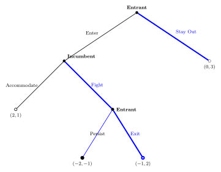
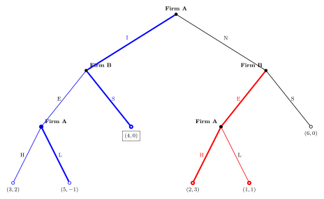

# Game Theory with Perfect Information

Game theory is a mathematical framework for analysing strategic interactions
between rational decision-makers. It provides powerful tools for understanding
situations where the outcome for each participant depends not only on their own
choices, but also on the choices made by others. From oligopolistic competition
and market entry deterrence to collusion and product differentiation, game theory
offers insights into how firms and individuals make decisions when their success
depends on anticipating and responding to the actions of rivals.

In this chapter we explore the fundamental concepts of game theory through a
series of applied economic models and formal definitions. We begin with two
canonical models of firm competition:

- **Cournot competition**, where firms compete by choosing quantities simultaneously
- **Bertrand competition with differentiated products**, where firms set prices for
  imperfectly substitutable goods

These applied models motivate a formal treatment of the building blocks of game
theory. We define normal-form games, dominant and dominated strategies, iterated
elimination, and **Nash equilibrium** in both pure and mixed strategies. We also
examine the relationship between Nash equilibrium and Pareto optimality, and
formalise the distinction between strategic complements and strategic substitutes.

We then move beyond simultaneous-move settings to study **extensive-form
games** — games with sequential decision-making represented by game trees. Key
concepts include information sets, subgames, backward induction, and **subgame
perfect Nash equilibrium** (SPNE), which eliminates non-credible threats that may
arise in the normal-form analysis.

Finally, we study **repeated games**, both finitely and infinitely repeated. We
show how backward induction limits cooperation under finite repetition with a
unique stage-game equilibrium, and how infinite repetition — combined with trigger
strategies such as the grim trigger — can sustain cooperative outcomes. We apply
these ideas to tacit collusion in Cournot oligopoly and conclude with the Folk
Theorem, which characterises the full set of equilibrium outcomes achievable by
patient players.

By the end of this chapter you will have developed both the economic intuition for
strategic thinking and the formal analytical tools needed to model and solve
game-theoretic problems in a range of competitive and cooperative settings.

## Cournot Competition

Cournot competition is a foundational model in industrial organisation in which
firms compete by simultaneously choosing production quantities. Named after the
French mathematician Antoine Augustin Cournot, who introduced the model in 1838,
it represents one of the earliest formal analyses of oligopolistic markets —
settings in which a small number of firms make strategically interdependent
decisions.

The central premise is simple yet powerful: each firm selects its output level to
maximise its own profit, taking the quantities produced by its rivals as given.
The market price is then determined by total industry supply through an inverse
demand function. Because each firm's profit depends on the output choices of all
firms, the model captures a genuine strategic interaction: producing more raises a
firm's revenue from additional units sold, but simultaneously depresses the market
price faced by every producer.

This tension between individual expansion and collective price erosion is the
driving force behind the Cournot equilibrium. The resulting outcome lies between
two familiar benchmarks — monopoly (where a single firm restricts output to
maximise profit) and perfect competition (where firms produce until price equals
marginal cost). As we shall see, the Cournot equilibrium produces more output and a
lower price than monopoly, but less output and a higher price than perfect
competition, reflecting the intermediate market power of oligopolists.

The Cournot framework has wide-ranging applications across economics, including:

- Merger analysis in competition policy
- Natural resource extraction (oil production quotas, mining output)
- Manufacturing industries with capacity constraints
- International trade and export competition between countries
- Environmental policy design and emission permit markets

The model's elegance lies in its ability to generate rich strategic insights from
relatively simple mathematics, making it an ideal starting point for the formal
study of game theory and strategic interaction.

### Model Setup

Consider two firms, Firm 1 and Firm 2, producing identical products. Let $q_1$ and
$q_2$ denote their respective output quantities. The market demand function is
given by

$$
P = a - b(q_1 + q_2)
$$

where $a > 0$ represents the maximum price consumers are willing to pay, and
$b > 0$ measures how sensitive price is to total quantity.

For simplicity, assume both firms have constant marginal costs of production:
$c_1 = c_2 = c$, where $a > c$ to ensure positive profits are possible.

### Firms' Problem

Each firm seeks to maximise its profit by choosing the optimal quantity, taking
the other firm's quantity as given. In other words, there is a strategic
interdependence between firms.

**Step 1: Firm 1's profit maximisation**

Firm 1's profit function is

$$
\pi_1(q_1, q_2) = P \cdot q_1 - c \cdot q_1 = \bigl[a - b(q_1 + q_2)\bigr] q_1 - c\, q_1
$$

The first-order condition of the profit function with respect to $q_1$ yields

$$
\frac{\partial \pi_1}{\partial q_1} = a - 2bq_1 - bq_2 - c,
$$

and solving it for $q_1$ yields

$$
q_1 = \frac{a - c - bq_2}{2b} \equiv R_{1}(q_{2}).
$$

This is Firm 1's **best response function**, denoted $R_1(q_2)$. It tells us the
optimal quantity for Firm 1 to produce given any quantity choice by Firm 2.

**Step 2: Firm 2's best response function**

By symmetry, Firm 2 faces an identical problem. Following the same process,

$$
\pi_2(q_1, q_2) = aq_2 - bq_2^2 - bq_1q_2 - cq_2
$$

Taking the partial derivative and setting it to zero,

$$
\frac{\partial \pi_2}{\partial q_2} = a - 2bq_2 - bq_1 - c = 0
$$

Firm 2's best response function is

$$
q_2 = \frac{a - c - bq_1}{2b} \equiv R_{2}(q_{1}).
$$

Similar to the previous case, this is the best response function of Firm 2 and it
tells us the optimal quantity for Firm 2 to produce given any quantity choice by
Firm 1.

::: {.infobox}
**Verifying that the first-order conditions identify maxima.** The first-order
conditions above are necessary but not sufficient for a maximum. To confirm that
the critical points are indeed profit-maximising quantities (rather than minima or
saddle points), we check the second-order conditions. For Firm 1,

$$
\frac{\partial^2 \pi_1}{\partial q_1^2} = -2b < 0
$$

Since $b > 0$, the second derivative is strictly negative for all $q_1$, confirming
that $\pi_1$ is globally concave in $q_1$ (for any fixed $q_2$). An analogous
calculation for Firm 2 yields $\partial^2 \pi_2 / \partial q_2^2 = -2b < 0$.
Therefore, each firm's profit function is a downward-opening parabola in its own
quantity, and the first-order condition identifies the unique global maximum in
each case. This guarantees that the best response functions $R_1(q_2)$ and
$R_2(q_1)$ derived above are well-defined and yield optimal (profit-maximising)
output choices. **Please see the Pre-course Math Static Optimization lesson for
further reading.**
:::

**Understanding best response functions**

The best response functions reveal several important insights:

::: {.highlightbox}
1. **Strategic substitutability**: Both functions have negative slopes
   ($-\tfrac{1}{2}$), meaning that as one firm increases production, the other
   firm's optimal response is to decrease production. This reflects the competitive
   nature of the market.
2. **Reaction to costs**: When marginal cost $c$ increases, both firms reduce their
   optimal output, as seen from the $(a-c)$ term in the numerator.
3. **Market size effects**: Larger market potential (higher $a$) leads to higher
   production levels for both firms.
4. **Competition intensity**: The parameter $b$ affects how much each firm reacts
   to its rival's output decisions.
:::

### Finding Equilibrium Quantities

The equilibrium occurs where both firms are simultaneously playing their best
responses to each other. This means we need to solve the system of equations

$$
\begin{aligned}
q_1 &= \frac{a - c - bq_2}{2b} \\[4pt]
q_2 &= \frac{a - c - bq_1}{2b}
\end{aligned}
$$

**Solution method.** Substitute the second equation into the first:

$$
q_1 = \frac{a - c - b \cdot \dfrac{a - c - bq_1}{2b}}{2b}
$$

Simplifying,

$$
q_1 = \frac{a - c}{2b} - \frac{1}{2} \cdot \frac{a - c - bq_1}{2b}
$$

$$
q_1 = \frac{a - c}{2b} - \frac{a - c}{4b} + \frac{q_1}{4}
$$

$$
q_1 - \frac{q_1}{4} = \frac{a - c}{4b}
$$

$$
\frac{3q_1}{4} = \frac{a - c}{4b}
$$

Therefore, the equilibrium quantities are

$$
q_1^* = \frac{a - c}{3b}, \qquad q_2^* = \frac{a - c}{3b}
$$

By symmetry, both firms produce the same quantity in equilibrium.

### Equilibrium Analysis

The total market output is

$$
Q^* = q_1^* + q_2^* = \frac{2(a - c)}{3b}
$$

The equilibrium market price is

$$
P^* = a - bQ^* = a - b \cdot \frac{2(a - c)}{3b} = \frac{a + 2c}{3}
$$

Each firm's equilibrium profit is

$$
\pi^* = (P^* - c)\, q^* = \left(\frac{a + 2c}{3} - c\right) \cdot \frac{a - c}{3b} = \frac{(a - c)^2}{9b}
$$

This equilibrium represents a stable outcome where neither firm has an incentive to
unilaterally change its production decision, given the other firm's choice.

### Comparison with Monopoly and Perfect Competition

To fully understand the implications of Cournot competition, let us compare it with
two benchmark market structures: monopoly and perfect competition.

#### Monopoly solution

Suppose a monopolist controls the entire market and chooses quantity to maximise
total industry profit. The monopolist faces the same demand curve $P = a - bQ$ and
has marginal cost $c$. The monopolist's problem is to maximise its profit function

$$
\max_{Q} \ \pi_M = (P - c) Q = (a - bQ - c) Q = aQ - bQ^2 - cQ
$$

The first-order condition yields

$$
\frac{d\pi_M}{dQ} = a - 2bQ - c = 0
$$

Solving for the monopoly quantity,

$$
Q_M = \frac{a - c}{2b}
$$

The monopoly price is

$$
P_M = a - bQ_M = a - b \cdot \frac{a - c}{2b} = \frac{a + c}{2}
$$

The monopoly profit is

$$
\pi_M = (P_M - c) Q_M = \left(\frac{a + c}{2} - c\right) \cdot \frac{a - c}{2b} = \frac{(a - c)^2}{4b}
$$

#### Perfect competition solution

Under perfect competition, firms are price-takers and produce until price equals
marginal cost. This occurs when $P = c$. Using the demand function $P = a - bQ$,

$$
a - bQ_C = c
$$

Solving for the competitive quantity,

$$
Q_C = \frac{a - c}{b}, \qquad P_C = c, \qquad \pi_C = 0
$$

The competitive profit per firm approaches zero.

#### Comparative Analysis

Now let us compare the outcomes across all three market structures.

| Market structure | Total quantity | Price | Total industry profit |
|---|---|---|---|
| Monopoly | $\dfrac{a-c}{2b}$ | $\dfrac{a+c}{2}$ | $\dfrac{(a-c)^2}{4b}$ |
| Cournot duopoly | $\dfrac{2(a-c)}{3b}$ | $\dfrac{a+2c}{3}$ | $\dfrac{2(a-c)^2}{9b}$ |
| Perfect competition | $\dfrac{a-c}{b}$ | $c$ | $0$ |

#### Quantity relationships

Comparing total market quantities,

$$
\begin{aligned}
Q_M &= \frac{a-c}{2b} = \frac{3(a-c)}{6b} \\[4pt]
Q_{\text{Cournot}} &= \frac{2(a-c)}{3b} = \frac{4(a-c)}{6b} \\[4pt]
Q_C &= \frac{a-c}{b} = \frac{6(a-c)}{6b}
\end{aligned}
$$

Therefore $Q_M < Q_{\text{Cournot}} < Q_C$.

The monopolist restricts output the most to maximise profit. Perfect competition
produces the highest quantity, while Cournot duopoly falls between the two extremes.

#### Price relationships

Comparing market prices,

$$
\begin{aligned}
P_C &= c \\[4pt]
P_{\text{Cournot}} &= \frac{a+2c}{3} = \frac{a-c}{3} + c \\[4pt]
P_M &= \frac{a+c}{2} = \frac{a-c}{2} + c
\end{aligned}
$$

Therefore $P_C < P_{\text{Cournot}} < P_M$.

Prices follow the reverse pattern of quantities. The monopolist charges the highest
price, while perfect competition results in price equal to marginal cost.

#### Profit relationships

Comparing total industry profits,

$$
\pi_C = 0, \qquad \pi_{\text{Cournot}} = \frac{2(a-c)^2}{9b}, \qquad \pi_M = \frac{(a-c)^2}{4b}
$$

To compare Cournot and monopoly profits,

$$
\frac{\pi_{\text{Cournot}}}{\pi_M} = \frac{\;\dfrac{2(a-c)^2}{9b}\;}{\dfrac{(a-c)^2}{4b}} = \frac{2}{9} \cdot \frac{4}{1} = \frac{8}{9} \approx 0.89
$$

Therefore $\pi_C < \pi_{\text{Cournot}} < \pi_M$.

The monopolist earns the highest profit, while Cournot duopolists together earn
about 89% of monopoly profit.

### Economic Intuition

These results illustrate several important economic principles:

::: {.highlightbox}
1. **Market power and output**: Greater market power (fewer competitors) leads to
   lower output and higher prices. The monopolist has maximum market power, while
   perfect competitors have none.
2. **Strategic interaction effects**: In Cournot competition, each firm's output
   decision affects the other firm's optimal choice. This strategic interaction
   leads to higher total output than monopoly but lower than perfect competition.
3. **Profit dissipation**: Competition reduces profits. Moving from monopoly to
   duopoly significantly reduces total industry profit, and perfect competition
   eliminates profits entirely.
4. **Consumer welfare**: Consumers benefit from increased competition through lower
   prices and higher quantities. Perfect competition maximises consumer surplus,
   while monopoly minimises it.
5. **Efficiency considerations**: Perfect competition achieves allocative efficiency
   ($P = MC$), while both monopoly and Cournot duopoly result in deadweight losses
   due to underproduction.
:::

This analysis demonstrates how market structure fundamentally shapes economic
outcomes, with strategic interactions in oligopolistic markets like Cournot
competition producing results that lie between the extremes of monopoly and
perfect competition.

### Section Quiz {.unnumbered}

:::: {.quiz data-answer="B"}
**1.** Firm 1 and Firm 2 compete in a Cournot duopoly with inverse demand
$P = 10 - (q_1 + q_2)$ and constant marginal cost $c = 1$ for both firms. What is
each firm's Nash equilibrium quantity?

(A) $q^* = 2$
(B) $q^* = 3$
(C) $q^* = 4$
(D) $q^* = 4.5$

::: {.explain}
**(B).** Using $q^* = \dfrac{a - c}{3b} = \dfrac{10 - 1}{3} = 3$.
:::
::::

:::: {.quiz data-answer="B"}
**2.** In the same Cournot duopoly ($P = 10 - Q$, $c = 1$), what is the equilibrium
market price?

(A) $P^* = 3$
(B) $P^* = 4$
(C) $P^* = 5$
(D) $P^* = 5.5$

::: {.explain}
**(B).** Using $P^* = \dfrac{a + 2c}{3} = \dfrac{10 + 2}{3} = 4$.
:::
::::

:::: {.quiz data-answer="C"}
**3.** In the Cournot duopoly above ($a=10$, $b=1$, $c=1$), what is each firm's
equilibrium profit?

(A) $\pi^* = 6$
(B) $\pi^* = 8$
(C) $\pi^* = 9$
(D) $\pi^* = 12$

::: {.explain}
**(C).** Each firm earns $\pi^* = (P^* - c)\, q^* = (4 - 1) \cdot 3 = 9$.
Equivalently, $\pi^* = \dfrac{(a-c)^2}{9b} = \dfrac{81}{9} = 9$.
:::
::::

:::: {.quiz data-answer="C"}
**4.** Which of the following correctly orders total equilibrium output across
market structures (using $a=10$, $b=1$, $c=1$)?

(A) $Q_{\text{Monopoly}} > Q_{\text{Cournot}} > Q_{\text{Competitive}}$
(B) $Q_{\text{Competitive}} > Q_{\text{Monopoly}} > Q_{\text{Cournot}}$
(C) $Q_{\text{Monopoly}} < Q_{\text{Cournot}} < Q_{\text{Competitive}}$
(D) $Q_{\text{Cournot}} = Q_{\text{Monopoly}} < Q_{\text{Competitive}}$

::: {.explain}
**(C).** Monopoly output is $\tfrac{9}{2} = 4.5$, Cournot total is
$2 \times 3 = 6$, and competitive output is $9$. The monopolist restricts output the
most; perfect competition achieves the socially efficient quantity.
:::
::::

:::: {.quiz data-answer="B"}
**5.** In a Cournot duopoly, if Firm 2 increases its quantity by 1 unit, what is the
change in Firm 1's best-response quantity?

(A) Increases by 1 unit
(B) Decreases by $\tfrac{1}{2}$ unit
(C) Remains unchanged
(D) Decreases by 1 unit

::: {.explain}
**(B).** Firm 1's best response is $R_1(q_2) = \dfrac{a-c-bq_2}{2b}$, which has
slope $\dfrac{\partial R_1}{\partial q_2} = -\dfrac{1}{2}$. Quantities are strategic
substitutes: a 1-unit increase by Firm 2 induces a $\tfrac{1}{2}$-unit reduction by
Firm 1.
:::
::::

## Bertrand Competition with Differentiated Products

While Cournot competition focuses on quantity decisions, Bertrand competition
examines strategic price-setting behaviour. This model assumes firms choose prices
simultaneously, with consumers then deciding which products to purchase based on
these prices. In contrast to our earlier example, in this model we assume products
are **differentiated**.

::: {.definition}
**Product differentiation** refers to the strategy of distinguishing a product or
service from competing offerings by emphasising unique characteristics, features,
or attributes that create perceived value differences among consumers.
:::

- **Horizontal differentiation**: Products differ in characteristics but are not
  necessarily superior or inferior to each other (e.g. different flavours of soft
  drinks, car colours, or geographic locations)
- **Vertical differentiation**: Products differ in quality levels, with some
  objectively better than others (e.g. luxury vs. economy cars, first-class vs.
  economy airline seats)
- **Spatial differentiation**: Products differ by physical or virtual location,
  creating convenience preferences for different consumer segments

Product differentiation is crucial in real-world markets. Consider the smartphone
industry, where Apple, Samsung, and Google compete not just on price but on
features, design, ecosystem integration, and brand perception. Similarly, in the
automobile industry, BMW and Mercedes-Benz maintain premium pricing despite intense
competition because consumers perceive their products as distinct.

The key economic insight is that differentiation reduces the degree of
substitutability between products. When products are perfectly differentiated
(completely unique), each firm essentially operates as a monopolist in its market
segment. Conversely, when products are homogeneous (identical), firms face intense
price competition that can drive profits to zero, which we review in the analysis
below.

### Model Setup

Consider two firms producing differentiated products where the degree of product
differentiation is given exogenously.^[In other words, firms cannot adjust product
differentiation between themselves.] Let $p_1$ and $p_2$ denote their respective
prices. The demand functions are derived from a representative consumer's quadratic
utility function
$U = a(q_1+q_2) - \dfrac{q_1^2 + 2\theta q_1 q_2 + q_2^2}{2b}$, giving

$$
\begin{aligned}
q_1(p_1, p_2) &= \frac{b\bigl[a(1-\theta) - p_1 + \theta p_2\bigr]}{1-\theta^2} \\[6pt]
q_2(p_1, p_2) &= \frac{b\bigl[a(1-\theta) - p_2 + \theta p_1\bigr]}{1-\theta^2}
\end{aligned}
$$

where:

- $a > 0$ is a market size parameter
- $b > 0$ measures price sensitivity
- $\theta \in [0,1)$ captures the degree of substitutability between products:
  - $\theta = 0$: Products are independent; each firm faces monopoly demand
    $q_i = b(a - p_i)$
  - $\theta \to 1$: Products are perfect substitutes; Bertrand competition drives
    $p^* \to c$
  - $0 < \theta < 1$: Products are differentiated substitutes

**Interpretation of the demand functions.** The demand function
$q_{i}(p_{i}, p_{j})$, where $i \neq j$, satisfies

$$
\frac{\partial q_i}{\partial p_i} = \frac{-b}{1-\theta^2} < 0,
\qquad
\frac{\partial q_i}{\partial p_j} = \frac{\theta b}{1-\theta^2} > 0
$$

An increase in firm $i$'s own price reduces its demand, while an increase in the
rival's price raises it. Crucially, as $\theta \to 1$, both effects become
arbitrarily large, capturing the extreme price sensitivity of near-homogeneous
products.

For simplicity, assume both firms have identical constant marginal costs:
$c_1 = c_2 = c$.

### Deriving Best Response Functions

Each firm chooses its price to maximise profit, taking the rival's *price* as given.

**Firm 1's profit maximisation**

Firm 1's profit function is

$$
\pi_1(p_1, p_2) = (p_1 - c) \cdot \frac{b\bigl[a(1-\theta) - p_1 + \theta p_2\bigr]}{1-\theta^2}
$$

Since $\dfrac{b}{1-\theta^2} > 0$ is a positive constant, maximising $\pi_1$ is
equivalent to maximising

$$
(p_1 - c)\bigl[a(1-\theta) - p_1 + \theta p_2\bigr]
$$

Taking the first-order condition,

$$
\frac{\partial \pi_1}{\partial p_1} = a(1-\theta) - p_1 + \theta p_2 - (p_1 - c) = 0
$$

Solving for $p_1$,

$$
a(1-\theta) + c - 2p_1 + \theta p_2 = 0
$$

This is Firm 1's best response function:

$$
R_1(p_2) = \frac{a(1-\theta) + c}{2} + \frac{\theta p_2}{2}
$$

**Firm 2's best response function**

By symmetry, Firm 2's best response function is

$$
R_2(p_1) = \frac{a(1-\theta) + c}{2} + \frac{\theta p_1}{2}
$$

### Understanding Best Response Functions in Price Competition

The best response functions in Bertrand competition have fundamentally different
properties compared to Cournot.

::: {.highlightbox}
1. **Strategic complementarity**: Both functions have positive slopes
   ($\tfrac{\theta}{2} > 0$), meaning firms' prices move in the same direction. If
   one firm raises its price, the other firm's optimal response is also to raise
   its price.
2. **Differentiation effects**: The slope $\tfrac{\theta}{2}$ increases with product
   substitutability. When products are more similar (higher $\theta$), firms react
   more strongly to rivals' price changes.
3. **Base price level**: The intercept $\dfrac{a(1-\theta) + c}{2}$ decreases as
   $\theta$ increases, reflecting the downward pressure on prices from greater
   competition.
:::

### Finding Equilibrium Prices

The equilibrium solves

$$
\begin{aligned}
p_1 &= \frac{a(1-\theta) + c}{2} + \frac{\theta p_2}{2} \\[4pt]
p_2 &= \frac{a(1-\theta) + c}{2} + \frac{\theta p_1}{2}
\end{aligned}
$$

**Solution method.** By symmetry, $p_1^* = p_2^* = p^*$. Substituting into either
equation,

$$
p^* = \frac{a(1-\theta) + c}{2} + \frac{\theta p^*}{2}
$$

Collecting terms,

$$
p^*\!\left(1 - \frac{\theta}{2}\right) = \frac{a(1-\theta) + c}{2}
\qquad\Longrightarrow\qquad
p^* \cdot \frac{2 - \theta}{2} = \frac{a(1-\theta) + c}{2}
$$

Therefore, the equilibrium price is

$$
p^* = \frac{a(1-\theta) + c}{2-\theta}
$$

By symmetry, both firms charge the same equilibrium price.

### Equilibrium Analysis

**Equilibrium quantities.** Substituting $p_1^* = p_2^* = p^*$ into the demand
function,

$$
q^* = \frac{b\bigl[a(1-\theta) - p^* + \theta p^*\bigr]}{1-\theta^2}
   = \frac{b(1-\theta)(a - p^*)}{(1-\theta)(1+\theta)}
   = \frac{b(a - p^*)}{1+\theta}
$$

Since
$a - p^* = a - \dfrac{a(1-\theta)+c}{2-\theta} = \dfrac{a(2-\theta) - a(1-\theta) - c}{2-\theta} = \dfrac{a - c}{2-\theta}$,

$$
q^* = \frac{b(a-c)}{(2-\theta)(1+\theta)}
$$

**Equilibrium profits.** The price-cost margin simplifies to

$$
p^* - c = \frac{a(1-\theta) + c - c(2-\theta)}{2-\theta} = \frac{(a-c)(1-\theta)}{2-\theta}
$$

Therefore

$$
\pi^* = (p^* - c)\, q^* = \frac{(a-c)(1-\theta)}{2-\theta} \cdot \frac{b(a-c)}{(2-\theta)(1+\theta)} = \frac{b(a-c)^2(1-\theta)}{(2-\theta)^2(1+\theta)}
$$

### Effects of Product Differentiation

The parameter $\theta$ governs how equilibrium outcomes transition between two polar
cases.

**Case 1: Independent products ($\theta = 0$)**

$$
p^* = \frac{a + c}{2}, \qquad q^* = \frac{b(a-c)}{2}, \qquad \pi^* = \frac{b(a-c)^2}{4}
$$

This is the **monopoly solution** for each firm in its own market segment: with no
substitutes, each firm enjoys full market power.

**Case 2: Perfect substitutes ($\theta \to 1$)**

$$
\lim_{\theta \to 1} p^* = c, \qquad
\lim_{\theta \to 1} q^* = \frac{b(a-c)}{2}, \qquad
\lim_{\theta \to 1} \pi^* = 0
$$

As products become homogeneous, we run into the **Bertrand paradox**: price
competition drives prices to marginal cost and eliminates all profits, even with
only two firms.

::: {.infobox}
**The Bertrand paradox** happens when products are homogeneous ($\theta \to 1$):
price competition drives equilibrium prices to marginal cost ($p^* \to c$) and
profits to zero ($\pi^* \to 0$) even with only two firms. This starkly contrasts
with Cournot competition, where duopolists retain positive markups. The paradox
arises because with perfect substitutes, any firm charging above marginal cost
loses its entire market to a slightly cheaper rival. Product differentiation
($\theta < 1$) resolves this paradox, allowing firms to sustain positive margins.
:::

This validates the demand specification: the model correctly nests both extremes.
Product differentiation allows firms to avoid the Bertrand paradox by softening
price competition, and the degree of market power is monotonically decreasing in
$\theta$.

### Comparative Statics

**Effect of increasing substitutability**

$$
\frac{\partial p^*}{\partial \theta} = \frac{-a(2-\theta) + \bigl[a(1-\theta)+c\bigr]}{(2-\theta)^2} = \frac{c - a}{(2-\theta)^2} < 0
$$

since $a > c$. As products become more substitutable (higher $\theta$), equilibrium
prices *decrease*, converging toward marginal cost. Greater substitutability
intensifies price competition, eroding market power.

**Economic intuition**

::: {.highlightbox}
1. **Market power from differentiation**: Product differentiation is the source of
   market power in Bertrand competition. When $\theta = 0$, each firm is a local
   monopolist; as $\theta \to 1$, market power erodes completely.
2. **Strategic complementarity**: Prices are strategic complements (positive slope
   in best responses). Both firms benefit when the rival charges higher prices,
   which is why differentiation — by softening rivalry — sustains positive profits.
3. **Bertrand paradox as a limit**: The differentiated model shows a smooth
   transition from monopoly ($\theta=0$) to competitive ($\theta\to1$) outcomes.
4. **Customer loyalty**: Differentiation creates customer segments with preferences
   for specific products, reducing the effectiveness of price cuts in stealing
   market share. For example, Apple maintains premium smartphone pricing despite
   competition because its ecosystem (iCloud, App Store, device integration) creates
   switching costs that reduce customers' price sensitivity to competitors.
:::

This analysis demonstrates that product differentiation fundamentally changes
competitive dynamics. The demand specification captures both polar outcomes:
monopoly pricing when products are independent and marginal cost pricing when
products are perfect substitutes.

### Section Quiz {.unnumbered}

:::: {.quiz data-answer="B"}
**1.** In the Bertrand model with differentiated products, when the substitutability
parameter is $\theta = 0$, what price does each firm charge in equilibrium?

(A) $p^* = c$ (marginal cost pricing)
(B) $p^* = \dfrac{a + c}{2}$ (monopoly price)
(C) $p^* = a - c$
(D) $p^* = a$

::: {.explain}
**(B).** When $\theta = 0$, the equilibrium formula gives
$p^* = \dfrac{a(1-0)+c}{2-0} = \dfrac{a+c}{2}$, the standard monopoly price. With no
substitutes, each firm has full market power over its own segment.
:::
::::

:::: {.quiz data-answer="B"}
**2.** Using parameters $a = 10$, $c = 1$, and $\theta = 0.5$, what is the Nash
equilibrium price in the Bertrand differentiated products model?

(A) $p^* = 3$
(B) $p^* = 4$
(C) $p^* = 5$
(D) $p^* = 6$

::: {.explain}
**(B).** Substituting into the equilibrium formula:
$p^* = \dfrac{a(1-\theta)+c}{2-\theta} = \dfrac{10(0.5)+1}{2-0.5} = \dfrac{6}{1.5} = 4$.
:::
::::

:::: {.quiz data-answer="B"}
**3.** In the Bertrand model with differentiated products, when the substitutability
parameter $\theta$ increases (products become more similar), the equilibrium price:

(A) Increases, because fiercer competition raises revenue per unit
(B) Decreases, because intensified price competition erodes market power
(C) Remains unchanged, since the equilibrium formula does not depend on $\theta$
(D) First decreases then increases, depending on whether $\theta$ exceeds $0.5$

::: {.explain}
**(B).** From the comparative static
$\dfrac{\partial p^*}{\partial \theta} = \dfrac{c - a}{(2-\theta)^2} < 0$ (since
$a > c$), equilibrium prices fall as products become more substitutable, converging
to marginal cost as $\theta \to 1$.
:::
::::

:::: {.quiz data-answer="B"}
**4.** In the Bertrand model with differentiated products, the best response function
$R_1(p_2)$ has a positive slope equal to $\dfrac{\theta}{2}$. This means firms'
prices are:

(A) Strategic substitutes: one firm's price increase leads the rival to lower its price
(B) Strategic complements: one firm's price increase leads the rival to raise its price
(C) Strategically independent: each firm's price does not depend on the rival's price
(D) Strategic substitutes for $\theta < 0.5$ and strategic complements for $\theta > 0.5$

::: {.explain}
**(B).** A positive slope in the best response function indicates strategic
complementarity: when Firm 2 raises its price, demand shifts to Firm 1, and Firm 1
optimally responds by also raising its price to exploit this improved market
position.
:::
::::

:::: {.quiz data-answer="C"}
**5.** As products approach perfect substitutes ($\theta \to 1$) in the Bertrand
differentiated products model, equilibrium profit per firm approaches:

(A) The monopoly profit $\dfrac{b(a-c)^2}{4}$
(B) Half the monopoly profit
(C) Zero (the Bertrand paradox is restored)
(D) A positive constant independent of $\theta$

::: {.explain}
**(C).** As $\theta \to 1$, the profit formula
$\pi^* = \dfrac{b(a-c)^2(1-\theta)}{(2-\theta)^2(1+\theta)} \to 0$. Price competition
among near-homogeneous products drives profits to zero, recovering the Bertrand
paradox.
:::
::::

## Formal Foundations of Game Theory

Having explored several applied models of strategic interaction — Cournot quantity
competition and Bertrand price competition with differentiated products — we now
step back to formalise the underlying concepts. This section defines the building
blocks of game theory rigorously and introduces the key solution concepts that
underpin the equilibrium analyses we have already performed.

> Game theory can be defined as the study of mathematical models of conflict and
> cooperation between intelligent rational decision-makers. Game theory provides
> general mathematical techniques for analyzing situations in which two or more
> individuals make decisions that will influence one another's welfare.
>
> — **Roger B. Myerson, 1991**

::: {.definition}
Game theory is the study of interactive decision-making or strategic interaction.
:::

Game theory consists of a mathematical *language* for representing strategic
interactions and a set of tools for predicting the outcome of a strategic
interaction. A prediction of behaviour in a game is called a *solution*. A method
for making such a prediction is called a *solution concept*.

### What Is a Game?

A **game** is a formal model of a strategic situation in which the outcome for each
participant depends on the actions chosen by all participants. We work under the
following simplified assumptions.

::: {.highlightbox}
1. **Rationality**: Every player is a rational decision-maker who seeks to maximise
   their own payoff.
2. **Common knowledge of rationality**: Every player knows that all other players
   are rational, knows that they know this, and so on ad infinitum.
3. **Symmetric (complete) information**: All players know the structure of the
   game — the set of players, the strategies available to each player, and the
   payoff function of every player. No player has private information that is
   unavailable to others.
4. **Simultaneous moves**: In the baseline (static) setting, all players choose
   their actions at the same time, or equivalently, without observing each other's
   choices before committing.
:::

These assumptions are stylised, but they provide a tractable foundation. The models
we studied earlier — Cournot and Bertrand — all satisfy these conditions: firms
choose quantities or prices simultaneously, the demand structure and cost functions
are known to all, and each firm maximises its own profit.

::: {.definition}
A **(static) game of complete information** (also called a **normal-form game** or
**strategic-form game**) is a triple
$\Gamma = \langle \mathcal{N}, (S_i)_{i \in \mathcal{N}}, (u_i)_{i \in \mathcal{N}} \rangle$
consisting of:

1. A finite set of **players**: $\mathcal{N} = \{1, 2, \ldots, n\}$.
2. For each player $i \in \mathcal{N}$, a **strategy set** (or **action space**)
   $S_i$. The set of all possible strategy profiles is
   $S = S_1 \times S_2 \times \cdots \times S_n$. In other words, a strategy profile
   is just a list of strategies chosen by each of the players.
3. For each player $i \in \mathcal{N}$, a **payoff function** $u_i : S \to \mathbb{R}$,
   which assigns a real-valued payoff to every possible combination of strategies
   chosen by all players.
:::

::: {.infobox}
**Notation.** A strategy profile is written $s = (s_1, s_2, \ldots, s_n) \in S$. It
is often convenient to separate player $i$'s strategy from that of all other
players: $s = (s_i, s_{-i})$, where
$s_{-i} = (s_1, \ldots, s_{i-1}, s_{i+1}, \ldots, s_n)$ denotes the strategies of
all players except $i$.
:::

### Strategies in Normal Form

The **normal form** (or strategic form) represents a game as a matrix (for two
players with finite strategy sets). Each cell of the matrix specifies the payoffs to
all players for a given combination of strategies.

#### Example: the Prisoner's Dilemma

Two suspects are arrested for a crime, and interviewed separately. If they both keep
quiet (they cooperate with each other) they go to prison for a year. If one suspect
supplies incriminating evidence (defects) then that one is freed, and the other one
is imprisoned for nine years. If both defect then they are imprisoned for six years.
Their preferences are solely contingent on any jail term they individually serve.

We can represent this situation as a game:

- **Players:** The players are the two suspects, $\mathcal{N} = \{1, 2\}$.
- **Strategies:** The strategy set for players is $S_1 = S_2 = \{C, D\}$.
- **Payoffs:** Represent the payoffs in the strategic-form *payoff matrix*:

|  | **Player 2: C** | **Player 2: D** |
|---|---|---|
| **Player 1: C** | $(-1, -1)$ | $(-3, 0)$ |
| **Player 1: D** | $(0, -3)$ | $(-2, -2)$ |

where the first number in each cell represents player 1 (the "row player")'s
payoff, and the second in each cell represents player 2 (the "column player")'s
payoff. For example, in cell $(D, C)$, the payoffs $(0, -3)$ mean Player 1 (the
defector) receives 0, while Player 2 (the cooperator) receives $-3$.

### Dominant and Dominated Strategies

A natural starting point for solving a game is to ask: does any player have a
strategy that is *always* best, regardless of what others do?

::: {.definition}
A strategy $s_i^* \in S_i$ is a **strictly dominant strategy** for player $i$ if, for
every alternative strategy $s_i' \in S_i$ with $s_i' \neq s_i^*$ and for every
strategy profile of the other players $s_{-i} \in S_{-i}$,

$$
u_i(s_i^*, s_{-i}) > u_i(s_i', s_{-i})
$$
:::

A strictly dominant strategy is the uniquely optimal choice *no matter what the
other players do*. If a rational player has a dominant strategy, they will always
play it.

::: {.definition}
A strategy $s_i' \in S_i$ is **strictly dominated** by another strategy
$s_i^* \in S_i$ if, for every $s_{-i} \in S_{-i}$,

$$
u_i(s_i^*, s_{-i}) > u_i(s_i', s_{-i})
$$

A rational player will *never* play a strictly dominated strategy, because there is
always a better alternative available.
:::

::: {.definition}
A strategy $s_i' \in S_i$ is **weakly dominated** by $s_i^* \in S_i$ if, for every
$s_{-i} \in S_{-i}$,

$$
u_i(s_i^*, s_{-i}) \geq u_i(s_i', s_{-i})
$$

with strict inequality for at least one $s_{-i}$.
:::

#### Example: dominant strategy in the Prisoner's Dilemma

Returning to the Prisoner's Dilemma, consider Player 1:

- If Player 2 plays C: $u_1(D, C) = 0 > -1 = u_1(C, C)$
- If Player 2 plays D: $u_1(D, D) = -2 > -3 = u_1(C, D)$

Defect yields a strictly higher payoff regardless of Player 2's choice. Therefore,
D is a strictly dominant strategy for Player 1. By symmetry, D is also strictly
dominant for Player 2. The unique **dominant strategy equilibrium** is $(D, D)$ with
payoffs $(-2, -2)$.

### Iterated Elimination of Strictly Dominated Strategies (IESDS)

When no player has a dominant strategy, we can still make progress by *iteratively
removing* strategies that no rational player would ever use.

::: {.definition}
**Iterated Elimination of Strictly Dominated Strategies (IESDS)** is a procedure that
works as follows:

1. For each player, identify and remove all strictly dominated strategies from their
   strategy set.
2. In the reduced game, check again whether any remaining strategies are now
   strictly dominated (they may have become dominated once some of the opponents'
   strategies were removed).
3. Repeat until no further strategies can be eliminated.

The strategies that survive this process are called **rationalisable strategies**.
:::

The logical foundation of IESDS relies on common knowledge of rationality:

- **Round 1**: A rational player never plays a strictly dominated strategy.
  $\rightarrow$ Eliminate such strategies.
- **Round 2**: A rational player who *knows* the opponents are rational can infer
  that the eliminated strategies will never be played. In the reduced game, new
  strategies may now be dominated. $\rightarrow$ Eliminate again.
- **Round $k$**: The reasoning continues, with each round requiring one additional
  layer of "I know that you know that I know…" rationality.

**Important properties of IESDS**

::: {.highlightbox}
1. **Order independence**: The final set of surviving strategies does not depend on
   the order in which dominated strategies are eliminated.
2. **May not yield a unique outcome**: IESDS may leave multiple strategies for each
   player.
:::

#### Example 1: IESDS in a 3 × 3 game

Consider the following game:

|  | **Player 2: L** | **Player 2: M** | **Player 2: R** |
|---|---|---|---|
| **Player 1: T** | $(1, 0)$ | $(1, 2)$ | $(0, 1)$ |
| **Player 1: C** | $(0, 3)$ | $(0, 1)$ | $(2, 0)$ |
| **Player 1: B** | $(0, 1)$ | $(2, 0)$ | $(0, 3)$ |

**Round 1.** For Player 2, is any strategy strictly dominated?

- Compare R with M: Against T, $u_2(R)=1 < 2=u_2(M)$. So R does not dominate M.
- Compare L with M: Against T, $u_2(L)=0 < 2=u_2(M)$; against C,
  $u_2(L)=3 > 1=u_2(M)$. Neither dominates.
- For Player 1, compare B and C with T: Against L,
  $u_1(T)=1 > 0=u_1(C)=u_1(B)$; against M, $u_1(T)=1$ while $u_1(B)=2$. So T does
  not dominate B.

Careful inspection shows that no strategy is strictly dominated in the first round
for this particular game, so IESDS does not reduce it further.

#### Example 2: IESDS in a 3 × 3 game

Consider the following game:

|  | **Player 2: L** | **Player 2: M** | **Player 2: R** |
|---|---|---|---|
| **Player 1: T** | $(3, 1)$ | $(0, 1)$ | $(0, 0)$ |
| **Player 1: C** | $(1, 1)$ | $(1, 1)$ | $(5, 0)$ |
| **Player 1: B** | $(2, 1)$ | $(4, 2)$ | $(0, 1)$ |

**Round 1.** For Player 2, strategy R is strictly dominated by M:

- Against T: $u_2(M) = 1 > 0 = u_2(R)$ ✓
- Against C: $u_2(M) = 1 > 0 = u_2(R)$ ✓
- Against B: $u_2(M) = 2 > 1 = u_2(R)$ ✓

Eliminate R. The reduced game is:

|  | **Player 2: L** | **Player 2: M** |
|---|---|---|
| **Player 1: T** | $(3, 1)$ | $(0, 1)$ |
| **Player 1: C** | $(1, 1)$ | $(1, 1)$ |
| **Player 1: B** | $(2, 1)$ | $(4, 2)$ |

**Round 2.** For Player 1, strategy C is now strictly dominated by B:

- Against L: $u_1(B) = 2 > 1 = u_1(C)$ ✓
- Against M: $u_1(B) = 4 > 1 = u_1(C)$ ✓

Eliminate C. The reduced game is:

|  | **Player 2: L** | **Player 2: M** |
|---|---|---|
| **Player 1: T** | $(3, 1)$ | $(0, 1)$ |
| **Player 1: B** | $(2, 1)$ | $(4, 2)$ |

No further strategies are strictly dominated in this reduced game, so IESDS
terminates after two rounds. Note that C was *not* dominated in the original
$3 \times 3$ game (since the payoff of $5$ from $(C, R)$ exceeded both $(T, R)$ and
$(B, R)$ for Player 1), but *became* dominated once R was removed. This illustrates
the power of iterated elimination: common knowledge of rationality allows players to
remove strategies that only survive because of the opponent's irrational choices.

### Nash Equilibrium

The central solution concept in game theory is the **Nash equilibrium**, named after
John Nash (1950). It captures the idea of a stable outcome: a strategy profile from
which no player has a unilateral incentive to deviate.

::: {.definition}
A strategy profile $s^* = (s_1^*, s_2^*, \ldots, s_n^*) \in S$ is a **Nash
equilibrium (NE)** if, for every player $i \in \mathcal{N}$ and every alternative
strategy $s_i' \in S_i$,

$$
u_i(s_i^*, s_{-i}^*) \geq u_i(s_i', s_{-i}^*)
$$

That is, each player's strategy is a best response to the strategies of all other
players.
:::

Equivalently, $s^*$ is a Nash equilibrium if and only if for each player $i$,

$$
s_i^* \in \arg\max_{s_i \in S_i} \, u_i(s_i, s_{-i}^*)
$$

**Connection to best response functions.** If $R_i(s_{-i})$ denotes player $i$'s best
response correspondence, then $s^*$ is a Nash equilibrium if and only if
$s_i^* \in R_i(s_{-i}^*)$ for all $i$. This is precisely how we found equilibria in
the Cournot and Bertrand models: we derived each firm's best response function and
found the intersection.

**Cournot competition**

- $\mathcal{N} = \{1, 2\}$ (two firms)
- $S_i = [0, \infty)$ for each $i$ (each firm chooses a non-negative quantity $q_i$)
- $u_i(q_1, q_2) = \pi_i(q_1, q_2) = [a - b(q_1 + q_2) - c]\, q_i$ (profit as a
  function of both firms' quantities)

The strategy sets are continuous (intervals of real numbers) rather than finite, so
the game cannot be represented as a simple payoff matrix. However, the logical
structure is identical to a finite game: each firm simultaneously selects a strategy
(quantity), and the payoff to each firm depends on the entire strategy profile
$(q_1, q_2)$. The equilibrium quantities we derived — $q_1^* = q_2^* = \frac{a-c}{3b}$
— are precisely a strategy profile in which each firm's quantity is a best response
to the other's.

**Bertrand competition with differentiated products**

- $\mathcal{N} = \{1, 2\}$ (two firms)
- $S_i = [0, \infty)$ for each $i$ (each firm chooses a non-negative price $p_i$)
- $u_i(p_1, p_2) = (p_i - c)\, q_i(p_1, p_2)$, where
  $q_i(p_1, p_2) = \frac{b[a(1-\theta) - p_i + \theta p_j]}{1 - \theta^2}$ is firm
  $i$'s demand

Here the strategic variable is price rather than quantity, but the mathematical
structure is the same: a set of players, continuous strategy sets, and payoff
functions defined over the space of all strategy profiles. The equilibrium price
$p^* = \frac{a(1-\theta) + c}{2-\theta}$ is the Nash equilibrium of this normal-form
game.

**Common structure.** In both models, the equilibrium was found by the same method:

1. Derive each player's best response function $R_i(s_{-i})$ by optimising $u_i$ with
   respect to $s_i$, holding $s_{-i}$ fixed.
2. Find the fixed point of the best response system: the strategy profile $s^*$ such
   that $s_i^* = R_i(s_{-i}^*)$ for all $i$.

This procedure is the operational content of the Nash equilibrium concept applied to
games with continuous strategy sets. The formal definition of a normal-form game
thus provides the theoretical scaffolding that unifies these seemingly distinct
economic models under a single analytical framework.

#### Nash Equilibrium in Pure Strategies

A **pure strategy** is a deterministic choice of action. A Nash equilibrium in pure
strategies is a profile of deterministic actions satisfying the equilibrium condition
above.

##### Example: coordination game

Consider two players choosing between two events, Opera (O) and Football (F):

|  | **Player 2: O** | **Player 2: F** |
|---|---|---|
| **Player 1: O** | $(3, 2)$ | $(0, 0)$ |
| **Player 1: F** | $(0, 0)$ | $(2, 3)$ |

This is a classic **coordination game**, often historically called the **Battle of
the Sexes**. Two friends — Player 1 and Player 2 — want to spend an evening together
but have different preferences: Player 1 prefers the Opera (O), while Player 2
prefers Football (F). However, both value *being together* more than being alone at
their preferred activity. If they choose different events, both receive a payoff of
0. If both attend the Opera, Player 1 gets their preferred activity *and* company
(payoff $=3$), while Player 2 compromises but enjoys the company (payoff $=2$). The
reverse holds if both attend Football. This game illustrates a fundamental tension:
coordination is mutually beneficial, but players disagree about *which* coordination
point is best.

To find pure-strategy Nash equilibria, we check each cell:

- $(O, O)$: Player 1's best response to O is O ($3 > 0$) ✓. Player 2's best response
  to O is O ($2 > 0$) ✓. **NE.**
- $(O, F)$: Player 1's best response to F is F ($2 > 0$) ✗. Not a NE.
- $(F, O)$: Player 2's best response to F is F ($3 > 0$) ✗. Not a NE.
- $(F, F)$: Player 1's best response to F is F ($2 > 0$) ✓. Player 2's best response
  to F is F ($3 > 0$) ✓. **NE.**

There are **two pure-strategy Nash equilibria**: $(O, O)$ with payoffs $(3, 2)$ and
$(F, F)$ with payoffs $(2, 3)$. This illustrates that Nash equilibria need not be
unique and may involve a coordination problem.

##### Example: Matching Pennies (no pure-strategy NE)

Matching Pennies is a classic zero-sum game that illustrates a situation where no
pure-strategy Nash equilibrium exists. Consider two players who simultaneously choose
to show either Heads or Tails. Player 1 wins (and Player 2 loses) if both coins
match; Player 2 wins (and Player 1 loses) if they differ. This game captures the
essence of strategic unpredictability: any deterministic choice can be exploited by an
opponent who anticipates it. Examples of such interactions include penalty kicks in
football (the kicker chooses a direction, the goalkeeper guesses), military tactics
where predictability is dangerous, and competitive situations where each party wants
to outguess the other.

|  | **Player 2: Heads** | **Player 2: Tails** |
|---|---|---|
| **Player 1: Heads** | $(1, -1)$ | $(-1, 1)$ |
| **Player 1: Tails** | $(-1, 1)$ | $(1, -1)$ |

Checking each cell reveals no pure-strategy Nash equilibrium: in every cell, at least
one player wants to deviate. This motivates the concept of mixed strategies.

#### Nash Equilibrium in Mixed Strategies

::: {.definition}
A **mixed strategy** for player $i$ is a probability distribution $\sigma_i$ over
$S_i$. If $S_i = \{s_i^1, s_i^2, \ldots, s_i^{m_i}\}$, then a mixed strategy is a
vector $\sigma_i = \bigl(\sigma_i(s_i^1), \sigma_i(s_i^2), \ldots, \sigma_i(s_i^{m_i})\bigr)$
where $\sigma_i(s_i^k) \geq 0$ for all $k$ and $\sum_{k=1}^{m_i} \sigma_i(s_i^k) = 1$.

A pure strategy is a special case of a mixed strategy that assigns probability 1 to a
single action.
:::

Under mixed strategies, expected payoffs are used. Player $i$'s expected payoff given
a mixed strategy profile $\sigma = (\sigma_1, \ldots, \sigma_n)$ is

$$
U_i(\sigma) = \sum_{s \in S} \left(\prod_{j=1}^{n} \sigma_j(s_j)\right) u_i(s)
$$ {#eq-mixed-expected-payoff}

At first sight this is a forbidding expression, but it is doing something quite
ordinary, and it repays taking apart slowly. The problem it solves is that once
players randomise, the game no longer delivers a payoff; it delivers a lottery over
payoffs. Before we can say that one mixed strategy is better than another, we need to
collapse that lottery into a single number, and the natural candidate is the average
payoff, with each possible outcome weighted by how likely it is. That is all the
equation computes.

**Step 1: list the possible outcomes.** The sum runs over $s \in S$, where each
$s = (s_1, \ldots, s_n)$ is a complete description of what every player did — one cell
of the payoff matrix. There is nothing random about a cell taken on its own: once we
know that $s$ occurred, player $i$ simply receives $u_i(s)$, an ordinary number read
off the matrix. The randomness lives entirely in *which* cell we end up in.

**Step 2: work out how likely each outcome is.** Player $j$ chooses the action $s_j$
with probability $\sigma_j(s_j)$, and — crucially — each player randomises on their
own, privately, with no communication and no shared signal to condition on.
Independent events have multiplicative probabilities, so the chance that all $n$
players simultaneously select exactly the actions in $s$ is

$$
\Pr(s \mid \sigma) = \sigma_1(s_1) \times \sigma_2(s_2) \times \cdots \times \sigma_n(s_n) = \prod_{j=1}^{n} \sigma_j(s_j).
$$

This is the only place independence is used, and it is a modelling assumption rather
than a mathematical necessity. Allowing players to correlate their choices on a
public signal — a coin both observe, a traffic light, a mediator's recommendation —
gives a different and larger solution concept, *correlated equilibrium*, which we do
not pursue here.

**Step 3: take the average.** Having attached a probability to every cell, we weight
each payoff by its probability and add up, which is precisely the definition of an
expected value: $U_i(\sigma) = \mathbb{E}_{s \sim \sigma}[u_i(s)]$. Notice that pure
strategies are not a separate case. If every player puts probability 1 on a single
action $\hat{s}_j$, then every term in the sum contains a zero except the one
corresponding to $\hat{s}$, and the whole expression collapses to $u_i(\hat{s})$. The
mixed-strategy payoff function extends the pure-strategy one; it does not replace it.

**Step 4: write the sum out in a 2 × 2 game.** Abstract notation is easiest to trust
once you have seen it unpacked. Return to the coordination game above and let Player 1
choose O with probability $p$ (so F with probability $1-p$) and Player 2 choose O with
probability $q$. There are two players with two actions each, so $S$ has
$2 \times 2 = 4$ elements and the sum has exactly four terms — one per cell:

$$
\begin{aligned}
U_1(p, q) &= \underbrace{pq}_{\Pr(O,O)} \cdot \underbrace{3}_{u_1(O,O)}
\;+\; \underbrace{p(1-q)}_{\Pr(O,F)} \cdot \underbrace{0}_{u_1(O,F)}
\;+\; \underbrace{(1-p)q}_{\Pr(F,O)} \cdot \underbrace{0}_{u_1(F,O)}
\;+\; \underbrace{(1-p)(1-q)}_{\Pr(F,F)} \cdot \underbrace{2}_{u_1(F,F)} \\[6pt]
&= 3pq + 2(1-p)(1-q).
\end{aligned}
$$

It is worth checking the corners. Setting $p = q = 1$ gives $U_1 = 3$, the payoff at
$(O,O)$; setting $p = 1$ and $q = 0$ gives $U_1 = 0$, the payoff when Player 1 goes to
the opera alone. The formula reproduces the matrix exactly where it should.

**Step 5: regroup by your own action.** So far we have grouped the terms by cell.
Suppose instead we group them by what *Player 1* did, collecting the two terms in
which they play O and the two in which they play F:

$$
U_1(p, q) = p \underbrace{\big[\, 3q + 0(1-q) \,\big]}_{\text{payoff to playing O}} + (1-p) \underbrace{\big[\, 0q + 2(1-q) \,\big]}_{\text{payoff to playing F}} = p \cdot 3q + (1-p) \cdot 2(1-q).
$$

The same rearrangement works in any game. Pulling player $i$'s own factor out of the
product and summing over everyone else's actions gives

$$
U_i(\sigma) = \sum_{s_i \in S_i} \sigma_i(s_i) \, U_i(s_i, \sigma_{-i}),
\qquad \text{where} \quad
U_i(s_i, \sigma_{-i}) = \sum_{s_{-i} \in S_{-i}} \left( \prod_{j \neq i} \sigma_j(s_j) \right) u_i(s_i, s_{-i})
$$

is the expected payoff to playing the *pure* action $s_i$ against the opponents'
mixtures.

This rearrangement is the single most useful thing to take from the equation, because
it says that the payoff to a mixed strategy is just a weighted average of the payoffs
to the pure strategies it mixes over. Three conclusions follow, and between them they
drive everything in the rest of this section. First, a weighted average can never
exceed the largest quantity being averaged, so no mixed strategy can do better than
the best pure strategy, and it is enough to check pure deviations when testing a
candidate equilibrium. Second, if one of the pure actions were strictly better than
the others, a player could raise the average by shifting all weight onto it; so a
player is willing to mix only when the actions being mixed are equally good. That is
the indifference principle stated below. Third, and easily missed, player $i$'s own
probabilities do not appear anywhere in $U_i(s_i, \sigma_{-i})$. Each player's mixing
probability is therefore determined not by their own indifference condition but by
their *opponent's* — which is exactly what the worked examples that follow do when
they compute $U_1(O) = 3q$ and $U_1(F) = 2(1-q)$ and solve for $q$.

::: {.definition}
A mixed strategy profile $\sigma^* = (\sigma_1^*, \ldots, \sigma_n^*)$, where
$\sigma_i(s_i)$ is the probability that player $i$ chooses strategy $s_i$, is a
**mixed-strategy Nash equilibrium** if, for every player $i$ and every mixed strategy
$\sigma_i'$,

$$
U_i(\sigma_i^*, \sigma_{-i}^*) \geq U_i(\sigma_i', \sigma_{-i}^*)
$$
:::

A fundamental property of mixed-strategy Nash equilibria is the **indifference
principle**: in a mixed-strategy NE, each player must be indifferent among all pure
strategies that are played with positive probability. If a player strictly preferred
one action, they would place all probability on that action, and so mixing could not
be a best response.

::: {.theorem}
**Nash's Existence Theorem (1950).** Every finite game (finite number of players, each
with a finite strategy set) has at least one Nash equilibrium, possibly in mixed
strategies.
:::

##### Example: mixed-strategy NE in Matching Pennies

Let Player 1 play Heads with probability $p$ and Player 2 play Heads with probability
$q$. For Player 2 to be willing to mix, Player 1's strategy must make Player 2
indifferent:

$$
\begin{aligned}
U_2(\text{Heads}) &= U_2(\text{Tails}) \\
p \cdot (-1) + (1-p) \cdot 1 &= p \cdot 1 + (1-p) \cdot (-1) \\
-p + 1 - p &= p - 1 + p \\
1 - 2p &= 2p - 1 \\
4p &= 2 \\
p &= \tfrac{1}{2}
\end{aligned}
$$

By symmetry (or an analogous calculation for Player 1's indifference), $q = \frac{1}{2}$.
The unique NE is for both players to randomise uniformly, each playing Heads and Tails
with equal probability. The expected payoff for each player is 0.

##### Example: mixed-strategy NE in the coordination game

In addition to the two pure-strategy equilibria, the coordination game has a
mixed-strategy NE. Let Player 1 play O with probability $p$ and Player 2 play O with
probability $q$.

|  | **Player 2: O ($q$)** | **Player 2: F ($1-q$)** |
|---|---|---|
| **Player 1: O ($p$)** | $(3, 2)$ | $(0, 0)$ |
| **Player 1: F ($1-p$)** | $(0, 0)$ | $(2, 3)$ |

**Expected payoff calculations.** For Player 1,

$$
\begin{aligned}
U_1(O) &= 3q + 0(1-q) = 3q \\
U_1(F) &= 0q + 2(1-q) = 2(1-q)
\end{aligned}
$$

For Player 2,

$$
\begin{aligned}
U_2(O) &= 2p + 0(1-p) = 2p \\
U_2(F) &= 0p + 3(1-p) = 3(1-p)
\end{aligned}
$$

**Finding indifference points.** Player 1 is indifferent between O and F when
$U_1(O) = U_1(F)$:

$$
\begin{aligned}
3q &= 2(1-q) \\
3q + 2q &= 2 \\
5q &= 2 \\
q &= \tfrac{2}{5}
\end{aligned}
$$

Player 2 is indifferent between O and F when $U_2(O) = U_2(F)$:

$$
\begin{aligned}
2p &= 3(1-p) \\
2p + 3p &= 3 \\
5p &= 3 \\
p &= \tfrac{3}{5}
\end{aligned}
$$

**Intuition.** Each player randomises to make the other indifferent. Player 1 prefers
O if Player 2 chooses O often enough, but if Player 2 chooses F more, then F becomes
more attractive for Player 1. The indifference point ($q = \frac{2}{5}$) is where
Player 1's expected payoffs from O and F are equal, so Player 2 must mix to keep
Player 1 uncertain. Similarly, Player 2's indifference point ($p = \frac{3}{5}$)
ensures Player 1's mixing keeps Player 2 uncertain. In equilibrium, both players
randomise to prevent the other from exploiting a predictable choice, reflecting the
coordination problem and the incentive to avoid being left out.

The mixed-strategy NE is $\sigma_1 = \left(\frac{3}{5}, \frac{2}{5}\right)$ and
$\sigma_2 = \left(\frac{2}{5}, \frac{3}{5}\right)$. Each player's expected payoff is

$$
U_1 = 3 \cdot \frac{2}{5} = \frac{6}{5}, \qquad U_2 = 3 \cdot \frac{2}{5} = \frac{6}{5}
$$

Note that the mixed-strategy NE payoffs $\left(\frac{6}{5}, \frac{6}{5}\right)$ are
lower for *both* players than either pure-strategy NE outcome $(3,2)$ or $(2,3)$. The
randomisation introduces coordination failures.

### Nash Equilibrium vs. Pareto Optimality

A Nash equilibrium is stable in the sense that no individual player can benefit by
unilaterally deviating. However, this does *not* mean it is efficient. The concept of
**Pareto optimality** captures efficiency.

::: {.definition}
An outcome $s^*$ is **Pareto optimal** (or **Pareto efficient**) if there is no other
outcome $s'$ such that $u_i(s') \geq u_i(s^*)$ for all players $i$, with strict
inequality for at least one player. In other words, it is impossible to make any
player better off without making at least one other player worse off.
:::

#### Nash equilibrium need not be Pareto optimal

The **Prisoner's Dilemma** provides the canonical illustration. The unique Nash
equilibrium $(D, D)$ yields payoffs $(-2, -2)$. However, $(C, C)$ yields $(-1, -1)$,
which Pareto dominates $(D, D)$: both players are strictly better off. Yet $(C, C)$ is
not a Nash equilibrium because each player has an incentive to deviate to D.

|  | **Player 2: C** | **Player 2: D** |
|---|---|---|
| **Player 1: C** | $(-1, -1)$ *Pareto optimal* | $(-3, 0)$ |
| **Player 1: D** | $(0, -3)$ | $(-2, -2)$ *Nash equilibrium* |

The tension between individual rationality (Nash equilibrium) and collective
rationality (Pareto optimality) is one of the most profound insights in game theory.
It arises whenever there is a divergence between individual incentives and social
welfare.

#### Connection to Cournot competition

We observed this tension in the Cournot model. The Cournot equilibrium quantities
$\left(\frac{a-c}{3b}, \frac{a-c}{3b}\right)$ yield total industry profit of
$\frac{2(a-c)^2}{9b}$. If the firms could collude to jointly produce the monopoly
quantity $\frac{a-c}{2b}$ (splitting equally), total profit would be
$\frac{(a-c)^2}{4b} > \frac{2(a-c)^2}{9b}$. Each firm would earn
$\frac{(a-c)^2}{8b} > \frac{(a-c)^2}{9b}$.

Therefore the Cournot Nash equilibrium is **not Pareto optimal** for the firms — they
would both prefer the collusive outcome. However, the collusive outcome is not a Nash
equilibrium: given that one firm restricts output to $\frac{a-c}{4b}$, the other
firm's best response is to produce more than $\frac{a-c}{4b}$, thereby deviating from
the agreement.

::: {.highlightbox}
**Key distinction**

- **Nash equilibrium** is a property of *individual stability* — no single player can
  improve their payoff by changing strategy alone.
- **Pareto optimality** is a property of *collective efficiency* — no reallocation can
  make someone better off without hurting someone else.
- These concepts may coincide (as in the pure-strategy NE of the coordination game) or
  diverge (as in the Prisoner's Dilemma and Cournot competition).
:::

### Strategic Complements and Strategic Substitutes

In the models we studied earlier, we observed two qualitatively different patterns in
how firms' best responses relate to their rivals' actions. These patterns are
formalised by the concepts of **strategic complements** and **strategic substitutes**.

::: {.definition}
Let $R_i(s_{-i})$ be player $i$'s best response function. The strategies of players
$i$ and $j$ are:

- **Strategic complements** if $R_i$ is increasing in $s_j$: when Player $j$ increases
  their action, Player $i$'s optimal response is to increase their action as well.
- **Strategic substitutes** if $R_i$ is decreasing in $s_j$: when Player $j$ increases
  their action, Player $i$'s optimal response is to decrease their action.
:::

More formally, in a two-player game where each player's strategy is a real number,
strategic complementarity and substitutability can be characterised by the sign of the
cross-partial derivative of the payoff function:

$$
\frac{\partial^2 u_i}{\partial s_i \, \partial s_j}
\begin{cases}
> 0 & \text{strategic complements} \\
< 0 & \text{strategic substitutes}
\end{cases}
$$

#### Cournot competition: strategic substitutes

In the Cournot model, Firm 1's profit is $\pi_1 = [a - b(q_1 + q_2) - c]\, q_1$. The
cross-partial derivative is

$$
\frac{\partial^2 \pi_1}{\partial q_1 \, \partial q_2} = -b < 0
$$

Quantities are **strategic substitutes**: when Firm 2 increases production, Firm 1's
marginal profitability of output decreases, so Firm 1 optimally reduces its
production. This is reflected in the *negatively sloped* best response functions we
derived:

$$
R_1(q_2) = \frac{a - c - bq_2}{2b}, \qquad \frac{\partial R_1}{\partial q_2} = -\frac{1}{2} < 0
$$

#### Bertrand competition with differentiated products: strategic complements

In the Bertrand model with differentiated products, the best response functions have
positive slopes:

$$
R_1(p_2) = \frac{a(1-\theta) + c}{2} + \frac{\theta}{2} p_2, \qquad \frac{\partial R_1}{\partial p_2} = \frac{\theta}{2} > 0
$$

Prices are **strategic complements**: when Firm 2 raises its price, demand shifts
toward Firm 1, which optimally responds by also raising its price (to exploit its
improved market position). This positive feedback between prices sustains higher
markups and is one reason why tacit collusion is considered more likely in
price-competition settings.

#### Comparison and economic implications

| Property | Cournot (quantities) | Bertrand (prices) |
|---|---|---|
| Strategic interaction type | Substitutes | Complements |
| Best response slope | Negative | Positive |
| Cross-partial $\dfrac{\partial^2 \pi_i}{\partial s_i \partial s_j}$ | $< 0$ | $> 0$ |
| Effect of rival's aggressive move | Accommodate (reduce $q_i$) | Retaliate (reduce $p_i$) |
| Equilibrium stability | Converges via alternating adjustments | Converges via reinforcing adjustments |

::: {.highlightbox}
**Economic significance**

1. **Strategic substitutes** tend to produce *dampened* competitive responses. An
   aggressive move by one firm (e.g. expanding output) is partially offset by the
   rival's contraction, leading to moderate equilibrium changes.
2. **Strategic complements** produce *amplified* responses. A price increase by one
   firm encourages a price increase by the rival, which can sustain higher prices
   industry-wide. Conversely, a price cut triggers retaliatory cuts, leading to
   aggressive price wars.
3. **Policy implications**: Understanding whether firms' strategies are complements or
   substitutes is crucial for competition policy. Mergers in markets with strategic
   complements may raise prices through coordinated effects, while mergers in markets
   with strategic substitutes may raise prices through the elimination of competitive
   pressure.
4. **Comparative statics**: In games of strategic complements, an exogenous increase
   in one firm's marginal cost typically raises *both* firms' equilibrium prices. In
   games of strategic substitutes, the cost increase reduces one firm's output but
   increases the rival's.
:::

### Summary of Key Concepts

| Concept | Definition |
|---|---|
| Normal-form game | A specification of players, strategy sets, and payoff functions |
| Strictly dominant strategy | A strategy that yields strictly higher payoff regardless of others' actions |
| Strictly dominated strategy | A strategy that yields strictly lower payoff than some alternative, regardless of others' actions |
| IESDS | Iterative removal of strictly dominated strategies using common knowledge of rationality |
| Nash equilibrium (pure) | A strategy profile where each player's strategy is a best response to others' strategies |
| Nash equilibrium (mixed) | A profile of probability distributions over strategies where each player's mixture is a best response |
| Pareto optimality | An outcome where no player can be made better off without making another worse off |
| Strategic complements | Actions where an increase by one player raises the marginal payoff to increasing one's own action |
| Strategic substitutes | Actions where an increase by one player reduces the marginal payoff to increasing one's own action |

These formal concepts provide the analytical foundation for the applied models studied
in this chapter. The Cournot and Bertrand equilibria are all Nash equilibria of
appropriately specified normal-form games, and understanding dominant strategies,
iterated elimination, the distinction between Nash equilibrium and Pareto optimality,
and the nature of strategic interaction (complements vs. substitutes) enriches our
ability to interpret and extend these models.

### Section Quiz {.unnumbered}

:::: {.quiz data-answer="B"}
**1.** In the Prisoner's Dilemma, with payoffs $(C,C)=(-1,-1)$, $(D,C)=(0,-3)$,
$(C,D)=(-3,0)$, $(D,D)=(-2,-2)$, which strategy profile is the unique Nash
equilibrium?

(A) $(C, C)$
(B) $(D, D)$
(C) $(C, D)$
(D) $(D, C)$

::: {.explain}
**(B).** Defect strictly dominates Cooperate for both players: regardless of the
opponent's strategy, each player receives a strictly higher payoff by defecting. The
unique dominant strategy equilibrium is $(D,D)$ with payoffs $(-2,-2)$.
:::
::::

:::: {.quiz data-answer="D"}
**2.** Using the same Prisoner's Dilemma payoffs, which outcome is Pareto dominated
(i.e. is *not* Pareto optimal)?

(A) $(C, C)$ with payoffs $(-1,-1)$
(B) $(D, C)$ with payoffs $(0,-3)$
(C) $(C, D)$ with payoffs $(-3, 0)$
(D) $(D, D)$ with payoffs $(-2,-2)$

::: {.explain}
**(D).** The outcome $(D,D)$ is Pareto dominated by $(C,C)$: both players improve from
$(-2,-2)$ to $(-1,-1)$. This illustrates the core tension in the Prisoner's Dilemma
between individual rationality (Nash equilibrium at $(D,D)$) and collective efficiency.
:::
::::

:::: {.quiz data-answer="C"}
**3.** In the coordination game with payoffs $(O,O)=(3,2)$, $(O,F)=(0,0)$,
$(F,O)=(0,0)$, $(F,F)=(2,3)$, what is the probability that Player 1 plays Opera ($O$)
in the mixed-strategy Nash equilibrium?

(A) $p = \dfrac{1}{2}$
(B) $p = \dfrac{2}{5}$
(C) $p = \dfrac{3}{5}$
(D) $p = \dfrac{3}{4}$

::: {.explain}
**(C).** Player 1 mixes to make Player 2 indifferent:
$U_2(O) = U_2(F) \Rightarrow 2p = 3(1-p) \Rightarrow 5p = 3 \Rightarrow p = \tfrac{3}{5}$.
:::
::::

:::: {.quiz data-answer="C"}
**4.** In the IESDS example above, Player 1's strategy C is not dominated in the
original $3\times3$ game, but becomes dominated after Player 2's strategy R is
eliminated. This is because:

(A) The order of elimination changes the final surviving strategies
(B) Strategy C only weakly dominates B in the original game
(C) Once R is removed (as no rational Player 2 would play it), C yields a lower payoff than B against every remaining strategy of Player 2
(D) IESDS never applies to Player 1's strategies

::: {.explain}
**(C).** Strategy C survived the original game because $(C,R) = 5$ exceeded
$(B,R) = 0$ for Player 1. Once R is eliminated through common knowledge of
rationality, the reduced game reveals that B yields a strictly higher payoff than C
against both remaining strategies L and M.
:::
::::

:::: {.quiz data-answer="B"}
**5.** In the Cournot model,
$\dfrac{\partial^2 \pi_1}{\partial q_1 \partial q_2} = -b < 0$, while in the Bertrand
differentiated products model,
$\dfrac{\partial^2 \pi_1}{\partial p_1 \partial p_2} > 0$. Which statement correctly
interprets both signs?

(A) Both models involve strategic complements: rivals always move in the same direction
(B) Cournot quantities are strategic substitutes; Bertrand prices are strategic complements
(C) Cournot quantities are strategic complements; Bertrand prices are strategic substitutes
(D) Both models involve strategic substitutes: rivals always move in opposite directions

::: {.explain}
**(B).** A negative cross-partial in Cournot means quantities are strategic
substitutes (one firm's output increase lowers the rival's best-response output). A
positive cross-partial in Bertrand means prices are strategic complements (one firm's
price increase raises the rival's best-response price).
:::
::::

## Extensive Form Games

The normal-form representation captures the essential strategic elements of a game —
players, strategies, and payoffs — but it does not explicitly model the *timing* of
decisions. Many real-world strategic interactions are inherently sequential: one
player moves first, and subsequent players observe (or do not observe) that choice
before making their own decisions. The **extensive form** provides a richer
representation that captures the order of moves, the information available to each
player at each decision point, and the consequences of every possible sequence of
actions.

### Motivation: The Market Entry Game

Consider the following scenario. A potential **Entrant** (Player 1) is deciding
whether to enter a market currently served by an **Incumbent** (Player 2). If the
Entrant stays out, the Incumbent retains its monopoly profit. If the Entrant enters,
the Incumbent must decide how to respond: it can either *Accommodate* the new
competitor (sharing the market peacefully) or *Fight* (engaging in a costly price war
to drive out the Entrant).

This game has a natural sequential structure:

1. First, the Entrant chooses: *Enter* (E) or *Stay Out* (O).
2. Then, *only if* the Entrant enters, the Incumbent chooses: *Accommodate* (A) or
   *Fight* (F).

The payoffs (Entrant, Incumbent) are:

- If Entrant stays out: $(0, 3)$ — the Entrant earns nothing, and the Incumbent enjoys
  monopoly profit.
- If Entrant enters and Incumbent accommodates: $(2, 1)$ — both firms earn positive
  profits, but less than monopoly for the Incumbent.
- If Entrant enters and Incumbent fights: $(-1, 0)$ — the price war is costly for both,
  but especially for the Entrant.

This game cannot be fully captured by a simple payoff matrix without losing the
sequential structure. The extensive form is the appropriate representation.

### The Game Tree

An **extensive-form game** is represented by a **game tree** (a directed graph with no
cycles) consisting of:

::: {.highlightbox}
1. **Nodes**: Each node represents a point at which a decision is made or the game
   ends.
   - The **root node** (or initial node) is where the game begins.
   - **Decision nodes** are points where a specific player chooses an action.
   - **Terminal nodes** (or leaves) are endpoints where the game concludes and payoffs
     are realised.
2. **Branches**: Each branch emanating from a decision node represents an available
   action for the player moving at that node.
3. **Player labels**: Each decision node is labelled with the player who moves at that
   point.
4. **Payoff vectors**: Each terminal node is labelled with a payoff vector
   $(u_1, u_2, \ldots, u_n)$, one entry per player.
:::

#### Game tree for the Market Entry Game

The extensive form of the Market Entry Game is depicted below. The Entrant moves first
at the root node, choosing between *Enter* and *Stay Out*. If the Entrant enters, the
Incumbent then moves, choosing between *Accommodate* and *Fight*. If the Entrant stays
out, the game ends immediately.

::: {.gametree data-fig="tree01"}
{fig-alt="Game tree for the Market Entry Game. The Entrant moves first, choosing Enter or Stay Out; after Enter, the Incumbent chooses Accommodate, giving payoffs (2,1), or Fight, giving (-1,0). Stay Out gives (0,3)."}
:::

Reading the tree from top to bottom:

- The game begins at the top node, where the Entrant decides.
- The left branch represents *Enter*, leading to the Incumbent's decision node.
- At the Incumbent's node, *Accommodate* leads to payoffs $(2, 1)$ and *Fight* leads to
  $(-1, 0)$.
- The right branch from the root represents *Stay Out*, leading directly to the
  terminal payoff $(0, 3)$.

### Information Sets

A critical feature of the extensive form is its ability to represent what each player
*knows* when making a decision. This is captured by the concept of an **information
set**.

::: {.definition}
An **information set** for player $i$ is a collection of decision nodes that satisfies
two conditions:

1. Player $i$ moves at every node in the information set.
2. When the game reaches any node in the information set, player $i$ *cannot
   distinguish* which node has been reached. That is, the player has the same
   information (same set of available actions) at every node within the information
   set.
:::

Information sets are typically indicated on a game tree by connecting the relevant
nodes with a dashed line or enclosing them in an oval.

#### Perfect information

In the Market Entry Game above, every information set contains a **single node**. The
Entrant knows it is at the root (trivially), and the Incumbent knows that the Entrant
has chosen *Enter* (otherwise the Incumbent would not be called upon to move). A game
in which every information set is a singleton is called a game of **perfect
information**: every player, at every decision point, knows the complete history of all
previous moves.

::: {.definition}
A game has **perfect information** if every information set contains exactly one
decision node. Equivalently, every player observes all previous actions before making
their own choice.
:::

Examples of perfect-information games include chess, tic-tac-toe, and the Market Entry
Game.

#### Imperfect information

Many games involve situations where a player must act *without* knowing what another
player has done. When an information set contains *multiple* nodes, the player at that
information set cannot distinguish between those nodes and must choose the same action
at all of them.

::: {.definition}
A game has **imperfect information** if at least one information set contains more than
one decision node. The player moving at such an information set does not know which
node has been reached.
:::

### Simultaneous Moves vs. Sequential Moves in the Extensive Form

A key insight is that **simultaneous-move games can be represented in extensive form**
using information sets. When two players move "simultaneously", neither observes the
other's choice before acting. In the extensive form, we model this by having one player
move first in the tree, but placing the second player's decision nodes in a *single
information set* so that the second player does not know which action the first player
chose.

#### Example: simultaneous Market Entry Game

Suppose we modify the Market Entry Game so that the Entrant and the Incumbent make
their decisions *simultaneously*. The Entrant still chooses *Enter* or *Stay Out*, and
the Incumbent simultaneously chooses *Accommodate* or *Fight* (committing to a response
before knowing the Entrant's decision). The payoffs remain as before, with the
convention that if the Entrant stays out, the Incumbent's choice is irrelevant, and the
payoffs are $(0, 3)$ regardless.

In the extensive form, we draw the Entrant moving first, but place the Incumbent's two
decision nodes in a single information set (indicated by a dashed line), reflecting that
the Incumbent does not know whether the Entrant has entered or stayed out:

::: {.gametree data-fig="tree02"}
{fig-alt="Extensive form of the simultaneous Market Entry Game. The Incumbent's two decision nodes are joined by a dashed line into a single information set, so the Incumbent cannot tell whether the Entrant entered or stayed out."}
:::

::: {.highlightbox}
**Key principle**: In an extensive-form game, **simultaneous moves** are represented by
placing the decision nodes of the player who moves "second" in the tree within a
**single information set**. The order in which players appear in the tree is irrelevant
when information sets span multiple nodes — what matters is what each player *knows*
when making their decision.
:::

### Strategies in the Extensive Form

The notion of a "strategy" in an extensive-form game is more nuanced than in the normal
form. A strategy must specify what a player will do at *every* information set where
they might be called upon to act, including those that may not be reached given the
player's own earlier choices.

::: {.definition}
A **(pure) strategy** for player $i$ in an extensive-form game is a complete contingent
plan that specifies an action for *every* information set at which player $i$ moves.
:::

This definition is crucial: a strategy is not merely a description of what a player does
along the path of play, but a complete plan covering every possible contingency.

#### Strategies in the Market Entry Game (sequential version)

In the sequential Market Entry Game:

- The **Entrant** has one information set (the root node) and two actions: *Enter* or
  *Stay Out*. So the Entrant has **2 strategies**: $\{E, O\}$.
- The **Incumbent** has one information set (reached only if the Entrant enters) and two
  actions: *Accommodate* or *Fight*. So the Incumbent has **2 strategies**: $\{A, F\}$.

The Incumbent's strategy specifies what it *would do* if the Entrant enters, even if in
equilibrium the Entrant stays out. This contingent specification is essential for
analysing the credibility of threats (as we will see with backward induction).

#### Strategies in a more complex example

Consider an extended version of the Market Entry Game where, after the Entrant enters
and the Incumbent fights, the Entrant can choose to *Persist* (P) or *Exit* (X). The
game tree is:

::: {.gametree data-fig="tree03"}
{fig-alt="Extended Market Entry Game tree. After Enter and Fight, the Entrant moves again, choosing Persist with payoffs (-2,-1) or Exit with payoffs (-1,2)."}
:::

Now the Entrant has **two** information sets:

- Information set 1 (root): Choose *Enter* or *Stay Out*.
- Information set 2 (after Enter $\to$ Fight): Choose *Persist* or *Exit*.

The Entrant's strategy must specify an action at *both* information sets. The Entrant
therefore has $2 \times 2 = 4$ strategies:

1. $(E, P)$: Enter, and if Fought then Persist.
2. $(E, X)$: Enter, and if Fought then Exit.
3. $(O, P)$: Stay Out, and if Fought then Persist.
4. $(O, X)$: Stay Out, and if Fought then Exit.

Note that strategies 3 and 4 specify what the Entrant would do at information set 2,
even though this information set is never reached (because the Entrant stays out). This
is *intentional*: the Incumbent's equilibrium behaviour may depend on what the Entrant
*would* do at every contingency. By describing strategies in this richer way, we can
thereby describe each player's prediction for how the other would play in each possible
circumstance (i.e. at each information set) in the game.

The Incumbent has one information set with two actions, giving **2 strategies**:
$\{A, F\}$.

### Converting Extensive Form to Normal Form

Any extensive-form game can be converted into a normal-form game by enumerating each
player's complete strategies and computing the payoff for every combination of
strategies.

#### Normal form of the sequential Market Entry Game

The Entrant has strategies $\{E, O\}$ and the Incumbent has strategies $\{A, F\}$. The
payoff matrix is:

|  | **Incumbent: A** | **Incumbent: F** |
|---|---|---|
| **Entrant: E** | $(2, 1)$ | $(-1, 0)$ |
| **Entrant: O** | $(0, 3)$ | $(0, 3)$ |

**Finding Nash equilibria.** We check each cell by verifying best responses:

- $(E, A)$: Entrant's best response to A is E ($2 > 0$) ✓. Incumbent's best response to
  E is A ($1 > 0$) ✓. **NE.**
- $(E, F)$: Entrant's best response to F is O ($0 > -1$) ✗. Not a NE.
- $(O, A)$: Entrant's best response to A is E ($2 > 0$) ✗. Not a NE.
- $(O, F)$: Entrant's best response to F is O ($0 > -1$) ✓. Incumbent's best response to
  O is A or F (both give 3) ✓. **NE.**

There are **two Nash equilibria**: $(E, A)$ and $(O, F)$.

#### Interpreting the two Nash equilibria

The equilibrium $(E, A)$ is natural: the Entrant enters, and the Incumbent accommodates
because fighting is costly ($0 < 1$). Both players behave rationally given sequential
logic.

The equilibrium $(O, F)$ is more puzzling: the Entrant stays out because the Incumbent
threatens to fight. But is this threat *credible*? If the Entrant actually entered, the
Incumbent would face a choice between accommodating (payoff 1) and fighting (payoff 0).
A rational Incumbent would accommodate! The threat to fight is an **empty threat** — it
is not in the Incumbent's interest to carry it out.

This distinction — between Nash equilibria with credible versus non-credible threats —
motivates the concept of **subgame perfect equilibrium**.

#### Normal form of the extended Market Entry Game

For the extended game with the Entrant's second decision (Persist or Exit after being
Fought), the Entrant has 4 strategies and the Incumbent has 2 strategies, giving a
$4 \times 2$ payoff matrix:

|  | **Incumbent: A** | **Incumbent: F** |
|---|---|---|
| **Entrant: $(E, P)$** | $(2, 1)$ | $(-2, -1)$ |
| **Entrant: $(E, X)$** | $(2, 1)$ | $(-1, 2)$ |
| **Entrant: $(O, P)$** | $(0, 3)$ | $(0, 3)$ |
| **Entrant: $(O, X)$** | $(0, 3)$ | $(0, 3)$ |

Observe that strategies $(O, P)$ and $(O, X)$ yield identical payoffs across all
columns. This is expected: when the Entrant stays out, the action specified at the
unreached information set has no effect on payoffs. Nevertheless, these are formally
distinct strategies that must be included in the normal-form representation.

### Key Insights from the Extensive Form

::: {.highlightbox}
1. **Timing matters**: The extensive form explicitly models the order of moves.
   Sequential games can yield different strategic considerations than simultaneous
   games, even with the same players, actions, and payoffs.
2. **Information sets capture knowledge**: The grouping of decision nodes into
   information sets precisely specifies what each player knows at each point.
   Simultaneous games are represented by multi-node information sets; sequential games
   with observed actions have singleton information sets.
3. **Strategies are contingent plans**: A strategy in an extensive-form game specifies a
   complete plan of action for every possible contingency, including those that are
   never reached on the equilibrium path. This completeness is necessary for evaluating
   off-path behaviour and the credibility of threats.
4. **Normal-form conversion**: Every extensive-form game can be converted to a
   normal-form game by enumerating strategies and computing payoffs. However, the normal
   form may have multiple Nash equilibria, some of which rely on non-credible threats
   that the extensive form reveals to be implausible.
5. **Credibility of threats**: The extensive form highlights that some Nash equilibria
   involve strategies that a rational player would not actually carry out if called upon
   to act. This observation motivates refinements of Nash equilibrium, particularly
   **subgame perfect equilibrium**, which requires that strategies constitute Nash
   equilibria in every subgame of the extensive-form game.
:::

### Understanding Payoffs, Strategies, and Conditional Play

Before introducing more advanced solution concepts, it is worth consolidating our
understanding of the key elements of multistage games.

#### Payoffs in multistage games

Payoffs in extensive-form games are assigned only at **terminal nodes** — the endpoints
of every possible path through the game tree. Each terminal node carries a payoff vector
$(u_1, u_2, \ldots, u_n)$, one entry per player. The payoff a player receives depends on
the *entire sequence* of actions taken by all players from the root to that terminal
node, not merely on the player's own action.

In the Market Entry Game, for example, the Incumbent's payoff depends not only on its
own choice (Accommodate or Fight) but also on the Entrant's prior decision (Enter or
Stay Out). The payoff of $3$ from Stay Out reflects the Incumbent's monopoly profit; the
payoff of $1$ from $(E, A)$ reflects the reduced profit from sharing the market; and the
payoff of $0$ from $(E, F)$ reflects the cost of a price war.

#### Strategies as complete contingent plans

As emphasised above, a strategy in an extensive-form game is a **complete contingent
plan**: it specifies an action at every information set where a player might be called
upon to move. This includes information sets that are *not reached* along the
equilibrium path.

Why does this matter? Consider the extended Market Entry Game. The Entrant's strategy
$(O, P)$ specifies "Stay Out, but *if* I had entered and been Fought, I would Persist."
The second component is never tested on the equilibrium path (since the Entrant stays
out), yet it is strategically relevant: the Incumbent's optimal behaviour depends on what
the Entrant *would* do in every contingency. If the Incumbent believes the Entrant would
Persist after a Fight, it has a stronger incentive to Accommodate; if it believes the
Entrant would Exit, Fighting becomes more attractive.

#### Conditional play and sequential rationality

**Conditional play** refers to the idea that a player's action at a later stage may
depend on the actions taken at earlier stages. In a multistage game, later-moving players
can condition their choices on the observed history.

This creates a fundamental tension:

- A player moving early can attempt to **influence** the later player's behaviour through
  their initial choice (e.g. the Entrant's decision to enter may be designed to provoke
  Accommodation).
- A player moving later can attempt to **deter** the early mover by committing (or
  threatening) to punish certain actions (e.g. the Incumbent threatening to Fight if
  entry occurs).

The central question is: which threats and promises are **credible**? A threat is
credible only if the player making it would actually find it optimal to carry it out when
the time comes. This is the principle of **sequential rationality**, which forms the
foundation of backward induction and subgame perfect equilibrium.

### Backward Induction

**Backward induction** is a solution method for extensive-form games of perfect
information. It works by analysing the game from the *end* to the *beginning*: we first
determine the optimal actions at the final decision nodes, then use these to determine
optimal actions at the preceding nodes, and so on until we reach the root.

::: {.definition}
**Backward induction** is a procedure that solves a finite extensive-form game of perfect
information by the following steps:

1. **Start at the terminal decision nodes**: Identify all decision nodes whose successors
   are exclusively terminal nodes. At each such node, the player moving there chooses the
   action that maximises their payoff.
2. **Replace**: Replace each such decision node with the terminal node (and associated
   payoff vector) that results from the optimal action.
3. **Iterate**: The game tree is now smaller. Repeat steps 1–2 on the reduced tree until
   only the root node remains.
4. **Read off the solution**: The sequence of optimal actions identified at each stage
   constitutes the backward induction solution.
:::

The logic of backward induction rests on **sequential rationality**: at every decision
point, the player moving there is assumed to act optimally given the future play of the
game. This eliminates non-credible threats because every player's action is evaluated
*in context* — not as a hypothetical commitment, but as a choice that must be optimal
when actually faced.

#### Example: backward induction in the Market Entry Game

Let us apply backward induction to the sequential Market Entry Game.

**Step 1: the Incumbent's decision node.** At the Incumbent's node (reached after the
Entrant enters), the Incumbent chooses between:

- Accommodate: payoff to Incumbent $= 1$
- Fight: payoff to Incumbent $= 0$

Since $1 > 0$, the Incumbent optimally chooses *Accommodate*.

**Step 2: replace the Incumbent's node.** Knowing the Incumbent will Accommodate, we
replace the Incumbent's decision node with the terminal payoff $(2, 1)$. The reduced tree
is:

::: {.gametree data-fig="tree04"}
{fig-alt="Reduced Market Entry Game tree after backward induction: the Entrant chooses between Enter, now leading directly to payoffs (2,1), and Stay Out, leading to (0,3)."}
:::

**Step 3: the Entrant's decision node (root).** At the root, the Entrant chooses between:

- Enter: payoff to Entrant $= 2$ (since the Incumbent will Accommodate)
- Stay Out: payoff to Entrant $= 0$

Since $2 > 0$, the Entrant optimally chooses *Enter*.

**Backward induction solution**: The Entrant enters, and the Incumbent accommodates. The
outcome is $(2, 1)$.

This corresponds to the Nash equilibrium $(E, A)$ and *eliminates* the Nash equilibrium
$(O, F)$. The threat to fight is not credible: if the Entrant actually entered, the
rational Incumbent would accommodate, not fight. Backward induction rules out strategies
that rely on non-credible threats.

#### Example: backward induction in the extended Market Entry Game

Now consider the extended game where the Entrant can Persist or Exit after being Fought.

**Step 1: the Entrant's second decision node (after Enter $\to$ Fight).** The Entrant
chooses between:

- Persist: payoff to Entrant $= -2$
- Exit: payoff to Entrant $= -1$

Since $-1 > -2$, the Entrant optimally chooses *Exit*. Replace this node with payoff
$(-1, 2)$.

**Step 2: the Incumbent's decision node (after Enter).** The Incumbent now chooses
between:

- Accommodate: payoff to Incumbent $= 1$
- Fight: payoff to Incumbent $= 2$ (since the Entrant will Exit)

Since $2 > 1$, the Incumbent optimally chooses *Fight*. Replace this node with payoff
$(-1, 2)$.

**Step 3: the Entrant's first decision node (root).** The Entrant chooses between:

- Enter: payoff to Entrant $= -1$ (since the Incumbent will Fight and the Entrant will
  then Exit)
- Stay Out: payoff to Entrant $= 0$

Since $0 > -1$, the Entrant optimally chooses *Stay Out*.

**Backward induction solution**: The Entrant stays out. The outcome is $(0, 3)$.
Importantly, this outcome is sustained by *credible* threats: the Incumbent *would* fight
if entry occurred (because the Entrant would then exit, making fighting profitable), and
the Entrant correctly anticipates this chain of reasoning.

::: {.gametree data-fig="tree05"}
{fig-alt="Extended Market Entry Game with the backward induction path highlighted in blue: Stay Out at the root, Fight by the Incumbent, and Exit by the Entrant."}
:::

#### Properties of backward induction

::: {.highlightbox}
1. **Unique solution**: In finite games of perfect information with no ties in payoffs,
   backward induction yields a *unique* strategy profile.
2. **Sequential rationality**: The solution requires every player to act optimally at
   every decision node, including off-equilibrium nodes.
3. **Eliminates non-credible threats**: Any Nash equilibrium sustained by a threat that
   the threatening player would not actually carry out is ruled out.
4. **Applies only to perfect information**: Backward induction in its standard form
   requires that every information set be a singleton. For games of imperfect
   information, we need the more general concept of subgame perfect equilibrium.
:::

### Subgames

To generalise backward induction to games that may involve imperfect information
(multi-node information sets), we need the concept of a **subgame**.

::: {.definition}
A **subgame** of an extensive-form game is a portion of the game tree that:

1. **Begins at a single decision node** that is the only node in its information set
   (i.e. the starting node is a singleton information set).
2. **Contains all successors**: It includes all decision nodes and terminal nodes that
   follow from the starting node.
3. **Respects information sets**: If any node in the subgame belongs to an information
   set, then *all* nodes in that information set must also be in the subgame. (No
   information set is "split" between the subgame and the rest of the game.)
:::

A subgame is itself a well-defined extensive-form game that can be analysed
independently. The **entire game** is always considered a subgame of itself (starting at
the root node).

#### Identifying subgames in the Market Entry Game

In the sequential Market Entry Game:

- **Subgame 1**: The entire game (starting at the root — the Entrant's decision node).
  This is always a subgame.
- **Subgame 2**: The portion starting at the Incumbent's decision node (after the Entrant
  enters). This node is a singleton information set, and all its successors are contained
  within the subtree.

There are **2 subgames** in total.

#### Identifying subgames in the extended Market Entry Game

In the extended game:

- **Subgame 1**: The entire game (starting at the root).
- **Subgame 2**: The subtree starting at the Incumbent's decision node (after Enter).
- **Subgame 3**: The subtree starting at the Entrant's second decision node (after
  Enter $\to$ Fight).

There are **3 subgames** in total.

#### When subgames do not exist

Consider the simultaneous Market Entry Game represented earlier with a dashed line
connecting the Incumbent's two decision nodes. Can we start a subgame at either of the
Incumbent's decision nodes?

No. Each of the Incumbent's decision nodes belongs to an information set containing *two*
nodes. Condition 1 of the subgame definition requires the starting node to be a singleton
information set. Since neither of the Incumbent's nodes satisfies this condition, neither
can initiate a subgame. The only subgame is the entire game itself.

This illustrates an important point: **simultaneous-move games (represented with
multi-node information sets) typically have fewer subgames** than their sequential
counterparts. This limits the bite of subgame perfection as a refinement in such games, a
concept to which we turn next.

### Subgame Perfect Nash Equilibrium

We are now ready to define the key refinement of Nash equilibrium for extensive-form
games.

::: {.definition}
A strategy profile $s^*$ is a **Subgame Perfect Nash Equilibrium (SPNE)** if it induces a
Nash equilibrium in *every subgame* of the extensive-form game.
:::

Equivalently, $s^*$ is an SPNE if and only if:

1. $s^*$ is a Nash equilibrium of the overall game, **and**
2. The restriction of $s^*$ to every proper subgame is a Nash equilibrium of that subgame.

::: {.highlightbox}
**Key properties of SPNE**

1. Every SPNE is a Nash equilibrium, but not every Nash equilibrium is subgame perfect.
2. SPNE eliminates Nash equilibria that rely on **non-credible threats or promises** —
   actions that a player would not carry out if actually called upon to act.
3. In finite games of perfect information, the SPNE coincides with the backward induction
   solution.
4. Every finite extensive-form game has at least one SPNE (possibly in mixed strategies).
:::

#### SPNE in the Market Entry Game

Recall that the sequential Market Entry Game has two Nash equilibria: $(E, A)$ and
$(O, F)$. There are two subgames:

- **Subgame 2** (Incumbent's decision after Enter): The Incumbent chooses between A
  (payoff 1) and F (payoff 0). The unique NE of this subgame is *Accommodate*.
- **Subgame 1** (entire game): Given that the Incumbent plays A in subgame 2, the
  Entrant's best response at the root is Enter ($2 > 0$).

Check the two NE for subgame perfection:

- $(E, A)$: In subgame 2, the Incumbent plays A. This is the NE of subgame 2. ✓ **SPNE.**
- $(O, F)$: In subgame 2, the Incumbent plays F. But F is *not* a best response in
  subgame 2 (since $0 < 1$). ✗ **Not SPNE.**

The unique SPNE is $(E, A)$: the Entrant enters, and the Incumbent accommodates. The Nash
equilibrium $(O, F)$ is eliminated because the Incumbent's threat to fight is not
credible — it would not be carried out if the Entrant actually entered.

#### SPNE in the extended Market Entry Game

The extended game has three subgames. We solve by backward induction (which is equivalent
to checking SPNE in games of perfect information):

1. **Subgame 3** (Entrant's choice after Enter $\to$ Fight): Exit ($-1 > -2$). NE: *Exit*.
2. **Subgame 2** (Incumbent's choice after Enter, knowing the Entrant will Exit after
   Fight): Fight ($2 > 1$). NE: *Fight*.
3. **Subgame 1** (Entrant's initial choice, knowing the Incumbent will Fight and the
   Entrant would then Exit): Stay Out ($0 > -1$). NE: *Stay Out*.

The unique SPNE is $\bigl((O, X),\, F\bigr)$: the Entrant's strategy is "Stay Out; if I
had entered and been Fought, Exit," and the Incumbent's strategy is "Fight." The outcome
is $(0, 3)$.

Notice the contrast with the original Market Entry Game: adding the Exit option after a
price war makes the Incumbent's threat to fight *credible*, because fighting followed by
the Entrant's exit is more profitable for the Incumbent than accommodating. This changes
the equilibrium outcome dramatically.

### Comparing Nash Equilibrium and Subgame Perfect Nash Equilibrium

| Feature | Nash equilibrium | Subgame perfect NE |
|---|---|---|
| Requirement | No player can profitably deviate *given the overall strategy profile* | No player can profitably deviate in *any subgame* |
| Credibility | May include non-credible threats and promises | All threats and promises are credible (sequentially rational) |
| Relationship | Weaker concept | Stronger refinement: every SPNE is a NE, but not vice versa |
| Solution method | Best response analysis on normal form | Backward induction (perfect info) or subgame-by-subgame NE analysis |
| Off-path behaviour | Not constrained to be optimal | Must be optimal even at decision nodes not reached in equilibrium |

### Activity: Graphical Representation and Analysis of an Extensive-Form Game

In this activity, you will practise constructing game trees, identifying subgames, and
applying backward induction to find the SPNE.

#### Scenario: the Investment Game

Two firms, Firm A and Firm B, are competing in a market. The game unfolds over three
stages:

1. **Stage 1**: Firm A decides whether to make a costly *Investment* (I) in new
   technology or *Not Invest* (N).
2. **Stage 2**: Firm B observes Firm A's decision and chooses to *Enter* (E) the market
   or *Stay Out* (S).
3. **Stage 3**: If Firm B enters, Firm A chooses to set a *High Price* (H) or a *Low
   Price* (L).

The payoffs (Firm A, Firm B) at each terminal node are:

| Path | Firm A's payoff | Firm B's payoff |
|---|---|---|
| $I \to S$ (Invest, B stays out) | $4$ | $0$ |
| $I \to E \to H$ (Invest, enter, high price) | $3$ | $2$ |
| $I \to E \to L$ (Invest, enter, low price) | $5$ | $-1$ |
| $N \to S$ (Not invest, B stays out) | $6$ | $0$ |
| $N \to E \to H$ (Not invest, enter, high price) | $2$ | $3$ |
| $N \to E \to L$ (Not invest, enter, low price) | $1$ | $1$ |

#### Task 1: draw the game tree

Construct the full extensive-form representation of this game. Your tree should include:

- All decision nodes, labelled with the player who moves
- All branches, labelled with the available actions
- All terminal nodes, labelled with payoff vectors

The complete game tree is:

::: {.gametree data-fig="tree06"}
{fig-alt="Game tree for the Investment Game. Firm A chooses Invest or Not Invest; Firm B then chooses Enter or Stay Out; if B enters, Firm A chooses High or Low price."}
:::

#### Task 2: identify all subgames

A subgame begins at every singleton information set. Since this is a game of perfect
information, every decision node initiates a subgame:

1. **Subgame 1**: The entire game (root node — Firm A's investment decision).
2. **Subgame 2**: The subtree following Firm A's choice of *Invest* (Firm B's decision
   node after I).
3. **Subgame 3**: The subtree following Firm A's choice of *Not Invest* (Firm B's
   decision node after N).
4. **Subgame 4**: The subtree following $I \to E$ (Firm A's pricing decision after Invest
   and Entry).
5. **Subgame 5**: The subtree following $N \to E$ (Firm A's pricing decision after Not
   Invest and Entry).

There are **5 subgames** in total.

#### Task 3: apply backward induction to find the SPNE

**Step 1: solve the final-stage subgames (Subgames 4 and 5).**

*Subgame 4* ($I \to E$, Firm A chooses H or L):

- H: Firm A gets $3$
- L: Firm A gets $5$

Firm A chooses **L** (Low Price). Outcome: $(5, -1)$.

*Subgame 5* ($N \to E$, Firm A chooses H or L):

- H: Firm A gets $2$
- L: Firm A gets $1$

Firm A chooses **H** (High Price). Outcome: $(2, 3)$.

**Step 2: solve the second-stage subgames (Subgames 2 and 3).**

*Subgame 2* (after I, Firm B chooses E or S):

- E: Firm B gets $-1$ (since Firm A will play L)
- S: Firm B gets $0$

Firm B chooses **S** (Stay Out). Outcome: $(4, 0)$.

*Subgame 3* (after N, Firm B chooses E or S):

- E: Firm B gets $3$ (since Firm A will play H)
- S: Firm B gets $0$

Firm B chooses **E** (Enter). Outcome: $(2, 3)$.

**Step 3: solve the first-stage subgame (Subgame 1 — root).**

Firm A chooses I or N:

- I: Firm A gets $4$ (Firm B stays out)
- N: Firm A gets $2$ (Firm B enters, Firm A sets H)

Firm A chooses **I** (Invest). Outcome: $(4, 0)$.

**The unique SPNE is:**

- **Firm A's strategy**: Invest; play Low Price after $(I, E)$; play High Price after
  $(N, E)$.
- **Firm B's strategy**: Stay Out after I; Enter after N.

The equilibrium outcome is $(4, 0)$: Firm A invests, Firm B stays out, and Firm A earns a
payoff of 4.

::: {.gametree data-fig="tree07"}
{fig-alt="Investment Game tree with the subgame perfect equilibrium path highlighted: Firm A invests, Firm B stays out, giving payoffs (4,0)."}
:::

::: {.highlightbox}
1. **Strategic investment as deterrence**: Firm A's investment serves a dual purpose — it
   improves Firm A's competitive position (enabling credible low pricing after entry) and
   deters Firm B from entering. Even though Not Investing and being a monopolist yields
   $6 > 4$, Firm A cannot achieve payoff $6$ because Firm B would enter.
2. **Credibility through commitment**: Investment is a **commitment device**. By
   investing, Firm A credibly signals that it will price aggressively if entry occurs
   (because after investment, L yields $5 > 3$ from H). This makes entry unprofitable for
   Firm B.
3. **Off-path behaviour matters**: The equilibrium path involves only the branch
   $I \to S$, but the SPNE requires specifying credible actions at every decision node.
   Firm A's plan to set Low Price after $(I, E)$ and High Price after $(N, E)$ are both
   essential to supporting the equilibrium, even though neither pricing decision is
   actually executed.
4. **First-mover advantage through investment**: By moving first and investing, Firm A
   shapes the subsequent game in its favour. This illustrates how strategic commitment can
   transform the competitive landscape.
:::

This activity demonstrates the full workflow for analysing extensive-form games:
constructing the game tree, identifying subgames, applying backward induction, and
interpreting the resulting SPNE in economic terms. The distinction between Nash
equilibrium and subgame perfect Nash equilibrium is central: SPNE ensures that every
player's strategy is credible at every stage of the game, eliminating outcomes that depend
on empty threats.

### Section Quiz {.unnumbered}

:::: {.quiz data-answer="C"}
**1.** In the sequential Market Entry Game (Entrant moves first; payoffs are
$(E,A)=(2,1)$, $(E,F)=(-1,0)$, $(O)=(0,3)$), how many Nash equilibria does the
normal-form representation have?

(A) 0
(B) 1
(C) 2
(D) 3

::: {.explain}
**(C).** There are two Nash equilibria: $(E,A)$ and $(O,F)$. In the equilibrium $(O,F)$,
the Entrant stays out because the Incumbent threatens to fight — but this threat is
non-credible since the Incumbent would prefer to accommodate if entry actually occurred.
:::
::::

:::: {.quiz data-answer="C"}
**2.** Applying backward induction to the sequential Market Entry Game above, what is the
unique subgame perfect Nash equilibrium outcome?

(A) Stay Out; outcome $(0,3)$
(B) Enter, then Incumbent Fights; outcome $(-1,0)$
(C) Enter, then Incumbent Accommodates; outcome $(2,1)$
(D) Stay Out, because the Incumbent commits to Fight

::: {.explain}
**(C).** Working backward: the Incumbent accommodates if entry occurs ($1 > 0$), so the
Entrant enters ($2 > 0$). The Nash equilibrium $(O,F)$ is ruled out because the
Incumbent's threat to fight is not credible — it would not be carried out if actually
needed.
:::
::::

:::: {.quiz data-answer="C"}
**3.** In the extended Market Entry Game (Entrant can also Persist or Exit after being
Fought, with terminal payoffs: Persist $=(-2,-1)$, Exit $=(-1,2)$), backward induction
predicts:

(A) Enter; Incumbent Accommodates; outcome $(2,1)$
(B) Enter; Incumbent Fights; Entrant Persists; outcome $(-2,-1)$
(C) Stay Out; outcome $(0,3)$
(D) Enter; Incumbent Fights; Entrant Exits; outcome $(-1,2)$

::: {.explain}
**(C).** Step 1: Entrant chooses Exit if Fought ($-1 > -2$). Step 2: Knowing this, the
Incumbent chooses Fight ($2 > 1$). Step 3: Anticipating Fight then Exit, the Entrant stays
out ($0 > -1$). The Incumbent's threat is now *credible*.
:::
::::

:::: {.quiz data-answer="B"}
**4.** How many proper subgames (i.e. subgames excluding the whole game) does the
sequential Market Entry Game have?

(A) 0
(B) 1
(C) 2
(D) 3

::: {.explain}
**(B).** There is exactly one proper subgame: the portion of the game tree beginning at
the Incumbent's decision node (reached only if the Entrant enters). This node is a
singleton information set whose successors are all terminal nodes.
:::
::::

:::: {.quiz data-answer="B"}
**5.** In the Investment Game activity (Firm A: Invest/Not Invest $\to$ Firm B: Enter/Stay
Out $\to$ Firm A: High/Low Price), what is Firm A's optimal first-stage action in the
SPNE, and why?

(A) Not Invest, since this yields a monopoly payoff of $6 > 4$
(B) Invest, because investment credibly commits Firm A to Low Pricing, deterring Firm B's entry and yielding payoff $4$
(C) Not Invest, because Firm B will stay out regardless of Firm A's investment decision
(D) Invest, because it allows Firm A to charge a High Price and earn payoff $3$

::: {.explain}
**(B).** By backward induction: after I, Firm A would set Low Price (payoff $5 > 3$),
making entry unprofitable for Firm B ($-1 < 0$); after N, Firm A would set High Price
(payoff $2 > 1$), making entry profitable for Firm B ($3 > 0$). Comparing first-stage
payoffs: Invest yields $4$ while Not Invest yields only $2$. Investment acts as a credible
commitment device.
:::
::::

## Repeated Games

The games we have studied so far are played *once*. In many real-world settings,
however, the same players interact repeatedly over time: firms compete in the same
market quarter after quarter, countries negotiate trade agreements year after year, and
individuals interact within the same community day after day. **Repeated games** capture
these ongoing strategic relationships by modelling the same **stage game** played
multiple (or infinitely many) times, with players observing the outcomes of previous
rounds before choosing their next actions.

Repetition fundamentally changes strategic incentives. In a one-shot Prisoner's Dilemma,
defection is the unique equilibrium. But when the game is repeated, players can condition
their current actions on the history of past play, creating the possibility of **reward**
(for past cooperation) and **punishment** (for past defection). The central question of
this section is: *when can repetition sustain cooperation that would be impossible in a
one-shot game?*

### Finitely Repeated Games

::: {.definition}
A **finitely repeated game** consists of a stage game $G$ — a simultaneous move game, as
previously described — which is played $T < \infty$ times in sequence
($t = 1, 2, \ldots, T$). After each round, all players observe the actions chosen by
every player in that round. A player's total payoff is the sum (or discounted sum) of
their stage-game payoffs across all $T$ rounds.
:::

Formally, let
$G = \langle \mathcal{N}, (S_i)_{i \in \mathcal{N}}, (u_i)_{i \in \mathcal{N}} \rangle$
be the stage game. The repeated game $G(T)$ is an extensive-form game in which:

- At each period $t \in \{1, 2, \ldots, T\}$, all players simultaneously choose actions
  from their stage-game strategy sets.
- After each period, the action profile $(s_1^t, s_2^t, \ldots, s_n^t)$ is publicly
  observed.
- A **history** at the start of period $t$ is the sequence of all past action profiles:
  $h^t = \bigl((s^1), (s^2), \ldots, (s^{t-1})\bigr)$.
- A **strategy** in the repeated game specifies, for each period $t$ and each possible
  history $h^t$, an action in the stage game: $\sigma_i(h^t) \in S_i$.
- Player $i$'s total payoff is $\sum_{t=1}^{T} \delta^{t-1} u_i(s^t)$, where
  $\delta \in (0, 1]$ is the **discount factor**. When $\delta = 1$, the player values all
  periods equally; when $\delta < 1$ it reflects impatience.

**Connection to extensive-form games.** A finitely repeated game is a special case of an
extensive-form game. Each history $h^t$ initiates a **subgame** — specifically, a smaller
repeated game with $T - t + 1$ periods remaining. After observing the history, all players
share common knowledge of what has transpired and then face the strategic problem of
playing the remaining $(T - t + 1)$-period repeated game. This structure is directly
analogous to the subgames we identified in the Market Entry Game, where each decision node
initiated a well-defined subgame. The key difference is that in repeated games, every
period (except the first) begins with a non-trivial history, and the subgame starting from
that history is itself a repeated game of shorter length. This observation will be crucial
when we apply backward induction to finitely repeated games and verify subgame perfection
in infinitely repeated games.

#### The Finitely Repeated Prisoner's Dilemma

Consider the Prisoner's Dilemma played $T$ times:

|  | **Player 2: C** | **Player 2: D** |
|---|---|---|
| **Player 1: C** | $(2, 2)$ | $(0, 3)$ |
| **Player 1: D** | $(3, 0)$ | $(1, 1)$ |

Here mutual cooperation yields payoffs $(2,2)$, mutual defection yields $(1,1)$, and
unilateral defection yields $3$ for the defector and $0$ for the cooperator. The stage
game has a unique Nash equilibrium: $(D, D)$.

**Can repetition sustain cooperation?**

Consider a candidate strategy: "Cooperate in every period as long as both players have
cooperated in all previous periods; defect for the rest of the game if anyone has ever
defected." We will show that this strategy *cannot* be sustained as an SPNE when the game
is finitely repeated.

**Backward induction argument**

**Period $T$ (final round)**: Regardless of the history, the last period is strategically
equivalent to a one-shot Prisoner's Dilemma. There is no future to reward cooperation or
punish defection. Both players defect in period $T$.

**Period $T-1$**: Both players know that defection will occur in period $T$ regardless of
what happens in period $T-1$. Therefore, the actions chosen in period $T-1$ cannot affect
future play. Period $T-1$ is strategically equivalent to a one-shot game. Both players
defect.

**Period $T-2$**: By the same reasoning, both players know that defection will occur in
periods $T-1$ and $T$. So period $T-2$ is also effectively a one-shot game. Both players
defect.

**Continuing this unravelling** back to period $1$, we conclude:

::: {.highlightbox}
**Theorem (unravelling result).** If the stage game $G$ has a *unique* Nash equilibrium
$s^*$, then the finitely repeated game $G(T)$ has a unique SPNE in which the stage-game
Nash equilibrium $s^*$ is played in every period, regardless of the history.
:::

In the finitely repeated Prisoner's Dilemma, the unique SPNE is $(D, D)$ in every period,
yielding total payoffs of $T \cdot 1 = T$ for each player (with $\delta = 1$). The
efficient outcome of $T \cdot 2 = 2T$ is unattainable.

#### Intuition Behind the Unravelling Result

The unravelling result is driven by the **known, finite horizon**. The argument depends
crucially on:

1. **Uniqueness of the stage-game NE**: If the stage game has multiple Nash equilibria,
   the unravelling argument breaks down (see below).
2. **Common knowledge of the terminal period**: All players know exactly when the game
   ends, enabling the backward induction chain.

The result captures a genuine economic insight: in relationships with a known end date,
the incentive to cooperate erodes as the terminal date approaches. This is observed in
practice — for instance, employees nearing retirement may have less incentive to invest in
workplace relationships, and firms exiting a market may compete more aggressively in the
final period.

#### Finite Repetition with Multiple Stage-Game Equilibria

The unravelling result relies on the stage game having a *unique* Nash equilibrium. When
the stage game has **multiple Nash equilibria**, cooperation can sometimes be sustained
even in finitely repeated games through a mechanism that rewards or punishes by switching
between equilibria.

##### Example: stage game with two Nash equilibria

Consider the following stage game:

|  | **Player 2: L** | **Player 2: M** | **Player 2: R** |
|---|---|---|---|
| **Player 1: T** | $(4, 4)$ | $(0, 5)$ | $(0, 0)$ |
| **Player 1: C** | $(5, 0)$ | $(1, 1)$ | $(0, 0)$ |
| **Player 1: B** | $(0, 0)$ | $(0, 0)$ | $(3, 3)$ |

This stage game has two pure-strategy Nash equilibria:

- $(C, M)$ with payoffs $(1, 1)$ — this is the "bad" equilibrium.
- $(B, R)$ with payoffs $(3, 3)$ — this is the "good" equilibrium.

The outcome $(T, L)$ with payoffs $(4, 4)$ is *not* a Nash equilibrium (Player 1 deviates
to C for $5 > 4$, and similarly Player 2 deviates to M for $5 > 4$), but it Pareto
dominates both Nash equilibria.

Now consider this game repeated $T = 2$ times. We construct a strategy that sustains
$(T, L)$ in the first period.

**Proposed strategy for each player**

- Period 1: Play the cooperative action (T for Player 1, L for Player 2).
- Period 2: If both players chose $(T, L)$ in period 1, play the good equilibrium
  $(B, R)$. If anyone deviated in period 1, play the bad equilibrium $(C, M)$.

**Checking SPNE conditions**

*Period 2 subgames*: In every period-2 subgame, the strategy prescribes either $(B, R)$ or
$(C, M)$. Both are Nash equilibria of the stage game, so the strategy induces a Nash
equilibrium in every period-2 subgame. ✓

*Period 1*: Consider Player 1's incentive. If Player 1 follows the strategy and plays T:

- Period 1 payoff: $4$ (from $(T, L)$)
- Period 2 payoff: $3$ (from $(B, R)$)
- Total: $4 + \delta \cdot 3 = 4 + 3\delta$

If Player 1 deviates to C in period 1 (the most profitable deviation):

- Period 1 payoff: $5$ (from $(C, L)$)
- Period 2 payoff: $1$ (punishment: $(C, M)$ is played)
- Total: $5 + \delta \cdot 1 = 5 + \delta$

Player 1 prefers to cooperate if

$$
4 + 3\delta \geq 5 + \delta \quad \Longleftrightarrow \quad 2\delta \geq 1 \quad \Longleftrightarrow \quad \delta \geq \frac{1}{2}
$$

By symmetry, the same condition applies to Player 2. Therefore, for
$\delta \geq \frac{1}{2}$, the proposed strategy profile is an SPNE. The non-equilibrium
outcome $(T, L)$ with payoffs $(4, 4)$ is sustained in the first period through the
*credible threat* of switching to a worse (but still equilibrium) continuation.

::: {.highlightbox}
**Key insight**: When the stage game has multiple Nash equilibria, the "carrot and stick"
approach works even in finitely repeated games. The threat of switching to a worse
equilibrium in future periods can discipline current behaviour, provided the discount
factor is sufficiently high. The threat is credible because the punishment itself is a
Nash equilibrium of the stage game.
:::

### Infinitely Repeated Games

The unravelling result shows that finite repetition with a unique stage-game NE cannot
sustain cooperation. In many real-world interactions, however, there is no clearly defined
"last period": firms expect to compete indefinitely, diplomatic relationships continue
from one administration to the next, and individuals interact within communities without a
fixed endpoint. **Infinitely repeated games** model these ongoing interactions and,
remarkably, can sustain cooperation even when the stage game has a unique NE.

::: {.definition}
An **infinitely repeated game** consists of a stage game $G$ played in each period
$t = 1, 2, 3, \ldots$ (with no terminal period). After each round, all players observe the
action profile chosen in that round. Player $i$'s total payoff is the discounted sum of
stage-game payoffs:

$$
V_i = \sum_{t=1}^{\infty} \delta^{t-1} u_i(s^t)
$$

where $\delta \in (0, 1)$ is the common **discount factor**.
:::

The discount factor $\delta$ reflects the players' patience. A higher $\delta$ (closer to
1) means the player values future payoffs almost as much as current ones; a lower $\delta$
means the player is impatient and places much greater weight on immediate gains.

**Interpretation of $\delta$.** The discount factor can represent:

- **Time preference**: $\delta = \frac{1}{1+r}$, where $r$ is the interest rate.
- **Continuation probability**: In each period, the game continues to the next period with
  probability $\delta$ and terminates with probability $1 - \delta$. Under this
  interpretation, the expected number of periods is $\frac{1}{1-\delta}$.

**Normalised payoffs.** It is often convenient to express payoffs in per-period (average)
terms. The **normalised discounted payoff** is

$$
\bar{V}_i = (1 - \delta) \sum_{t=1}^{\infty} \delta^{t-1} u_i(s^t)
$$

The factor $(1 - \delta)$ ensures that if the same stage-game payoff $u$ is received every
period, the normalised payoff equals $u$:

$$
(1-\delta) \sum_{t=1}^{\infty} \delta^{t-1} u = (1-\delta) \cdot \frac{u}{1-\delta} = u
$$

#### Why Infinite Repetition Differs from Finite Repetition

The key difference is the **absence of a final period**. In a finitely repeated game,
backward induction begins at the last period, where no future rewards or punishments are
possible. This initiates the unravelling chain. In an infinitely repeated game, *every
period is followed by another period*, so the threat of future punishment is always
present. There is no endpoint from which unravelling can begin.

This means that players can credibly condition their future actions on past behaviour,
creating self-enforcing agreements. The possibility of future punishment makes cooperation
*individually rational* when players are sufficiently patient.

#### Strategies in Infinitely Repeated Games

A strategy in an infinitely repeated game maps every possible history to an action in the
stage game. Since the game has no terminal period, the set of possible histories is
infinite. Several important classes of strategies arise in practice.

::: {.definition}
A **history** at the beginning of period $t$ is the sequence of all past action profiles:

$$
h^t = (s^1, s^2, \ldots, s^{t-1}) \in \bigl(S_1 \times S_2 \times \cdots \times S_n\bigr)^{t-1}
$$

The initial history is $h^1 = \emptyset$ (the empty sequence). A **strategy** for player
$i$ is a function $\sigma_i: \bigcup_{t=1}^{\infty} H^t \to S_i$, where $H^t$ is the set of
all possible histories at period $t$.
:::

Common types of strategies include:

- **Unconditional strategies**: Play the same action regardless of history (e.g. "Always
  Defect").
- **Trigger strategies**: Cooperate as long as a certain condition holds; switch
  permanently or temporarily to punishment if the condition is violated.
- **Tit-for-Tat**: In each period, play whatever the opponent played in the previous
  period.

### The Grim Trigger Strategy

The simplest and most widely studied trigger strategy is the **grim trigger** (also called
the **Nash reversion strategy**). It sustains cooperation by threatening *permanent*
reversion to the stage-game Nash equilibrium following any deviation.

::: {.definition}
In the infinitely repeated Prisoner's Dilemma, the **grim trigger strategy** for player
$i$ is

$$
\sigma_i^{GT}(h^t) = \begin{cases}
C & \text{if } s^{\tau} = (C, C) \text{ for all } \tau = 1, 2, \ldots, t-1 \text{ (or } t = 1\text{)} \\
D & \text{otherwise}
\end{cases}
$$

In words: cooperate in the first period and continue cooperating as long as both players
have cooperated in every previous period. If *any* player has ever defected, defect in
every subsequent period forever.
:::

The grim trigger strategy partitions the game into two **phases**:

- **Cooperative phase**: Both players cooperate, earning $(2, 2)$ per period.
- **Punishment phase**: Once triggered by any deviation, both players defect forever,
  earning $(1, 1)$ per period.

The punishment is "grim" because it is **permanent and unforgiving**: a single deviation
triggers eternal punishment, with no possibility of returning to cooperation.

#### SPNE Analysis of the Grim Trigger

We now verify that the grim trigger strategy profile $(\sigma_1^{GT}, \sigma_2^{GT})$
constitutes a subgame perfect Nash equilibrium for sufficiently patient players.

**Stage game** (Prisoner's Dilemma used throughout):

|  | **Player 2: C** | **Player 2: D** |
|---|---|---|
| **Player 1: C** | $(2, 2)$ | $(0, 3)$ |
| **Player 1: D** | $(3, 0)$ | $(1, 1)$ |

To verify SPNE, we must check that $\sigma^{GT}$ induces a Nash equilibrium in every
subgame. In an infinitely repeated game, every subgame beginning after any history $h^t$
is strategically equivalent to an infinitely repeated game (since there are still
infinitely many periods remaining). There are two types of subgames to consider.

**Case 1: subgames in the cooperative phase** (no deviation has occurred).

In such a subgame, the grim trigger prescribes cooperation. Consider whether Player 1 (by
symmetry, the argument applies to Player 2) has an incentive to deviate.

*Payoff from following the strategy (cooperating forever)*:

$$
V_{\text{cooperate}} = 2 + 2\delta + 2\delta^2 + 2\delta^3 + \cdots = \frac{2}{1 - \delta}
$$

*Payoff from deviating (defecting today, then both defect forever)*: If Player 1 deviates
to D while Player 2 plays C, Player 1 earns $3$ today. From tomorrow onward, the punishment
phase is triggered: both play D forever, and Player 1 earns $1$ per period.

$$
V_{\text{deviate}} = 3 + 1 \cdot \delta + 1 \cdot \delta^2 + 1 \cdot \delta^3 + \cdots = 3 + \frac{\delta}{1 - \delta}
$$

*Cooperation is optimal if* $V_{\text{cooperate}} \geq V_{\text{deviate}}$:

$$
\frac{2}{1 - \delta} \geq 3 + \frac{\delta}{1 - \delta}
$$

Multiplying both sides by $(1 - \delta)$:

$$
\begin{aligned}
2 &\geq 3(1 - \delta) + \delta \\
2 &\geq 3 - 3\delta + \delta \\
2 &\geq 3 - 2\delta \\
2\delta &\geq 1 \\
\delta &\geq \tfrac{1}{2}
\end{aligned}
$$

**Case 2: subgames in the punishment phase** (a deviation has already occurred).

In such a subgame, the grim trigger prescribes $D$ forever. The resulting play is $(D, D)$
in every remaining period. Since $(D, D)$ is a Nash equilibrium of the stage game, neither
player can profitably deviate in any single period: deviating to $C$ yields $0 < 1$ when
the opponent plays $D$. Furthermore, since the punishment phase prescribes $D$ regardless
of further history, no sequence of deviations can improve a player's payoff. The strategy
profile constitutes a Nash equilibrium in every punishment-phase subgame. In other words,
the threat of defection forever after a deviation is credible. ✓

::: {.highlightbox}
**Conclusion.** The grim trigger strategy profile is a **subgame perfect Nash
equilibrium** of the infinitely repeated Prisoner's Dilemma if and only if
$\delta \geq \frac{1}{2}$. When this condition holds, mutual cooperation $(C, C)$ is
sustained in every period on the equilibrium path.
:::

#### Interpretation of the Critical Discount Factor

The condition $\delta \geq \frac{1}{2}$ has a natural economic interpretation. It compares
the **short-term gain from defection** with the **long-term cost of punishment**:

- **Temptation**: Deviating from C to D in a single period yields an immediate gain of
  $3 - 2 = 1$.
- **Punishment**: Following the deviation, the player loses $2 - 1 = 1$ per period forever
  (the difference between the cooperative payoff and the punishment payoff), starting one
  period later.
- **Balance**: The present value of the punishment is $\frac{\delta}{1-\delta}$.
  Cooperation is sustainable when this exceeds the temptation:
  $\frac{\delta}{1-\delta} \geq 1$, i.e. $\delta \geq \frac{1}{2}$.

More generally, for a Prisoner's Dilemma with payoffs

|  | **Player 2: C** | **Player 2: D** |
|---|---|---|
| **Player 1: C** | $(R, R)$ | $(S, T)$ |
| **Player 1: D** | $(T, S)$ | $(P, P)$ |

where $T > R > P > S$ (temptation $>$ reward $>$ punishment $>$ sucker's payoff), the
critical discount factor for the grim trigger strategy is

$$
\delta^* = \frac{T - R}{T - P}
$$

This can be derived as follows. Cooperation is sustainable if

$$
\begin{aligned}
\frac{R}{1-\delta} &\geq T + \frac{\delta P}{1-\delta} \\
R &\geq T(1-\delta) + \delta P \\
R &\geq T - \delta T + \delta P \\
R - T &\geq -\delta(T - P) \\
\delta(T - P) &\geq T - R \\
\delta &\geq \frac{T - R}{T - P}
\end{aligned}
$$

For our numerical example, $T = 3$, $R = 2$, $P = 1$, giving
$\delta^* = \frac{3 - 2}{3 - 1} = \frac{1}{2}$, consistent with our earlier derivation.

#### Properties of the Grim Trigger Strategy

::: {.highlightbox}
1. **Harshest possible punishment**: The grim trigger uses the most severe punishment
   available — permanent reversion to the worst equilibrium payoff. This makes it the
   "easiest" trigger strategy to sustain cooperation (it requires the lowest $\delta$).
2. **Not renegotiation-proof**: After a deviation, both players earn $1$ forever. Both
   would prefer to "forgive" and return to cooperation (earning $2$). The punishment path
   is Pareto dominated, creating pressure to renegotiate. This motivates the study of
   renegotiation-proof equilibria, which we do not pursue here.
3. **Punishment is on the equilibrium path only after mistakes**: In the SPNE, no deviation
   actually occurs. The punishment phase is never reached. The threat of punishment is
   sufficient to deter defection. However, if trembling-hand mistakes or bounded
   rationality are introduced, the permanent punishment feature becomes costly.
4. **Simple but extreme**: The all-or-nothing nature of grim trigger makes it analytically
   tractable but behaviourally extreme. In practice, strategies with *temporary* punishment
   (such as Tit-for-Tat) may be more realistic.
:::

### Application: Tacit Collusion in Cournot Oligopoly

One of the most important applications of repeated games is to **tacit collusion** — the
ability of firms to sustain above-competitive prices without explicit communication or
legally binding agreements. The key insight is that infinitely repeated interaction allows
firms to use trigger strategies to enforce collusive outcomes, even though each firm has a
short-run incentive to deviate.

#### Setup

Consider the Cournot duopoly from earlier in this chapter, repeated infinitely many times.
In each period, both firms simultaneously choose output quantities. The stage game has:

- Inverse demand: $P = a - b(q_1 + q_2)$
- Constant marginal cost: $c$ (identical for both firms), with $a > c$
- Cournot NE quantities: $q_1^{NE} = q_2^{NE} = \frac{a-c}{3b}$
- Cournot NE profit per firm: $\pi^{NE} = \frac{(a-c)^2}{9b}$
- Joint-profit-maximising (monopoly) output: $Q_M = \frac{a-c}{2b}$, split equally:
  $q_M = \frac{a-c}{4b}$ each
- Collusive profit per firm: $\pi^{M} = \frac{(a-c)^2}{8b}$

Note that $\pi^{M} = \frac{(a-c)^2}{8b} > \frac{(a-c)^2}{9b} = \pi^{NE}$, so both firms
benefit from collusion. However, collusion is not a Nash equilibrium of the stage game:
each firm has an incentive to deviate by producing more than $q_M$.

#### The Deviation Profit

To apply the grim trigger analysis, we need to compute the **optimal deviation profit**:
the maximum profit a firm earns from a one-period deviation, assuming the other firm sticks
to the collusive output $q_M$.

If Firm 1 deviates while Firm 2 produces $q_M = \frac{a-c}{4b}$, Firm 1's best response is

$$
q_1^{D} = R_1(q_M) = \frac{a - c - b \cdot \frac{a-c}{4b}}{2b} = \frac{a - c - \frac{a-c}{4}}{2b} = \frac{\frac{3(a-c)}{4}}{2b} = \frac{3(a-c)}{8b}
$$

The total output under deviation is

$$
Q^D = q_1^D + q_M = \frac{3(a-c)}{8b} + \frac{a-c}{4b} = \frac{3(a-c)}{8b} + \frac{2(a-c)}{8b} = \frac{5(a-c)}{8b}
$$

The market price under deviation is

$$
P^D = a - bQ^D = a - b \cdot \frac{5(a-c)}{8b} = a - \frac{5(a-c)}{8} = \frac{3a + 5c}{8}
$$

Firm 1's deviation profit is

$$
\pi^{D} = (P^D - c)\, q_1^D = \left(\frac{3a + 5c}{8} - c\right) \cdot \frac{3(a-c)}{8b} = \frac{3(a-c)}{8} \cdot \frac{3(a-c)}{8b} = \frac{9(a-c)^2}{64b}
$$

#### Grim Trigger Collusion Strategy

The proposed strategy for each firm is

$$
\sigma_i^{GT}(h^t) = \begin{cases}
q_M = \frac{a-c}{4b} & \text{if both firms produced } q_M \text{ in all previous periods} \\
q^{NE} = \frac{a-c}{3b} & \text{otherwise}
\end{cases}
$$

That is: produce the collusive (monopoly) quantity as long as both firms have colluded in
every past period; revert to the Cournot Nash equilibrium forever if any firm has ever
deviated.

#### Deriving the Critical Discount Factor

*Payoff from collusion (following the strategy)*:

$$
V_{\text{collude}} = \frac{\pi^M}{1-\delta} = \frac{(a-c)^2}{8b(1-\delta)}
$$

*Payoff from deviation (deviating today, then Cournot NE forever)*:

$$
V_{\text{deviate}} = \pi^D + \frac{\delta \pi^{NE}}{1-\delta} = \frac{9(a-c)^2}{64b} + \frac{\delta (a-c)^2}{9b(1-\delta)}
$$

*Collusion is sustainable if* $V_{\text{collude}} \geq V_{\text{deviate}}$:

$$
\frac{(a-c)^2}{8b(1-\delta)} \geq \frac{9(a-c)^2}{64b} + \frac{\delta(a-c)^2}{9b(1-\delta)}
$$

Dividing both sides by $\frac{(a-c)^2}{b}$:

$$
\frac{1}{8(1-\delta)} \geq \frac{9}{64} + \frac{\delta}{9(1-\delta)}
$$

Multiplying through by $64 \cdot 9 \cdot (1-\delta) = 576(1-\delta)$:

$$
\begin{aligned}
\frac{576(1-\delta)}{8(1-\delta)} &\geq \frac{9 \cdot 576(1-\delta)}{64} + \frac{\delta \cdot 576(1-\delta)}{9(1-\delta)} \\
72 &\geq 81(1-\delta) + 64\delta \\
72 &\geq 81 - 81\delta + 64\delta \\
72 &\geq 81 - 17\delta \\
17\delta &\geq 9 \\
\delta &\geq \tfrac{9}{17} \approx 0.529
\end{aligned}
$$

::: {.highlightbox}
**Result**: Tacit collusion in the infinitely repeated Cournot duopoly can be sustained as
a subgame perfect Nash equilibrium using grim trigger strategies if and only if
$\delta \geq \frac{9}{17}$. When this condition holds, both firms produce the monopoly
quantity $q_M = \frac{a-c}{4b}$ in every period, earning the collusive profit
$\pi^M = \frac{(a-c)^2}{8b}$ per period.
:::

#### Verifying the Punishment Phase

As with the Prisoner's Dilemma, we must also verify that the punishment phase (permanent
Cournot reversion) constitutes a Nash equilibrium of every punishment-phase subgame. After
any deviation, both firms play the Cournot NE quantities forever. Since the Cournot outcome
$\left(\frac{a-c}{3b}, \frac{a-c}{3b}\right)$ is a Nash equilibrium of the stage game,
neither firm can profitably deviate from it in any single period. Moreover, because the
strategy prescribes Cournot play regardless of further deviations, no multi-period
deviation can be profitable either. The punishment-phase subgames are therefore Nash
equilibria. ✓

#### Summary of Payoffs

| Scenario | Per-period profit | Relative to collusive profit |
|---|---|---|
| Collusive (monopoly share) | $\dfrac{(a-c)^2}{8b}$ | $1$ |
| One-shot deviation | $\dfrac{9(a-c)^2}{64b}$ | $\dfrac{9}{8} = 1.125$ |
| Cournot NE (punishment) | $\dfrac{(a-c)^2}{9b}$ | $\dfrac{8}{9} \approx 0.889$ |

The deviation yields a one-period gain of $12.5\%$ above the collusive profit, but triggers
a permanent loss of approximately $11.1\%$ per period thereafter. Patient firms (with
$\delta \geq 9/17$) find the long-term cost of punishment outweighs the short-term benefit
of deviation.

### Factors Affecting the Sustainability of Tacit Collusion

The grim trigger analysis reveals several factors that make tacit collusion easier or
harder to sustain.

::: {.highlightbox}
1. **Patience (discount factor $\delta$)**: Higher $\delta$ makes collusion easier to
   sustain. Firms with low discount rates (e.g. large, established firms with long planning
   horizons) are more likely to collude than firms facing financial distress or short-term
   pressure.
2. **Number of firms**: With $n$ symmetric Cournot firms sharing the monopoly profit, the
   per-firm collusive profit decreases as $n$ increases, while the temptation to deviate
   grows. The critical discount factor increases with $n$, making collusion harder in
   markets with more firms. (For $n$ symmetric Cournot firms with grim trigger,
   $\delta^* = \frac{n^2 - n}{n^2 + n - 1}$, which is increasing in $n$.)
3. **Market transparency**: The grim trigger strategy requires firms to *detect*
   deviations. If firms cannot perfectly observe rivals' output or prices, or if detection
   occurs with a lag, collusion becomes harder to sustain because deviations may go
   unpunished for some time.
4. **Severity of punishment**: Harsher punishments (lower punishment-phase profits) make
   collusion easier to sustain by increasing the cost of deviation. The grim trigger uses
   the stage-game NE as punishment; in some models, even more severe (though potentially
   non-equilibrium) punishments can be supported.
5. **Demand stability**: In markets with volatile demand, it is difficult to distinguish a
   rival's deviation from a negative demand shock. This "observability problem" was
   formalised by Green and Porter (1984) and can lead to periodic price wars even in
   equilibrium.
6. **Symmetry**: Asymmetries in costs, capacities, or market shares make collusion harder
   because firms disagree on the optimal collusive outcome, and the critical discount
   factors differ across firms.
7. **Frequency of interaction**: More frequent interactions (shorter periods between
   decisions) effectively increase $\delta$ for a given real discount rate, because each
   period represents a shorter time interval. This is why collusion may be more sustainable
   in markets with frequent price adjustments.
:::

### Competition Policy Implications

The analysis of tacit collusion in repeated games has profound implications for competition
(antitrust) policy:

- **Legal status**: Tacit collusion is typically *not* illegal, because it does not require
  explicit communication or agreement between firms. Competition authorities can prohibit
  explicit cartels (formal agreements to fix prices or output) but cannot easily prevent
  firms from independently choosing to sustain high prices through repeated interaction.
- **Market structure and collusion**: The analysis suggests that competition authorities
  should be particularly vigilant in markets with few firms, homogeneous products,
  transparent pricing, and stable demand — conditions that facilitate tacit collusion.
  Merger review, for instance, should consider whether a proposed merger would make tacit
  collusion more likely by reducing the number of competitors.
- **Facilitating practices**: Certain business practices can make collusion easier to
  sustain by increasing market transparency or commitment. Examples include:
  - Most-favoured-customer clauses (which effectively commit firms to not undercutting)
  - Price announcement or price-matching policies
  - Information-sharing agreements through trade associations

  Competition authorities often scrutinise such practices even when they appear innocuous
  in isolation.
- **Leniency programmes**: Many jurisdictions offer reduced penalties to cartel members who
  report illegal agreements. By increasing the expected cost of explicit collusion, leniency
  programmes push firms toward tacit collusion (which is harder to sustain) rather than
  explicit cartels.

### The Folk Theorem

The grim trigger analysis shows that cooperation can be sustained in the infinitely
repeated Prisoner's Dilemma. Remarkably, this result generalises far beyond the Prisoner's
Dilemma or Cournot collusion. The **Folk Theorem** (so named because it was widely known
among game theorists before being formally proved) establishes that a vast range of
outcomes can be sustained as equilibria in infinitely repeated games, provided players are
sufficiently patient.

::: {.definition}
The set of **feasible payoffs** in a stage game is the set of all payoff vectors that can
be achieved by some (possibly mixed) combination of strategy profiles:

$$
\mathcal{F} = \text{convex hull}\bigl\{(u_1(s), \ldots, u_n(s)) : s \in S\bigr\}
$$

A payoff vector $(v_1, \ldots, v_n)$ is **individually rational** if
$v_i \geq \underline{v}_i$ for each player $i$, where
$\underline{v}_i = \min_{s_{-i}} \max_{s_i} u_i(s_i, s_{-i})$ is player $i$'s **minmax
payoff** — the lowest payoff that other players can force on player $i$ when $i$ plays a
best response.
:::

::: {.theorem}
**Folk Theorem (Friedman 1971 / Fudenberg & Maskin 1986).** Consider an infinitely repeated
game with stage game $G$ and discount factor $\delta$. Any feasible and individually
rational payoff vector can be sustained as the outcome of a subgame perfect Nash
equilibrium for sufficiently large $\delta$ (i.e. for $\delta$ close enough to $1$).
:::

#### Illustration: Folk Theorem in the Prisoner's Dilemma

For our Prisoner's Dilemma:

|  | **Player 2: C** | **Player 2: D** |
|---|---|---|
| **Player 1: C** | $(2, 2)$ | $(0, 3)$ |
| **Player 1: D** | $(3, 0)$ | $(1, 1)$ |

The feasible payoff set is the convex hull of $\{(2,2), (0,3), (3,0), (1,1)\}$ — a
quadrilateral in $\mathbb{R}^2$.

The minmax payoff for each player is $1$ (the worst that can be imposed by the opponent
choosing $D$, when the player best-responds with $D$).

The Folk Theorem states that any feasible payoff pair $(v_1, v_2)$ with $v_1 \geq 1$ and
$v_2 \geq 1$ can be sustained as an SPNE outcome for sufficiently high $\delta$. This
includes:

- $(2, 2)$: Mutual cooperation (sustained by grim trigger, as shown)
- $(1.5, 1.5)$: Partial cooperation (e.g. alternating between cooperation and defection)
- $(1, 3)$ or $(3, 1)$: Asymmetric outcomes (one player cooperates while the other defects,
  sustained by severe punishment threats)
- $(1, 1)$: Permanent mutual defection (always an equilibrium)

::: {.highlightbox}
**Interpretation**: The Folk Theorem reveals that patience unlocks a vast multiplicity of
equilibrium outcomes. This is both powerful and problematic.

1. **Power**: It shows that cooperative outcomes are achievable without binding contracts,
   external enforcement, or explicit communication — self-interest and patience suffice.
2. **Problem**: The theorem predicts too many equilibria. It tells us what *can* be
   sustained but not what *will* be sustained. Selecting among the many equilibria requires
   additional considerations — focal points, social norms, evolutionary dynamics, or
   refinements beyond SPNE.
3. **Policy relevance**: The multiplicity of equilibria helps explain why markets with
   seemingly similar structural characteristics may exhibit very different degrees of
   collusion. History, culture, and coordination mechanisms play important roles in
   selecting among equilibria.
:::

### Summary

| Feature | Finitely repeated game | Infinitely repeated game |
|---|---|---|
| Horizon | Known, finite ($T$ periods) | Infinite (or uncertain endpoint) |
| Backward induction | Applicable: unravelling from period $T$ | Not applicable: no final period |
| Cooperation (unique stage NE) | Cannot be sustained in SPNE | Can be sustained for high $\delta$ |
| Cooperation (multiple stage NE) | Possible via equilibrium switching for high $\delta$ | Also possible, with broader scope |
| Key strategy type | Limited scope for punishment | Trigger strategies (grim, tit-for-tat) |
| Critical condition | Requires multiple stage-game NE | Requires $\delta \geq \delta^*$ (sufficiently patient players) |
| Folk Theorem | Does not apply | Vast multiplicity of SPNE outcomes |

Repeated games demonstrate that the strategic landscape changes fundamentally when players
interact over time. The shadow of the future — the prospect of continued interaction and
the possibility of future punishment — can sustain cooperation that is impossible in
one-shot interactions. The grim trigger strategy provides the simplest mechanism for this,
and the Folk Theorem shows that the set of sustainable outcomes is remarkably large. These
insights are central to understanding collusion, cooperation, and the design of
institutions that shape long-term strategic interaction.

### Section Quiz {.unnumbered}

:::: {.quiz data-answer="C"}
**1.** Consider the Prisoner's Dilemma with payoffs $(C,C)=(2,2)$, $(D,D)=(1,1)$,
$(D,C)=(3,0)$, $(C,D)=(0,3)$, played finitely for $T = 10$ periods. What is the unique
subgame perfect Nash equilibrium?

(A) Cooperate in all 10 periods
(B) Defect only in period 10; cooperate in periods 1–9
(C) Defect in all 10 periods
(D) Cooperate in periods 1–9 if no deviation has occurred; defect in period 10

::: {.explain}
**(C).** By the unravelling result: in period 10, both players defect (no future periods
exist). In period 9, both defect because period 10 play cannot be conditioned on period 9
choices. Repeating this reasoning back to period 1 yields defection in every period — the
unique SPNE when the stage game has a unique Nash equilibrium.
:::
::::

:::: {.quiz data-answer="B"}
**2.** In the infinitely repeated Prisoner's Dilemma (payoffs: $T=3$, $R=2$, $P=1$, $S=0$),
what is the minimum discount factor $\delta^*$ required to sustain mutual cooperation under
the grim trigger strategy?

(A) $\delta^* = \dfrac{1}{3}$
(B) $\delta^* = \dfrac{1}{2}$
(C) $\delta^* = \dfrac{2}{3}$
(D) $\delta^* = \dfrac{3}{4}$

::: {.explain}
**(B).** Using $\delta^* = \dfrac{T - R}{T - P} = \dfrac{3 - 2}{3 - 1} = \dfrac{1}{2}$.
Equivalently, cooperation is sustainable iff
$\dfrac{2}{1-\delta} \geq 3 + \dfrac{\delta}{1-\delta}$, which simplifies to
$\delta \geq \tfrac{1}{2}$.
:::
::::

:::: {.quiz data-answer="C"}
**3.** In the infinitely repeated Cournot duopoly, when both firms collude at
$q_M = \dfrac{a-c}{4b}$, what is the optimal one-period deviation profit $\pi^D$ for a
deviating firm?

(A) $\pi^D = \dfrac{(a-c)^2}{8b}$ (the collusive profit)
(B) $\pi^D = \dfrac{(a-c)^2}{9b}$ (the Cournot Nash equilibrium profit)
(C) $\pi^D = \dfrac{9(a-c)^2}{64b}$
(D) $\pi^D = \dfrac{(a-c)^2}{4b}$ (the full monopoly profit)

::: {.explain}
**(C).** The deviating firm plays its best response to $q_M$:
$q^D = R_1(q_M) = \dfrac{3(a-c)}{8b}$. Computing the deviation profit yields
$\pi^D = \dfrac{9(a-c)^2}{64b}$, which exceeds the collusive per-firm profit by
approximately 12.5%.
:::
::::

:::: {.quiz data-answer="B"}
**4.** What is the minimum discount factor required to sustain tacit collusion under the
grim trigger strategy in the symmetric Cournot duopoly?

(A) $\delta^* = \dfrac{1}{2}$
(B) $\delta^* = \dfrac{9}{17} \approx 0.529$
(C) $\delta^* = \dfrac{2}{3}$
(D) $\delta^* = \dfrac{3}{4}$

::: {.explain}
**(B).** Setting $V_{\text{collude}} \geq V_{\text{deviate}}$ and solving:
$\dfrac{(a-c)^2}{8b(1-\delta)} \geq \dfrac{9(a-c)^2}{64b} + \dfrac{\delta(a-c)^2}{9b(1-\delta)}$
simplifies to $17\delta \geq 9$, giving $\delta^* = \dfrac{9}{17}$. The one-period gain from
deviating ($\approx 12.5\%$ above collusive profit) must be weighed against the permanent
loss from Cournot reversion.
:::
::::

:::: {.quiz data-answer="C"}
**5.** The Folk Theorem states that in an infinitely repeated game with a sufficiently high
discount factor, which payoff vectors can be sustained as subgame perfect Nash equilibrium
outcomes?

(A) Only the payoffs from the unique stage-game Nash equilibrium
(B) Only payoff vectors that Pareto dominate the stage-game Nash equilibrium payoffs
(C) Any feasible and individually rational payoff vector
(D) Only symmetric payoff vectors where all players receive equal payoffs

::: {.explain}
**(C).** The Folk Theorem characterises the full set of sustainable SPNE outcomes: any
feasible payoff vector (achievable by some mixture of strategy profiles) that gives each
player at least their minmax payoff can be sustained for $\delta$ sufficiently close to 1.
This implies a vast multiplicity of equilibria, including cooperative, asymmetric, and
partial-cooperation outcomes.
:::
::::
