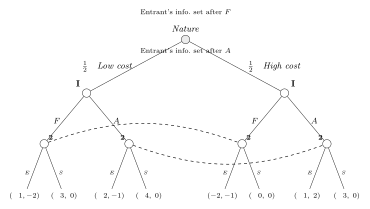
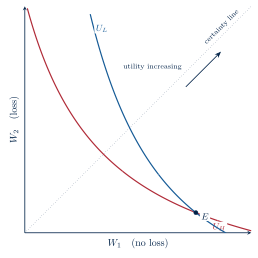
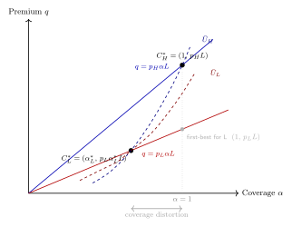
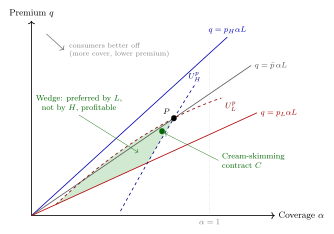
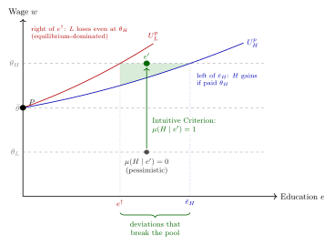

# Game Theory with Imperfect Information

This chapter studies games in which some or all of the players have incomplete
knowledge of the game — of their rivals' payoffs, or of the characteristics that
determine them.

In the previous chapter we assumed that all players had full knowledge of the game,
including everyone's payoffs and strategies, as well as confidence in the rationality
of others. That assumption simply fails in most economically interesting situations.
A firm rarely knows its rival's true marginal cost. A bidder at an auction does not
know how much the person sitting next to them values the object. An insurer cannot
observe how careful a driver is. An employer cannot see how productive a job applicant
will turn out to be. In each case one side holds **private information** about
something that matters for payoffs, and the entire strategic problem turns on how the
uninformed side reasons about it.

Here you will develop the tools to analyse exactly these situations by introducing
**Bayesian game theory**. The focus is on how **Bayesian Nash Equilibrium (BNE)** is
used to model games in which players have private information and form beliefs about
the **types** of other players, where a player's type captures their payoff-relevant
private characteristics, such as their cost structure or valuation. We also cover
**belief updating** and **strategic uncertainty** in decision-making.

## Getting Started: Your Roadmap and Objectives

### How Your Learning Is Structured

This chapter covers the following core areas:

- Types of missing information, and the Harsanyi transformation
- Cournot and Bertrand competition under imperfect information
- Bayesian games and Bayesian Nash Equilibrium (BNE)
- Entry deterrence under uncertainty
- Auction models and Bayesian bidding strategies
- The Rothschild–Stiglitz insurance model and screening under asymmetric information
- The Spence education signalling model and Perfect Bayesian Equilibrium (PBE)
- Pooling and separating equilibria in signalling games
- Welfare implications and comparative statics of signalling
- The multiplicity problem and equilibrium refinement using the Intuitive Criterion
- Connecting Bayesian Nash Equilibrium and Perfect Bayesian Equilibrium across static
  and dynamic games

### Your Learning Outcomes

By the end of this chapter, you will be able to:

- Distinguish between complete and incomplete information, and between static and
  dynamic Bayesian games.
- Apply Bayesian Nash Equilibrium (BNE) to analyse strategic interactions under
  incomplete information, including Cournot and Bertrand competition.
- Interpret and apply Bayesian Nash Equilibrium (BNE) in games with private
  information.
- Analyse equilibrium outcomes in the Rothschild–Stiglitz insurance model, focusing on
  screening and self-selection.
- Evaluate strategic behaviour in the Spence education signalling model using Perfect
  Bayesian Equilibrium (PBE).
- Analyse pooling and separating equilibria, and evaluate their welfare implications.
- Apply refinement criteria, including the Intuitive Criterion, to eliminate
  implausible equilibria.
- Explain how beliefs, strategies, and information interact to determine equilibrium
  outcomes in dynamic Bayesian games.

### Check Your Knowledge {.unnumbered}

Before diving in, let's see what you already know. Don't worry if you are unsure —
these questions are here to get you thinking about the key ideas you will cover in
this chapter.

:::: {.quiz data-answer="B"}
**Question 1.** What is the key feature of incomplete information in a game?

(A) Players cannot observe past actions.
(B) Players do not know the payoff-relevant characteristics of other players.
(C) Players make decisions at the same time.
(D) Players always have identical preferences.

::: {.feedback data-option="A"}
**Try again.** That describes imperfect information, not incomplete information.
:::

::: {.feedback data-option="B"}
**Well done.** Incomplete information arises when players lack knowledge about others'
costs, types, or valuations.
:::

::: {.feedback data-option="C"}
**Try again.** This relates to timing, not information.
:::

::: {.feedback data-option="D"}
**Try again.** Incomplete information often involves differences in preferences or
types.
:::
::::

:::: {.quiz data-answer="B"}
**Question 2.** Which one of the following best describes imperfect information?

(A) Players do not know the rules of the game.
(B) Players do not observe some past actions in the game.
(C) Players are uncertain about others' payoffs.
(D) Players choose strategies randomly.

::: {.feedback data-option="A"}
**Try again.** The rules are assumed to be known.
:::

::: {.feedback data-option="B"}
**Well done.** Imperfect information refers to situations where players cannot observe
previous moves.
:::

::: {.feedback data-option="C"}
**Try again.** That is incomplete information.
:::

::: {.feedback data-option="D"}
**Try again.** Strategies are purposeful, not random.
:::
::::

:::: {.quiz data-answer="B"}
**Question 3.** Why do beliefs play an important role in games with incomplete
information?

(A) Because players ignore the actions of others.
(B) Because players must form expectations about unknown characteristics of others.
(C) Because beliefs replace strategies in decision-making.
(D) Because beliefs eliminate uncertainty.

::: {.feedback data-option="A"}
**Try again.** Strategic interaction requires considering others.
:::

::: {.feedback data-option="B"}
**Well done.** Beliefs allow players to make decisions under uncertainty about others'
types.
:::

::: {.feedback data-option="C"}
**Try again.** Strategies and beliefs work together, not as substitutes.
:::

::: {.feedback data-option="D"}
**Try again.** Beliefs help manage uncertainty, not remove it.
:::
::::

:::: {.quiz data-answer="B"}
**Question 4.** What does Bayesian Nash Equilibrium (BNE) capture?

(A) A situation where players maximise total welfare.
(B) A situation where players choose strategies based on beliefs about others' types.
(C) A situation where players have perfect information.
(D) A situation where all players choose identical strategies.

::: {.feedback data-option="A"}
**Try again.** BNE focuses on individual optimisation under uncertainty.
:::

::: {.feedback data-option="B"}
**Well done.** BNE extends Nash equilibrium to settings with incomplete information.
:::

::: {.feedback data-option="C"}
**Try again.** BNE is specifically used when information is incomplete.
:::

::: {.feedback data-option="D"}
**Try again.** Strategies may differ depending on types and beliefs.
:::
::::

:::: {.quiz data-answer="B"}
**Question 5.** In signalling models such as education signalling, what is the main
purpose of a signal?

(A) To reduce production costs.
(B) To reveal or convey private information about a player's type.
(C) To eliminate competition between players.
(D) To ensure all players receive the same payoff.

::: {.feedback data-option="A"}
**Try again.** Signals are about information, not costs.
:::

::: {.feedback data-option="B"}
**Well done.** Signals help others infer hidden characteristics such as ability or
productivity.
:::

::: {.feedback data-option="C"}
**Try again.** Competition still exists in signalling environments.
:::

::: {.feedback data-option="D"}
**Try again.** Payoffs typically differ depending on types and actions.
:::
::::

## Static Games with Incomplete Information

**Imperfect vs. incomplete information.** In a game of *imperfect information*, players
know the structure of the game (players, strategies and payoffs) but may not observe
some actions of other players, for example when firms choose quantities simultaneously.
In a game of *incomplete information*, at least one player is uncertain about a
payoff-relevant characteristic of another player, such as a rival's marginal cost in a
Cournot or Bertrand duopoly.

**Type.** A player's *type* $\theta_i$ summarises all of their private information that
is relevant to payoffs. In the Cournot example, Firm 2's type is its marginal cost,
$\theta_2 \in \{c_L, c_H\}$. Each firm knows its own type but not necessarily the types
of its rivals. A strategy is therefore a function of type: Firm 2 chooses $q_2(c_L)$ and
$q_2(c_H)$.

**Common prior.** The *common prior* assumption states that Nature draws types from a
probability distribution that is common knowledge among all players. For example, it is
common knowledge that Firm 2 has cost $c_H$ with probability $\rho$ and $c_L$ with
probability $1-\rho$. Firm 1 uses this prior to compute its expected profit, and any
differences in beliefs arise only from differences in private information. In the
Bertrand model the same logic applies: firms set prices given beliefs about the rival's
cost type, which determine the probability of being the lowest-priced firm.

**Why types and common priors are essential.** Types describe precisely what is
privately known and what is uncertain, and allow strategies to be defined as
type-contingent plans. The common prior gives all players a shared probability
distribution over types, so that each can form beliefs (by Bayes' rule) and compute
expected payoffs. It also closes the model, since all players know how the others form
beliefs. Without these assumptions, beliefs about beliefs would be unrestricted and the
equilibrium could not be determined.

**How economists solve incomplete information games.** Following John C. Harsanyi (who
shared the 1994 Nobel Memorial Prize in Economic Sciences with John F. Nash and Reinhard
Selten for their pioneering analysis of equilibria in non-cooperative games), economists
transform a game of incomplete information into a game of imperfect information. Nature
moves first and draws each player's type; each player observes only their own type, not
Nature's draw for the others. The game can then be analysed with standard tools:
strategies are functions of types, and each type maximises their expected payoff given
their beliefs about the others' types. The solution concept is *Bayesian Nash
equilibrium* (BNE), in which every type of every player best responds to the other
players' type-contingent strategies.

### Strategic Competition under Uncertainty: Cournot and Bertrand Models

In many real-world markets, firms do not have complete information about their
competitors. In particular, firms may be uncertain about key payoff-relevant
characteristics such as production costs.

This section extends the Cournot and Bertrand models to incorporate this uncertainty.
You will explore how firms make decisions when they must act based on expectations
rather than complete knowledge, and how this affects equilibrium outcomes.

#### Cournot Competition with Uncertain Costs

We work through the Cournot model under uncertainty in turn: the model setup, firm
optimisation under incomplete information, equilibrium outcomes, and the economic
intuition behind these results.

##### Model setup

Consider a classic Cournot duopoly where two firms, Firm 1 and Firm 2, compete by
setting quantities $q_1$ and $q_2$ for a homogeneous product. The market inverse demand
function is linear:

$$
P(Q) = a - Q, \quad \text{where } Q = q_1 + q_2.
$$

Uncertainty is introduced regarding production costs. Firm 1 has a constant marginal
cost $c_1$ that is common knowledge. However, Firm 2's marginal cost is private
information. Firm 1 only knows that Firm 2's cost can take two possible values:

- $c_H$ with probability $\rho$, or
- $c_L$ with probability $1 - \rho$.

Firm 2 observes its own cost, but Firm 1 does not. This creates incomplete information,
as Firm 1 faces uncertainty about a payoff-relevant characteristic of Firm 2.

This differs from imperfect information, where players may not observe past actions.
Here, Firm 1 cannot observe Firm 2's private characteristic (its cost) even before the
game begins. The uncertainty is about *who* Firm 1 is playing against: is it a low-cost
competitor or a high-cost one? This private information held by Firm 2 fundamentally
shapes the strategic interaction.

##### Firms' optimisation problem

Firm 2's problem, knowing its own cost and taking Firm 1's quantity $q_1$ as given, is to
maximise its profit for each of its possible costs:

$$
\max_{q_2^H} \ \pi_2^H = (a - q_1 - q_2^H - c_H)\, q_2^H
$$

$$
\max_{q_2^L} \ \pi_2^L = (a - q_1 - q_2^L - c_L)\, q_2^L
$$

Taking first-order conditions gives Firm 2's best response functions:

$$
q_2^H(q_1) = \frac{a - q_1 - c_H}{2}, \qquad
q_2^L(q_1) = \frac{a - q_1 - c_L}{2}
$$

Firm 1 must choose a single quantity $q_1$ without knowing Firm 2's cost. It therefore
maximises expected profit:

$$
\max_{q_1} \ E[\pi_1] = \rho (a - q_1 - q_2^H - c_1)q_1 + (1 - \rho)(a - q_1 - q_2^L - c_1)q_1
$$

As in static games of complete information, Firm 1 takes as given the quantity choices
of the different types of Firm 2. Taking the partial derivative with respect to $q_1$ and
setting it equal to zero yields Firm 1's best response:

$$
q_1(q_2^H, q_2^L) = \frac{a - c_1 - (\rho q_2^H + (1 - \rho)q_2^L)}{2}
$$

Substituting Firm 2's best responses into Firm 1's reaction function gives the
equilibrium quantity:

$$
q_1^* = \frac{a - 2c_1 + (\rho c_H + (1 - \rho)c_L)}{3}
$$

Substituting $q_1^*$ back into Firm 2's best responses yields:

$$
q_2^{H*} = \frac{2a - 3c_H + 2c_1 - (\rho c_H + (1 - \rho)c_L)}{6}
$$

$$
q_2^{L*} = \frac{2a - 3c_L + 2c_1 - (\rho c_H + (1 - \rho)c_L)}{6}
$$

##### Economic intuition

The equilibrium results reveal how incomplete information shapes firms' output
decisions.

**Information disadvantage for Firm 1.** Firm 1's equilibrium quantity depends on the
expected cost of Firm 2,

$$
\rho c_H + (1-\rho)c_L
$$

rather than Firm 2's actual cost. This reflects Firm 1's information disadvantage: it
must commit to a single quantity without knowing which type of competitor it faces.

**Asymmetric responses to cost realisations.** Firm 2 produces more when its costs are
low:

$$
q_2^{L*} > q_2^{H*}
$$

This follows directly from the equilibrium expressions above. Intuitively, a low-cost
firm finds it profitable to produce more aggressively and capture a larger market share.

**Comparison with complete information.**

- Under complete information (where Firm 1 knows Firm 2's cost), the standard Cournot
  equilibrium would give Firm 1 a quantity that varies with Firm 2's actual cost.
- Under incomplete information, Firm 1 chooses an intermediate quantity that hedges
  against both possibilities.

This hedging behaviour generally reduces Firm 1's expected profit compared to the
complete information benchmark.

**Value of information.** If Firm 1 could acquire information about Firm 2's cost type
before choosing output, it could tailor its response more optimally. The difference
between Firm 1's expected profit under complete versus incomplete information represents
the *value of information* in this strategic setting.

::: {.infobox}
**Key insight**

Firm 1 responds to its expectation of Firm 2's behaviour, while Firm 2 responds to Firm
1's quantity tailored to its own true cost. This asymmetry in information creates a
fundamental strategic tension that characterises games of incomplete information.
:::

#### Bertrand Competition with Uncertain Costs

We now turn to the Bertrand model under uncertainty, covering the model setup, firm
pricing decisions under incomplete information, equilibrium outcomes, and the economic
intuition behind these results.

##### Model setup

We revisit the differentiated-products Bertrand model introduced in the previous
chapter, this time allowing for private information about production costs. The demand
functions are:

$$
q_1(p_1,p_2) = \frac{b\bigl[a(1-\theta)-p_1+\theta p_2\bigr]}{1-\theta^2}
$$

$$
q_2(p_1,p_2) = \frac{b\bigl[a(1-\theta)-p_2+\theta p_1\bigr]}{1-\theta^2}
$$

Suppose Firm 1's marginal cost is $c_1$, which is publicly known. Firm 2's marginal cost
is private information. It takes one of two possible values:

- $c_H$ with probability $\rho$.
- $c_L$ with probability $1-\rho$,

where $c_H > c_L$.

To determine the equilibrium prices, we solve for each firm's optimal pricing strategy.
Firm 2 has two possible pricing strategies:

- Charge $p_2^H$ if its marginal cost is $c_H$.
- Charge $p_2^L$ if its marginal cost is $c_L$.

Firm 1 must choose a single price, $p_1$, to maximise its expected profit across the two
possible cost realisations of Firm 2.

##### Firm optimisation

Firm 2 chooses its optimal price based on its realised marginal cost and Firm 1's price.
For each cost type $k\in\{H,L\}$, Firm 2 solves:

$$
\max_{p_2^k}\; \pi_2^k = (p_2^k-c_k) \cdot \frac{b\bigl[a(1-\theta)-p_2^k+\theta p_1\bigr]}{1-\theta^2}
$$

Taking the first-order condition and solving gives Firm 2's best-response function for
each cost type:

$$
p_2^H(p_1) = \frac{a(1-\theta)+c_H+\theta p_1}{2}, \qquad
p_2^L(p_1) = \frac{a(1-\theta)+c_L+\theta p_1}{2}
$$

These best-response functions slope **upward** in $p_1$, meaning prices are **strategic
complements**. When Firm 1 raises its price, demand shifts towards Firm 2, allowing Firm
2 to profitably increase its own price. This contrasts with the Cournot model, where
quantities are strategic substitutes.

Firm 1 chooses a single price, $p_1$, before knowing Firm 2's cost type. It therefore
maximises its **expected profit** by weighting the two possible demand outcomes by their
probabilities:

$$
\max_{p_1}\; E[\pi_1] = \rho(p_1-c_1)\, q_1(p_1,p_2^H) + (1-\rho)(p_1-c_1)\, q_1(p_1,p_2^L)
$$

##### Solving for equilibrium

Because the demand function is linear, Firm 1's expected profit simplifies to:

$$
\max_{p_1} \; (p_1-c_1) \cdot \frac{b}{1-\theta^2}\bigl[a(1-\theta)-p_1+\theta\bar{p}_2\bigr]
$$

where

$$
\bar{p}_2 = \rho p_2^H + (1-\rho)p_2^L
$$

is Firm 2's expected price. Taking the first-order condition gives Firm 1's
best-response function to Firm 2's expected price:

$$
p_1(\bar{p}_2) = \frac{a(1-\theta)+c_1+\theta\bar{p}_2}{2}
$$

One way to solve the system simultaneously is to recognise that Firm 2's expected price
also depends on Firm 1's price. Averaging Firm 2's best-response functions gives:

$$
\bar{p}_2 = \rho\,p_2^H(p_1) + (1-\rho)\,p_2^L(p_1) = \frac{a(1-\theta)+\bar{c}_2+\theta p_1}{2},
$$

where

$$
\bar{c}_2 = \rho c_H + (1-\rho)c_L
$$

is Firm 2's expected marginal cost. Substituting $\bar{p}_2$ into Firm 1's best-response
function and solving for $p_1$ gives the equilibrium price:

$$
p_1^* = \frac{(2+\theta)a(1-\theta)+2c_1+\theta\bar{c}_2}{4-\theta^2}
$$

Substituting $p_1^*$ back into Firm 2's best-response functions gives the equilibrium
price for each cost type:

$$
p_2^{H*} = \frac{2(2+\theta)a(1-\theta) + (4-\theta^2)c_H + 2\theta c_1 + \theta^2\bar{c}_2}{2(4-\theta^2)}
$$

$$
p_2^{L*} = \frac{2(2+\theta)a(1-\theta) + (4-\theta^2)c_L + 2\theta c_1 + \theta^2\bar{c}_2}{2(4-\theta^2)}
$$

##### Economic intuition

**Strategic complements versus substitutes.** In moving from Cournot to Bertrand
competition, the firms' choice variable changes from quantity to price. This changes the
nature of the strategic interaction between them.

In Cournot competition, quantities are **strategic substitutes**: best-response
functions slope downward, so if Firm 2 produces more, Firm 1 prefers to produce less. In
Bertrand competition, prices are **strategic complements**: best-response functions
slope upward, so if Firm 2 charges a higher price, Firm 1 also finds it profitable to
raise its price. This reversal fundamentally changes how uncertainty propagates through
the equilibrium.

**Firm 1 responds to Firm 2's expected price.** As in the Cournot case, Firm 1 cannot
condition its decision on Firm 2's realised cost. Instead, it sets the price that is
optimal against the **probability-weighted average** of the prices Firm 2 may charge:
$p_1^*$ depends on $\bar{c}_2 = \rho c_H + (1-\rho)c_L$. This hedging behaviour means
that Firm 1's pricing decision depends on Firm 2's *expected* marginal cost rather than
on the actual cost realisation.

**Cost ordering is preserved.** Since $c_L<c_H$, it follows immediately that
$p_2^{L*}<p_2^{H*}$. The low-cost type prices more aggressively to capture market share,
while the high-cost type prices more softly to protect its margin. Firm 1's equilibrium
price, $p_1^*$, lies between the prices it would charge under complete information about
either cost type.

**Information rents and strategic complementarity.** Strategic complementarity has two
important implications.

- The low-cost type's aggressive pricing pulls Firm 1's price downward, compressing Firm
  1's margin.
- The high-cost type's softer pricing allows Firm 1 to charge a higher price.
- The low-cost type earns an **information rent**. Because Firm 1 cannot distinguish it
  from the high-cost type, the low-cost firm faces a higher rival price than it would
  under complete information, allowing it to earn profits above its full-information
  benchmark.

**Role of the differentiation parameter $\theta$.** The parameter $\theta$ determines the
degree of product substitutability.

- As $\theta\rightarrow0$, products become independent. Firms' pricing decisions
  decouple, and Firm 2's private cost information has little influence on Firm 1's
  pricing decision.
- As $\theta\rightarrow1$, products become close substitutes. Price competition
  intensifies, and uncertainty about Firm 2's cost has a proportionally larger effect on
  Firm 1's optimal price.

::: {.infobox}
**Key takeaway**

Firm 1 reacts to **expected prices**, while Firm 2 reacts to its **realised cost**. This
informational asymmetry creates strategic tension and allows the informed firm to earn an
information rent under incomplete information.
:::

Under incomplete information, the uninformed firm bases its pricing decision on
expectations, while the informed firm responds to its realised marginal cost. Because
prices are strategic complements, private information affects not only the informed
firm's pricing decision but also the rival firm's equilibrium price.

### Understanding Bayesian Games under Uncertainty

The two preceding examples — Cournot and Bertrand competition with uncertain costs —
share a common structure. One player holds private information about a payoff-relevant
characteristic, namely its cost type, while competitors only know the probability
distribution over that characteristic.

This structure defines a **Bayesian game**, and the appropriate equilibrium concept is
the **Bayesian Nash Equilibrium (BNE)**. The core components are as follows.

#### Players and actions

A static Bayesian game consists of multiple players:

$$
N = \{1, \dots, n\}
$$

Each player $i$ chooses actions from an action set $A_i$. In a Bayesian game, players
choose actions while facing uncertainty about other players' private information.

#### Types and private information

Each player has a type space $T_i$, representing the private information that player may
hold. A player's type $t_i \in T_i$ encodes payoff-relevant characteristics such as
costs, valuations, or preferences.

In the Cournot example, Firm 2's production cost represents its private type.

#### Payoffs and beliefs

A payoff function determines how much each player receives based on the actions chosen
by all players, and the players' types:

$$
u_i : A_1 \times \dots \times A_n \times T_1 \times \dots \times T_n \rightarrow \mathbb{R}
$$

This means player $i$'s payoff may depend on the full profile of actions and types.

In many settings, the other players' types matter only indirectly, through the actions
those players choose. The definition is general enough to also allow them to matter
directly, as in a common-value auction.

::: {.infobox}
**Understanding the payoff function**

The payoff function

$$
u_i : A_1 \times \dots \times A_n \times T_1 \times \dots \times T_n \rightarrow \mathbb{R}
$$

takes all players' actions and types as inputs and returns a real-valued payoff.

Think of $u_i$ as a lookup table. The input is one complete "scenario": what every player
does and what type every player is. The output is one number — player $i$'s payoff in
that scenario.

The $\times$ symbols simply mean "pick one from each set". So
$A_1 \times \dots \times A_n \times T_1 \times \dots \times T_n$ is the set of all
possible scenarios $(a_1, \dots, a_n, t_1, \dots, t_n)$.

For example, in a two-player game with actions $\{L, R\}$ and types
$\{\text{high}, \text{low}\}$, the scenario $(R, R, \text{low}, \text{high})$ describes
player 1 choosing $R$ while being type low, and player 2 choosing $R$ while being type
high.
:::

The definition allows player $i$'s payoff to depend on the other players' types, but it
does not require it. In many applications the payoff depends only on the actions of all
players and on player $i$'s own type:

$$
u_i(a_1, \dots, a_n, t_i).
$$

This is the **private values** case, and the Cournot example has this structure. Firm 1's
profit is determined by the two quantities produced and by its own cost, so Firm 2's cost
matters to Firm 1 only indirectly, through the quantity Firm 2 chooses.

In other applications, the other players' private information is directly
payoff-relevant. Such settings are described as having **common values**, or equivalently
as featuring **informational externalities**.

**Example.** Two firms bid for the drilling rights to an oil tract. The tract has the
same value $v$ for both firms, but neither firm observes it. Each firm $i$ commissions
its own geological survey and privately observes an estimate $t_i$, and the value of the
tract is the average of the two estimates:

$$
v = \frac{t_1 + t_2}{2}.
$$

If Firm 1 wins the tract with a bid $b$, its payoff is

$$
u_1 = \frac{t_1 + t_2}{2} - b,
$$

which depends directly on Firm 2's private estimate, and not only on its own.

Firm 2's survey is therefore valuable information for Firm 1. Had Firm 1 observed $t_2$,
it would revise its estimate of the tract's value and adjust its bid accordingly, even
with its own survey unchanged. This interdependence also generates the **winner's
curse**: winning indicates that the rival's estimate was the lower of the two, so the
tract is worth less than Firm 1's own survey suggested.

As a result, player $i$'s payoff may depend on the full profile of actions and types.

#### A common prior and posterior beliefs

A **prior** is a player's belief about others' types *before* receiving any private
information. A **posterior** is the updated belief *after* the player observes their own
type.

A common prior $p(t_1, \dots, t_n)$ is a joint probability distribution over type
profiles that is common knowledge among all players. "Common" means every player starts
from the same prior, so any difference in beliefs arises only from differences in the
private types they observe.

Each player then updates the prior using Bayes' rule to obtain a posterior:

$$
p(t_{-i} \mid t_i) = \frac{p(t_i, t_{-i})}{p(t_i)}.
$$

This posterior is the belief used to compute expected payoffs, and hence best responses,
in a Bayesian Nash Equilibrium. If types are independent, observing $t_i$ reveals nothing
about $t_{-i}$, so the posterior equals the prior (as in the Cournot example, where Firm
1 assigns probability $\rho$ to Firm 2 being high-cost regardless of its own cost).

The timing of a static Bayesian game is as follows:

- Nature draws a type profile $(t_1, \dots, t_n)$ from the common prior distribution $p$.
- Each player observes only their own type $t_i$.
- Players form beliefs about rivals' types.
- Players simultaneously choose actions.
- Payoffs are realised.

::: {.infobox}
**Understanding $t_{-i}$ and conditional beliefs**

The subscript $-i$ means "all player types except type $i$". So $t_{-i}$ represents the
types of all other players, and $t_{-i} \mid t_i$ is player $i$'s conditional belief
about these types after observing their own type $t_i$.

**Example.** In the Cournot game, Firm 1 ($i=1$) observes its own cost $t_1 = c_1$ and
forms the belief

$$
p(t_2 \mid t_1) = p(t_2 \mid c_1)
$$

This means Firm 1 assigns probability $\rho$ that Firm 2 is high-cost and $1-\rho$ that
Firm 2 is low-cost.
:::

#### Strategies under incomplete information

Because players do not know rivals' types when acting, a strategy must specify an action
for every possible type realisation. A pure strategy for player $i$ is a function

$$
s_i : T_i \rightarrow A_i
$$

mapping each possible type to an action.

In the Cournot example, Firm 2's strategy is exactly such a function:

$$
s_2(c_H) = q_2^H, \qquad s_2(c_L) = q_2^L
$$

where $q_2^H$ and $q_2^L$ are the equilibrium quantities corresponding to high-cost and
low-cost types, respectively. This demonstrates how strategies in Bayesian games must
cover every possible type a player may observe.

### Bayesian Nash Equilibrium

A **Bayesian Nash Equilibrium (BNE)** extends the idea of Nash Equilibrium to situations
where players have incomplete information about one another. Instead of responding only
to observed actions, players must also form beliefs about the possible *types* of other
players and choose strategies accordingly.

#### Definition

A strategy profile $(s_1^*, \dots, s_n^*)$ is a Bayesian Nash Equilibrium if, for every
player $i$ and every type $t_i \in T_i$,

$$
s_i^*(t_i) \in \arg\max_{a_i \in A_i} \mathbb{E}_{t_{-i}}\left[ u_i(a_i, s_{-i}^*(t_{-i}), t_i, t_{-i}) \mid t_i \right]
$$

In plain words: *every type of every player is doing the best it can, given what it
believes about the others and how it expects them to behave.* Each player knows their own
type, but not the others'. So they cannot best-respond to a single known action. Instead,
they best-respond to the *average* outcome, taken over the other players' possible types,
with each type playing its own equilibrium strategy.

Concretely, each player's choice rests on two ingredients:

- **Beliefs** about the types of other players.
- **Strategies** those other types are expected to follow.

**Reading the formula piece by piece:**

- $t_i$: player $i$'s own type, which they know (e.g. Firm 2 knows its cost is $c_H$ or
  $c_L$).
- $a_i \in A_i$: a candidate action (e.g. a quantity $q_i$) that the player considers.
- $s_{-i}^*(t_{-i})$: what the other players would do, given their types, in equilibrium
  (e.g. Firm 1 produces $q_1^H$ if high-cost, $q_1^L$ if low-cost).
- $\mathbb{E}_{t_{-i}}[\,\cdot \mid t_i\,]$: the expected payoff, averaging over the other
  players' possible types, weighted by player $i$'s beliefs.
- $\arg\max$: among all candidate actions, pick the one with the highest expected payoff.

**Illustration (Cournot with uncertain cost).** Suppose Firm 1 is high-cost with
probability $\theta$ and low-cost with probability $1-\theta$. Firm 2 does not know which
Firm 1 it faces, so it weighs the two possibilities: with probability $\theta$ rival
output is $q_1^H$, and with probability $1-\theta$ it is $q_1^L$. Firm 2 (type $c_2$)
therefore chooses $q_2$ to solve

$$
s_2^*(c_2) \in \arg\max_{q_2}\; \theta\,\pi_2(q_2, q_1^H; c_2) + (1-\theta)\,\pi_2(q_2, q_1^L; c_2),
$$

where $\pi_2(q_2,q_1;c_2) = (P(q_1+q_2) - c_2)\,q_2$. Firm 1 solves the analogous problem
for each of its own types. A BNE is a set of quantities $(q_1^H, q_1^L, q_2^H, q_2^L)$
such that every type's quantity is a best response to the others' type-contingent
quantities, so no type of any player wants to deviate.

#### Key principles

Two important ideas follow from this definition:

- **Strategies depend on type**: Different types of the same player may rationally choose
  different actions.
- **Equilibrium is defined over strategies, not just actions**: A player's full strategy
  specifies what they would do for every possible type they could have.

When types are common knowledge, the Bayesian game reduces to a standard Nash Equilibrium
game. BNE therefore generalises ordinary Nash Equilibrium to environments with incomplete
information.

#### Example 1: Prisoner's Dilemma with uncertain types

Consider two players who simultaneously choose Cooperate ($C$) or Defect ($D$). Player
1's payoffs are common knowledge. Player 2's type is private information:

- With probability $\rho$, Player 2 is *Selfish* (type $S$), with the same payoffs as
  Player 1.
- With probability $1-\rho$, they are *Altruistic* (type $A$).

**Bimatrix payoffs for each type**

Type $S$ (Selfish), probability $\rho$:

|  | **Player 2: $C$** | **Player 2: $D$** |
|---|---|---|
| **Player 1: $C$** | $3,\;3$ | $0,\;4$ |
| **Player 1: $D$** | $4,\;0$ | $1,\;1$ |

Type $A$ (Altruistic), probability $1-\rho$:

|  | **Player 2: $C$** | **Player 2: $D$** |
|---|---|---|
| **Player 1: $C$** | $3,\;3$ | $0,\;4-g$ |
| **Player 1: $D$** | $4,\;0$ | $1,\;1-g$ |

*Note:* Since $g>1$, type-$A$ payoffs satisfy $4-g<3$ and $1-g<0$, making $C$ strictly
dominant for the altruistic type.

**Key points**

- The BNE is solved by reasoning from type-dominant strategies.
- For type $S$: $D$ strictly dominates $C$.
- For type $A$: $C$ strictly dominates $D$ (since $3 > 4-g$ and $0 > 1-g$ when $g > 1$).
- Player 2's strategy depends on Player 2's type: $s_2^*(S) = D$, $s_2^*(A) = C$.

**Expected payoffs for Player 1**

$$
\mathbb{E}[u_1 \mid D] = \rho \cdot 1 + (1-\rho) \cdot 4 = 4-3\rho
$$

$$
\mathbb{E}[u_1 \mid C] = \rho \cdot 0 + (1-\rho) \cdot 3 = 3-3\rho
$$

Since $4-3\rho > 3-3\rho$ for all $\rho \in [0,1]$, defection is strictly dominant for
Player 1. The unique BNE is

$$
s_1^* = D, \quad s_2^*(S) = D, \quad s_2^*(A) = C
$$

**Insights**

*Dominant strategies survive incomplete information.* Dominant strategies persist even
with private information. Even with a $(1-\rho)$ chance of a cooperative opponent, Player
1 defects because the gain from defecting is constant. Private information about the
opponent's preferences cannot rescue cooperation, so defection is unconditional.

*Asymmetric equilibrium strategies.* Player 2 adopts a type-contingent strategy: the
altruistic type cooperates, the selfish type defects. Different types face different
payoffs and take different actions. Player 2's strategy, $s_2^*(S) = D$, $s_2^*(A) = C$,
remains dominant and beats any other type-contingent plan.

*Partial improvement over the complete-information benchmark.* With complete information,
the unique NE is $(D,D)$. Under incomplete information, the altruistic type cooperates
with probability $1-\rho$, increasing aggregate cooperation, even though Player 1 still
defects. Private type heterogeneity shifts aggregate outcomes without changing individual
incentives.

#### Example 2: Technology adoption as a coordination game

Two firms simultaneously decide whether to *Adopt* ($A$) a new technology standard or
*Stay* ($B$) with the existing one. Each firm $i$ has a private coordination value $v_i$.

Payoff matrix (row $=$ Firm $i$, column $=$ Firm $j$):

|  | **$A$** | **$B$** |
|---|---|---|
| **$A$** | $v_i,\; v_j$ | $0,\; s$ |
| **$B$** | $s,\; 0$ | $s,\; s$ |

*Note:* $v_i$ is firm $i$'s private coordination value; $s>0$ is the safe payoff from
staying.

**Type-dependent strategies**

- Each firm $i$ has a private coordination value $v_i$, drawn independently.
- With probability $p$, a firm has high value $v_H > s$ (adoption worthwhile if the
  partner also adopts).
- With probability $1-p$, a firm has low value $v_L < 0$ (adoption is loss-making; $B$
  strictly dominates). Types are independent.
- **Low-type firm ($v_L$):**
  - $B$ yields $s>0$ regardless of the partner's action.
  - $A$ yields at most $v_L<0$, so $s_i^*(v_L) = B$ by strict dominance.
- **High-type firm ($v_H$):**
  - Let $\sigma \in [0,1]$ be the probability a high-type partner adopts.
  - Since low-type partners always play $B$, the probability that a partner plays $A$ is
    $p\sigma$.
  - Expected payoffs:

$$
\mathbb{E}[u_i \mid A, v_H] = p\sigma \cdot v_H + (1-p\sigma) \cdot 0 = p\sigma v_H
$$

$$
\mathbb{E}[u_i \mid B, v_H] = p\sigma \cdot s + (1-p\sigma) \cdot s = s
$$

**Equilibrium regimes**

The high-type firm prefers $A$ if and only if $p \sigma v_H > s$, i.e. $\sigma > \kappa$
where $\kappa \equiv s/(p v_H)$. Two qualitatively distinct regimes arise.

- **Low-probability regime ($p v_H < s$, $\kappa > 1$):** Even if all high types adopt
  ($\sigma=1$), $p v_H < s$, so adoption is not worthwhile. The unique BNE is
  $\sigma^* = 0$ — all firms stay, regardless of type.
- **High-probability regime ($p v_H > s$, $\kappa < 1$):** Two pure-strategy BNE exist:
  - **Adoption equilibrium** ($\sigma^* = 1$): high-type firms adopt and the
    best-response condition $p v_H > s$ is satisfied.
  - **Failure equilibrium** ($\sigma^* = 0$): no firm adopts; the expected gain from
    deviating to $A$ is zero, less than $s$, so staying is a best response. A
    mixed-strategy BNE exists at $\sigma^* = \kappa$.

**Insights**

- **Multiplicity mirrors complete-information coordination.** With complete information
  ($v_H > s$), the coordination game has two pure-strategy NE: $(A,A)$ and $(B,B)$.
  Incomplete information preserves multiplicity but requires $p v_H > s$, as firms
  discount mutual adoption by the probability of facing a high-type partner.
- **Coordination failure as a self-confirming belief.** The failure equilibrium
  ($\sigma^* = 0$) is a BNE even when $p v_H > s$. Firms stay because they expect partners
  to stay; equilibrium selection depends on which beliefs coordinate.
- **Role of the common prior.** The probability $p$ shapes which adoption strategies are
  rational. Higher $p$ lowers $\kappa = s/(p v_H)$, making adoption easier to sustain. The
  common prior channels population beliefs to influence equilibrium selection.
- **Contrast with the Prisoner's Dilemma.** In the Prisoner's Dilemma, strategic dominance
  eliminates multiplicity: a unique BNE exists independent of beliefs. In coordination, no
  action is dominant for the high type; multiple equilibria arise through strategic
  complementarities.

### Auctions as Bayesian Games

Auctions are a classic application of Bayesian games. In the simplest setting, each
bidder has a **private valuation** — the maximum they are willing to pay for the object —
which rivals do not observe. This private valuation is the bidder's **type**.

#### Auction mechanism

The auction mechanism defines three key elements:

- **Action space:** What bids are feasible.
- **Allocation rule:** Who wins the object.
- **Payment rule:** How much each bidder pays.

A **Bayesian Nash Equilibrium** of the auction is a profile of bidding strategies, one
for each bidder type, such that every type maximises its expected payoff given that
rivals bid according to their equilibrium strategies and beliefs about rivals' types are
determined by the common prior.

#### Independent private values setting

Throughout this section, we work in the **independent private values (IPV)** setting.

- There are $n$ risk-neutral bidders.
- Each bidder $i$ draws a valuation $v_i \sim F$ independently and identically from a
  distribution $F$ with density $f$ on $[\underline{v},\bar{v}]$.
- Bidder $i$ observes $v_i$, but not $v_j$ for $j\neq i$.
- The payoff to the winning bidder with valuation $v$ who pays price $p$ is $v-p$.
- A losing bidder pays nothing and receives zero.

#### Second-Price Sealed-Bid Auction

In a second-price sealed-bid auction (also called a Vickrey auction), every bidder
simultaneously submits a sealed bid $b_i$. The bidder who submits the highest bid wins
the object, but pays the *second-highest* bid rather than their own. Ties are broken by a
fair randomisation.

##### Formal game-theoretic structure

The formal components required for game-theoretic analysis:

- **Players:** $i = 1, \dots, n$.
- **Type space:** $T_i = [\underline{v}, \bar{v}]$, with type $t_i = v_i$ drawn from $F$.
- **Action space:** $A_i = \mathbb{R}_{\ge 0}$ (a non-negative bid).
- **Strategy:** a function $\beta_i : [\underline{v}, \bar{v}] \to \mathbb{R}_{\ge 0}$,
  mapping each valuation to a bid.
- **Payoff:** if bidder $i$ wins at price $p$ (the highest rival bid), $u_i = v_i - p$;
  otherwise $u_i = 0$.

##### Proposition 1: dominant-strategy equilibrium

In the second-price auction, truthful bidding $\beta_i(v_i) = v_i$ is a weakly dominant
strategy for every bidder — it maximises expected payoff regardless of what rivals bid.

**Proof.** Fix any rival bid profile $b_{-i}$ and let $m = \max_{j \neq i} b_j$ be the
highest rival bid.

- **Case 1:** $v_i > m$. Bidder $i$ can win by bidding any $b_i > m$ and receives payoff
  $v_i - m > 0$. Bidding $b_i = v_i > m$ wins and achieves exactly $v_i - m$. Bidding
  $b_i < m$ loses and yields $0 < v_i - m$. Hence $b_i = v_i$ is at least as good as any
  alternative.
- **Case 2:** $v_i < m$. Any winning bid $b_i > m$ yields $v_i - m < 0$. Bidding
  $b_i = v_i \le m$ loses and yields $0$. Hence $b_i = v_i$ is at least as good as any
  alternative.
- **Case 3:** $v_i = m$. Both winning and losing yield payoff $v_i - m = 0$, so all bids
  are equally good. $b_i = v_i$ is weakly optimal.

Because truthful bidding is a dominant strategy, the BNE $\beta^*(v_i) = v_i$ requires no
beliefs about rivals' strategies — it holds regardless. This is a notably strong
equilibrium concept: no bidder ever regrets bidding their true valuation after the
auction is resolved.

##### Expected revenue

To keep the algebra simple, from here on suppose valuations are drawn independently from
$\text{Uniform}[0,1]$, so $F(v)=v$ and $f(v)=1$. The Revenue Equivalence Theorem below
states the result for a general distribution $F$.

Under truthful bidding, the winner pays the *second-highest* valuation among the $n$
bidders, denoted $v^{(2)}$. Its density can be built up from three ingredients. For the
second-highest value to equal $v$:

- one bidder (any of the $n$) must have a value above $v$: probability $1-v$;
- one of the remaining $n-1$ bidders must have a value of exactly $v$: density $1$;
- the other $n-2$ bidders must have values below $v$: probability $v^{n-2}$.

Multiplying gives the density $n(n-1)\,v^{n-2}(1-v)$, so expected seller revenue is

$$
R^{SPA} = \int_0^1 v \cdot n(n-1)\,v^{n-2}(1-v)\,dv = n(n-1)\left(\frac{1}{n}-\frac{1}{n+1}\right) = \frac{n-1}{n+1}.
$$

With $n=2$ bidders, the winner pays the lower of the two values and
$R^{SPA}=\frac{1}{3}$. Revenue rises towards $1$ as $n$ grows, because more competition
pushes the second-highest value towards the top of the support.

#### First-Price Sealed-Bid Auction

In a first-price sealed-bid auction, the highest bidder again wins, but now pays their
*own bid*. This changes the strategic environment fundamentally: bidding their true
valuation is no longer optimal, since winning at price $v_i$ yields zero surplus. Every
bidder must **shade** their bid below their valuation, creating a genuine strategic
trade-off between the probability of winning (which rises with a higher bid) and the
surplus conditional on winning (which falls). As in the second-price case, valuations are
$\text{Uniform}[0,1]$.

##### Formal game-theoretic structure

The type space, action space, and player set are identical to the second-price case. The
payoff differs:

$$
u_i(b_i, b_{-i}, v_i) =
\begin{cases}
v_i - b_i & \text{if } b_i > \max_{j \neq i} b_j \\[1ex]
0 & \text{otherwise}
\end{cases}
$$

The equilibrium now genuinely depends on beliefs about rivals, since a bidder's optimal
bid depends on the distribution of rivals' bids, which depends on their strategies, which
depends on their type distributions.

##### Symmetric BNE

We look for a symmetric, strictly increasing equilibrium strategy
$\beta : [0,1] \to \mathbb{R}_{\ge 0}$, meaning all bidders use the same function and
higher types bid more. If rivals all use $\beta$, a bidder who bids $b$ beats rival $j$
if and only if $\beta(v_j) < b$, that is, $v_j < \beta^{-1}(b)$. With uniform values, each
rival satisfies this with probability $\beta^{-1}(b)$, independently, so

$$
\Pr(\text{win} \mid b) = \left(\beta^{-1}(b)\right)^{n-1}.
$$

Let $z = \beta^{-1}(b)$ denote the type that would bid exactly $b$ in equilibrium.
Choosing a bid $b$ is therefore the same as choosing which type $z$ to imitate. A bidder
with value $v$ chooses $z$ to maximise

$$
\pi(z,v) = \underbrace{\left(v-\beta(z)\right)}_{\text{surplus if win}} \cdot \underbrace{z^{\,n-1}}_{\Pr(\text{win})}.
$$

In a symmetric equilibrium, the best choice is to bid as your own type, $z=v$. The
first-order condition evaluated at $z=v$ is

$$
-\beta'(v)\,v^{n-1} + \left(v - \beta(v)\right)(n-1)\,v^{n-2} = 0.
$$

The first term is the marginal cost of bidding a little more (you pay more whenever you
win); the second is the marginal benefit (you win more often).

Rearranging yields a first-order linear ordinary differential equation (ODE) in the
unknown bid function $\beta$:

$$
\beta'(v)\,v^{n-1} + (n-1)\,v^{n-2}\,\beta(v) = (n-1)\,v^{n-1}.
$$

By the product rule, the left-hand side is exactly the derivative of
$\beta(v)\,v^{n-1}$, so the ODE can be written as

$$
\frac{\mathrm{d}}{\mathrm{d}v}\left[\beta(v)\,v^{n-1}\right] = (n-1)\,v^{n-1}.
$$

::: {.infobox}
**Maths link: differential equations.** This is a first-order linear ODE, and $v^{n-1}$
acts as the *integrating factor*: once the left-hand side is recognised as the derivative
of a product, the equation is solved by integrating both sides and using a boundary
condition to pin down the constant of integration. For a refresher, see Lesson 3
(Dynamics) of the Maths Prep course, which covers first-order differential equations.
:::

Integrate both sides from $0$ to $v$. The boundary condition is $\beta(0)=0$: a bidder
with value $0$ would make a loss from any positive winning bid, so bids nothing. Then

$$
\beta(v)\,v^{n-1} - \underbrace{\beta(0)\cdot 0^{\,n-1}}_{=\,0} = \int_0^v (n-1)\,x^{n-1}\,\mathrm{d}x = \frac{n-1}{n}\,v^n.
$$

Dividing by $v^{n-1}$ gives the symmetric equilibrium bid:

$$
\beta^*(v) = \frac{n-1}{n}\,v.
$$

**Check.** Substituting $\beta^*$ back into the ODE, the left-hand side is
$\frac{n-1}{n}v^{n-1} + (n-1)v^{n-2}\cdot\frac{n-1}{n}v = (n-1)v^{n-1}\left(\frac{1}{n}+\frac{n-1}{n}\right) = (n-1)v^{n-1}$,
which equals the right-hand side.

##### Bid shading and equilibrium interpretation

- With $n=2$ bidders, each bids exactly half their value; with $n=3$, two-thirds; with
  $n=4$, three-quarters.
- Every bidder shades their bid by $v/n$ below their valuation. Shading vanishes as
  competition intensifies: as $n \to \infty$, $\beta^*(v) \to v$, since in a thick market
  nearly every bidder faces a rival nearly as strong as themselves.

The bid also has a natural interpretation. Conditional on $v$ being the highest value, the
$n-1$ rivals' values are uniform on $[0,v]$, and the expected highest of them is
$\frac{n-1}{n}v$. So a bidder bids the *expected value of the strongest rival, given that
they themselves are the strongest*. This is exactly what they would expect to pay when
winning a second-price auction.

##### Expected revenue

The winner is the bidder with the highest value $v^{(1)}$, who pays
$\beta^*(v^{(1)}) = \frac{n-1}{n}v^{(1)}$. The highest of $n$ uniform values has CDF
$\Pr(v^{(1)} \le v) = v^n$ and therefore density $n v^{n-1}$. Expected seller revenue is

$$
R^{FPA} = \int_0^1 \frac{n-1}{n}\,v \cdot n v^{n-1}\,\mathrm{d}v = (n-1)\int_0^1 v^{n}\,\mathrm{d}v = \frac{n-1}{n+1}.
$$

This is exactly the second-price revenue $R^{SPA}$ derived above.

| Bidders $n$ | FPA bid $\beta^*(v)$ | SPA bid | Expected revenue (both formats) |
|---|---|---|---|
| 2 | $v/2$ | $v$ | $1/3$ |
| 3 | $2v/3$ | $v$ | $1/2$ |
| 4 | $3v/4$ | $v$ | $3/5$ |
| 10 | $9v/10$ | $v$ | $9/11$ |

In any single auction the two formats charge different prices: the first-price winner
pays their own shaded bid, while the second-price winner pays the runner-up's value. On
average, however, the prices coincide. This is not a coincidence of the uniform
distribution, as the next section shows.

#### Revenue Equivalence Theorem

The first- and second-price auctions charge different prices in any single auction, yet
in the uniform example they raise the same revenue on average. The **Revenue Equivalence
Theorem** (Vickrey 1961; Myerson 1981) shows this holds for *any* distribution of values,
and tells a seller exactly when the choice of format does, and does not, matter.

##### The theorem

In the IPV setting with $n$ risk-neutral bidders and values drawn i.i.d. from *any*
distribution $F$, any two auction formats that, in equilibrium:

- award the object to the bidder with the highest valuation, and
- give the lowest possible type an expected payoff of zero

raise the same expected revenue. Since the second-price auction satisfies both
conditions, that revenue is the expected second-highest value:

$$
R = \mathbb{E}\left[v^{(2)}\right] = \int_{\underline{v}}^{\bar{v}} v \cdot n(n-1)\,F(v)^{n-2}\left(1-F(v)\right) f(v)\,\mathrm{d}v.
$$

**How to use it.** To find the expected revenue of a first-price auction, you do not need
to solve for equilibrium bids. Compute the expected second-highest value instead.

**Intuition.** Bidders in a first-price auction shade their bids by exactly enough that,
on average, the winner pays what they would have paid in a second-price auction: the
expected value of the strongest rival.

##### Practice: choosing an auction format

::: {.exercisebox}
A government is selling a licence to two firms. Each firm's value (in £bn) is drawn
independently from $[0,1]$ with $F(v)=v^2$, so high values are more likely than under a
uniform distribution. Advisers disagree about whether to use a sealed-bid first-price or
second-price auction.

(a) What is the expected revenue from a second-price auction?

(b) What is the expected revenue from a first-price auction? Does the choice of format
matter?

(c) *Challenge:* Derive the first-price equilibrium bid using the differential-equation
method and confirm (b). *Hint:* with one rival, $\Pr(\text{win} \mid b) = z^2$, where
$z=\beta^{-1}(b)$.
:::

::: {.answerbox}
**(a)** The second-highest of two values has density
$2f(v)\left(1-F(v)\right) = 4v(1-v^2)$, so

$$
R^{SPA} = \int_0^1 v \cdot 4v(1-v^2)\,\mathrm{d}v = \frac{8}{15} \approx \text{£}0.53\text{bn}.
$$

**(b)** By the theorem, $R^{FPA} = \frac{8}{15}$ as well. Under these assumptions, the
advisers' debate does not matter for revenue.

**(c)** The first-order condition gives
$\frac{\mathrm{d}}{\mathrm{d}v}\left[\beta(v)\,v^2\right] = 2v^2$, so
$\beta^*(v) = \frac{2}{3}v$. The highest value has density $4v^3$, so
$R^{FPA} = \int_0^1 \frac{2}{3}v \cdot 4v^3\,\mathrm{d}v = \frac{8}{15}$. ✓
:::

##### When equivalence fails

Each assumption of the theorem that fails in practice gives the seller a reason to prefer
one format.

| Assumption fails | Effect | Implication for the seller |
|---|---|---|
| Risk-neutral bidders | Risk-averse bidders shade less in a first-price auction to avoid losing. | Sealed first-price raises more, as is common in procurement. |
| Independent values | With correlated values (e.g. oil reserves, spectrum), the price in an ascending auction reflects rivals' information. | Open ascending or second-price formats raise more. |
| Symmetric bidders | A strong incumbent is almost certain to win an ascending auction, which deters entrants. | Sealed bids give weaker bidders a chance and encourage entry. |
| Independent bidding | Bidders coordinate instead of competing. | Choose formats and rules that make collusion hard. |

##### Practical implications

Revenue equivalence is a theoretical ideal. In practice, the assumptions above routinely
fail, so auction design matters for revenue.

Above all, the model assumes bidders act independently, whereas in practice the
first-order issue is **collusion**. Bidders often meet repeatedly and can coordinate
through explicit bid-rigging or tacit signals in their bids. In the 1999 German spectrum
auction, Mannesmann's opening bids signalled a proposed split of the lots; T-Mobile went
along with it, and the auction ended after two rounds at low prices (Klemperer, 2002).

Sellers have several design levers to protect revenue:

- **Sealed rather than open bids**, so that cartel members cannot observe and punish
  deviations or signal to each other.
- **Reserve prices**, which put a floor under revenue when competition is weak or bidders
  collude.
- **Encouraging entry**, since more bidders raise revenue and make collusion harder to
  sustain.
- **Limiting information and communication**, for example by withholding bidders'
  identities.

### Practice Activity: Market Entry with One-Sided Private Information

Now it's your turn to find a Bayesian Nash Equilibrium (BNE) directly, by working out
each player's best response type by type.

::: {.exercisebox}
Two firms simultaneously decide whether to Enter ($E$) a new market or Stay Out ($O$).

- **Firm 1:** Known low-cost producer (common knowledge).
- **Firm 2:** Cost is private information. With probability $p$ it is a low-cost type
  ($L$), and with probability $1-p$ a high-cost type ($H$).

Each cell shows (Firm 1's payoff, Firm 2's payoff).

Type $L$ (low cost), probability $p$:

|  | **Firm 2: $E$** | **Firm 2: $O$** |
|---|---|---|
| **Firm 1: $E$** | $1,\;2$ | $3,\;0$ |
| **Firm 1: $O$** | $0,\;4$ | $0,\;0$ |

Type $H$ (high cost), probability $1-p$:

|  | **Firm 2: $E$** | **Firm 2: $O$** |
|---|---|---|
| **Firm 1: $E$** | $1,\;-1$ | $3,\;0$ |
| **Firm 1: $O$** | $0,\;4$ | $0,\;0$ |

**Your tasks**

- **Task 1:** Find the BNE. Remember that a strategy for Firm 2 specifies an action for
  each type, $(a_L, a_H)$.
- **Task 2:** Compare the BNE outcome with the complete-information outcomes when Firm 1
  knows Firm 2's type. Does Firm 2's private information matter here?
:::

::: {.answerbox}
**Task 1: find the BNE**

Look for dominant strategies first.

- **Type $L$:** Entering yields $2$ (if Firm 1 enters) or $4$ (if Firm 1 stays out),
  compared with $0$ from staying out. Entering is a dominant strategy: $s_2^*(L) = E$.
- **Firm 1:** Entering yields $1$ or $3$, whatever Firm 2's type and action, compared with
  $0$ from staying out. Entering is a dominant strategy: $s_1^* = E$. Firm 1 does not need
  to know $p$ or what Firm 2 does.
- **Type $H$:** Type $H$ has no dominant strategy. It would enter against an absent Firm 1
  ($4 > 0$) but not against an entrant ($-1 < 0$). Since Firm 1 enters, its best response
  is to stay out: $s_2^*(H) = O$.

The unique BNE is

$$
s_1^* = E, \qquad s_2^* = (E, O),
$$

and Firm 1's expected payoff is $p \cdot 1 + (1-p)\cdot 3 = 3 - 2p > 0$.

**Task 2: does private information matter?**

- **Firm 1 knows Firm 2 is type $L$:** both firms enter, giving payoffs $(1,2)$.
- **Firm 1 knows Firm 2 is type $H$:** Firm 1 enters and type $H$ stays out, giving
  payoffs $(3,0)$.

These are exactly the outcomes of the BNE for each type. Private information does not
matter here because Firm 1 has a dominant strategy: its best action is the same whatever
it believes about Firm 2, so the prior $p$ plays no role.

**Takeaway:** incomplete information changes outcomes only when a player's best response
depends on their beliefs about others' types. If, for instance, Firm 1 made a loss in a
duopoly against a low-cost rival, it would enter only if $p$ were low enough, and the
equilibrium would depend on its beliefs.
:::

### Quick Check-In {.unnumbered}

Before moving on to **dynamic Bayesian games and competitive screening**, test your
understanding of the content in this section.

:::: {.quiz data-answer="C"}
**Question 1.** In Cournot competition with uncertain costs, Firm 1 has known cost $c_L$, while Firm 2’s cost is $c_H$ with probability $\rho$ or $c_L$ with probability $1-\rho$. In the Bayesian Nash Equilibrium, Firm 1’s quantity $q_1^*$:

(A) Equals the Cournot best response to $c_H$ alone.
(B) Is determined by Firm 2’s realized cost.
(C) Depends on the expected cost $\bar{c}_2 = \rho c_H + (1-\rho) c_L$.
(D) Is independent of Firm 2’s cost distribution.

::: {.feedback data-option="A"}
**Try again.** This reflects max–min (worst-case) reasoning rather than expected-profit maximisation. Planning only for $c_H$ ignores the possibility that Firm 2 is a low-cost, aggressive competitor (the probability-$(1-\rho)$ event), which increases Firm 2's output and reduces Firm 1's residual demand. Max–min and expected-payoff maximisation coincide only if the worst-case scenario occurs with probability 1.
:::

::: {.feedback data-option="B"}
**Try again.** In this static simultaneous game, quantities are chosen before any market outcome is observed. Firm 1 therefore bases its decision on the prior distribution of Firm 2's costs.
:::

::: {.feedback data-option="C"}
**Well done.** Firm 1 maximises expected profit by weighting the two market outcomes by their probabilities. The first-order condition yields the best response:

$$
q_1 = \frac{a - c_1 - (\rho q_2^H + (1-\rho) q_2^L)}{2}
$$

Substituting Firm 2’s type-contingent best responses:

$$
q_2^k = \frac{a - q_1 - c_k}{2}, \quad k \in \{H,L\}
$$

and solving gives:

$$
q_1^* = \frac{a - 2 c_1 + \bar{c}_2}{3}
$$

Firm 1’s equilibrium output depends on the probability-weighted average of Firm 2’s cost, not the realised cost.
:::

::: {.feedback data-option="D"}
**Try again.** Firm 2's cost distribution affects its equilibrium output, which directly enters Firm 1's residual demand:

$$
P=a-q_1-q_2
$$

Although Firm 1's own cost is independent of Firm 2's type, its residual demand—and therefore its optimal output—depends on Firm 2's cost distribution.
:::

::::

:::: {.quiz data-answer="C"}
**Question 2.** In differentiated Bertrand competition, best response functions slope upward because prices are strategic complements. Firm 1's best response price $p_1(\bar{p}_2)$ therefore:

(A) Decreases when Firm 2's expected price $\bar{p}_2$ rises.
(B) Is independent of Firm 2's expected price.
(C) Increases when Firm 2's expected price $\bar{p}_2$ rises.
(D) Equals Firm 2's expected price.

::: {.feedback data-option="A"}
**Try again.** This reflects the logic of strategic substitutes in Cournot quantity competition. In Bertrand competition with differentiated products, the opposite applies: a higher rival price shifts demand towards Firm 1, reducing competitive pressure and allowing Firm 1 to raise its price.
:::

::: {.feedback data-option="B"}
**Try again.** Product differentiation reduces the degree of strategic interaction (the slope is $\theta/2$, which falls as $\theta\rightarrow0$), but does not eliminate it while $\theta>0$. Firm 2's price becomes irrelevant to Firm 1's optimal price only when products are completely independent ($\theta=0$).
:::

::: {.feedback data-option="C"}
**Well done.** From the best response function:

$$
p_1(\bar{p}_2)=\frac{a(1-\theta)+c_1+\theta\bar{p}_2}{2}
$$

the slope with respect to $\bar{p}_2$ is $\theta/2>0$. As Firm 2 raises its expected price, some demand shifts to Firm 1, allowing it to increase its own price. This upward-sloping best response is the defining feature of strategic complements.
:::

::: {.feedback data-option="D"}
**Try again.** Equal prices arise only when both firms have identical costs ($c_1=c_2$) and the same demand parameters. With uncertain costs, Firm 2's equilibrium price varies by type ($p_2^{H*}\neq p_2^{L*}$), so Firm 1's equilibrium price—based on Firm 2's expected price—generally differs from either type's price.
:::

::::

:::: {.quiz data-answer="B"}
**Question 3.** A strategy profile $(s_1^*, \dots, s_n^*)$ is a Bayesian Nash Equilibrium if and only if:

(A) No player can increase their expected payoff by switching strategy.
(B) Every player and every type plays a best response.
(C) At least one type of each player is best responding.
(D) The strategy profile is a Nash Equilibrium of the complete-information game.

::: {.feedback data-option="A"}
**Try again.** Averaging optimality across a player's own types is insufficient. For example, suppose type $H$ chooses a strictly dominated action while type $L$ performs well enough for the average payoff to remain maximised. Although this satisfies option A, it does not satisfy the BNE requirement because type $H$ can profitably deviate.
:::

::: {.feedback data-option="B"}
**Well done.** A Bayesian Nash Equilibrium requires optimality for every type of every player, not just on average. Formally, for each player $i$ and each type $t_i\in T_i$:

$$
s_i^*(t_i)\in
\arg\max_{a_i}
E_{t_{-i}}
\!\left[
u_i(a_i,s_{-i}^*(t_{-i}),t_i,t_{-i})
 \middle|  t_i
\right]
$$

The expectation is taken over the rivals' types, while the player's own type is fixed. This type-by-type condition makes BNE a fixed point in strategy space rather than action space.
:::

::: {.feedback data-option="C"}
**Try again.** This condition is too weak. A BNE requires every type of every player to play a best response simultaneously. If even one type can profitably deviate, the strategy profile is not a Bayesian Nash Equilibrium.
:::

::: {.feedback data-option="D"}
**Try again.** A complete-information Nash Equilibrium is defined for a particular type profile. A Bayesian Nash Equilibrium applies to the full incomplete-information game, where types are drawn from a prior distribution. The two coincide only when each $T_i$ is a singleton (that is, types are known with certainty).
:::

::::

:::: {.quiz data-answer="B"}
**Question 4.** In a Cournot duopoly, the demand intercept is $a=12$, Firm 1's cost is $c_1=3$, and Firm 2's cost is $c_H=6$ with probability $\rho=\tfrac{1}{2}$ or $c_L=0$ with probability $\tfrac{1}{2}$. Compute Firm 1's Bayesian Nash Equilibrium quantity $q_1^*$.

(A) $q_1^*=1.5$.
(B) $q_1^*=3$.
(C) $q_1^*=4$.
(D) $q_1^*=4.5$.

::: {.feedback data-option="A"}
**Try again.** Using only the high-cost response ignores the probability-weighted expected cost. Firm 1's equilibrium quantity is based on the expected cost of Firm 2, not on a single cost realisation.
:::

::: {.feedback data-option="B"}
**Well done.** Using the expected cost:

$$
\bar{c}_2=\rho c_H+(1-\rho)c_L
=\frac{1}{2}(6)+\frac{1}{2}(0)=3
$$

the Bayesian Nash Equilibrium quantity for Firm 1 is:

$$
q_1^*
=\frac{a-2c_1+\bar{c}_2}{3}
=\frac{12-6+3}{3}
=3
$$

Substituting Firm 2's type-specific responses:

$$
q_2^{H*}=\frac{12-3-6}{2}=1.5,
\qquad
q_2^{L*}=\frac{12-3-0}{2}=4.5
$$

confirms that Firm 1's best response to the expected quantity is indeed $q_1^*=3$.
:::

::: {.feedback data-option="C"}
**Try again.** Using $q_1=4$ ignores Firm 2's probability-weighted responses. It is not consistent with the Bayesian Nash Equilibrium formula.
:::

::: {.feedback data-option="D"}
**Try again.** This confuses Firm 2's low-cost equilibrium quantity, $q_2^{L*}$, with Firm 1's equilibrium quantity. These are different equilibrium outputs for different players.
:::

::::

:::: {.quiz data-answer="C"}
**Question 5.** In the technology adoption game, high-type firms each earn $v_H = 10$ if both adopt, pay a cost $s = 4$ to adopt regardless of the partner's action, and the probability the partner is high type is $p = 0.6$. Compute the threshold $\kappa \equiv s/(pv_H)$ that governs the mixed-strategy Bayesian Nash Equilibrium (BNE).

(A) $\kappa = \frac{2}{5}$.
(B) $\kappa = \frac{1}{2}$.
(C) $\kappa = \frac{2}{3}$.
(D) $\kappa = \frac{4}{3}$.

::: {.feedback data-option="A"}
**Try again.** Using $\kappa=\frac{2}{5}$ omits the probability $p$ from the denominator. The threshold depends on the expected benefit from adoption, $pv_H$, not on $v_H$ alone.
:::

::: {.feedback data-option="B"}
**Try again.** Using $p=0.8$ instead of $p=0.6$ gives this value. Check the parameters carefully before substituting into the formula.
:::

::: {.feedback data-option="C"}
**Well done.** Using:

$$
\kappa=\frac{s}{pv_H}
=\frac{4}{0.6\times10}
=\frac23
$$

you obtain $\kappa=\frac23$. Since $\kappa<1$, adoption is individually rational. Both pure-strategy equilibria exist, and in the mixed-strategy BNE high types adopt with probability $\kappa=\frac23$.
:::

::: {.feedback data-option="D"}
**Try again.** This corresponds to using the wrong formula or incorrect parameters. Since $pv_H=6>s=4$, the threshold must be less than $1$.
:::

::::

:::: {.quiz data-answer="B"}
**Question 6.** In a second-price sealed-bid auction with independent private values, bidding one's true valuation $\beta_i(v_i)=v_i$ is:

(A) A Bayesian Nash Equilibrium strategy, but only if rivals also bid truthfully.
(B) A weakly dominant strategy, optimal regardless of what rivals bid.
(C) Optimal only when valuations are uniformly distributed.
(D) Strictly dominated by shading below $v_i$, since the winner pays the second-highest bid anyway.

::: {.feedback data-option="A"}
**Try again.** Truthful bidding is optimal regardless of how rivals bid. Weak dominance does not require rivals to bid truthfully.
:::

::: {.feedback data-option="B"}
**Well done.** Using:

$$
m=\max_{j\neq i}b_j
$$

the payoff comparison is:

- If $v_i>m$, truthful bidding wins and earns $v_i-m>0$.
- If $v_i<m$, truthful bidding loses and avoids a negative payoff.
- If $v_i=m$, every bid gives payoff $0$.

Thus, bidding $b_i=v_i$ is at least as good as any alternative for every rival bid profile, making it a weakly dominant strategy.
:::

::: {.feedback data-option="C"}
**Try again.** Weak dominance does not depend on the distribution of valuations. It holds for any valuation distribution.
:::

::: {.feedback data-option="D"}
**Try again.** This confuses first-price and second-price auctions. In a second-price auction, lowering your bid cannot reduce the price you pay—it can only cause you to lose profitable auctions.
:::

::::

:::: {.quiz data-answer="D"}
**Question 7.** In a first-price sealed-bid auction with $n=4$ bidders whose valuations are drawn i.i.d. from $\mathrm{Uniform}[0,1]$, the symmetric Bayesian Nash Equilibrium bidding strategy is:

(A) $\beta^*(v)=v$.
(B) $\beta^*(v)=\frac12v$.
(C) $\beta^*(v)=\frac23v$.
(D) $\beta^*(v)=\frac34v$.

::: {.feedback data-option="A"}
**Try again.** Truthful bidding yields zero surplus whenever you win because you pay your own bid. Rational bidders therefore shade their bids below their valuations.
:::

::: {.feedback data-option="B"}
**Try again.** This is the equilibrium bidding function when $n=2$. With four bidders, competition is stronger, so bidders shade less.
:::

::: {.feedback data-option="C"}
**Try again.** This corresponds to $n=3$ bidders. Be careful not to confuse $n$ with $n-1$ in the general formula.
:::

::: {.feedback data-option="D"}
**Well done.** Using the symmetric first-price auction equilibrium:

$$
\beta^*(v)=\frac{n-1}{n}v
$$

with $n=4$ gives:

$$
\beta^*(v)=\frac34v
$$

This is the solution of the differential equation

$$
\frac{\mathrm{d}}{\mathrm{d}v}\left[\beta(v) v^{n-1}\right]=(n-1) v^{n-1}
$$

with boundary condition $\beta(0)=0$.
:::

::::

:::: {.quiz data-answer="B"}
**Question 8.** The Revenue Equivalence Theorem states that two auction mechanisms generate the same expected revenue if the bidder with the highest valuation wins and the lowest type receives zero expected payoff. With $n=2$ bidders and $v_i\sim\mathrm{Uniform}[0,1]$, what is the common expected revenue under both first-price and second-price auctions?

(A) $\dfrac{1}{4}$.
(B) $\dfrac{1}{3}$.
(C) $\dfrac{1}{2}$.
(D) $\dfrac{2}{3}$.

::: {.feedback data-option="A"}
**Try again.** This is obtained by halving the mean valuation, but expected revenue depends on the order statistics of the valuation distribution, not the average valuation.
:::

::: {.feedback data-option="B"}
**Well done.** Using the second-price auction, the winner pays the second-highest valuation:

$$
R^{\mathrm{SPA}}
=
\int_0^1
v\cdot2(1-v) \mathrm{d}v
=
\frac13
$$

By the Revenue Equivalence Theorem, the first-price auction generates the same expected revenue:

$$
R^{\mathrm{FPA}}
=
\frac13
$$
:::

::: {.feedback data-option="C"}
**Try again.** This is the expected value of a single valuation:

$$
\mathbb{E}[v_i]=\frac12
$$

not the seller's expected revenue.
:::

::: {.feedback data-option="D"}
**Try again.** This is the expected value of the highest valuation:

$$
\mathbb{E}[\max(v_1,v_2)]=\frac23
$$

whereas expected revenue equals the second-highest valuation (or its equivalent shaded bid), which is $\frac13$.
:::

::::

:::: {.quiz data-answer="B"}
**Question 9.** In the market entry game, Firm 1 always earns $1$ or $3$ from entering and $0$ from staying out. Type $L$ of Firm 2 always prefers to enter. Type $H$ earns $-1$ from entering if Firm 1 enters, $4$ from entering if Firm 1 stays out, and $0$ from staying out. Which is the BNE, written as $(s_1;  s_2(L), s_2(H))$?

(A) $(E;  E, E)$.
(B) $(E;  E, O)$.
(C) $(O;  E, E)$.
(D) It depends on the prior probability $p$ that Firm 2 is type $L$.

::: {.feedback data-option="A"}
**Try again.** Given that Firm 1 enters, type $H$ earns $-1$ from entering and $0$ from staying out, so it stays out.
:::

::: {.feedback data-option="B"}
**Well done.** Entering is dominant for Firm 1 and for type $L$. Type $H$ best responds to Firm 1's entry by staying out, since $0 > -1$.
:::

::: {.feedback data-option="C"}
**Try again.** Firm 1 earns at least $1$ from entering and $0$ from staying out, so staying out is never a best response.
:::

::: {.feedback data-option="D"}
**Try again.** Firm 1 has a dominant strategy, so its choice does not depend on its beliefs about Firm 2's type.
:::

::::

:::: {.quiz data-answer="B"}
**Question 10.** In the market entry game, the BNE outcome for each type of Firm 2 is the same as when Firm 1 knows Firm 2's type. Why does incomplete information not matter here?

(A) Because Firm 2 knows its own type.
(B) Because Firm 1 has a dominant strategy, so its beliefs about Firm 2's type do not affect its choice.
(C) Because the two types of Firm 2 are equally likely.
(D) Because both types of Firm 2 have dominant strategies.

::: {.feedback data-option="A"}
**Try again.** Firm 2 always knows its own type in a Bayesian game. What matters is whether the uninformed player's choice depends on what it believes.
:::

::: {.feedback data-option="B"}
**Well done.** Firm 1 enters whatever it believes. Each type of Firm 2 then best responds to entry exactly as under complete information.
:::

::: {.feedback data-option="C"}
**Try again.** The result holds for any prior $p$, because Firm 1's best action never depends on $p$.
:::

::: {.feedback data-option="D"}
**Try again.** Only type $L$ has a dominant strategy. Type $H$'s best action depends on what Firm 1 does.
:::

::::

## Dynamic Bayesian Games and Competitive Screening

### From Static to Dynamic Bayesian Games

In the previous section, you explored static Bayesian games. Nature first assigns a
private type to each player, after which all players act simultaneously, each knowing
their own type but not their rivals' types or actions. A Bayesian Nash Equilibrium (BNE)
specifies the best response for each type, based on expectations about opponents'
type-contingent strategies.

Dynamic Bayesian games modify this framework in one important way: players act
sequentially, and later players may observe earlier actions before making their
decisions. Information now operates on two levels.

**Unobserved types.** As before, later players cannot directly observe who they are
facing.

**Inference from observed actions.** Because a rational player's action depends on their
type, observing that action may partially reveal it.

This second level is genuinely new. An action that is inexpensive for a low-cost type but
costly for a high-cost type will, in equilibrium, tend to be chosen only by the low-cost
type, making it informative.

Because the order of moves now matters, dynamic Bayesian games are drawn as game trees.
Nature's draw of each type is the first move, and an **information set** groups together
the decision nodes a player cannot tell apart, for example because they do not know the
type of the player who moved before them. In the tree, nodes in the same information set
are joined by a dashed line, and the player must choose the same action at all of them.

This ability to infer private information from observed actions is the defining feature
of dynamic Bayesian games. It is this signalling effect that requires you to go beyond
standard Bayesian Nash Equilibrium analysis.

#### Worked Example: Sequential Entry with Cost Uncertainty

Now consider how these concepts are applied to a sequential entry game with cost
uncertainty. Unlike the simultaneous version, the incumbent (Firm 1) knows its own cost
and moves first. The potential entrant (Firm 2) observes that action before deciding
whether to enter.

##### Nature assigns the incumbent's cost type

Nature draws the incumbent's marginal cost:

- **Low ($L$):** Probability $=\frac{1}{2}$.
- **High ($H$):** Probability $=\frac{1}{2}$.

The incumbent observes its own type before choosing a strategy.

##### The incumbent commits to a market strategy

The incumbent chooses one of two strategic postures:

- **Fight ($F$):** Expand output or cut price — an aggressive, costly commitment to the
  market.
- **Accommodate ($A$):** Hold back output or raise price, leaving room for a rival.

##### The potential entrant responds

The potential entrant:

- Observes the incumbent's chosen strategy.
- Does **not** observe the incumbent's cost type.
- Chooses whether to Enter ($E$) or Stay Out ($S$).

Payoffs (incumbent, entrant) are shown below.

| Incumbent type | Action | Entrant: $E$ | Entrant: $S$ |
|---|---|---|---|
| Low ($L$) | Fight ($F$) | $(1,\;-2)$ | $(3,\;0)$ |
| Low ($L$) | Accommodate ($A$) | $(2,\;-1)$ | $(4,\;0)$ |
| High ($H$) | Fight ($F$) | $(-2,\;-1)$ | $(0,\;0)$ |
| High ($H$) | Accommodate ($A$) | $(1,\;2)$ | $(3,\;0)$ |

The entrant's payoff depends on the incumbent's cost. Against an accommodating incumbent,
entry is profitable if the incumbent is high-cost ($+2$) but loses money against a
low-cost incumbent, which can still undercut it ($-1$). After a fight, the market is
crowded and entry loses money against either type ($-2$ or $-1$).

Fighting is costly for both incumbent types, but it is much more costly for the high-cost
type. Switching from *Accommodate* ($A$) to *Fight* ($F$) reduces the high-cost
incumbent's payoff by 3 units, compared with only 1 unit for the low-cost incumbent.

Because the two types face different costs of fighting, their strategic choices may
differ. This makes the incumbent's action informative, allowing the entrant to infer
something about the incumbent's private cost type.

The game tree below shows the payoff structure, the single-crossing condition, and how
the decision nodes and information sets are represented.

::: {.gametree}
{fig-alt="Game tree for sequential entry with cost uncertainty. Nature draws the incumbent's cost as Low or High with probability one half each; the incumbent then chooses Fight or Accommodate, and the entrant's two information sets are shown as dashed arcs joining the nodes it cannot distinguish."}
:::

Reading the tree:

- **The entrant's payoff depends on the incumbent's cost.** After $A$, the entrant profits
  from entering against a high-cost incumbent $(+2)$ but loses against a low-cost one
  $(-1)$. After $F$, entering loses money against either type.
- **Fighting is more costly for a high-cost incumbent.** Fighting is costly to the
  incumbent, but *disproportionately so for the high-cost type*: switching from $A$ to $F$
  costs the high-cost type 3 profit units in either scenario, versus 1 for the low-cost
  type.
- **Single-crossing makes actions informative.** This asymmetry creates the
  **single-crossing condition**, making the incumbent's action potentially informative
  about its private cost.
- **Decision nodes.** $\mathbf{I}$ denotes the incumbent's decision node. Each cost type
  has its own (unlabelled) information set because the incumbent observes its own cost.
  $\mathbf{2}$ denotes the entrant's decision node.
- **Information sets and payoffs.** Dashed arcs connect nodes in the same information set:
  the entrant observes $F$ or $A$ but cannot distinguish the incumbent's cost type.
  Terminal payoffs are shown as **(incumbent, entrant)**.

Compared with the static entry game, the uncertainty has shifted. In the static game,
Firm 1 made its decision without knowing Firm 2's type. In the sequential game, the
entrant observes the incumbent's action before deciding, but still does not know the
incumbent's cost type.

The entrant's information sets therefore span the two type branches, representing the
situations "I see $F$ but don't know the incumbent's cost" and "I see $A$ but don't know
the incumbent's cost". The sequential stage moves the inference problem one level deeper
in the game tree.

If the entrant believes the incumbent is low-cost with probability $\mu$, its expected
payoff from entering is

$$
\text{after } A: \ \mu(-1) + (1-\mu)(2) = 2 - 3\mu, \qquad \text{after } F: \ \mu(-2) + (1-\mu)(-1) = -1-\mu < 0.
$$

So after $A$ the entrant enters if and only if $\mu < \tfrac{2}{3}$, while after $F$
staying out is optimal whatever it believes.

##### Why BNE is not enough

BNE requires each player's strategy to be a best response to the other players'
strategies, *in expectation over the whole game*. It places no requirement on what a
player does at an information set that is never reached in equilibrium.

Consider the following candidate equilibrium:

- Both incumbent types choose **Accommodate ($A$)**.
- The entrant chooses **Enter ($E$)**, regardless of what it observes.

This is a BNE:

- **Entrant:** both types play $A$, so after $A$ the entrant learns nothing and
  $\mu = \tfrac{1}{2}$. Entering yields $2 - \tfrac{3}{2} = \tfrac{1}{2} > 0$, so entering
  after $A$ is optimal.
- **Low-cost incumbent:** $A$ yields $2$, while fighting would be met by entry and yield
  $1$. No gain from deviating.
- **High-cost incumbent:** $A$ yields $1$, while fighting would yield $-2$. No gain from
  deviating.

But look at what holds the equilibrium together. The low-cost incumbent does not fight
only because the entrant has *threatened to enter even after a fight*. That threat is
never tested, because no one fights in equilibrium, so BNE never checks it.

If the entrant actually saw $F$, would it enter? No: entering after $F$ yields
$-1-\mu < 0$ *whatever* it believes about the incumbent's cost. The threat is not
credible. Once the low-cost incumbent realises that fighting would deter entry, it fights
and earns $3 > 2$, and the candidate equilibrium collapses.

The lesson is that behaviour at information sets that are never reached is not a
technicality: here, an incredible off-path threat is the only thing sustaining the
outcome.

##### What a stronger solution concept requires

This example highlights two additional requirements for a stronger solution concept.

**Beliefs must be specified at every information set.**

- On the equilibrium path, Bayes' rule determines the entrant's posterior beliefs using
  the incumbent's strategy and the prior. For example, if only the low-cost type chooses
  **Fight ($F$)**, then observing $F$ should lead the entrant to infer that it is facing a
  low-cost incumbent.
- Off the equilibrium path, Bayes' rule no longer applies because the observed action was
  not expected to occur. Even so, beliefs must still be specified, since a player reaching
  that information set must still decide what to do. These off-path beliefs can determine
  whether a candidate equilibrium is sustained or unravels.

**Strategies must be sequentially rational.**

- At every information set, including those off the equilibrium path, each player must
  choose a best response given their beliefs about the type of player they are facing and
  what opponents will do next.
- The entrant's threat to enter after observing **Fight ($F$)** is credible only if
  entering is actually optimal given the entrant's beliefs at that information set. Here
  it is not optimal under *any* belief.
- A threat that would not be carried out if the situation actually arose cannot form part
  of an equilibrium.

These two requirements define a **Perfect Bayesian Equilibrium (PBE)**.

##### Solving the entry game

Apply the two requirements step by step.

- **After $F$:** staying out is optimal whatever the entrant believes, so in any PBE the
  entrant stays out after a fight.
- **High-cost incumbent:** fighting now yields $0$, while accommodating yields at least
  $1$. So the high-cost type always plays $A$.
- **Low-cost incumbent:** fighting yields $3$. If it also played $A$, the entrant would see
  $A$ from both types, believe $\mu = \tfrac{1}{2}$, and enter, leaving the low-cost type
  with only $2$. So the low-cost type plays $F$.
- **Beliefs:** by Bayes' rule, $\mu(L \mid F) = 1$ and $\mu(L \mid A) = 0$. The entrant
  stays out after $F$ and enters after $A$ (since $2 - 3\cdot 0 = 2 > 0$).

The unique PBE is **separating**: the low-cost incumbent fights and deters entry, while
the high-cost incumbent accommodates and faces entry. Fighting works as a signal because
it is cheap enough for the low-cost type ($3 > 2$) but too expensive for the high-cost
type ($0 < 1$) to imitate.

#### Extending BNE: Perfect Bayesian Equilibrium

The worked example highlighted an important limitation of Bayesian Nash Equilibrium
(BNE): it allowed an outcome sustained by a threat the entrant would never carry out.
Once players observe actions and use them to infer information about others, a stronger
solution concept is needed.

**Perfect Bayesian Equilibrium (PBE)** extends subgame-perfect equilibrium to settings
with incomplete information by combining strategies with beliefs. A PBE specifies two
components:

- **Strategies.** For each player, an action plan at every information set, conditional on
  their own type and any observed history.
- **Beliefs.** A posterior distribution over opponents' types at each information set,
  representing what a player infers from the history up to that point.

These must satisfy two conditions.

**Sequential rationality.** Each player's strategy maximises their expected payoff given
their beliefs and opponents' equilibrium strategies — at *every* information set,
including off-equilibrium ones.

**Bayesian consistency.** Beliefs must be derived from the equilibrium strategies using
Bayes' rule wherever possible. If type $t$ has prior probability $p(t)$ and plays action
$a$ with probability $\sigma_t(a)$, then a player who observes $a$ believes

$$
\mu(t \mid a) = \frac{p(t)\,\sigma_t(a)}{\sum_{t'} p(t')\,\sigma_{t'}(a)}.
$$

- If types separate (only type $t$ plays $a$), observing $a$ reveals the type:
  $\mu(t \mid a) = 1$.
- If types pool (all types play $a$), observing $a$ reveals nothing:
  $\mu(t \mid a) = p(t)$, the prior.
- If *no* type plays $a$, the denominator is zero. The action is **off the equilibrium
  path** and Bayes' rule says nothing, so, in the signalling games in this chapter, PBE
  allows *any* belief there.

#### Why Off-Path Beliefs Matter

It is tempting to think that beliefs after actions nobody takes are a technicality: if an
action is never played, why should it matter what anyone would think after seeing it? In
fact, **off-path beliefs are often what holds an equilibrium together**. You have already
seen a version of this in the entry game: the pooling outcome survived under BNE only
because of what the entrant would do after a fight, an action that never happened.

An equilibrium is a situation in which no one wants to deviate. Whether a deviation pays
depends on how others respond to it, and their response depends on what they believe
about whoever deviated. So the beliefs that are never put to use on the equilibrium path
decide which behaviour can be an equilibrium in the first place. The actions nobody takes
determine the actions everybody takes.

The following example previews the education signalling model you will study later in
this chapter.

##### A pooling candidate

Workers are high productivity ($\theta_H = 200$) or low productivity ($\theta_L = 100$),
with equal probability. Education costs $c_H(e) = 10e$ for high types and
$c_L(e) = 20e$ for low types, and employers pay a wage equal to expected productivity
given their beliefs.

Suppose both types choose no education, $e=0$. On the equilibrium path, Bayes' rule gives
the prior, $\mu(H \mid 0) = \tfrac{1}{2}$, so everyone is paid $150$. Every other
education level is off the path. Is this an equilibrium?

##### The answer depends only on off-path beliefs

Consider a high type who deviates to $e = 4$, at a cost of $40$.

- **Pessimistic beliefs**, $\mu(H \mid 4) = 0$: the employer pays $100$, so the deviator
  earns $100 - 40 = 60 < 150$. If employers hold this belief after every $e > 0$, no
  deviation can beat $150$, and pooling *is* an equilibrium.
- **Optimistic beliefs**, $\mu(H \mid 4) = 1$: the employer pays $200$, so a high type
  earns $200 - 40 = 160 > 150$. High types deviate, and pooling *is not* an equilibrium.

On-path behaviour, on-path beliefs and wages are identical in both cases. The only
difference is what employers would believe after an action that, in equilibrium, never
happens, and that alone decides whether the outcome survives.

##### Why refine off-path beliefs?

PBE lets the modeller choose any off-path belief, and this creates two problems.

- **Too many equilibria.** By choosing pessimistic beliefs, almost any pooling outcome can
  be sustained, so the theory makes few firm predictions.
- **Some beliefs are unreasonable.** In the example, a low type choosing $e=4$ would earn
  at most $200 - 80 = 120 < 150$, even if paid the highest possible wage. A high type, by
  contrast, could gain. Believing that a worker with $e = 4$ is a low type attributes the
  deviation to the one type that could never benefit from it.

Refinements such as the **Intuitive Criterion** (introduced later in this chapter) rule
out such beliefs: if only one type could possibly gain from a deviation, the observer
should believe it came from that type. In this example, that restores the optimistic
belief and eliminates the pooling equilibrium.

##### Why this matters in practice

How people interpret unexpected moves determines whether those moves can carry
information at all.

- A firm offering an unusually long warranty, a company raising its dividend, or a job
  candidate taking on an unusual qualification is choosing an action that may be off the
  path.
- If customers, investors or employers treat such moves with suspicion, no one dares make
  them, and markets stay stuck in uninformative pooling.
- If they read the move as coming from the type that could benefit from it, high-quality
  types can separate, and information is revealed.

### Competitive Screening in Insurance Markets

Earlier in the programme we studied how risk-neutral insurers offer *actuarially fair*
premiums (premiums that yield zero expected profit) under complete information. In that
setting a risk-averse individual purchases *full insurance*, because full insurance
guarantees them the same wealth whatever happens, which a risk-averse agent strictly
prefers to the original risky bundle. This benchmark result relies on two conditions:
perfect competition among risk-neutral insurers, and complete information about each
consumer's probability of loss.

We now review the Rothschild–Stiglitz model, which asks what happens when the second
condition fails and insurers cannot observe how likely individuals are to be exposed to
risk. Insurers move first, posting menus of contracts; consumers move second, choosing
from the menu. Because the uninformed side moves first, this is a **screening** game
rather than a signalling one, and the problem it creates is **adverse selection**. The
central question is whether competition can solve adverse selection, and what the
resulting equilibrium looks like.

::: {.infobox}
**Adverse selection**

Adverse selection is a market situation where there is an asymmetry of information (one
party knows more than the other) before a deal is struck, which causes the "wrong" or
"adverse" buyers and sellers to participate in the market, often driving out the "good"
ones.
:::

### Formal Model

The Rothschild–Stiglitz model of insurance under adverse selection rests on three
building blocks: the structure of the market, the distribution of consumer risk types,
and the preferences that generate demand for insurance.

#### Market structure

The insurance market consists of risk-averse consumers seeking protection against
potential losses and risk-neutral insurance companies competing to provide coverage. The
market operates under conditions of perfect competition among insurers, which ensures
that all contracts must satisfy a zero-profit condition in equilibrium. A critical
information asymmetry exists: while consumers possess complete knowledge of their own
risk characteristics, insurance companies cannot directly observe individual risk types
and must rely on the observable population distribution. Insurance policies are
characterised as contracts that specify both a coverage level and an associated premium,
creating a two-dimensional choice space for both consumers and insurers.

#### Consumer types

The consumer population is heterogeneous, consisting of exactly two distinct risk types
that differ in their probability of experiencing a loss. High-risk consumers (denoted as
type $H$) face a loss probability of $p_H$ and constitute a proportion $\lambda$ of the
total population. Low-risk consumers (type $L$) have a strictly lower loss probability
$p_L < p_H$ and represent the remaining $(1 - \lambda)$ fraction of the market. The
fundamental information asymmetry arises because each individual consumer knows their own
risk type with certainty, while insurance companies can only observe the aggregate
distribution of types across the population. This private information creates the
strategic environment that drives the screening problem central to the Rothschild–Stiglitz
analysis.

#### Economic environment

Each consumer enters the market with an initial wealth level $W > 0$ and faces the
possibility of incurring a loss of magnitude $L > 0$, where the probability of this loss
occurring depends on their individual risk type $p_i$. All consumers share identical
preferences represented by a utility function $u(w)$ defined over final wealth, where
$u'(w) > 0$ indicates that utility increases with wealth, and $u''(w) < 0$ reflects risk
aversion. This assumption of risk aversion is crucial because it creates the demand for
insurance, as individuals are willing to pay a premium above the actuarially fair price to
avoid bearing the full uncertainty of potential losses. The combination of uncertain
losses and risk-averse preferences generates the fundamental economic motivation for
insurance markets to exist.

#### Consumer Preferences and Market Dynamics

##### Insurance contracts

Insurance contracts are formally characterised by a two-dimensional specification
$(q, \alpha)$ that fully describes the terms of coverage.

- **Premium $q \ge 0$:** Upfront payment made to the insurer, regardless of whether a loss
  occurs.
- **Coverage fraction $\alpha \in [0,1]$:** Determines the fraction of any potential loss
  $L$ that is compensated by the insurer, so that the total payout in the event of a loss
  equals $\alpha L$.
- **Financial transfer from insurer to consumer:** If a loss occurs, the net transfer is
  $\alpha L - q$, representing the insurance payout minus the premium already paid.
- **Contractual structure:** Allows for a wide range of insurance arrangements, from no
  insurance ($\alpha = 0$) to full insurance ($\alpha = 1$), with corresponding premiums
  that may vary independently to create different risk-sharing arrangements.

##### Consumer preferences and expected utility

A type-$i$ consumer facing a contract $(q, \alpha)$ has expected utility

$$
EU_i(q, \alpha) = (1-p_i) \, u(W - q) + p_i \, u(W - q - L + \alpha L)
$$

- **No loss occurs** (probability $1-p_i$): the consumer retains $W - q$.
- **Loss occurs** (probability $p_i$): final wealth is $W - q - (1-\alpha)L$, reflecting
  the premium paid and the uninsured share of the loss.
- **Risk aversion** ($u''<0$) drives insurance demand: consumers are willing to pay above
  the actuarially fair premium to reduce wealth volatility.

##### Consumer indifference and the premium–coverage trade-off

In the $(q, \alpha)$ contract space, indifference curves trace combinations that deliver
equal expected utility. Totally differentiating $EU_i$ and setting it to zero gives

$$
\frac{dq}{d\alpha}\Big|_{EU_i = \text{constant}} = \frac{p_i L\, u'(W - q - (1-\alpha)L)}{(1-p_i)u'(W-q) + p_i u'(W - q - (1-\alpha)L)}
$$

- The positive slope ($\frac{dq}{d\alpha}>0$) captures the intuitive economic principle
  that consumers are willing to pay higher premiums in exchange for greater coverage.
- This reflects the value that risk-averse individuals place on reducing their exposure to
  financial uncertainty.
- The steepness of this trade-off varies systematically across consumer types, a crucial
  property that drives the entire screening mechanism.

::: {.gametree}
{fig-alt="Indifference curves in wealth space. The low-risk consumer's indifference curve through the endowment point E is steeper than the high-risk consumer's, and both cross the certainty line."}

Indifference curves.
:::

::: {.highlightbox}
**The foundation of screening: differential willingness to pay for coverage**

High-risk consumers exhibit steeper indifference curves than low-risk consumers, meaning
they are willing to pay proportionally more for additional coverage:

$$
\frac{dq}{d\alpha}\Big|_{H} > \frac{dq}{d\alpha}\Big|_{L}
$$
:::

**Key points**

- High-risk individuals face a greater probability of needing the insurance payout, making
  each additional unit of coverage more valuable to them.
- Looking at the slope expression above, notice that $\frac{dq}{d\alpha}$ increases with
  $p_i$:
  - A higher loss probability raises the numerator directly through the $p_i$ term.
  - It also shifts weight in the denominator from $(1-p_i)u'(W-q)$ towards
    $p_i\,u'(W-q-(1-\alpha)L)$.
  - Since this second term appears in both the numerator and denominator, it partially
    cancels.
- Overall, the fraction increases. Intuitively, if two individuals are deciding whether to
  pay an extra pound for slightly better coverage, the person who is more likely to
  experience a loss places greater value on that additional protection.
- This difference in valuation creates the economic foundation for separating equilibria.
  Insurance companies can design contracts that appeal differently to each risk type,
  encouraging consumers to reveal their private information through their contract
  choices.
- Because high-risk consumers value additional coverage more highly, they are willing to
  accept contracts that low-risk consumers would reject. This enables the market to sort
  consumers despite the information asymmetry.

##### Competitive insurance companies

Insurance companies are risk-neutral profit-maximisers operating under perfect
competition. For a contract $(q, \alpha)$ purchased by type-$i$ consumers, expected profit
is

$$
\Pi_i(q, \alpha) = q - p_i \alpha L
$$

Under perfect competition, the zero-profit condition requires

$$
q = p_i \alpha L
$$

This means premiums must equal expected payouts for each risk type.

### Equilibrium Analysis in the Insurance Market

Equilibrium analysis asks which insurance contracts can survive in a competitive market
where insurers cannot observe individual risk types. Two candidate equilibria naturally
arise: separating and pooling.

**Separating equilibrium.** In a separating equilibrium, each risk type chooses a
different contract. The menu is designed so that consumers voluntarily sort themselves:
high-risk individuals choose one contract, and low-risk individuals choose another. This
process reveals consumers' private information through their market behaviour. Separation
is achieved not by direct observation, but by exploiting the fact that different risk
types have different preferences over premium–coverage combinations.

**Pooling equilibrium.** In a pooling equilibrium, both risk types select the same
contract. Rather than sorting consumers, the market offers a single policy priced at the
population-average risk. High-risk and low-risk individuals are served identically, and
their private information is not revealed.

#### Separating Equilibrium

A separating equilibrium arises when each risk type self-selects into a distinct
contract, revealing their private information through their choices. Let
$(q_H, \alpha_H)$ denote the contract chosen by high-risk consumers and
$(q_L, \alpha_L)$ denote the contract chosen by low-risk consumers. Three conditions must
hold.

##### Condition 1: zero-profit condition

Perfect competition requires each contract to break even on the risk type it attracts.
Because insurers are risk-neutral and free entry drives economic profits to zero:

- any contract earning strictly positive profit would be undercut by a rival offering a
  slightly more attractive contract;
- any contract making losses would be withdrawn.

In a separating equilibrium, each contract is purchased by a single, identifiable risk
type. The break-even calculation can therefore be performed separately for each type. The
premium collected must equal the insurer's expected payout:

$$
q_H = p_H \alpha_H L \qquad \text{(ZP-H)}
$$

$$
q_L = p_L \alpha_L L \qquad \text{(ZP-L)}
$$

These conditions are necessary for equilibrium in a competitive market. If
$q_i > p_i\alpha_iL$, a competing insurer could profitably attract type $i$ by offering a
slightly lower premium (or slightly higher coverage) while still breaking even. If
$q_i < p_i\alpha_iL$, the insurer would make expected losses on every policy sold and
would exit the market.

Therefore, in any Perfect Bayesian Equilibrium (PBE) among competing insurers, every
contract must earn exactly zero profit on the risk type it serves.

##### Condition 2: incentive compatibility (self-selection)

In a competitive market, insurers cannot see who is who, so they cannot stop a consumer
from buying a contract intended for the other type. Each consumer simply buys whichever
contract on offer they like best.

So the allocation "high-risk consumers buy $(q_H,\alpha_H)$ and low-risk consumers buy
$(q_L,\alpha_L)$" can only be what we observe in the market if each type actually prefers
its own contract:

$$
EU_H(q_H,\alpha_H)\ge EU_H(q_L,\alpha_L) \qquad\text{(IC-H)}
$$

$$
EU_L(q_L,\alpha_L)\ge EU_L(q_H,\alpha_H) \qquad\text{(IC-L)}
$$

Notice that each constraint evaluates both contracts using the *same* type's expected
utility function: it describes what each type would choose given its own preferences.

**Why competition makes these conditions unavoidable.** Suppose (IC-H) failed, so that
high-risk consumers preferred the low-risk contract. They would buy it. That contract
would then be bought by both types, and its expected payout per policy would be

$$
\left(\lambda p_H + (1-\lambda)p_L\right)\alpha_L L \;>\; p_L\alpha_L L = q_L,
$$

so it would make losses and be withdrawn. Condition 1 would fail.

In other words, an allocation that violates incentive compatibility is not consistent
with a competitive market: the contracts would not attract the types they were priced for.
Incentive compatibility is not an extra assumption added to the model. It is what zero
profit on each contract requires once you recognise that consumers choose for themselves.

**Example.** Under complete information, each type would get full coverage at its fair
premium: $(p_HL,1)$ and $(p_LL,1)$. Offered both, a high-risk consumer would buy the
cheaper low-risk contract for identical coverage, and that contract would make losses. The
complete-information outcome cannot survive once types are hidden.

**Which constraint binds?** A constraint **binds** when it holds with equality in
equilibrium, so that it actually restricts the outcome: relaxing it slightly would change
the equilibrium. A constraint is **slack** when it holds with strict inequality, so it
could be dropped without changing anything.

For an incentive compatibility constraint, binding means the type is *exactly indifferent*
between its own contract and the other type's contract. A slack constraint means the type
strictly prefers its own contract, so there is no temptation to switch.

::: {.infobox}
**Maths link: binding and slack constraints.** This is the same distinction you met in
constrained optimisation, where a binding inequality constraint can be treated as an
equality and a slack one can be ignored. For a refresher, see Lesson 1 (Static
optimisation) of the Maths Prep course, on complementary slackness.
:::

The binding constraint is **(IC-H)**. The temptation runs one way: high-risk consumers
want the low-risk contract for its cheaper premium. In equilibrium, the low-risk contract
is made just unattractive enough that high-risk consumers are exactly indifferent between
the two contracts.

The reverse temptation, where low-risk consumers prefer the high-risk contract, is not a
concern, because the high-risk contract charges a premium that is fair only for high-risk
consumers. Low-risk consumers strictly prefer their own contract, so **(IC-L)** is slack.

Making the low-risk contract unattractive to high-risk consumers distorts it, as you will
see below.

##### Condition 3: participation (individual rationality)

Both consumer types must be at least as well off accepting their designated contract as
they would be with no insurance at all. Each type must achieve expected utility at least
as high as remaining uninsured.

High-risk consumers:

$$
EU_H(q_H,\alpha_H)\ge (1-p_H)u(W)+p_Hu(W-L) \qquad\text{(IR-H)}
$$

Low-risk consumers:

$$
EU_L(q_L,\alpha_L)\ge (1-p_L)u(W)+p_Lu(W-L) \qquad\text{(IR-L)}
$$

The right-hand side of each inequality is the expected utility of remaining uninsured:

- with probability $(1-p_i)$, no loss occurs and wealth remains $W$;
- with probability $p_i$, the full loss $L$ occurs and wealth falls to $W-L$.

These constraints ensure **voluntary market participation**. Insurance is not compulsory,
so if a contract leaves a consumer worse off than bearing the risk alone, that consumer
will simply walk away.

**Intuition.** The participation constraints set a **floor** on the value each contract
must provide. Each contract must deliver at least as much expected utility as the
consumer's outside option of self-insuring (that is, bearing the full risk).

In this model, insurers are competitive and premiums are actuarially fair, so the
participation constraints are typically satisfied with room to spare. Risk-averse
consumers strictly benefit from actuarially fair insurance. As a result, the binding
conditions in equilibrium are usually the **incentive compatibility conditions**, rather
than the participation constraints.

#### Equilibrium Outcomes and Coverage Asymmetry

The resulting equilibrium contracts reveal a striking asymmetry, driven by the logic of
competitive entry.

##### High-risk consumers: full coverage

High-risk consumers get the first-best contract. They receive full coverage
($\alpha_H^* = 1$) at their actuarially fair premium ($q_H^* = p_H L$).

Suppose the market offered high-risk consumers less than this optimal contract. Then an
entrant could profitably offer full coverage at $p_H L$, attracting all high-risk
consumers and breaking even. If this offer also attracted low-risk consumers — who are
cheaper to serve — the entrant would earn strictly positive profit on those consumers as
well.

Competition therefore drives the high-risk contract to the first-best allocation, matching
what a full-information social planner would assign.

##### Low-risk consumers: partial coverage

Low-risk consumers cannot receive full coverage at their fair price $(p_LL)$. Why not?

Full coverage at $p_LL$ is a better deal than the high-risk contract $(p_HL,1)$ for
*everyone*, because the premium is lower and the coverage is identical. High-risk
consumers would abandon their own contract and choose the low-risk contract, generating
losses of $(p_H-p_L)L$ per policy for the insurer.

The first-best outcome for low-risk consumers is therefore destroyed by the incentive for
high-risk consumers to mimic them.

##### Competition pins down the low-risk contract

Competition resolves this tension by offering low-risk consumers the *most* coverage
possible at a fair price, subject to not attracting high-risk consumers.

Formally, the low-risk contract maximises $\alpha_L$ along the zero-profit line

$$
q_L = p_L \alpha_L L
$$

subject to the constraint that high-risk consumers weakly prefer their own contract:

$$
EU_H(q_H^*, \alpha_H^*) \geq EU_H(q_L, \alpha_L).
$$

At the optimum, this incentive compatibility constraint must bind:

$$
EU_H(q_H^*, \alpha_H^*) = EU_H(q_L^*, \alpha_L^*).
$$

If it were slack, an entrant could offer slightly more coverage at a fair price without
attracting high-risk consumers, thereby attracting all low-risk consumers.

The result is partial coverage $(\alpha_L^* < 1)$ at the actuarially fair premium

$$
q_L^* = p_L \alpha_L^* L,
$$

representing the maximum coverage that can be sustained without triggering mimicry.

::: {.infobox}
**Welfare implications**

The distortion — namely bearing residual risk despite being insured — is the welfare cost
that low-risk consumers pay because of the information asymmetry. They would prefer full
coverage, and an insurer would be happy to provide it at $p_LL$, but doing so is
impossible because it would unravel the separating equilibrium.
:::

The figure below illustrates the separating equilibrium in $(q,\alpha)$-space.

::: {.gametree}
{fig-alt="Separating equilibrium in coverage-premium space. The high-risk contract sits at full coverage on the high-risk zero-profit line; the low-risk contract sits at partial coverage on the low-risk zero-profit line, where the high-risk indifference curve binds. The unattainable first-best low-risk contract is marked in grey."}
:::

Reading the figure:

- **High-risk contract $(C_H^*)$** — the point $(1,\,p_HL)$ on the high-risk zero-profit
  line. High-risk consumers receive full coverage $(\alpha_H^*=1)$ at their actuarially
  fair premium $(q_H^*=p_HL)$. Competition drives this contract to the first-best
  allocation, matching the outcome under complete information.
- **Low-risk contract $(C_L^*)$** — the point $(\alpha_L^*,\,p_L\alpha_L^*L)$ on the
  low-risk zero-profit line. The contract provides partial coverage at the actuarially
  fair premium $q_L^*=p_L\alpha_L^*L$. It offers the maximum coverage that can be
  sustained while satisfying the binding incentive compatibility constraint and preventing
  high-risk consumers from mimicking the low-risk contract.
- **First-best low-risk contract (unattainable)** — the grey point $(1,\,p_LL)$. This is
  the first-best contract for low-risk consumers under complete information. It cannot be
  sustained under asymmetric information because offering full coverage at the low-risk
  actuarially fair premium would attract high-risk consumers and unravel the separating
  equilibrium. The gap between this point and the equilibrium low-risk contract
  illustrates the coverage distortion created by information asymmetry.
- **Binding incentive compatibility constraint** — the high-risk indifference curve
  $\bar{U}_H$ passes through both equilibrium contracts because the incentive
  compatibility constraint is binding: $EU_H(C_H^*)=EU_H(C_L^*)$. If this constraint were
  slack, another insurer could offer slightly more coverage at a fair price without
  attracting high-risk consumers, thereby attracting all low-risk consumers. This
  determines the maximum coverage that can be offered while maintaining the separating
  equilibrium.

#### Pooling Equilibrium

A pooling equilibrium occurs when both consumer types choose the same contract
$(q^p,\alpha^p)$. Instead of sorting consumers by their unobservable risk, a single
contract pools everyone together, with low-risk consumers implicitly helping to cover the
claims of high-risk consumers.

At first glance, this looks like an attractive way to achieve broad risk-sharing. Under
competition, however, it falls apart.

##### What a pooling equilibrium would require

For a single contract to serve the entire market, three conditions must hold
simultaneously.

**Zero-profit condition (average pricing).** Because the insurer cannot distinguish
between high-risk and low-risk consumers, it must set the premium using the *average*
riskiness of the population. If the insurer knew every consumer's type, it could charge
each their actuarially fair premium. Instead, incomplete information requires a single
premium:

$$
q^p=\bar{p}\,\alpha^pL
$$

where

$$
\bar{p}=\lambda p_H+(1-\lambda)p_L
$$

is the population-weighted average loss probability. The pooling premium therefore lies
between the actuarially fair premiums for the two consumer types. As a result:

- High-risk consumers receive insurance below their actuarially fair price.
- Low-risk consumers pay more than their actuarially fair price.

**Individual rationality (participation).** Both types must prefer buying the pooling
contract to walking away with no insurance at all. Being uninsured means bearing the full
lottery: wealth $W$ with probability $(1-p_i)$ and wealth $W-L$ with probability $p_i$.
The pooling contract must therefore provide at least as much expected utility as this
outside option for each type:

$$
EU_H(q^p, \alpha^p) \geq (1-p_H)\,u(W) + p_H\,u(W-L) \qquad \text{(IR-H}_\text{pool}\text{)}
$$

$$
EU_L(q^p, \alpha^p) \geq (1-p_L)\,u(W) + p_L\,u(W-L) \qquad \text{(IR-L}_\text{pool}\text{)}
$$

- **High-risk consumers:** This condition is relatively easy to satisfy because they
  receive insurance below their true actuarial cost.
- **Low-risk consumers:** The condition is tighter because they are being overcharged
  relative to their own risk. However, provided the coverage is valuable enough relative
  to the overcharge, they will still choose to participate.

**No profitable deviation.** No rival insurer can introduce an alternative contract that
earns strictly positive profit. This is the condition that ultimately fails.

#### Understanding Pooling Equilibrium: Challenges and Cream-Skimming

##### Why pooling is appealing

A pooling contract creates an implicit transfer from low-risk to high-risk consumers.
Since $p_H>\bar{p}>p_L$, high-risk consumers pay $\bar{p}\,\alpha^pL$ instead of their
true cost $p_H\alpha^pL$, while low-risk consumers pay $\bar{p}\,\alpha^pL$ instead of
their true cost $p_L\alpha^pL$.

Think of it as low-risk consumers quietly picking up part of the tab for their high-risk
neighbours. That cross-subsidy is precisely what makes the pooling contract vulnerable.

##### Cream-skimming and cross-subsidy

An entrepreneur can design a contract that targets only low-risk consumers, known as a
cream-skimming contract $(q^{CS}, \alpha^{CS})$. This contract has three key properties.

- **Profitable on low-risk consumers**: The premium exceeds the expected payout when only
  low-risk consumers buy:

$$
q^{cs} > p_L\,\alpha^{cs} L \qquad \text{(Profit)}
$$

- **Attractive to low-risk consumers**: They strictly prefer it to the pooling contract:

$$
EU_L(q^{cs}, \alpha^{cs}) > EU_L(q^p, \alpha^p) \qquad \text{(Attract-L)}
$$

- **Unattractive to high-risk consumers**: They prefer to stay in the pool:

$$
EU_H(q^{cs}, \alpha^{cs}) < EU_H(q^p, \alpha^p) \qquad \text{(Deter-H)}
$$

This design ensures the contract attracts only low-risk consumers, leaving high-risk
consumers in the pooling contract, which is why competitive pressures unravel pooling.

##### How cream-skimming works

Why can such a contract always be found? The answer lies in the **single-crossing
property**.

- High-risk consumers have steeper indifference curves. They value coverage more highly
  and are less sensitive to small reductions in premiums.
- Low-risk consumers have flatter indifference curves. They are more sensitive to premium
  savings and less concerned about a small reduction in coverage.

This difference in slopes creates a wedge in $(q,\alpha)$-space. The wedge lies below the
low-risk indifference curve, so low-risk consumers prefer the new contract, but above the
high-risk indifference curve, so high-risk consumers do not.

::: {.gametree}
{fig-alt="A cream-skimming contract C lies in the wedge between the two types' indifference curves through the pooling contract P."}

A cream-skimming contract $C$ lies in the wedge between the two types' indifference
curves through the pooling contract $P$: below $U_L^p$ (low-risk consumers prefer it),
above $U_H^p$ (high-risk consumers do not), and above $q = p_L\alpha L$ (profitable when
bought only by low-risk consumers).
:::

An entrepreneur can place a cream-skimming contract in this wedge. In practice, a
cream-skimming contract offers slightly less coverage at a noticeably lower premium than
the pooling contract.

- A low-risk consumer thinks: *"I am unlikely to have a claim anyway, so I would rather
  save on premiums."*
- A high-risk consumer thinks: *"I need that coverage. The premium saving is not worth the
  additional risk."*

The two consumer types therefore self-sort, which is precisely what the pooling
equilibrium was intended to prevent.

::: {.infobox}
**Single-crossing property**

The single-crossing property states that, at any given point in $(q,\alpha)$-space, a
high-risk consumer's indifference curve is *steeper* than a low-risk consumer's. Formally,
the two curves cross at most once.

Geometrically, this means that starting from any contract where both types are
indifferent, moving toward lower coverage and lower premiums enters a region preferred by
low-risk consumers but not high-risk consumers, while moving toward higher coverage and
higher premiums does the reverse.

This divergence in the slope of preferences opens a "wedge" in the contract space: a
region that appeals exclusively to one consumer type, making cream-skimming, and more
generally separation, possible.
:::

##### The fundamental insight

The collapse of the pooling equilibrium highlights a fundamental principle:

> **Competition prevents sustainable cross-subsidisation whenever the subsidising group
> can be separately targeted.**

As long as there exists *any* contract that low-risk consumers prefer and that is
profitable when only they buy it, some insurer will offer it, and the cross-subsidy will
collapse.

The single-crossing property guarantees that such a contract always exists. As a result,
pooling equilibria *never* survive under the competitive conditions of the
Rothschild–Stiglitz model.

This principle has broader implications. Competitive markets are powerful engines of
efficiency, but they are also powerful engines of *selection*. When different customers
have different costs to serve, and those differences are correlated with preferences,
competition will sort customers, even when keeping them together would be socially
desirable.

The impossibility of pooling therefore illustrates a fundamental tension between market
competition and redistributive risk-sharing. It also provides one of the classic
justifications for regulatory intervention, such as mandatory insurance pools or
community-rated premiums, in markets affected by adverse selection.

### Quick Check-In {.unnumbered}

Before moving on to **the Spence education signalling model**, test your understanding
of the content in this section.

:::: {.quiz data-answer="C"}
**Question 1.** In the Rothschild–Stiglitz separating equilibrium, high-risk consumers receive:

(A) Partial coverage at a premium above their actuarial cost.
(B) Full coverage ($\alpha_H^* = 1$) at a premium above their actuarial cost.
(C) Full coverage ($\alpha_H^* = 1$) at their actuarially fair premium $q_H^* = p_HL$.
(D) The same contract as low-risk consumers.

::: {.feedback data-option="A"}
**Try again.** High-risk consumers do not receive partial coverage at a premium above their actuarial cost.
:::

::: {.feedback data-option="B"}
**Try again.** High-risk consumers receive full coverage, but the premium is actuarially fair, not above their actuarial cost.
:::

::: {.feedback data-option="C"}
**Well done.** High-risk consumers receive full coverage at their actuarially fair premium. This matches the first-best allocation for the high-risk type.
:::

::: {.feedback data-option="D"}
**Try again.** High-risk and low-risk consumers receive different contracts so that each type self-selects into its own contract.
:::

::::

:::: {.quiz data-answer="C"}
**Question 2.** In the separating equilibrium, low-risk consumers receive only partial coverage ($\alpha_L^* < 1$) because:

(A) Low-risk consumers voluntarily choose partial coverage.
(B) Offering partial coverage is less costly to administer for insurers.
(C) Offering full coverage to low-risk consumers at actuarially fair prices would make the contract attractive to high-risk consumers, violating the incentive compatibility constraint.
(D) Perfect competition always drives coverage levels below full insurance.

::: {.feedback data-option="A"}
**Try again.** Partial coverage is not chosen voluntarily. It is required to sustain the separating equilibrium.
:::

::: {.feedback data-option="B"}
**Try again.** Partial coverage is not chosen for administrative reasons. It is needed to satisfy the incentive compatibility constraint.
:::

::: {.feedback data-option="C"}
**Well done.** Offering full coverage at the low-risk actuarially fair premium would attract high-risk consumers, preventing the market from sustaining a separating equilibrium.
:::

::: {.feedback data-option="D"}
**Try again.** Perfect competition alone does not require partial coverage. The distortion arises because insurers must prevent high-risk consumers from mimicking low-risk consumers.
:::

::::

:::: {.quiz data-answer="C"}
**Question 3.** The slopes of consumer indifference curves in $(q,\alpha)$-space satisfy

$$
\left.\frac{dq}{d\alpha}\right|_H >
\left.\frac{dq}{d\alpha}\right|_L
$$

(the single-crossing property) because:

(A) High-risk consumers have greater initial wealth $W$.
(B) High-risk consumers are less risk-averse than low-risk consumers.
(C) High-risk consumers face a higher probability of loss, making each additional unit of coverage more valuable to them, so they are willing to pay more for it.
(D) The slope of indifference curves depends only on the loss magnitude $L$, not on the risk type.

::: {.feedback data-option="A"}
**Try again.** Initial wealth does not explain the difference in the slopes of the indifference curves.
:::

::: {.feedback data-option="B"}
**Try again.** The single-crossing property does not arise because of differences in risk aversion.
:::

::: {.feedback data-option="C"}
**Well done.** High-risk consumers value additional coverage more because they face a higher probability of loss. For example, someone whose product is likely to fail is more willing to pay for an extended warranty than someone whose product rarely fails.
:::

::: {.feedback data-option="D"}
**Try again.** The slope depends on both the loss magnitude and the consumer's probability of loss.
:::

::::

:::: {.quiz data-answer="B"}
**Question 4.** A pooling equilibrium cannot survive under perfect competition because:

(A) High-risk consumers prefer to hold a separate contract.
(B) A cream-skimming contract can be constructed that attracts only low-risk consumers, earns strictly positive profit, and leaves the pooling insurer with an adverse selection of high-risk consumers that makes it unprofitable.
(C) Insurance companies prefer separating contracts for regulatory compliance reasons.
(D) The average premium $\bar{p} \alpha^pL$ is always too high for any consumer to participate.

::: {.feedback data-option="A"}
**Try again.** High-risk consumers are willing to participate in the pooling contract. The problem is that the pooling contract is vulnerable to cream-skimming.
:::

::: {.feedback data-option="B"}
**Well done.** A cream-skimming contract attracts only low-risk consumers, earns positive profit, and leaves the original insurer with a pool of mostly high-risk consumers. This causes the pooling equilibrium to unravel.
:::

::: {.feedback data-option="C"}
**Try again.** The issue is not regulation. It is the profitability of cream-skimming under competition.
:::

::: {.feedback data-option="D"}
**Try again.** The average premium does not prevent participation. The problem is that low-risk consumers can be profitably targeted by a competing insurer.
:::

::::

:::: {.quiz data-answer="D"}
**Question 5.** The zero-profit condition

$$
q=p_i\alpha L
$$

for each risk type in the separating equilibrium reflects:

(A) A government mandate requiring premiums equal to expected payouts.
(B) The assumption that consumers are risk-neutral and therefore indifferent between contracts.
(C) A moral hazard constraint requiring consumers to report losses truthfully.
(D) Perfect competition among insurers drives economic profits to zero in equilibrium.

::: {.feedback data-option="A"}
**Try again.** The zero-profit condition is not imposed by regulation. It arises from competition.
:::

::: {.feedback data-option="B"}
**Try again.** Consumers may be risk-averse. The zero-profit condition is determined by competitive market forces.
:::

::: {.feedback data-option="C"}
**Try again.** The zero-profit condition reflects competition, not moral hazard.
:::

::: {.feedback data-option="D"}
**Well done.** Competition drives premiums to equal expected payouts, so both high-risk and low-risk contracts earn zero expected profit in equilibrium.
:::

::::

## The Spence Education Signalling Model

Signalling games arise in strategic environments where one player (the *sender*)
possesses private information and takes an observable action, called a *signal*, before
another player (the *receiver*) responds. The receiver cannot directly observe the
sender's private information but can use the signal to update their beliefs and make
inferences about the sender's type.

The central question is whether a sender's action can credibly convey information, under
what conditions different types of senders can be distinguished by their chosen signals,
and when all types pool on the same action, making the signal uninformative.

Signalling behaviour is pervasive across both biological and economic domains. In nature,
gazelles engage in *stotting* while male peacocks grow elaborate tails to signal genetic
quality. In economics, workers obtain higher education to signal productivity to
employers, borrowers offer collateral to signal creditworthiness, and firms repurchase
their own shares to signal confidence in future profitability.

Across these examples, the signal is credible because it is differentially costly. It is
cheaper or less burdensome for the type that wishes to be identified.

### Model Setup and Assumptions

One of the best-known signalling games in economics is **Spence's Education Signalling
Model**. Workers with different productivity levels choose how much education to acquire
before entering the labour market. Employers cannot directly observe a worker's
productivity before hiring.

Education is assumed to act purely as a signal rather than increasing productivity. This
allows the model to isolate the signalling mechanism from human capital effects, although
in practice both mechanisms are likely to operate simultaneously.

The model provides a framework for analysing how private information shapes labour market
outcomes, the conditions under which informative signalling equilibria arise, and the
welfare consequences of costly information transmission.

#### Worker types and productivity

There are two types of workers:

- High-productivity workers (type $H$) produce output $\theta_H$ per period.
- Low-productivity workers (type $L$) produce output $\theta_L$, where
  $\theta_L < \theta_H$.

The proportion of high-productivity workers in the population is $\lambda \in (0,1)$,
with low-productivity workers comprising the remaining $(1-\lambda)$ fraction. Workers
know their own type with certainty, while employers observe only the population
distribution.

#### Education as a signal

- Education is measured as a continuous variable $e \geq 0$, representing years of
  schooling.
- Education is assumed to be **pure signalling**. It does not enhance productivity but may
  reveal information about pre-existing ability.
- This assumption isolates the signalling mechanism from human capital enhancement as a
  source of demand. In practice, both mechanisms may operate simultaneously.

#### Cost structure and the single-crossing property

Let $c_i(e)$ denote the cost of acquiring education $e$ for a type-$i$ worker. The model
imposes three conditions.

$$
c_H'(e)<c_L'(e) \qquad \text{for all } e>0 \qquad (\text{SCP})
$$

$$
c_i''(e)\ge0 \qquad \text{for } i\in\{H,L\} \qquad (\text{Conv})
$$

$$
c_i(0)=0 \qquad \text{for } i\in\{H,L\} \qquad (\text{Norm})
$$

**Single-crossing property (SCP).** The marginal cost of education is strictly lower for
high types at every education level. This could reflect faster learning, better study
habits, or lower opportunity costs of time in school.

Without SCP, education cannot serve as a credible signal. Any education level that
deters mimicry by low types would impose the same cost on high types, making separation
impossible.

**Convexity (Conv)** imposes increasing marginal costs, while **normalisation (Norm)**
assumes that forgoing education is costless.

#### Employer competition and wages

Employers operate under perfect competition with free entry, driving expected profits to
zero. Given beliefs $\mu(H \mid e)\in[0,1]$ about the probability that a worker with
education level $e$ is high type, competitive wages equal expected productivity:

$$
w(e)=\mu(H\mid e)\theta_H+\left(1-\mu(H\mid e)\right)\theta_L
$$

This ensures that the returns to signalling accrue entirely to workers.

### Timing and Information Structure

The signalling game unfolds in the following sequence.

1. **Nature moves.** Determines each worker's type according to the population
   distribution $(\lambda, 1-\lambda)$.
2. **Workers move.** Each worker privately observes their own type and chooses an
   education level $e \ge 0$.
3. **Employers move.** Employers observe the education level $e$ (but not the worker's
   type) and post a wage $w(e)$ based on expected productivity.
4. **Payoffs realised.** Workers receive $w(e) - c_i(e)$, while employers earn zero profit
   under perfect competition.

::: {.infobox}
**Information sets**

Workers have perfect information about their type and the full structure of the game.
Employers know only the prior $\lambda$ and cannot observe individual types. Each
education level $e$ forms a distinct information set for employers, at which they form a
posterior belief $\mu(H\mid e)$.
:::

### First-Best Benchmark: Full Information

Before exploring equilibrium under asymmetric information, it is useful to establish the
**first-best benchmark**. This describes the outcome that would arise if employers could
directly observe each worker's productivity type.

#### Optimal education under full information

Suppose employers can directly observe whether a worker is high productivity or low
productivity. Because education is a pure signal that does not enhance productivity, it
provides no benefit when worker types are observable.

Under perfect competition, employers pay each worker their true marginal product:

$$
w_H=\theta_H, \qquad w_L=\theta_L
$$

Since education is costly and provides no productive benefit, the socially optimal
education level for both worker types is zero:

$$
e_H^{FB}=e_L^{FB}=0
$$

#### Payoffs under full information

With no signalling costs, each worker receives their full marginal product:

$$
U_H^{FB}=\theta_H, \qquad U_L^{FB}=\theta_L.
$$

Under perfect competition, employers earn zero profit.

#### Aggregate welfare

With no resources spent on signalling, total expected welfare is simply expected output:

$$
W^{FB} = \lambda\theta_H + (1-\lambda)\theta_L = \bar{\theta}.
$$

The first-best outcome represents the maximum attainable welfare and serves as the
benchmark for evaluating equilibria under asymmetric information.

Any positive expenditure on education, whether in separating or pooling equilibria,
represents a pure deadweight loss relative to the first-best outcome because education is
assumed to add nothing to output.

### Asymmetric Information and Perfect Bayesian Equilibrium

Employers cannot observe a worker's type. They see only the education level $e$ chosen
and must infer productivity from that signal alone.

This informational asymmetry is the heart of the Spence model. Wages can no longer be
pinned directly to output, and workers may find it worthwhile to distort their education
choices to influence what employers believe about them.

The appropriate solution concept is a **Perfect Bayesian Equilibrium (PBE)**. A PBE
requires two conditions to hold simultaneously.

- **Every player acts rationally given their beliefs.** Workers choose education to
  maximise net wages, while employers set wages equal to expected productivity.
- **Employer beliefs must be consistent with observed behaviour.** Whenever an education
  level is chosen in equilibrium, employers update their beliefs using Bayes' rule.

Together, these conditions ensure that a credible equilibrium cannot rely on implausible
beliefs or irrational behaviour.

#### Equilibrium objects

A Perfect Bayesian Equilibrium pins down three interdependent objects.

- **Worker strategies**: $\sigma_i(e)\in[0,1]$, the probability that type
  $i\in\{H,L\}$ chooses education level $e$, describing each type's optimal signalling
  behaviour.
- **Employer beliefs**: $\mu(H\mid e)\in[0,1]$, the posterior probability that a worker
  with education level $e$ is high type.
- **Wage schedule**:

$$
w(e)=\mu(H\mid e)\theta_H+\left(1-\mu(H\mid e)\right)\theta_L
$$

  the competitive wage, equal to expected output given employers' beliefs.

#### Conditions for equilibrium

The three equilibrium objects must be mutually consistent.

**Worker optimisation.** Given the wage schedule, each type chooses education to maximise
net payoff:

$$
\max_{e\ge0}\;w(e)-c_i(e)
$$

**Bayesian updating on the equilibrium path.** Whenever at least one type chooses
education level $e$ with positive probability, employer beliefs are determined by Bayes'
rule:

$$
\mu(H\mid e)= \frac{\lambda\sigma_H(e)}{\lambda\sigma_H(e)+(1-\lambda)\sigma_L(e)}
$$

If employers observe an education level that workers actually choose, they must update
their beliefs rationally. They cannot ignore the information provided by the equilibrium
strategies.

**Off-path beliefs.** If neither type chooses education level $e$, Bayes' rule cannot be
applied because it would require dividing by zero. As a result, employer beliefs
$\mu(H\mid e)\in[0,1]$ are unrestricted.

#### On-path and off-path beliefs

An education level is **on the equilibrium path** if at least one type chooses it with
positive probability. In this case, Bayes' rule uniquely determines employer beliefs.

An education level is **off the equilibrium path** if no type chooses it. Bayes' rule is
silent, so employer beliefs can be set freely.

**Example.** Suppose both types pool at $e^p=0$. Then $e'=3$ is off the equilibrium path.
Employers may hold any of the following beliefs.

- **Pessimistic**: $\mu(H\mid 3)=0 \Rightarrow w(3)=\theta_L$
- **Neutral**: $\mu(H\mid 3)=\lambda \Rightarrow w(3)=\lambda\theta_H+(1-\lambda)\theta_L$
- **Optimistic**: $\mu(H\mid 3)=1 \Rightarrow w(3)=\theta_H$

This freedom in off-path beliefs allows multiple equilibria to coexist, including some
sustained by implausible threats.

#### Multiplicity of equilibria

Because off-path beliefs are unrestricted, signalling games generally admit multiple
Perfect Bayesian Equilibria. For example, if employers believe that any worker choosing
$e>0$ is low type, deviators receive the low wage $\theta_L$, making deviation
unattractive for both types.

These beliefs become self-fulfilling:

- Pessimistic beliefs imply low wages for deviators.
- Low wages make deviation unprofitable, confirming the belief.
- Even high types will not deviate under sufficiently pessimistic beliefs.

This observation motivates the refinement criteria introduced in the next section.

### Quick Check-In {.unnumbered}

Before moving on to the equilibrium analysis, test your understanding of the content in
this section.

:::: {.quiz data-answer="B"}
**Question 1.** Consider Spence's education signalling model with $\theta_H = 200$, $\theta_L = 100$, $c_H(e)=10e$, and $c_L(e)=20e$. What is the minimum education level $e_H^*$ in the least-cost separating equilibrium?

(A) $e_H^*=2.5$.
(B) $e_H^*=5$.
(C) $e_H^*=10$.
(D) $e_H^*=20$.

::: {.feedback data-option="A"}
**Try again.** Apply the Least-Cost Separating Equilibrium (LCSE) condition, $c_L(e_H^*)=\theta_H-\theta_L$. This education level is too low to deter low-productivity workers from mimicking high-productivity workers.
:::

::: {.feedback data-option="B"}
**Well done.** Apply condition (LCSE):

$$
c_L(e_H^*)=\theta_H-\theta_L.
$$

Substituting the values gives:

$$
20e_H^*=200-100=100
$$

so:

$$
e_H^*=5
$$

The low-type cost function determines the required signalling level because the binding incentive compatibility constraint is (IC-L). It is the low type who must be deterred from mimicking the high type.
:::

::: {.feedback data-option="C"}
**Try again.** This education level is higher than necessary. The LCSE identifies the *minimum* education level needed to prevent low-productivity workers from mimicking high-productivity workers.
:::

::: {.feedback data-option="D"}
**Try again.** This education level would separate worker types but would not be efficient. The least-cost separating equilibrium minimises signalling costs while maintaining separation.
:::

::::

:::: {.quiz data-answer="A"}
**Question 2.** Consider Spence's education signalling model with $\theta_H = 200$, $\theta_L = 100$, $c_H(e)=10e$, $c_L(e)=20e$, and $\lambda=0.4$. What is the deadweight loss from signalling relative to the first-best?

(A) $DWL=20$.
(B) $DWL=40$.
(C) $DWL=50$.
(D) $DWL=100$.

::: {.feedback data-option="A"}
**Well done.** From (DWL),

$$
DWL=\lambda c_H(e_H^*)
=0.4\times10\times5
=20.
$$

Notice that the welfare cost depends on the *high-type* cost function evaluated at the signalling level. It is the cost borne by the signalling type, not the deterred type, that determines social waste.
:::

::: {.feedback data-option="B"}
**Try again.** Remember that deadweight loss depends on the *high-type* signalling cost multiplied by the proportion of high-productivity workers.
:::

::: {.feedback data-option="C"}
**Try again.** Check both the signalling cost and the proportion of high-productivity workers when applying the deadweight loss formula.
:::

::: {.feedback data-option="D"}
**Try again.** This ignores both the fraction of high-productivity workers and the signalling cost function. Apply

$$
DWL=\lambda c_H(e_H^*)
$$
:::

::::

:::: {.quiz data-answer="B"}
**Question 3.** In a pooling equilibrium with $e^p=0$, $\lambda=0.3$, $\theta_H=300$, and $\theta_L=100$, what wage do all workers receive?

(A) $w=100$.
(B) $w=160$.
(C) $w=200$.
(D) $w=300$.

::: {.feedback data-option="A"}
**Try again.** Employers cannot distinguish worker types in a pooling equilibrium, so they pay the expected productivity of the population rather than the low-productivity wage.
:::

::: {.feedback data-option="B"}
**Well done.** In a pooling equilibrium, employers cannot distinguish worker types and therefore pay the population-average wage from (ZP):

$$
\bar{\theta}
=
\lambda\theta_H
+
(1-\lambda)\theta_L
=
0.3(300)+0.7(100)
=
160
$$

High types are underpaid relative to their marginal product, while low types are overpaid. This cross-subsidy motivates high types to signal.
:::

::: {.feedback data-option="C"}
**Try again.** The pooling wage equals expected productivity, not the simple average of the two productivity levels.
:::

::: {.feedback data-option="D"}
**Try again.** Employers cannot identify high-productivity workers in a pooling equilibrium, so they will not pay every worker the high-productivity wage.
:::

::::

:::: {.quiz data-answer="C"}
**Question 4.** Consider Spence's education signalling model with $\theta_H = 200$, $\theta_L = 100$, $c_H(e)=10e$, and $c_L(e)=20e$. The government introduces a $50%$ proportional education subsidy. What happens to the equilibrium education level in the least-cost separating equilibrium?

(A) $e_H^s=2.5$.
(B) $e_H^s=5$.
(C) $e_H^s=10$.
(D) $e_H^s=20$.

::: {.feedback data-option="A"}
**Try again.** A subsidy reduces education costs for both worker types. This makes imitation more attractive for low-productivity workers, so the required signalling level increases rather than decreases.
:::

::: {.feedback data-option="B"}
**Try again.** The education subsidy changes the least-cost separating equilibrium. The original signalling level is no longer sufficient to deter imitation.
:::

::: {.feedback data-option="C"}
**Well done.** With a subsidy $s=0.5$, the equilibrium condition becomes:

$$
(1-s)c_L(e_H^s)
=
\theta_H-\theta_L
$$

Substituting the values gives

$$
0.5\times20\times e_H^s
=
100
$$

so:

$$
e_H^s
=
10
$$

The subsidy reduces the cost of education for *both* worker types, increasing the low type's incentive to mimic. High types must therefore acquire *more* education to maintain separation. Education subsidies can therefore worsen the signalling distortion.
:::

::: {.feedback data-option="D"}
**Try again.** The signalling level increases after the subsidy, but not by this amount. Apply the modified LCSE condition to calculate the new equilibrium.
:::

::::

## Equilibrium Analysis in the Signalling Model

### Separating Equilibrium

In a **separating equilibrium**, different worker types choose different education levels
($e_H \neq e_L$), allowing employers to infer productivity perfectly. Bayes' rule implies

$$
\mu(H\mid e_H)=1, \qquad \mu(H\mid e_L)=0,
$$

so equilibrium wages are

$$
w(e_H)=\theta_H, \qquad w(e_L)=\theta_L.
$$

For $(e_H,e_L)$ to constitute a separating equilibrium, two sets of constraints must hold.

#### Incentive compatibility constraints

Each type must weakly prefer the education level intended for it.

$$
\begin{aligned}
\theta_H-c_H(e_H) &\ge \theta_L-c_H(e_L) &&\text{(IC-H)} \\[4pt]
\theta_L-c_L(e_L) &\ge \theta_H-c_L(e_H) &&\text{(IC-L)}
\end{aligned}
$$

- **(IC-H)** prevents high types from mimicking low types to save signalling costs.
- **(IC-L)** prevents low types from mimicking high types to obtain the higher wage.
- In equilibrium, **(IC-H)** is typically non-binding, while **(IC-L)** binds.

**Individual rationality constraints.** Both types must prefer participating to taking
their outside option (normalised to zero).

$$
\begin{aligned}
\theta_H-c_H(e_H) &\ge 0 &&\text{(IR-H)} \\[4pt]
\theta_L-c_L(e_L) &\ge 0 &&\text{(IR-L)}
\end{aligned}
$$

Since $\theta_i>0$ and costs are non-negative, these constraints are satisfied in any
separating equilibrium where wages equal marginal products. The participation constraints
are therefore non-binding; the binding constraint is (IC-L).

#### Least-cost separating equilibrium

Efficiency within the class of separating equilibria requires minimising the signalling
cost borne by high types. The optimal allocation is:

- Low types choose $e_L=0$, since additional education raises costs without increasing
  wages.
- High types choose the minimum education level that makes the low-type incentive
  constraint bind.

Substituting $e_L=0$ and applying the normalisation condition gives

$$
c_L(e_H^*) = \theta_H-\theta_L \qquad \text{(LCSE)}
$$

This equation defines the **least-cost separating equilibrium (LCSE)**. Since
$c_L'(e)>0$ and $c_L(0)=0$, there is a unique solution. The resulting payoffs are

$$
U_H^{sep} = \theta_H-c_H(e_H^*), \qquad U_L^{sep} = \theta_L
$$

High types bear the signalling cost, while low types receive their marginal product
without distortion.

#### Comparative statics

Differentiating (LCSE) provides insight into how changes in the model's primitives affect
the equilibrium signalling level $e_H^*$ and the associated deadweight loss.

##### Productivity gap $(\theta_H-\theta_L)$

Applying the implicit function theorem to $c_L(e_H^*)=\theta_H-\theta_L$ gives

$$
\frac{\partial e_H^*}{\partial(\theta_H-\theta_L)} = \frac{1}{c_L'(e_H^*)} > 0.
$$

A larger productivity differential increases the wage premium that low types could obtain
by mimicking high types. High types must therefore acquire more education to deter
imitation. The deadweight loss $\lambda c_H(e_H^*)$ is therefore increasing in the
productivity gap. Industries or occupations where ability differences translate into
large output differences will exhibit more wasteful signalling.

##### Level of low-type costs

Suppose the low-type cost function shifts up by a multiplicative factor $\alpha>1$, so
that $\tilde c_L(e)=\alpha c_L(e)$. The new equilibrium signal satisfies

$$
\alpha c_L(\tilde e_H^*) = \theta_H-\theta_L
$$

giving

$$
c_L(\tilde e_H^*) = \frac{\theta_H-\theta_L}{\alpha} < \theta_H-\theta_L.
$$

Since $c_L$ is strictly increasing, $\tilde e_H^* < e_H^*$.

When low types find education uniformly more costly, less signalling is needed to deter
mimicry. Intuitively, if low types are already strongly averse to acquiring education,
even a modest education requirement is sufficient as a credible signal.

##### Slope of low-type costs (single-crossing gap)

The degree of separation between $c_L'$ and $c_H'$ determines how efficiently education
distinguishes between worker types.

If $c_L'(e)$ increases relative to $c_H'(e)$, so the single-crossing gap widens, the
required signalling level $e_H^*$ falls and the deadweight loss $\lambda c_H(e_H^*)$
declines.

In the limit, where low types find education prohibitively costly at every margin,
arbitrarily small education levels are sufficient for separation and the signalling cost
approaches zero.

##### Share of high types $(\lambda)$

Although $\lambda$ does not appear directly in (LCSE), it scales the aggregate deadweight
loss:

$$
DWL=\lambda c_H(e_H^*)
$$

As $\lambda\rightarrow1$, more workers bear the signalling cost, so total waste increases
even though each individual's signalling cost remains unchanged.

Conversely, when $\lambda\rightarrow0$, aggregate signalling costs are small. The pooling
wage $\bar\theta$ is then close to $\theta_L$, so the informational distortion from
pooling is also small, weakening the case for separation on welfare grounds.

##### High-type cost function

The equilibrium signalling level $e_H^*$ is determined entirely by $c_L$ through (LCSE).
However, welfare depends on the signalling cost borne by high types, $c_H(e_H^*)$.

If $c_H$ shifts downward because high types become even more efficient learners, the
deadweight loss falls without changing the required education level.

This illustrates a central feature of signalling models: social efficiency depends not on
the cost borne by the type being deterred, but on the cost borne by the type doing the
signalling.

::: {.highlightbox}
**Key takeaway**

These comparative statics collectively show that the welfare cost of signalling is
governed by three factors:

- The size of the informational asymmetry (the productivity gap).
- The severity of the single-crossing property, which determines how cheaply separation
  can be achieved.
- The prevalence of the signalling type in the population.

Policy interventions that narrow the productivity gap, improve direct observability of
ability, or reduce the cost differential between worker types will tend to reduce wasteful
signalling.
:::

#### Welfare Cost of Signalling

The separating equilibrium imposes a welfare cost relative to the full-information
benchmark. Defining $W^{FB} = \lambda\theta_H + (1-\lambda)\theta_L$, the separating
equilibrium yields

$$
W^{sep} = \lambda\bigl(\theta_H - c_H(e_H^*)\bigr) + (1-\lambda)\,\theta_L = W^{FB} - \lambda\,c_H(e_H^*).
$$

The deadweight loss from signalling is

$$
DWL = W^{FB} - W^{sep} = \lambda c_H(e_H^*) \qquad \text{(DWL)}
$$

where $e_H^*$ satisfies the LCSE condition. The deadweight loss increases with:

- The fraction of high types $\lambda$.
- The productivity differential $\theta_H - \theta_L$ (through (LCSE)).
- $c_H(e_H^*)$, which depends on the relative steepness of the two cost functions.

### Pooling Equilibrium

#### Pooling wages

In a **pooling equilibrium**, both worker types choose the same education level $e^p$,
rendering education uninformative. On the equilibrium path, Bayes' rule gives

$$
\mu(H\mid e^p)=\lambda
$$

so employers pay the population-average wage:

$$
w(e^p) = \lambda\theta_H + (1-\lambda)\theta_L = \bar{\theta} \qquad \text{(ZP)}
$$

#### No-deviation conditions

For pooling to be an equilibrium, neither worker type should gain from deviating to any
off-path education level $e$. With the off-path wage $w(e)$ determined by employer
beliefs, the following conditions must hold:

$$
\bar{\theta}-c_H(e^p) \ge w(e)-c_H(e), \qquad \forall e
$$

$$
\bar{\theta}-c_L(e^p) \ge w(e)-c_L(e), \qquad \forall e
$$

With **pessimistic off-path beliefs**, $\mu(H\mid e)=0$ for $e\neq e^p$, implying
$w(e)=\theta_L$, both no-deviation conditions are easily satisfied, supporting a wide
range of pooling equilibria.

This explains why pooling equilibria are numerous but fragile. They rely on off-path
beliefs that may be implausible.

#### Welfare

Pooling at $e^p > 0$ wastes resources on uninformative signalling:

$$
W^{pool} = \lambda(\theta_H - c_H(e^p)) + (1-\lambda)(\theta_L - c_L(e^p)) < W^{FB}.
$$

Only pooling at $e^p = 0$ achieves the first-best.

### Multiple Equilibria and the Intuitive Criterion

Perfect Bayesian Equilibrium can admit multiple equilibria, including pooling equilibria
sustained by pessimistic off-path beliefs.

The Intuitive Criterion, developed by Cho and Kreps (1987), refines Perfect Bayesian
Equilibrium by placing restrictions on these off-path beliefs. Rather than allowing
employers to hold arbitrary beliefs about unexpected behaviour, it asks which worker type
could have rationally chosen the deviation.

By the Single-Crossing Property (SCP), low-productivity workers face higher signalling
costs at every margin. As a result, a deviation to a higher level of education is often
more plausibly associated with a high-productivity worker than a low-productivity worker.

#### Formal definition

An equilibrium with payoff profile $(U_H^*,U_L^*)$ fails the Intuitive Criterion if there
exists an off-path education level $e'$ and a non-empty subset of worker types
$T\subseteq\{H,L\}$ such that the following two conditions hold.

**Condition 1: equilibrium domination.** For every worker type $t\notin T$, deviating to
$e'$ is weakly dominated by the equilibrium payoff, even under the most favourable
off-path belief:

$$
U_t^* \ge \max_{\mu(H\mid e')\in[0,1]} \left[ w(e';\mu)-c_t(e') \right]
$$

This means these worker types would never benefit from deviating, regardless of
employers' beliefs.

**Condition 2: profitable deviation.** For every worker type $t\in T$, there exists a
belief $\mu(H\mid e')$ under which deviating becomes strictly profitable:

$$
U_t^* < w(e';\mu)-c_t(e')
$$

If both conditions hold, employers should assign the deviation entirely to worker types
in $T$. If this belief makes deviation profitable for every type in $T$, the original
equilibrium is eliminated.

::: {.infobox}
**Economic interpretation**

- Condition 1 identifies worker types that would never benefit from deviating to $e'$,
  regardless of how favourable employers' beliefs become.
- Condition 2 identifies worker types that could benefit under some belief.

If only high-productivity workers satisfy Condition 2, employers should rationally infer
that any deviation to $e'$ comes from a high-productivity worker. This inference may itself
make the deviation profitable, contradicting the original equilibrium.
:::

### Application: Eliminating Pooling Equilibria

Pooling at $e^p=0$ (with wage $\bar{\theta}$) is evaluated using the Intuitive Criterion.

#### Step 1: reservation wages

The minimum wage that makes type $i$ exactly indifferent between staying in the pool and
deviating to $e' > 0$ (using (Norm)) is

$$
w_H(e') = \bar{\theta} + c_H(e'), \qquad w_L(e') = \bar{\theta} + c_L(e')
$$

By the Single-Crossing Property (SCP), $c_H(e') < c_L(e')$ for all $e'>0$, so
$w_H(e') < w_L(e')$.

High-productivity workers therefore require a lower wage than low-productivity workers to
make deviation worthwhile.

#### Step 2: equilibrium domination

Low-productivity workers are dominated whenever even the best possible off-path wage
cannot cover their reservation wage:

$$
w_L(e') \ge \theta_H \iff c_L(e') \ge (1-\lambda)(\theta_H-\theta_L) \qquad \text{(Dom-L)}
$$

#### Step 3: profitable deviation

Consider the education level $e^{\dagger}$ satisfying

$$
c_L(e^{\dagger}) = (1-\lambda)(\theta_H-\theta_L)
$$

where condition (Dom-L) holds with equality. By the Single-Crossing Property (SCP),
$c_H(e^{\dagger}) < c_L(e^{\dagger})$, so the reservation wage for high-productivity
workers satisfies

$$
\underline{w}_H(e^{\dagger}) = \bar{\theta} + c_H(e^{\dagger}) < \bar{\theta} + (1-\lambda)(\theta_H-\theta_L) = \theta_H
$$

Therefore

$$
\theta_H-c_H(e^{\dagger}) > \bar{\theta}
$$

If employers believe deviators are high-productivity workers and therefore pay
$\theta_H$, high-productivity workers strictly benefit from deviating. Condition 2 is
therefore satisfied for $T=\{H\}$.

#### Step 4: conclusion

Both conditions of the Intuitive Criterion are satisfied: low-productivity workers would
never deviate, even under the most optimistic beliefs, whereas high-productivity workers
would. Employers should therefore assign

$$
\mu(H\mid e')=1
$$

making deviation profitable for high-productivity workers and eliminating the pooling
equilibrium.

::: {.gametree}
{fig-alt="Education-wage space showing each type's indifference curve through the pooling contract P, the threshold education levels e-dagger and e-bar-H, and the shaded band of deviations that break the pool."}

Each type's indifference curve through the pooling contract $P$ shows the wage it needs
to be willing to deviate to education $e$. For $e' > e^{\dagger}$, the low type would need
more than $\theta_H$, so it would never deviate. For $e' < \bar{e}_H$, the high type needs
less than $\theta_H$. For any $e'$ between the two, the Intuitive Criterion sets
$\mu(H\mid e')=1$, the wage jumps from $\theta_L$ to $\theta_H$, and the high type
deviates: pooling is eliminated.
:::

#### Equilibrium Selection and Practical Implications

Applying the Intuitive Criterion produces a unique equilibrium prediction by eliminating
implausible pooling equilibria.

##### Equilibrium selection

Application of the Intuitive Criterion yields two important equilibrium selection results.

- **Elimination of pooling.** Most pooling equilibria fail the criterion. Only pooling at
  $e^p = 0$ might survive if low-type costs are so steep that (Dom-L) cannot be satisfied
  for any $e' > 0$.
- **Selection of the least-cost separating equilibrium.** Among separating equilibria, the
  Intuitive Criterion selects the least-cost separating equilibrium.

This is the unique outcome where $e_L = 0$ and $e_H^*$ satisfies (LCSE). Higher-cost
separating equilibria are eliminated because high types could profitably deviate to a
lower education level.

##### Practical implications

These selection results carry important practical benefits:

- Refinements can sometimes yield a unique equilibrium prediction.
- Empirical and policy analysis of different strategic settings becomes more tractable.

##### Limitations of refinement criteria

Refinement criteria are powerful analytical tools, but they also have important
limitations.

- **Ad hoc nature**: Refinements impose additional restrictions that may appear arbitrary
  or model specific.
- **Sensitivity**: Small changes in the refinement criterion can alter equilibrium
  selection.
- **Learning foundations**: It remains unclear how players would coordinate on a refined
  equilibrium without some prior learning process.

Despite these limitations, refinement criteria remain the standard tool for analysing
dynamic games with incomplete information.

### Economic Implications and Policy Analysis

Pure signalling creates a social inefficiency because resources are spent on education
that raises wages without increasing productivity. High-ability workers engage in costly
signalling to distinguish themselves, generating a deadweight loss (DWL) while
redistributing rather than creating value.

#### Education subsidies

A proportional subsidy $s$ reduces signalling costs to $(1-s)c_i(e)$, shifting the
Least-Cost Separating Equilibrium (LCSE) condition to

$$
(1-s)c_L(e_H^*) = \theta_H-\theta_L
$$

Since $c_L$ is increasing, $e_H^s>e_H^*$.

The subsidy therefore raises the equilibrium signalling level and increases the
deadweight loss. Subsidies that reduce the cost of signalling without eliminating the
incentive to signal may therefore worsen efficiency.

#### Alternative screening mechanisms

Direct productivity tests that reveal ability at cost $T$ dominate signalling whenever

$$
T < \lambda c_H(e_H^*).
$$

In this case, the total testing cost is lower than the aggregate signalling cost borne by
high-productivity workers.

#### Information provision

Policies that help employers directly observe productivity reduce the need for costly
signalling. As the information gap narrows, the equilibrium signalling level falls towards
zero and the deadweight loss approaches the first-best benchmark.

### Screening versus Signalling

Signalling and screening are both mechanisms through which private information can be
revealed in equilibrium. The key difference is who takes the initiative.

**Signalling.** The **informed party** moves first by taking a costly action (the signal)
to credibly communicate their type. Separation arises because the signal is cheap enough
for one type to justify but too costly for the other type to mimic. Spence's education
model is the canonical example:

- High-ability workers invest in education to distinguish themselves.
- Low-ability workers find the required education too costly to imitate.

**Screening.** The **uninformed party** moves first by offering a menu of contracts. The
informed party then self-selects, and the menu is designed so that each type finds it
optimal to choose the contract intended for them. Rather than revealing information
through costly actions, the uninformed principal designs incentives that cause different
types to sort themselves.

**Comparison.** In both signalling and screening, separation depends on the
**Single-Crossing Property (SCP)**. Different types must rank actions or contracts
differently so that what is attractive to one type is unattractive to the other. Without
SCP, neither a signal nor a menu of contracts can credibly distinguish worker types, and
pooling is unavoidable.

|  | Signalling | Screening |
|---|---|---|
| Who moves first? | Informed party | Uninformed party |
| Instrument | Signal chosen by the informed party | Menu of contracts offered by the uninformed party |
| Separation mechanism | Costly signalling | Self-selection from the menu |
| Canonical example | Spence education model | Rothschild–Stiglitz insurance model |

### Quick Check-In {.unnumbered}

Test your understanding of this section's content with the following question.

:::: {.quiz data-answer="B"}
**Question 1.** Which of the following best explains why the Intuitive Criterion eliminates pooling equilibria in Spence's model?

(A) Low-productivity workers always prefer to deviate because education is cheap for them.
(B) The Single-Crossing Property ensures that deviations to positive education are more costly for low types, so employers should rationally attribute such deviations to high types, making the deviation profitable for high types.
(C) Pooling equilibria are Pareto dominated by separating equilibria, so rational players would never choose them.
(D) The Intuitive Criterion requires all off-path beliefs to equal the prior probability $\lambda$.

::: {.feedback data-option="A"}
**Try again.** The opposite is true. Under the Single-Crossing Property, education is more costly for low-productivity workers than for high-productivity workers.
:::

::: {.feedback data-option="B"}
**Well done.** The Intuitive Criterion works in two steps:

- First, by (SCP), low types face higher marginal education costs, so there exist deviation levels $e'$ where even the best possible off-path wage ($\theta_H$) cannot compensate low types for deviating (Condition 1).
- Second, at those education levels, high types *would* benefit from deviating if employers paid $\theta_H$ (Condition 2).

 
The criterion therefore requires:

$$
\mu(H|e')=1
$$

making the deviation profitable and eliminating the pooling equilibrium.

Pooling equilibria are therefore ruled out because the off-path beliefs are not credible, not because separating equilibria always generate higher welfare.
:::

::: {.feedback data-option="C"}
**Try again.** This is not the reason. Some pooling equilibria, particularly at $e^p=0$, can generate higher welfare than separating equilibria because they avoid signalling costs.
:::

::: {.feedback data-option="D"}
**Try again.** The Intuitive Criterion does not require employers to retain their prior beliefs. Instead, it restricts off-path beliefs by ruling out beliefs that are inconsistent with rational deviations.
:::

::::

