# Applications of Game Theory

Throughout this book you have explored fundamental concepts in game theory and
information economics, from basic Nash equilibrium to sophisticated signalling models.
This chapter advances that understanding by examining how strategic interaction and
game-theoretic thinking apply to complex real-world economic problems. The focus shifts
from pure theory to applications, where strategic behaviour, private information and
institutional design interact.

We study three pivotal applications that demonstrate the power and versatility of
strategic thinking in economics. Each represents a different facet of how agents interact
when information is asymmetric.

**Mechanism design and monopoly screening.** We begin with mechanism design, often called
"reverse game theory". Instead of taking the rules of a game as given, you design the
rules to achieve a desired outcome. The focus is on monopoly screening problems, where a
monopolist faces consumers with different willingness to pay but cannot directly observe
these differences. The monopolist must design a menu of contracts, each a different
price–quantity combination, that induces consumers to reveal their private information
through their choices.

**Cheap talk and communication games.** We then examine cheap talk. Unlike signalling
games, where messages are costly, cheap talk asks when communication via "cheap"
statements can be informative in strategic settings. You will discover that even costless
messages can sometimes convey credible information when interests are sufficiently
aligned, and explore applications ranging from central bank communication to political
debates and expert advice.

**Moral hazard problems.** Finally, we turn to moral hazard, which arises when one party's
actions cannot be observed by another after a contract is signed. For example, once an
employee is hired, the employer cannot perfectly monitor effort levels; once insurance is
purchased, the insurer cannot observe how carefully the policyholder behaves. We explore
how contracts can be designed to mitigate moral hazard through incentive structures,
examining both the theoretical foundations and the practical solutions used in labour
markets, insurance, and corporate governance.

Each application takes a different aspect of strategic interaction under asymmetric
information: mechanism design the institutional arrangement, cheap talk the content of a
message, moral hazard the hidden action. Between them they cover most of the ways in
which private information constrains what parties can agree to.

The unifying theme across all three applications is the role of information asymmetries in
shaping economic outcomes. Whether dealing with unobservable effort, hidden types, private
signals, or strategic communication, you will see how game-theoretic analysis can both
explain observed behaviour and suggest improvements to existing institutions and policies.

## Monopolistic Screening

### Screening under Monopoly and Competition

Private information is a pervasive feature of economic life. Agents know things about
themselves, such as their health, their risk appetite, or their willingness to pay, that
other parties cannot directly observe. The economic consequences of this asymmetry depend
on the *market structure* in which it operates, and on *who* holds the informational
advantage. Together, these two dimensions determine both the nature of the contracting
problem and the form of the equilibrium response.

In the insurance market analysed in the previous chapter, following the framework of
Rothschild and Stiglitz (1976), the information asymmetry runs from *buyer to seller*: the
insured party knows her accident probability, and the insurer does not. The market is
competitive, so insurers earn zero profits in equilibrium and cannot sustain
cross-subsidies. The equilibrium, when it exists, is a **separating equilibrium**:
high-risk types obtain full insurance at an actuarially fair premium, while low-risk types
accept partial insurance in exchange for a lower premium that is still fair. The
distortion falls on the *low-type contract*, and the mechanism that enforces separation is
*self-selection*. The market allocation reveals each agent's type through their choices.

This chapter analyses a similar but distinct problem. A monopolist sells a good with
different quality versions. Consumers again differ in an unobservable characteristic, here
their *valuation* for quality. The information asymmetry runs in the same direction, but
the market structure is different: there is a single seller with market power. The
monopolist does not compete for rents; it extracts them. That changes the nature of the
equilibrium.

#### The common structure of screening problems

In any screening environment, the uninformed party (the *principal*) designs a menu of
contracts to offer the informed party (the *agent*). The menu must satisfy two classes of
constraints:

- **Participation constraints (IR):** each type must weakly prefer accepting some contract
  on the menu to the outside option, whether that is walking away, self-insuring, or not
  purchasing.
- **Incentive compatibility constraints (IC):** each type must weakly prefer the contract
  designed for it over any other contract on the menu. The agent must have no incentive to
  misrepresent her type.

The single-crossing condition, under which higher types value quality or coverage more at
the margin, is what makes separation possible in both environments.

#### Why a menu? The revelation principle

Written as a pair of constraints, the problem can look like an artefact of the modelling.
No sales director describes the job as "choosing an allocation that satisfies incentive
compatibility". They talk about a product range, a list price and a discount, and about
the risk that customers trade down. The two descriptions are the same thing, and the
result that guarantees it is the **revelation principle**.

Begin with what the firm could actually do. It could haggle with each customer, run an
auction, offer a loyalty scheme, make a take-it-or-leave-it offer, or ask customers to
complete a form and quote on the basis of their answers. Each of these is a game, and in
equilibrium each type of consumer plays it in whichever way suits her best.

Now look only at the *outcome* of that equilibrium: the quality each type ends up with,
and the price each type ends up paying. The firm can reproduce exactly that outcome with a
much simpler device. It writes down the quality–price pair that each type was receiving
anyway, puts both pairs on a menu, and lets consumers choose. No consumer has any reason
to choose differently from what she was already doing, because if she did, the same
deviation would have been available and profitable in the original game.

Two consequences follow.

- **Nothing is lost by looking only at menus** with one item per type. However elaborate a
  sales process the firm might devise, some menu matches it, so the best menu is the best
  the firm can do by any means at all (Myerson, 1981).
- **The constraint against misrepresentation is the economic problem.** In the firm's own
  language, (IC) is the **cannibalisation** constraint: the fear that the customers you
  were relying on to buy the premium version will buy the cheap one instead. Offering a
  menu is equivalent to inviting each consumer to announce her type, and (IC) is what makes
  the announcement truthful.

The analysis that follows therefore asks what the monopolist can achieve subject to (IR)
and (IC), rather than searching over sales processes: the revelation principle has done
that search already.

#### Objectives and constraints

The two settings also differ in what the principal is trying to achieve.

- **Under perfect competition (Rothschild–Stiglitz)**, firms cannot make a profit. Insurers
  break even on each contract type in a separating equilibrium. The equilibrium is not
  chosen by any single agent to maximise an objective; it is the outcome of a Nash
  equilibrium among competing firms. The low-risk type is made worse off to prevent the
  high-risk type from mimicking her.
- **Under monopoly**, the principal is a single profit-maximising firm that is able to
  maintain positive profit. The monopolist chooses the menu to maximise profit subject to
  participation (IR) and incentive compatibility (IC) constraints. The binding distortion
  again falls on the low-type allocation, but for a different reason, which you will
  examine shortly.

Both models illustrate the tension between efficiency and information revelation. What
changes is that monopoly power transforms screening from a defensive response to adverse
selection into an offensive tool for surplus extraction.

### Damaged Goods: Degrading a Product to Screen Consumers

To explore monopolistic screening, we work through a case study in which the monopolist
deliberately introduces an inferior version of its product. The degradation is not a
cost-saving measure but a *screening device*. The damaged good may even be *more* costly to
produce than the original, since degradation requires active engineering effort. Its sole
purpose is informational: it makes the premium product credibly more attractive to
high-valuation buyers, enabling the firm to extract greater surplus from them.

The damaged goods phenomenon is not confined to theory. Three cases in which a firm paid to
make its own product worse:

**Intel 486SX (1991).** The 486DX was Intel's flagship processor. Intel created the 486SX
by taking a fully functional 486DX off the production line and physically disabling the
floating-point unit. Disabling the unit required an extra manufacturing step, so the budget
chip was *more costly* to produce than the premium one.

**IBM LaserPrinter Series E.** IBM sold the LaserPrinter Series E alongside the standard
LaserPrinter at a lower price and half the speed. Teardowns revealed identical hardware in
both. The Series E firmware contained wait states inserted by engineers to slow printing
from ten pages per minute to five. IBM paid to make its printer worse.

**Adobe Acrobat Standard and Pro.** Both editions share the same codebase. The Standard
edition is produced by locking features behind licence checks, and writing, testing, and
maintaining this gating logic costs real engineering resources.

In each case the inferior product is not cheaper to make. Its role is to enforce separation
between consumer types, giving the firm the ability to charge high-valuation consumers
more.

We develop the theory in a discrete two-type setting, deriving the optimal menu first under
full information and then under asymmetric information. This will show that the damaged
good emerges endogenously as the profit-maximising response to adverse selection.

### The Model

The model has four components: the consumers, the monopolist, the assumptions that
constrain the firm's choices, and the order in which decisions are made.

#### Consumer types

The market is populated by two types of consumers, differentiated according to their
valuation of quality.

| Type | Proportion | Valuation per unit quality | Ordering |
|---|---|---|---|
| High ($H$) | $\lambda \in (0,1)$ | $\theta_H$ | $\theta_H > \theta_L > 0$ |
| Low ($L$) | $1 - \lambda$ | $\theta_L$ |  |

Each consumer demands at most one unit. A type-$i$ consumer's utility from purchasing a
good of quality $q$ at price $p$ is given by the quasi-linear specification

$$
U_i(q, p) \;=\; \theta_i \cdot q \;-\; p, \qquad i \in \{H, L\}.
$$

The outside option, not purchasing, yields utility $U_i = 0$.

::: {.gametree}
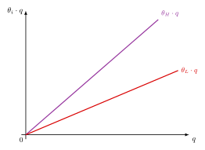{fig-alt="Gross valuation lines for the two consumer types: the high type's line is steeper than the low type's, both through the origin."}
:::

#### The monopolist

The monopolist can produce two versions of the good:

- An **original good** (top quality), $q = q_T$, produced at constant marginal cost
  $c_T \geq 0$.
- A **damaged good** (low quality), $q = q_B$ with $q_B < q_T$, produced at constant
  marginal cost $c_B$.

**Information structure.** Nature draws each consumer's type according to the prior
$(\lambda, 1-\lambda)$. The monopolist knows this distribution but *cannot* identify which
individual consumers are high value and which are low value.

This is the informational asymmetry that drives the entire analysis. The monopolist knows
that a proportion $\lambda$ of the market values quality highly, but cannot tell who they
are when a consumer walks through the door.

::: {.gametree}
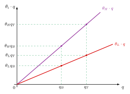{fig-alt="The two valuation lines with the damaged and original quality levels marked, showing each type's gross valuation of each good."}
:::

#### Assumptions

Two assumptions complete the model.

**Assumption 1: cost of damage.** The damaged good costs weakly more to produce than the
original:

$$
c_B \;\geq\; c_T
$$

This rules out any cost-saving motive for introducing the damaged good and establishes that
the *only* rationale for product degradation is informational. When the condition holds
strictly, so that $c_B > c_T$, the monopolist is spending real resources to make its
product *worse*. The additional expenditure $c_B - c_T$ might represent the engineering
cost of disabling features, testing the degraded version for stability, or manufacturing a
speed-limiting chip.

**Assumption 2: market coverage.** It is socially efficient to serve both types with the
original good:

$$
\theta_L \cdot q_T \;\geq\; c_T
$$

Taken together, the two assumptions imply that it is never efficient to serve the
low-valuation type with the damaged good. Damaged goods cost at least as much to produce,
and serving $L$-types with the original good is already efficient, so there is no
cost-saving or efficiency rationale for providing a degraded product.

Any degradation you observe in equilibrium is therefore driven entirely by the screening
motive, not by production economics.

#### Timing

The game proceeds in three stages:

- **Stage 1:** Nature draws each consumer's type.
- **Stage 2:** The monopolist posts a menu of quality–price pairs $\{(q_k, p_k)\}_{k}$.
- **Stage 3:** Each consumer observes the menu and selects the option, including
  non-purchase, that maximises utility.

Note that the monopolist commits to the full menu before any consumer chooses. It cannot
observe a consumer's choice and then adjust the terms.

### Benchmark: First-Best under Perfect Information

Before analysing what happens when types are hidden, it helps to establish a benchmark.
Suppose the monopolist can observe each consumer's type and offer personalised bundles.

#### Optimal quality

Under full information, the monopolist has no informational reason to distort quality. The
original good has quality $q_T > q_B$ and costs weakly less ($c_T \leq c_B$), so both types
should receive the original good.

Formally, for each type $i$:

$$
\theta_i \cdot q_T - c_T \;\geq\; \theta_i \cdot q_B - c_B \Rightarrow \underbrace{\theta_i(q_T - q_B)}_{>0} + \underbrace{(c_B - c_T)}_{\geq 0} > 0
$$

Both terms on the right are non-negative, and the first is strictly positive, so serving
either type with the original good always dominates serving them with the damaged good.

#### Optimal prices

The monopolist extracts the entire consumer surplus from each type by charging a price
equal to their maximum willingness to pay, $\theta_i \cdot q_T$:

$$
p_H^{*} = \theta_H \cdot q_T, \qquad p_L^{*} = \theta_L \cdot q_T
$$

Because types are observable, there is nothing to stop the monopolist charging each
consumer exactly what the good is worth to them. Each type is left with zero surplus.

#### First-best profit

Serving both types with the original good, the monopolist earns

$$
\pi^{FB} \;=\; \lambda\bigl(\theta_H \cdot q_T - c_T\bigr) \;+\; (1-\lambda)\bigl(\theta_L \cdot q_T - c_T\bigr)
$$

This is the maximum profit achievable in this market. Everything that follows will be
measured against it.

### The Screening Problem under Asymmetric Information

Now suppose the monopolist cannot observe types. It knows the distribution
$(\lambda, 1-\lambda)$ and the valuations $\theta_H$ and $\theta_L$, but when a consumer
walks through the door, the firm has no way to tell whether it is facing an $H$-type or an
$L$-type.

The natural starting point is to ask whether the first-best menu still works. It does not.

**The first attempt.** Suppose the monopolist offers the first-best menu unchanged:

$$
\{(q_T,\; \theta_H \cdot q_T),\; (q_T,\; \theta_L \cdot q_T)\}
$$

Both contracts offer the same quality $q_T$, and differ only in price: the $H$-type
contract charges more. Nothing prevents an $H$-type from picking the cheaper contract
instead.

**What an $H$-type gains by deviating.** If the $H$-type takes the contract intended for
her:

$$
U_H(q_T, \theta_H \cdot q_T) = \theta_H \cdot q_T - \theta_H \cdot q_T = 0.
$$

If she takes the $L$-type contract instead:

$$
U_H(q_T, \theta_L \cdot q_T) = \theta_H \cdot q_T - \theta_L \cdot q_T = (\theta_H - \theta_L)\cdot q_T > 0.
$$

Since $(\theta_H - \theta_L)\cdot q_T > 0$, every $H$-type strictly prefers the $L$-type's
contract.

**The menu unravels.** All consumers pool on the cheap contract, and the monopolist
collects only $\theta_L \cdot q_T$ per unit sold. This is precisely the low-price,
single-product outcome the menu was meant to improve on.

The root cause is simple. When both contracts offer the same quality, an $H$-type can
obtain the same good at a lower price by pretending to be an $L$-type. The firm has given
$H$-types no reason to self-select into the expensive contract. The first-best menu is
**not incentive compatible**.

#### The monopolist's response

To prevent mimicry, the monopolist designs two products and sells them at two different
prices:

- **Contract $H$**: quality $q_T$, the original good, at price $p_T$.
- **Contract $L$**: quality $q_B$, the damaged good, at price $p_B$.

The products are designed so that high-value consumers purchase the top-quality product at
a higher price, while low-value consumers purchase the base-quality product at a lower
price.

The monopolist maximises expected profit:

$$
\max_{q_B,\, p_T,\, p_B} \quad \pi \;=\; \lambda\bigl(p_T - c_T \bigr) \;+\; (1-\lambda)\bigl(p_B - c_B\bigr)
$$

subject to four constraints:

$$
\begin{aligned}
\theta_H \cdot q_T - p_T \;&\geq\; 0 &&\text{(IR-H)}\\[4pt]
\theta_L \cdot q_B - p_B \;&\geq\; 0 &&\text{(IR-L)}\\[4pt]
\theta_H \cdot q_T - p_T \;&\geq\; \theta_H \cdot q_B - p_B &&\text{(IC-H)}\\[4pt]
\theta_L \cdot q_B - p_B \;&\geq\; \theta_L \cdot q_T - p_T &&\text{(IC-L)}
\end{aligned}
$$

**Individual rationality.** The individual rationality constraints ensure that consumers
receive non-negative utility from the product designed for their type. Each consumer must
prefer participating to opting out. (IR-H) requires that the high type earns non-negative
utility from the top-quality contract; (IR-L) requires the same of the low type and the
base-quality contract. Without these, a consumer would simply walk away.

**Incentive compatibility.** The incentive compatibility constraints ensure that each
consumer *truthfully* selects the contract intended for their type rather than mimicking
the other type. (IC-H) ensures that high-value consumers prefer the top-quality product at
the high price over the base-quality product at the low price. (IC-L) ensures that
low-value consumers prefer the base-quality product at the low price over the top-quality
product at the high price. Without these, the uninformed monopolist faces the risk that
high-value consumers will pretend to be low-value in order to capture surplus, which is
exactly what happened to the first-best menu.

Together, individual rationality guarantees *voluntary participation* and incentive
compatibility guarantees *truthful self-selection*. These are the two pillars of any
screening problem, and you met them both in the competitive insurance model in the previous
chapter.

#### Which constraints bind?

We now apply the standard methodology from screening theory: identify which constraints
bind at the optimum, substitute, and reduce the dimensionality of the problem.

**Claim 1: (IR-L) binds at the optimum.** Suppose (IR-L) is slack:
$\theta_L \cdot q_B - p_B > 0$. Then the monopolist can raise $p_B$ by a small
$\varepsilon > 0$. This directly increases profit. It relaxes (IC-H) (raising $p_B$ makes
Bundle $B$ less attractive to the high type). It tightens (IC-L), but the constraint remains
satisfied for sufficiently small $\varepsilon$ since it was slack or binding. This
contradicts the optimality of the original menu.

**Claim 2: if (IC-H) and (IR-L) hold, then (IR-H) holds automatically.** The $H$-type's
participation constraint (IR-H) requires $\theta_H \cdot q_T - p_T \geq 0$, that is, the
$H$-type must earn non-negative utility from her intended contract. But this is guaranteed
whenever two other constraints hold.

(IC-H) says the $H$-type weakly prefers her own contract to the $L$-type's contract, so her
utility is at least as high as that she would get by deviating to the $L$-type contract:
$\theta_H \cdot q_T - p_T \geq \theta_H \cdot q_B - p_B$. And (IR-L) says the $L$-type
earns non-negative utility, which means $p_B \leq \theta_L \cdot q_B$.

Substituting this price bound into the (IC-H) inequality, the $H$-type's utility is at
least $\theta_H \cdot q_B - \theta_L \cdot q_B = (\theta_H - \theta_L)\cdot q_B$, which is
strictly positive since $\theta_H > \theta_L$ and $q_B > 0$.

In words: the $H$-type could always "pretend" to be an $L$-type and still earn positive
surplus (because she values quality more), so she certainly earns positive surplus from the
contract designed for her.

**Claim 3: (IC-H) binds at the optimum.** Suppose (IC-H) is slack. Then the monopolist can
raise $p_T$ by a small $\varepsilon > 0$, directly increasing profit. (IR-H) remains
satisfied by Claim 2 above. (IC-L) is relaxed (raising $p_T$ makes Bundle $T$ less
attractive to the low type). This contradicts optimality.

#### Solving for prices and profit

From the binding constraints, we express prices in terms of qualities. From (IR-L) binding:

$$
p_B \;=\; \theta_L \cdot q_B
$$

From (IC-H) binding:

$$
p_T \;=\; \theta_H \cdot q_T - (\theta_H - \theta_L)\cdot q_B
$$

Observe the structure of the high-type price: it equals the full-information price
$\theta_H \cdot q_T$ minus a *discount* of $(\theta_H - \theta_L)\cdot q_B$. This discount
is the **informational rent** that the high type extracts because the monopolist cannot
verify her type.

Note that the rent is *increasing* in $q_B$: a higher-quality damaged good makes mimicry
more tempting, so the high type must be compensated more.

Substituting these two expressions into the profit function, the monopolist's optimal profit
under screening is

$$
\pi^{S} \;=\; \lambda\bigl[\theta_H \cdot q_T - (\theta_H - \theta_L)\cdot q_B - c_T \bigr] \;+\; (1-\lambda)\bigl[\theta_L \cdot q_B - c_B\bigr]
$$

The problem is now a function of $q_B$ alone. Notice that $\pi^{S}$ is linear in $q_B$, with
slope

$$
\frac{\partial \pi^{S}}{\partial q_{B}} \;=\; -\lambda\bigl(\theta_{H} - \theta_{L}\bigr) + (1 - \lambda)\,\theta_{L}
$$

There is therefore no interior optimum. Depending on the sign of that slope, the monopolist
would push $q_B$ all the way down to zero or all the way up to $q_T$ — and those two corners
are precisely the exclusion and pooling outcomes analysed next. What makes screening a
distinct strategy in practice is that $q_B$ is fixed by technology: a chip either has its
floating-point unit disabled or it does not. The analysis that follows therefore treats
$q_B$ as given and asks whether offering the damaged good at all is profitable.

#### Three market regimes

Assuming the damaged good's quality $q_B$ is determined exogenously, the monopolist compares
the profit from three feasible strategies.

**Regime 1: separating menu.** The monopolist offers both contracts:

$$
\text{Contract } H: \bigl(q_T,\; p_T = \theta_H \cdot q_T - (\theta_H - \theta_L)\cdot q_B\bigr)
$$

$$
\text{Contract } L: \bigl(q_B,\; p_B = \theta_L \cdot q_B\bigr)
$$

yielding

$$
\pi^{S} = \lambda\bigl[\theta_H \cdot q_T - (\theta_H - \theta_L)\cdot q_B - c_T\bigr] + (1-\lambda)\bigl[\theta_L \cdot q_B - c_B\bigr]
$$

**Regime 2: exclusion of the low type.** Rather than designing a menu or cutting the price
to accommodate $L$-types, the monopolist can simply ignore them. It offers only the original
good $q_T$ and sets the price at the $H$-type's full willingness to pay:

$$
p = \theta_H \cdot q_T
$$

At this price, $H$-types earn zero surplus and buy the good. $L$-types cannot afford it,
since $\theta_L \cdot q_T - \theta_H \cdot q_T = (\theta_L - \theta_H)\cdot q_T < 0$ violates
their IR constraint, so they walk away. The monopolist therefore extracts the entire
$H$-type surplus but earns nothing from $L$-types:

$$
\pi^{Excl} = \lambda\bigl(\theta_H \cdot q_T - c_T\bigr)
$$

**Regime 3: pooling on the high-quality good.** Instead of offering a menu, the monopolist
sells only the original good $q_T$ at a single price. There are only two candidate prices,
$\theta_H \cdot q_T$ and $\theta_L \cdot q_T$, because any price between them still excludes
$L$-types without extracting the $H$-types' full surplus.

- At $\theta_H \cdot q_T$, only $H$-types buy and $L$-types are excluded. This is exactly
  Regime 2, so it is already covered.
- At $\theta_L \cdot q_T$, both types can afford the good. $L$-types earn zero surplus, as
  their IR constraint binds, and $H$-types earn positive surplus of
  $(\theta_H - \theta_L)\cdot q_T$. The monopolist sacrifices the ability to extract
  $H$-types fully, but in return serves the entire market.

The pooling regime therefore sets $p = \theta_L \cdot q_T$ and earns

$$
\pi^{Pool} = \theta_L \cdot q_T - c_T
$$

Notice that pooling profit is independent of $\lambda$. The monopolist earns the same margin
on every unit sold, and it sells to every consumer regardless of type. This makes pooling
attractive when $H$-types are rare: there is little to gain from charging a premium, so
sweeping the whole market at a low price dominates.

Exclusion profit, by contrast, rises linearly in $\lambda$. The more $H$-types in the
population, the more attractive this strategy becomes. Exclusion is optimal when $H$-types
are sufficiently numerous that the margin gained by charging them their full valuation
outweighs the revenue lost from abandoning the $L$-type segment entirely.

The monopolist selects whichever strategy yields the highest profit:

$$
\max\{\pi^{S},\; \pi^{Pool},\; \pi^{Excl}\}
$$

### When Is Introducing the Damaged Good Profitable?

The monopolist will only introduce the damaged good if screening beats both alternatives.
That requires two comparisons: screening against pooling, and screening against exclusion.

#### Separating versus pooling

The separating menu is optimal compared to pooling on both types if
$\pi^{S} \geq \pi^{Pool}$. After simplification, this requires

$$
\lambda \;\geq\; \frac{\theta_L(q_T - q_B) + c_B - c_T}{\theta_H(q_T - q_B) + c_B - c_T}
$$

The numerator is the *social cost* of degradation when serving an $L$-type: the value lost
from reduced quality, $\theta_L(q_T - q_B)$, plus the extra production cost, $c_B - c_T$.
The denominator is the analogous cost for an $H$-type, which is larger since
$\theta_H > \theta_L$.

Screening is optimal rather than pooling when the share of $H$-types is sufficiently large
that the gains from price discrimination outweigh the costs of quality distortion.

#### Separating versus exclusion

The separating menu is optimal compared to the exclusion menu when
$\pi^{S} \geq \pi^{Excl}$, which reduces to

$$
\lambda \;\leq\; \frac{\theta_L q_B - c_B}{\theta_H q_B - c_B}
$$

The numerator is the net surplus generated by serving an $L$-type with the damaged good:
the value $\theta_L q_B$ minus the production cost $c_B$. The denominator is the analogous
quantity for an $H$-type.

When the share of $H$-types exceeds this threshold, the gain from charging them full price
$\theta_H \cdot q_T$ under exclusion outweighs the benefit of serving $L$-types with the
damaged good. Screening dominates exclusion when there are sufficiently many $L$-types to
make the low-margin damaged-good sales worthwhile.

#### The screening window

Each comparison gives one bound on $\lambda$. Screening is more profitable than pooling when
the share of $H$-types is sufficiently large, and more profitable than exclusion when that
share is sufficiently small. Combining the two conditions identifies exactly when the
separating menu is optimal:

$$
\frac{\theta_L(q_T - q_B) + c_B - c_T}{\theta_H(q_T - q_B) + c_B - c_T} \;\leq\; \lambda \;\leq\; \frac{\theta_L q_B - c_B}{\theta_H q_B - c_B}
$$

The damaged good is therefore a middle-ground strategy. It is optimal only when the share of
high-value consumers is neither too small, in which case pooling is more profitable, nor too
large, in which case excluding low-value consumers is preferable.

::: {.gametree}
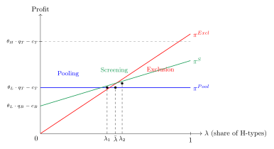{fig-alt="Profit from pooling, exclusion and screening plotted against the share of high types. Pooling is flat, exclusion rises steeply from the origin, and screening lies between them, optimal over an intermediate window."}
:::

::: {.answerbox}
**Proof of the screening window.** The proof runs in both directions, verifying that the
separating menu is optimal if and only if the two inequalities defining the screening window
hold, with $\lambda \in (0,1)$.

**Sufficiency.** Suppose both inequalities hold.

- The left inequality is equivalent to $\pi^{S} \geq \pi^{Pool}$, by the separating versus
  pooling condition.
- The right inequality is equivalent to $\pi^{S} \geq \pi^{Excl}$, by the separating versus
  exclusion condition.

Hence $\pi^{S} \geq \max\{\pi^{Pool}, \pi^{Excl}\}$, so the separating menu is optimal.

**Necessity.** Take the contrapositive: if either inequality fails, then screening is not
optimal.

- **Case 1.** Suppose
  $\lambda \leq \dfrac{\theta_L(q_T - q_B) + c_B - c_T}{\theta_H(q_T - q_B) + c_B - c_T}$.
  Rearranging and applying the separating versus pooling condition gives
  $\pi^{Pool} \geq \pi^{S}$. Pooling weakly dominates screening, contradicting the optimality
  of the separating menu.
- **Case 2.** Suppose $\lambda \geq \dfrac{\theta_L q_B - c_B}{\theta_H q_B - c_B}$.
  Rearranging and applying the separating versus exclusion condition gives
  $\pi^{Excl} \geq \pi^{S}$. Exclusion weakly dominates screening, again contradicting the
  optimality of the separating menu.

In either case, screening fails to be strictly optimal. Both inequalities must therefore
hold for the separating menu to be optimal, and both must hold strictly for it to be
uniquely optimal.
:::

#### The role of the damage cost

One parameter deserves particular attention: the cost of producing the damaged good.

::: {.infobox}
**Proposition 1 (impact of $c_B$)**

Higher damage cost $c_B$ makes the separating menu less attractive relative to both pooling
and exclusion. In the limit as $c_B \to \infty$, the damaged good is never offered.
:::

Reading the regime figure:

- **Pooling: flat in $\lambda$.** $\pi^{Pool} = \theta_L \cdot q_T - c_T$. Pooling serves
  everyone at the low-type price, so profit is independent of the type mix. This makes it
  attractive when $H$-types are rare.
- **Exclusion: rises linearly through the origin.**
  $\pi^{Excl} = \lambda(\theta_H \cdot q_T - c_T)$. The more $H$-types in the market, the
  higher the revenue from selling only to them at full price. At $\lambda = 0$ there are no
  $H$-types to sell to, so profit is zero.
- **Screening: rises, but less steeply.** Screening intercepts the vertical axis at
  $\theta_L \cdot q_B - c_B$, the stand-alone profit from selling the damaged good to
  $L$-types at $\lambda = 0$. It rises with slope
  $\theta_H(q_T - q_B) + c_B - c_T$, which is positive but smaller than the slope of
  $\pi^{Excl}$. Each additional $H$-type brings revenue $\theta_H \cdot q_T - c_T$, but also
  an information-rent cost of $(\theta_H - \theta_L)\cdot q_B$.
- **Two critical thresholds.** The three lines cross at $\lambda_1$ and $\lambda_2$,
  dividing the market into three regions: for $\lambda < \lambda_1$, pooling is optimal; for
  $\lambda_1 < \lambda < \lambda_2$, the screening menu outperforms both extremes; for
  $\lambda > \lambda_2$, exclusion becomes optimal. These are the same two bounds
  established above.

### Welfare Analysis

Screening solves the monopolist's problem, but at a cost to society. This section asks who
gains, who loses, and how much total surplus is destroyed along the way.

#### Consumer surplus

Under the separating menu, the two types fare very differently.

- **High type:** earns informational rent $U_H = (\theta_H - \theta_L)\cdot q_B > 0$, which
  is *increasing* in $q_B$.
- **Low type:** earns zero surplus, $U_L = 0$, because the participation constraint binds.

The high type captures a rent precisely because the monopolist cannot verify her type. The
low type, whose type is not worth mimicking, is left with nothing.

#### Deadweight loss

Compared to the first-best, two sources of inefficiency arise. The low type receives a
damaged good, $q_B < q_T$, even though producing the original is weakly cheaper. The
per-consumer welfare loss is

$$
\text{DWL} \;=\; \theta_L\,(q_T - q_B) \;+\; (c_B - c_T).
$$

::: {.gametree}
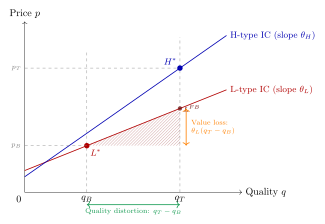{fig-alt="Quality-price space with the steeper high-type indifference curve and flatter low-type curve. The high type's contract sits at efficient quality; the low type's is distorted down to the damaged quality, with the welfare loss shaded."}
:::

Reading the figure:

- **No distortion at the top.** The $H$-type receives the efficient quality $q_T$ at
  contract $H^*$. This is the standard "no distortion at the top" result: the highest type
  always gets the allocation they would receive under full information. What the monopolist
  cannot do is charge the full-information price. The $H$-type keeps her informational rent.
- **Distortion at the bottom.** The $L$-type is offered a degraded product at quality
  $q_B < q_T$ at contract $L^*$, even though serving her at $q_T$ would be efficient. Point
  $L^{FB}$ marks that efficient contract on the same indifference curve. The monopolist
  distorts the $L$-type's quality downward to reduce the informational rent it must concede
  to $H$-types.
- **The deadweight loss.** The shaded triangle represents the welfare loss from degradation.
  The vertical distance $\theta_L(q_T - q_B)$ is the value the $L$-type gives up by
  consuming lower quality. An additional welfare loss, not shown on the graph, arises
  whenever $c_B > c_T$: the firm spends real resources to produce an inferior product.
- **Why separation is possible.** The $H$-type's indifference curve is steeper than the
  $L$-type's, reflecting her higher marginal valuation of quality, $\theta_H > \theta_L$.
  This single-crossing property is what makes separation possible. Because the two curves
  cross only once, a contract that is attractive to one type can be made unattractive to the
  other.

::: {.infobox}
**The paradox of costly degradation**

The monopolist spends real resources, $c_B - c_T \geq 0$, to make its product *worse*. This
is socially wasteful, since the same expenditure could improve the product or reduce prices.
Yet the monopolist's private incentive to screen is so powerful that it willingly incurs the
cost.

The damaged good *destroys* value in order to *appropriate* value. It is a rent-extraction
device disguised as a product.
:::

#### Policy implications

Should regulators prohibit firms from deliberately degrading products? The welfare calculus
is ambiguous.

On one hand, damaged goods create deadweight loss: real resources are spent making a product
worse, and the low type ends up consuming a quality below the efficient level.

On the other, a prohibition does not restore the first best. It simply deletes one option
from the monopolist's menu, leaving the two corners of the previous section, and which one
the firm jumps to decides the welfare verdict. If it pools at $\theta_L \cdot q_T$, every
consumer receives the efficient quality and total surplus *rises*. If instead it excludes,
trade with the low type disappears altogether and the surplus $\theta_L \cdot q_B - c_B$ is
destroyed.

It is worth being careful about who gains and loses here, because the intuitive answer is
wrong. Since (IR-L) binds in every regime, the low type earns *zero* surplus whether they buy
the damaged good or walk away: the entire gain from trading with them is captured by the
firm. So a prohibition that triggers exclusion does not harm the low type in utility terms at
all — it leaves them exactly as they were. The parties it makes worse off are the monopolist,
which loses the option it would have preferred, and the *high* type, who is now charged
$\theta_H \cdot q_T$ and surrenders the informational rent $(\theta_H - \theta_L)\cdot q_B$
that the damaged good had conferred.

The outcome is therefore Pareto-inferior, but not for the reason one might expect, and not at
the expense of the consumer the policy was meant to protect. The optimal policy depends on
specific market parameters, on which corner the monopolist retreats to, and on the
regulator's own informational constraints.

#### Rent extraction versus market coverage

The fundamental tension in the model is between *rent extraction* and *market coverage*.

The monopolist's inability to distinguish types generates an informational externality:
every unit of quality conferred on the low type creates a claim by the high type to a price
discount of $\theta_H - \theta_L$ per unit.

Degrading the low-type product is a rational attempt to minimise this externality, at the
cost of social efficiency.

### Comparing Monopoly and Competition

The damaged-goods model of monopolistic screening shares deep structural similarities with
the competitive insurance market analysed in the previous chapter, yet the two settings
generate strikingly different equilibrium outcomes. Comparing them illuminates how market
structure shapes the nature of informational distortions.

#### Common structure

Both problems feature an uninformed principal, the seller or insurer, facing agents, the
buyers or insureds, who hold private information about a payoff-relevant characteristic. In
both cases the principal designs a menu of contracts, and equilibrium requires:

- **Incentive compatibility**, so that each type self-selects.
- **Individual rationality**, so that each type participates voluntarily.

The single-crossing condition, under which higher types value quality or coverage more at the
margin, enables separation in both environments.

#### Who bears the distortion?

Superficially the two settings look alike: in each, the low type's allocation is distorted
downward, while the type whose incentive constraint binds receives an undistorted allocation
— the familiar "no distortion at the top" result. The resemblance is misleading. The low type
occupies opposite economic positions in the two markets, and the distortion serves opposite
purposes.

- In **competitive insurance**, the low type is the low-risk consumer, who could be fully
  insured at an actuarially fair premium. The high-risk type's incentive constraint binds,
  and the zero-profit condition precludes any cross-subsidy capable of sustaining the
  low-risk contract once it is mimicked. Coverage must therefore be withdrawn until the
  high-risk type is indifferent. The distortion is imposed on insurers by competition: a
  constraint, not a choice.
- In **monopolistic screening**, the low type is the low-valuation consumer, from whom the
  firm earns little and to whom quality is expensive to supply — each unit conceded raises
  the high type's informational rent by $\theta_H - \theta_L$. Here (IC-H) binds, and the
  monopolist degrades $q_B$ precisely to suppress that rent. Profit being linear in $q_B$, no
  interior optimum exists. The distortion is chosen, and chosen in order to extract surplus.

Note that the same consumer does the mimicking in both markets: the one who values coverage
or quality more at the margin, exactly as single crossing implies. The difference is what the
principal stands to lose if that consumer succeeds — an insurer would be writing a policy
that cannot break even, whereas a monopolist would be surrendering a premium it is otherwise
able to charge. One distortion averts a loss the market cannot fund; the other protects a
rent.

#### Why the distortion arises

The economic logic differs fundamentally between the two settings.

- **Competitive insurance:** Distortion arises from *cross-subsidisation constraints*. If
  low-risk types received full coverage at an actuarially fair premium, high-risk types would
  mimic them, causing losses. With zero profits required on each contract, insurers cannot
  compensate by overcharging high-risk types. The low-risk contract must therefore be
  distorted to break the mimicry incentive.
- **Monopolistic screening:** Distortion arises from *rent extraction*. The monopolist
  *could* serve all consumers efficiently, but doing so would require pooling at a low price.
  By degrading the low-type product, the monopolist makes the high-type contract relatively
  more attractive and can charge a premium. The distortion is a deliberate choice to enhance
  price discrimination, not a competitive necessity.

#### Welfare implications

Under competition, zero profits make consumers the residual claimants: the entire welfare
loss falls on low-risk consumers, as under-insurance.

Under monopoly the incidence is reversed. Measured against full information, where both types
receive $q_T$:

- The **low type** is unaffected: (IR-L) binds in both regimes, so their surplus is zero in
  each.
- The **high type** strictly gains the rent $(\theta_H - \theta_L)\cdot q_B$ — a transfer,
  not a loss.
- The **monopolist** bears everything: that rent, plus the social cost of degradation
  $\theta_L(q_T - q_B) + c_B - c_T$ per low type served.

The loss is therefore not shared: competition places the cost of private information on an
informed party, monopoly on the uninformed one.

The monopolist may also *choose* to exclude low types entirely, an option unavailable to
competitive insurers, who cannot coordinate on market exit.

### Worked Example: Screening with a Damaged Chip

This example applies the full screening framework to the Intel 486SX processor.

::: {.exercisebox}
**Setup**

A monopolist produces processors. It has two versions:

- **Original** (quality $q_H = 2$): the full-featured chip, marginal cost $c = 0$.
- **Damaged** (quality $q_L = 1$): the chip with the FPU disabled, marginal cost
  $c_D = 1$. The disabling step costs more than producing the original.

There are two consumer types:

| Type | Proportion | Valuation per unit quality | Utility from $(q,p)$ |
|---|---|---|---|
| High ($H$) | $\lambda = 0.4$ | $\theta_H = 4$ | $4q - p$ |
| Low ($L$) | $1-\lambda = 0.6$ | $\theta_L = 2$ | $2q - p$ |

Types are private information. The outside option gives zero utility.
:::

#### The first-best benchmark

Since the monopolist can verify each consumer's type, it offers two separate contracts, one
for each type, and sets prices equal to the consumer's maximum willingness to pay. Each type
earns zero surplus.

**Optimal quality.** Both types receive the original good $q_H = 2$. Serving either type
with the damaged good would be inefficient, since the original costs less
($c = 0 < c_D = 1$) and delivers higher quality ($q_H > q_L$). The damaged good has zero
value under full information.

**Optimal prices.** The monopolist extracts the full surplus from each type:

$$
p_H^{FB} = \theta_H \cdot q_H = 4 \times 2 = 8, \qquad p_L^{FB} = \theta_L \cdot q_H = 2 \times 2 = 4.
$$

**First-best profit:**

$$
\pi^{FB} = \underbrace{\lambda\,(p_H^{FB} - c)}_{\text{profit from } H\text{-types}} + \underbrace{(1-\lambda)\,(p_L^{FB} - c)}_{\text{profit from } L\text{-types}} = 0.4 \times 8 + 0.6 \times 4 = 3.2 + 2.4 = 5.6
$$

All consumer surplus is extracted. This is the **efficiency frontier**: the monopolist
captures the full social surplus.

#### Why the menu unravels

Suppose the monopolist offers the first-best menu $\{(q_H, 8),\; (q_H, 4)\}$ when types are
unobservable. Both contracts offer the *same* quality $q_H = 2$; they differ only in price.

An $H$-type consumer compares:

- **$H$-type contract** $(q_H = 2, p = 8)$: utility $= 4 \times 2 - 8 = 0$.
- **$L$-type contract** $(q_H = 2, p = 4)$: utility $= 4 \times 2 - 4 = 4 > 0$.

Every $H$-type strictly prefers the $L$-type contract. Since both products are identical in
quality, an $H$-type has nothing to lose by pretending to be an $L$-type: she gets the same
chip at half the price. The incentive compatibility constraint for $H$-types is
**violated**.

The menu unravels. All consumers, $H$ and $L$ alike, purchase the $L$-type contract at price
$p = 4$. The monopolist earns $4$ per unit instead of $5.6$.

**Root cause.** Mimicry is costless when both contracts offer the same quality. To prevent
$H$-types from defecting, the firm must make the cheap contract *unattractive* to them, not
just in price but in the underlying product. This is the rationale for the damaged good.

#### Designing the screening menu

The monopolist now offers two distinct products: the original $q_H = 2$ and the damaged good
$q_L = 1$. The design variables are $(p_H, p_L)$, since quality levels are given.

**Step 1: identify the binding constraints**

- **(IR-L) binds:** the $L$-type earns zero surplus.
- **(IC-H) binds:** the $H$-type is exactly indifferent between the two contracts.
- **(IR-H) is slack:** the $H$-type earns a positive informational rent.
- **(IC-L) is slack:** the $L$-type strictly prefers the damaged good.

**Step 2: recover prices from the binding constraints**

From (IR-L) binding:

$$
\theta_L \cdot q_L - p_L = 0 \quad\Longrightarrow\quad p_L = 2 \times 1 = 2
$$

From (IC-H) binding:

$$
p_H = \theta_H q_H - (\theta_H - \theta_L) q_L = 8 - (4-2)\times 1 = 6
$$

**The screening menu:**

| Contract | Quality | Price | Cost | Margin | Consumer surplus |
|---|---|---|---|---|---|
| $H$-type | $q_H = 2$ | $p_H = 6$ | $c = 0$ | $6$ | $U_H = 2$ (rent) |
| $L$-type | $q_L = 1$ | $p_L = 2$ | $c_D = 1$ | $1$ | $U_L = 0$ |

**Screening profit:**

$$
\pi^S = \lambda(p_H - c) + (1-\lambda)(p_L - c_D) = 0.4 \times 6 + 0.6 \times 1 = 2.4 + 0.6 = 3.0
$$

The $2.6$ gap relative to the first-best has two components: the informational rent given to
$H$-types ($0.4 \times 2 = 0.8$), and the loss from serving $L$-types with a low-quality,
costly product instead of the efficient good.

#### Comparing the three strategies

**Strategy 1: separating menu.** As derived above,

$$
\pi^S = 0.4 \times 6 + 0.6 \times 1 = 3.0
$$

**Strategy 2: pooling on the original good.** Set $p = \theta_L \cdot q_H = 4$, so both types
purchase the original chip:

$$
\pi^{Pool} = p - c = 4 - 0 = 4.0
$$

$H$-types earn surplus $(\theta_H - \theta_L)\cdot q_H = 4$, which the monopolist does not
extract. It serves the whole market cheaply instead of screening.

**Strategy 3: exclusion of $L$-types.** Set $p = \theta_H \cdot q_H = 8$, so only $H$-types
purchase:

$$
\pi^{Excl} = \lambda(\theta_H \cdot q_H - c) = 0.4 \times 8 = 3.2
$$

$L$-types are priced out. The monopolist captures the full $H$-type surplus but abandons the
$L$-type market.

| Strategy | Profit | $H$-type CS | $L$-type served? |
|---|---|---|---|
| Screening | $3.0$ | $2$ | Yes (damaged good) |
| Pooling | $4.0$ | $4$ | Yes (original) |
| Exclusion | $3.2$ | $0$ | No |
| **First-best** | **5.6** | $0$ | Yes (original) |

$$
\max\{3.0,\; 4.0,\; 3.2\} = 4.0 \quad\Longrightarrow\quad \textbf{pooling dominates at } \lambda = 0.4.
$$

**Why does pooling win here?** With only 40% $H$-types, the gain from price-discriminating
the $H$-segment is limited. The price premium from screening ($p_H = 6$ against pooling's
$p = 4$) applies to just 40% of consumers, netting $0.4 \times 2 = 0.8$ in extra revenue.
But the monopolist must also sell a costly damaged good to $L$-types at a thin margin of
$p_L - c_D = 1$, and it concedes an informational rent of $0.8$. Pooling at $p = 4$ is
simpler and more profitable.

#### How the answer changes with the type mix

The three profit lines as functions of $\lambda$:

$$
\pi^S(\lambda) = 6\lambda + 1(1-\lambda) = 5\lambda + 1, \qquad \pi^{Pool} = 4, \qquad \pi^{Excl}(\lambda) = 8\lambda.
$$

The crossover points are:

- Pooling against exclusion: $4 = 8\lambda \Rightarrow \lambda = 0.5$.
- Screening against pooling: $5\lambda + 1 = 4 \Rightarrow \lambda = 0.6$.
- Screening against exclusion: $5\lambda + 1 = 8\lambda \Rightarrow \lambda = 1/3 \approx 0.33$.

For $\lambda < 0.5$, pooling beats exclusion. For $\lambda > 0.5$, exclusion beats pooling.
At no value of $\lambda$ does screening simultaneously beat both alternatives.

This is not a coincidence. With $c_D > c$, the damaged good is genuinely costly to produce,
so the revenue from the $L$-segment under screening ($p_L - c_D = 1$) is low. The damaged
goods strategy is optimal when the damage cost premium $c_D - c$ is small relative to the
informational rent it saves. That condition holds in some real markets, such as software
where disabling features costs almost nothing, but not in hardware markets where physical
degradation is expensive.

#### Measuring the welfare cost

Even though pooling dominates in this example, it is instructive to analyse the welfare costs
of the screening menu. These represent the *full cost* the economy would bear if the firm
chose to introduce the damaged good.

**Total social surplus under screening:**

$$
\begin{aligned}
W^S &= \underbrace{\lambda\,(\theta_H \cdot q_H - c)}_{H\text{-type surplus net of cost}} + \underbrace{(1-\lambda)\,(\theta_L \cdot q_L - c_D)}_{L\text{-type surplus net of cost}} \\
&= 0.4 \times (8 - 0) + 0.6 \times (2 - 1) = 3.2 + 0.6 = 3.8
\end{aligned}
$$

**Total social surplus under the first-best:**

$$
W^{FB} = 0.4 \times (8 - 0) + 0.6 \times (4 - 0) = 3.2 + 2.4 = 5.6
$$

**Deadweight loss:**

$$
\text{DWL} = W^{FB} - W^S = 5.6 - 3.8 = 1.8
$$

Two sources of deadweight loss:

- **Consumer value destroyed by quality degradation.** An $L$-type consumes $q_L = 1$
  instead of the efficient $q_H = 2$, so the lost consumption value is
  $\theta_L \cdot (q_H - q_L) = 2$ per $L$-type consumer.
- **Resource waste from costly degradation.** The damaged good costs $c_D = 1$ to produce,
  while the original costs $c = 0$, so the additional production cost is $1$ per $L$-type
  consumer.

Total deadweight loss per $L$-type consumer is $2 + 1 = 3$, and total DWL is
$(1-\lambda) \times 3 = 0.6 \times 3 = 1.8$. ✓

**Distribution of surplus:**

| Agent | Under screening | Under first-best |
|---|---|---|
| $H$-type consumers (total) | $0.8$ | $0$ |
| $L$-type consumers (total) | $0$ | $0$ |
| Monopolist | $3.0$ | $5.6$ |
| **Total welfare** | **3.8** | **5.6** |

::: {.infobox}
**The paradox of costly degradation, in numbers**

The monopolist spends $c_D - c = 1$ per unit to make the chip *worse*. This expenditure:

- Generates *zero* consumer value, since the $L$-type would prefer the original.
- Enables the monopolist to charge $p_H = 6$ instead of $4$, recovering $0.8$ from
  $H$-types through the reduced informational rent.
- Costs $(1-\lambda) \times (c_D - c) = 0.6$ in production expenses.

From society's perspective, the monopolist spends $0.6$ in real resources to appropriate
$0.8$ from consumers, destroying $1.8$ in total welfare along the way.
:::

### Quick Check-In {.unnumbered}

Test your understanding of the screening material before moving on.

:::: {.quiz data-answer="C"}
**Question 1.** The damaged goods model assumes $c_B \geq c_T$. What is the purpose of this assumption?

(A) It ensures the damaged good is cheaper to supply, so degradation raises profit mechanically.
(B) It guarantees that the low type's participation constraint binds at the optimum.
(C) It rules out any cost-saving motive, so the only rationale for degradation is informational.
(D) It ensures the single-crossing condition holds, which makes separation feasible.

::: {.feedback data-option="A"}
**Try again.** The inequality runs the other way: the damaged good costs *weakly more* to produce. Assumption 1 deliberately removes any cost advantage from degradation.
:::

::: {.feedback data-option="B"}
**Try again.** (IR-L) binds because the monopolist would otherwise raise $p_B$ and increase profit. That argument does not rely on the relative costs of the two versions.
:::

::: {.feedback data-option="C"}
**Well done.** With $c_B \geq c_T$ the firm gains nothing on the production side by degrading its product. Any degradation observed in equilibrium must therefore be driven purely by the screening motive, which is exactly what makes the Intel 486SX and Adobe Acrobat cases instructive.
:::

::: {.feedback data-option="D"}
**Try again.** Single crossing follows from $\theta_H > \theta_L$ in the utility specification $U_i(q,p) = \theta_i q - p$, not from the cost assumption.
:::

::::

:::: {.quiz data-answer="B"}
**Question 2.** Under the optimal separating menu, $p_T = \theta_H q_T - (\theta_H - \theta_L)q_B$. What happens to the high type's informational rent as $q_B$ rises?

(A) The rent falls, because a better base product makes the top product less attractive.
(B) The rent rises, because mimicry becomes more attractive and the high type must be compensated more.
(C) The rent is unaffected, because (IC-H) binds regardless of $q_B$.
(D) The rent rises only if $c_B > c_T$.

::: {.feedback data-option="A"}
**Try again.** The direction is reversed. Raising $q_B$ makes mimicking the low type *more* tempting for the high type, so the rent must rise.
:::

::: {.feedback data-option="B"}
**Well done.** The rent is

$$
U_H = (\theta_H - \theta_L) q_B,
$$

which is increasing in $q_B$. A higher-quality damaged good is a more attractive deviation for the high type, so the monopolist must concede a larger discount to keep (IC-H) satisfied. This is precisely why the firm degrades the low-type product: distortion at the bottom buys back rent at the top.
:::

::: {.feedback data-option="C"}
**Try again.** (IC-H) binds at any $q_B$, but the *size* of the rent it concedes depends on $q_B$.
:::

::: {.feedback data-option="D"}
**Try again.** The rent $(\theta_H - \theta_L)q_B$ depends on valuations and quality alone. Costs affect the profitability of screening, not the size of the rent.
:::

::::

:::: {.quiz data-answer="B"}
**Question 3.** A monopolist faces $\theta_H = 4$, $\theta_L = 2$, $q_T = 2$, $q_B = 1$ and $c_B = 1$. Under the optimal separating menu, what price is charged for the top-quality good?

(A) $p_T = 4$.
(B) $p_T = 6$.
(C) $p_T = 8$.
(D) $p_T = 7$.

::: {.feedback data-option="A"}
**Try again.** This is the pooling price $\theta_L q_T$, at which both types buy the original good. It is not the top-quality price under a separating menu.
:::

::: {.feedback data-option="B"}
**Well done.** From (IR-L) binding, $p_B = \theta_L q_B = 2$. From (IC-H) binding,

$$
\theta_H q_T - p_T = \theta_H q_B - p_B \;\Longrightarrow\; 8 - p_T = 4 - 2,
$$

so $p_T = 6$. Equivalently,

$$
p_T = \theta_H q_T - (\theta_H - \theta_L)q_B = 8 - 2 = 6,
$$

leaving the high type an informational rent of $2$.
:::

::: {.feedback data-option="C"}
**Try again.** This is the full-information price $\theta_H q_T$. Charging it violates (IC-H): the high type would switch to the damaged good and earn a surplus of $2$.
:::

::: {.feedback data-option="D"}
**Try again.** Recover prices from the two binding constraints, (IR-L) and (IC-H), rather than splitting the difference between the pooling and full-extraction prices.
:::

::::

:::: {.quiz data-answer="A"}
**Question 4.** Why is the separating menu described as a ``middle-ground'' strategy in $\lambda$?

(A) Pooling dominates when $\lambda$ is small and exclusion dominates when $\lambda$ is large.
(B) Screening profit is independent of $\lambda$, so it is never the best or the worst option.
(C) Exclusion dominates when $\lambda$ is small and pooling dominates when $\lambda$ is large.
(D) The damaged good is optimal only when $c_B = c_T$ exactly.

::: {.feedback data-option="A"}
**Well done.** Pooling profit $\pi^{Pool} = \theta_L q_T - c_T$ is flat in $\lambda$, so sweeping the whole market at a low price wins when high types are rare. Exclusion profit $\pi^{Excl} = \lambda(\theta_H q_T - c_T)$ rises steeply in $\lambda$, so abandoning low types wins when high types are numerous. Screening is optimal only in the intermediate band

$$
\frac{\theta_L(q_T - q_B) + c_B - c_T}{\theta_H(q_T - q_B) + c_B - c_T} \;\leq\; \lambda \;\leq\; \frac{\theta_L q_B - c_B}{\theta_H q_B - c_B}.
$$
:::

::: {.feedback data-option="B"}
**Try again.** Screening profit rises in $\lambda$ with slope $\theta_H(q_T - q_B) + c_B - c_T$. It is *pooling* profit that is flat in $\lambda$.
:::

::: {.feedback data-option="C"}
**Try again.** This reverses the two regimes. At $\lambda = 0$ there are no high types to sell to, so exclusion yields zero profit.
:::

::: {.feedback data-option="D"}
**Try again.** A higher $c_B$ narrows the screening window, since $\partial \pi^{S}/\partial c_B = -(1-\lambda) < 0$, but the middle-ground result is driven by the type mix $\lambda$, not by an exact cost equality.
:::

::::

:::: {.quiz data-answer="B"}
**Question 5.** Both the competitive insurance model of Week 9 and the monopolistic screening model distort the low type's allocation. What distinguishes the source of the distortion?

(A) Under competition the distortion reflects rent extraction; under monopoly it reflects a zero-profit constraint.
(B) Under competition the distortion is required by cross-subsidisation constraints; under monopoly it is a deliberate choice to sharpen price discrimination.
(C) Only the monopoly model features incentive compatibility constraints.
(D) The distorted party is the good type to trade with in both settings.

::: {.feedback data-option="A"}
**Try again.** These are the wrong way round. Zero profit is the competitive feature; rent extraction is the monopoly feature.
:::

::: {.feedback data-option="B"}
**Well done.** Competitive insurers earn zero profit on each contract, so they cannot overcharge high risks to fund efficient low-risk coverage; distorting the low-risk contract is a competitive necessity. The monopolist, by contrast, could serve everyone efficiently by pooling at a low price, but chooses to degrade the low-type product in order to charge high types a premium.
:::

::: {.feedback data-option="C"}
**Try again.** Both models require (IC) and (IR), and single crossing enables separation in both settings.
:::

::: {.feedback data-option="D"}
**Try again.** The economic identities are inverted: in insurance the distorted low type is the *desirable* low-risk customer, whereas in monopolistic screening the distorted low type is the low-valuation, low-margin customer.
:::

::::

## Cheap Talk

### The Puzzle of Costless Communication

Strategic communication raises a fundamental question: when can words alone convey credible
information? Suppose the CEO of a research-intensive firm tells prospective investors, "We are
on the verge of a major scientific breakthrough." The statement costs nothing to make, and
there is nothing for the investors to check: the research is proprietary, and whether a
programme is about to succeed is a judgement about something that has not happened yet, not a
fact that can be looked up. The CEO would like to raise more than the investors would
willingly provide, but would also rather not be funded for a project that then fails in plain
view. Should the investors revise their assessment of the firm's prospects on the strength of
the announcement?

In the economics literature, this type of problem is known as **cheap talk**: communication
where the sender can say anything at no cost, cannot be held to her words, and the receiver
cannot verify the claim. Since there is no cost to lying and no way to verify the truth, why
would the receiver believe anything the sender says?

#### Cheap talk against costly signalling

Cheap talk stands in sharp contrast to **costly signalling**, where credibility is established
through differential costs. In Spence's (1973) job market signalling model, education is
credible because it is more costly for low-ability workers to obtain than for high-ability
workers. The cost difference allows separation: only high types find it worthwhile to incur
the signal cost.

Cheap talk lacks this mechanism. Since messages are free, no sender type faces a higher cost
of misrepresenting their type than any other type.

#### The theoretical question

The contrast raises a question: *can costless messages ever be informative in equilibrium,
given that senders face no penalty for lying?*

You might conjecture that the answer is no. If sending any message is free, a strategic sender
will say whatever maximises her payoff. The receiver, anticipating this, should ignore all
messages. Yet, as this section shows, there can be room for informative communication in such
settings.

#### The resolution

The resolution, established in the foundational paper of **Crawford and Sobel (1982)**, is
precise: **cheap talk can be informative, but only partially, and only when the sender's and
receiver's preferences are sufficiently aligned**.

When interests diverge sharply, all equilibria involve uninformative "babbling", in which the
sender randomises over messages and the receiver ignores them. When interests are more closely
aligned, equilibria exist in which messages partition the state space into intervals, allowing
the receiver to learn which interval contains the true state. The finer the alignment of
interests, the finer the partition and the more informative the communication.

::: {.infobox}
**Real-world applications of cheap talk**

Costless communication is not a theoretical curiosity. Below are three settings in which
unverifiable, non-binding statements are nonetheless treated as informative.

- **Central bank forward guidance**: Rate announcements are non-binding on future
  policymakers, yet markets respond to them, because the bank's interests broadly align with
  the public's.
- **Expert advice**: A financial adviser's recommendation is costless to make and
  unenforceable. It is partially credible because the adviser's reputation is at stake.
- **Earnings guidance**: Firms voluntarily provide earnings forecasts with no legal accuracy
  obligation. Investors treat them as informative because management has reputational skin in
  the game.
:::

### Crawford–Sobel Model: Players, Information, and Preferences

The Crawford–Sobel model formalises the cheap-talk environment described above. It has four
components: the state of the world, the players and the order in which they move, the message
technology, and the preferences that govern how each player ranks outcomes.

#### The state of the world

The fundamental uncertainty in the model is captured by a random variable
$\theta \sim U[0,1]$, drawn by nature at the start of the game. This state represents whatever
is privately known to the expert: the economy's true underlying condition, a project's genuine
quality, or the actual inflation risk.

The prior distribution is common knowledge, but the realised value of $\theta$ is observed
only by the sender.

#### Players and timing

The game proceeds in three stages:

- Nature draws $\theta \sim U[0,1]$.
- **Sender (S)** privately observes the realisation of $\theta$, then sends a message $m$ to
  the receiver.
- **Receiver (R)** observes $m$ but not $\theta$, then takes an action $a \in \mathbb{R}$.

The action might be a policy decision, an investment choice, or a regulatory response.

#### Messages

After observing $\theta$, the sender sends any message $m$ from some rich message space $M$.
There is no cost to sending any message and no mechanism to verify claims. This is the
defining feature of cheap talk: the message technology imposes no constraint on deception.

#### Preferences

Strategic cheap talk is analysed here in a stylised example, in which each player's
preferences are described by quadratic loss utility functions:

$$
U^R(a, \theta) = -(a - \theta)^2, \qquad U^S(a, \theta) = -\bigl(a - (\theta + b)\bigr)^2
$$

If the action differs from a player's ideal, that player suffers a loss equal to the squared
distance between the action and her ideal.

- The **receiver's bliss point** is $a^R = \theta$. She wants to match the action to the true
  state exactly.
- The **sender's bliss point** is $a^S = \theta + b$. She always wants the action to be
  *higher* by $b$ than what the receiver would choose.
- $b \geq 0$ is the **bias**, the fixed gap between their ideal points. This single parameter
  determines everything about whether communication is possible.

**Interpreting the bias $b$.** Picture the type space $[0,1]$ as a ruler. At every point
$\theta$, the receiver wants the action set at $\theta$ and the sender wants it set at
$\theta + b$. They always disagree by exactly $b$, regardless of the state.

- **$b = 0$**: Perfect alignment. No conflict. Full information revelation is possible, since
  each type can credibly send a distinct message and no type gains from misreporting.
- **Small $b > 0$**: Mild conflict. Some communication is possible, but only at a coarse level.
- **Large $b$**: Severe conflict. Very little can be credibly communicated.
- For some values of $b$, communication breaks down completely.

**Example.** A patient (R) wants treatment intensity $a = \theta$ matching their condition.
The doctor (S) knows $\theta$ but slightly prefers more aggressive treatment, so that $b > 0$,
perhaps because she is paid per procedure. The doctor cannot credibly transmit the precise
severity; she may only be able to credibly communicate that the condition is "mild" or
"severe".

#### Equilibrium concept

This is a signalling game, so we analyse it using the concept of a **Perfect Bayesian
Equilibrium (PBE)**, introduced in the previous chapter. An equilibrium consists of three
objects:

- A **sender strategy** $\sigma: [0,1] \to \Delta(M)$, a rule that assigns to each type
  $\theta$ a possibly mixed message. Here $\Delta(M)$ denotes the set of probability
  distributions over the message space $M$. A *pure* strategy sends a single deterministic
  message for each $\theta$; a *mixed* strategy randomises over messages.
- A **receiver strategy** $\rho: M \to \mathbb{R}$, a choice of action for each possible
  message the receiver might observe.
- **Posterior beliefs** $\mu(\theta \mid m)$, formed by the receiver according to Bayes' rule
  wherever applicable.

**Receiver optimality.** Given beliefs $\mu(\theta \mid m)$, the receiver chooses $a$ to
minimise expected squared loss:

$$
\min_a \; \mathbb{E}\bigl[(a - \theta)^2 \mid m\bigr] = \min_a \; \mathbb{E}\bigl[a^2 - 2a\theta + \theta^2 \mid m\bigr]
$$

Taking the first-order condition with respect to $a$:

$$
\frac{\partial}{\partial a}\mathbb{E}\bigl[a^2 - 2a\theta + \theta^2 \mid m\bigr] = 2a - 2\mathbb{E}[\theta \mid m] = 0 \implies \rho(m) = \mathbb{E}[\theta \mid m]
$$

The receiver's optimal action is the **posterior mean** of $\theta$ given the message
observed.

**Sender optimality.** A sender of type $\theta$ anticipates that message $m$ induces action
$\rho(m)$, so she chooses $m$ to maximise

$$
U^S(\rho(m), \theta) = -\bigl(\rho(m) - (\theta + b)\bigr)^2
$$

This is maximised when $\rho(m)$ is as close as possible to the sender's bliss point
$\theta + b$. The sender therefore picks the message whose induced action minimises the
distance $|\rho(m) - (\theta + b)|$.

**Belief consistency.** On the equilibrium path, beliefs $\mu(\theta \mid m)$ must be derived
from Bayes' rule using the sender's strategy $\sigma(\theta)$:

$$
\mu(\theta \mid m) = \frac{\sigma_\theta(m) \cdot f(\theta)}{\sum_{\theta'} \sigma_{\theta'}(m) \cdot f(\theta')}
$$

where $f(\theta)$ is the prior distribution.

Off the equilibrium path, for messages that are never sent in equilibrium, Bayes' rule has
nothing to work with: the denominator above is zero. The PBE concept therefore leaves the
receiver's *belief* after such a message free. It does not leave her *behaviour* free.
Whatever belief she holds, the action she takes must be optimal given that belief, at every
message, on the path or off it.

::: {.infobox}
**Is this really a Perfect Bayesian Equilibrium?**

Two requirements are easily conflated here.

- **Optimality is imposed everywhere.** The receiver must best respond after *every* message,
  including messages no type ever sends. This is a genuine restriction, and it is imposed
  here. It rules out an equilibrium propped up by a threat such as "say anything other than
  $m_0$ and I will set $a = 10$", because $a = 10$ is not a best response to any belief about
  a state lying in $[0,1]$. Off-path actions must be optimal against *some* belief; it is only
  the choice among such beliefs that is free.
- **Subgame perfection does not do this work.** A subgame must begin at a singleton
  information set. The receiver never observes $\theta$, so her information sets are not
  singletons and this game has no proper subgames at all. Every Nash equilibrium of it is
  therefore subgame perfect, babbling included. The work is done instead by sequential
  rationality at each information set, which is what PBE adds.
- **A note on terminology.** Because the only requirement placed on off-path beliefs is that
  *some* belief be specified, with no further consistency restriction linking it to the
  equilibrium strategies, the concept used here is what several textbooks call *weak* Perfect
  Bayesian equilibrium. It is the standard concept for signalling and cheap talk games, and it
  is what "PBE" means throughout this chapter. Stronger notions, such as sequential
  equilibrium, restrict off-path beliefs further.
- **Refinements bite differently here.** In a costly signalling game, off-path beliefs can be
  disciplined by asking which type could conceivably gain from the deviation, which is how the
  Intuitive Criterion selects the least-cost separating outcome. That argument has no purchase
  in cheap talk: messages are free, so no type finds a given message more expensive than any
  other, and the criterion eliminates nothing. Refinements for cheap talk, such as Farrell's
  (1993) neologism-proofness, instead ask whether a deviating message could be given a meaning
  that a self-selected set of types would want to claim.
:::

### The Babbling Equilibrium

Before identifying when communication works, an uncomfortable fact has to be confronted: there
always exists an equilibrium in which cheap talk conveys absolutely no information.

::: {.highlightbox}
**Proposition (the babbling equilibrium)**

The babbling equilibrium arises as a PBE in which:

- **Sender**: Plays the same message $m_0$ regardless of type, so that $\sigma(\theta) = m_0$
  for all $\theta$.
- **Receiver**: Ignores the message and acts on the prior, so that
  $\rho(m) = \mathbb{E}[\theta] = \tfrac{1}{2}$ for all $m$.
:::

The equilibrium is verified by mutual best response in two steps.

**The receiver's perspective.** The receiver observes a message $m$, but since every type
sends $m_0$, the message carries no information: $\mu(\theta \mid m_0) = U[0,1]$, the same as
the prior. The receiver's optimal action is the posterior mean, which equals the prior mean
$\mathbb{E}[\theta] = \tfrac{1}{2}$.

Suppose instead the sender deviates and sends some off-path message $m' \neq m_0$. The
receiver has never seen $m'$ in equilibrium, so Bayes' rule cannot be applied and the PBE
concept allows her to hold any belief. A natural specification is that the receiver treats any
unexpected message as uninformative and still plays $a = \tfrac{1}{2}$. Note that it is the
belief that is unrestricted here, not the action: given that belief, $a = \tfrac{1}{2}$ is the
posterior mean and so is her best response, exactly as optimality off the path requires.

The receiver's strategy $\rho(m) = \tfrac{1}{2}$ for all $m$ is therefore sequentially
rational.

**The sender's perspective.** Given that the receiver plays $a = \tfrac{1}{2}$ regardless of
what message is sent, the sender's payoff is

$$
U^S = -\bigl(\tfrac{1}{2} - (\theta + b)\bigr)^2
$$

no matter which $m$ she chooses. Every message produces the *same* action and therefore the
*same* utility. The sender is indifferent across all messages, so sending $m_0$, or anything
else, is weakly optimal.

Since each player is best-responding to the other's strategy, this constitutes a PBE. Notice,
however, that the equilibrium is *self-fulfilling*: the receiver ignores messages *because*
they carry no information, and they carry no information *because* the receiver ignores them.

### Partition Equilibria

Crawford and Sobel's central result is that the only informative equilibria in cheap talk
games have a special structure: they are all **partition equilibria**. The sender's message
reveals only that $\theta$ falls within some interval of the type space, not its precise
value.

::: {.definition}
**Partition equilibrium.** An $N$-step partition equilibrium consists of:

1. A **partition** $0 = \theta_0 < \theta_1 < \cdots < \theta_{N-1} < \theta_N = 1$ of the
   type space $[0,1]$ into $N$ intervals.
2. A **sender strategy**: if $\theta \in [\theta_{j-1}, \theta_j)$, send message $m_j$.
3. A **receiver strategy**: upon hearing $m_j$, take action
   $a_j = \dfrac{\theta_{j-1}+\theta_j}{2}$, the conditional mean of a uniform distribution on
   $[\theta_{j-1},\theta_j]$.
:::

The receiver learns *which cell* $\theta$ belongs to, but not the precise value of $\theta$
itself.

::: {.gametree}
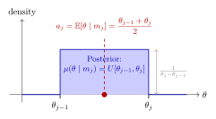{fig-alt="Posterior belief after message m_j: a uniform density over the interval between the two boundaries, with the optimal action marked at the midpoint."}

Posterior belief and optimal response after message $m_j$.
:::

- **The posterior belief.** When the receiver hears message $m_j$, she knows that
  $\theta \in [\theta_{j-1}, \theta_j]$ but nothing more. Since the prior was $U[0,1]$, Bayes'
  rule implies the posterior is uniform over this interval,
  $\mu(\theta \mid m_j) = U[\theta_{j-1}, \theta_j]$, with constant density
  $1/(\theta_j - \theta_{j-1})$.
- **The optimal action.** The receiver's optimal action minimises expected squared loss, which
  means choosing the posterior mean. For a uniform posterior, this is the midpoint of the
  interval.
- **Why the cell boundaries matter.** Every type inside the cell induces the same action,
  because the receiver cannot distinguish between them. All the informational content of the
  message lies in where the boundaries are placed.

These boundaries are not chosen freely. They are pinned down by the sender's incentive to
deviate.

#### The incentive compatibility condition

For the partition to be an equilibrium, sender types must not want to deviate to a different
message. These incentives determine the locations of the *interior boundaries* $\theta_j$, for
$j = 1, \ldots, N-1$.

At each boundary, the sender must be *exactly indifferent* between sending message $m_j$,
which induces receiver action $a_j$, and message $m_{j+1}$, which induces $a_{j+1}$. If she
strictly preferred one message, types near the boundary would deviate and the partition would
unravel.

::: {.gametree}
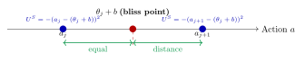{fig-alt="Incentive compatibility at a boundary: the two receiver actions marked on a line with the boundary type's bliss point exactly midway between them, equal distances marked on either side."}

Incentive compatibility at boundary $\theta_j$.
:::

Types below $\theta_j$ have bliss points closer to $a_j$ and prefer $m_j$; types above
$\theta_j$ have bliss points closer to $a_{j+1}$ and prefer $m_{j+1}$. If the bliss point were
not centred between the two actions, some types would strictly prefer to deviate and the
partition would unravel.

**Deriving the indifference condition.** Consider a sender of type $\theta = \theta_j$, the
boundary type between cells $j$ and $j+1$. Her utility from sending message $m_j$ is
$-\bigl(a_j - (\theta_j + b)\bigr)^2$, and from $m_{j+1}$ it is
$-\bigl(a_{j+1} - (\theta_j + b)\bigr)^2$. For indifference these must be equal, so

$$
\bigl|a_j - (\theta_j + b)\bigr| = \bigl|a_{j+1} - (\theta_j + b)\bigr|
$$

The sender's bliss point $\theta_j + b$ must therefore be **equidistant** from $a_j$ and
$a_{j+1}$. Since $a_j < a_{j+1}$, and the bliss point lies between them for the boundary type
to be indifferent, this is equivalent to

$$
\theta_j + b = \frac{a_j + a_{j+1}}{2}
$$

**From the condition to the recurrence.** The receiver's action in each cell is the
conditional mean:

$$
a_j = \frac{\theta_{j-1} + \theta_j}{2}, \qquad a_{j+1} = \frac{\theta_j + \theta_{j+1}}{2}
$$

Substituting into the equidistance condition:

$$
\theta_j + b = \frac{1}{2}\left(\frac{\theta_{j-1} + \theta_j}{2} + \frac{\theta_j + \theta_{j+1}}{2}\right) = \frac{\theta_{j-1} + 2\theta_j + \theta_{j+1}}{4}
$$

::: {.infobox}
**The IC recurrence relation**

$$
\theta_{j+1} = 2\theta_j - \theta_{j-1} + 4b \quad \text{for all } j = 1, 2, \ldots, N-1
$$

This second-order difference equation, together with the boundary conditions $\theta_0 = 0$
and $\theta_N = 1$, fully determines the partition structure.
:::

**Intervals expand by $4b$ at each step.** Define the width of cell $j$ as
$d_j = \theta_j - \theta_{j-1}$. From the recurrence,

$$
\theta_{j+1} - \theta_j = (2\theta_j - \theta_{j-1} + 4b) - \theta_j = \theta_j - \theta_{j-1} + 4b
$$

Therefore $d_{j+1} = d_j + 4b$. Each successive interval is exactly $4b$ *wider* than the
previous one. The intervals grow linearly moving up the type space.

**Why intervals expand.** The intuition comes from the sender's upward bias. Because $b > 0$,
every sender type prefers a *higher* action than the receiver would choose. Consider a type
just *below* boundary $\theta_j$: she belongs in cell $j$ but is tempted to send message
$m_{j+1}$ instead, obtaining the higher receiver action $a_{j+1}$.

To deter this deviation, the "overshoot" must be sufficiently painful. If she deviates to
$m_{j+1}$, she receives action $a_{j+1}$, which exceeds her bliss point $\theta + b$. The
penalty from overshooting must exactly offset the gain from a higher action.

Since types further up the type space have higher bliss points, maintaining indifference at
each successive boundary requires $a_{j+1}$ to be pushed further above the boundary type's
bliss point, which requires a wider interval. The cumulative effect is that each interval must
be $4b$ wider than its predecessor.

#### The two-step partition

**Finding the partition boundary.** Applying the IC recurrence with $j=1$:

$$
\theta_2 = 2\theta_1 - \theta_0 + 4b \implies 1 = 2\theta_1 + 4b \implies \theta_1 = \frac{1}{2} - 2b
$$

For the partition to be non-degenerate, $\theta_1 > 0$ is required, that is $b < \tfrac{1}{4}$.
When $b \geq \tfrac{1}{4}$ the boundary hits zero and the two-step partition collapses to
babbling.

This formula encapsulates a key economic insight: as the sender's bias $b$ increases, the
partition boundary shifts leftward toward zero. The "low" cell shrinks while the "high" cell
expands.

**The receiver's equilibrium actions.** The receiver responds to each message by taking the
conditional mean of the corresponding cell:

$$
a_1 = \frac{\theta_0 + \theta_1}{2} = \frac{0 + (1/2 - 2b)}{2} = \frac{1}{4} - b
$$

$$
a_2 = \frac{\theta_1 + \theta_2}{2} = \frac{(1/2 - 2b) + 1}{2} = \frac{3}{4} - b
$$

Both actions decrease as $b$ increases, but the gap between them remains constant at
$a_2 - a_1 = 1/2$. The entire action schedule shifts downward as the sender becomes more
biased.

**Verifying incentive compatibility.** For the two-step partition to constitute an
equilibrium, the boundary type $\theta = \theta_1 = 1/2 - 2b$ must be exactly indifferent
between sending "low" and "high". Her ideal action is

$$
\theta_1 + b = \left(\frac{1}{2} - 2b\right) + b = \frac{1}{2} - b
$$

Checking that this bliss point is equidistant from the two actions:

- Distance to $a_1 = \tfrac{1}{4} - b$:
  $\left|\left(\tfrac{1}{4} - b\right) - \left(\tfrac{1}{2} - b\right)\right| = \tfrac{1}{4}$
- Distance to $a_2 = \tfrac{3}{4} - b$:
  $\left|\left(\tfrac{3}{4} - b\right) - \left(\tfrac{1}{2} - b\right)\right| = \tfrac{1}{4}$

The distances are equal, confirming that the boundary type is exactly indifferent. This is not
coincidental: it is precisely the condition that determined $\theta_1$ in the first place. The
IC constraint and the partition boundary are two sides of the same coin.

**How the bias reshapes the partition.**

- **Zero bias ($b = 0$).** The partition is symmetric, with the boundary at
  $\theta_1 = 1/2$. Both cells have equal width. The receiver actions are $a_1 = 1/4$ and
  $a_2 = 3/4$, placed symmetrically around the midpoint. With no conflict of interest, there
  is nothing to distort.
- **Small positive bias ($0 < b < 1/4$).** The boundary shifts left to
  $\theta_1 = 1/2 - 2b$. The "low" cell $[0, \theta_1]$ becomes narrower than the "high" cell
  $[\theta_1, 1]$. This asymmetry arises because the sender's upward bias creates stronger
  incentives for low types to exaggerate into the high cell. Shrinking the low cell and
  widening the high cell is necessary to maintain incentive compatibility.
- **Critical bias ($b = 1/4$).** The boundary hits zero:
  $\theta_1 = \tfrac{1}{2} - 2\left(\tfrac{1}{4}\right) = 0$. The "low" cell vanishes entirely
  and all types pool into a single cell. The partition collapses into the babbling
  equilibrium.

#### From two steps to $N$ steps

The two-step case contains all the mechanics. For general $N$ nothing new is needed: each cell
is $4b$ wider than the one below it, and the widths must exhaust the type space. Those two
facts determine the partition.

::: {.infobox}
**Solving for the boundaries**

The widths form an arithmetic sequence with common difference $4b$:

$$
d_j = d_1 + 4b(j-1), \qquad j = 1, \ldots, N.
$$

They must add up to the length of the type space, $\sum_{j=1}^{N} d_j = 1$, which pins down
the first cell:

$$
N d_1 + 4b\,\frac{N(N-1)}{2} = 1 \quad \Longrightarrow \quad d_1 = \frac{1}{N} - 2b(N-1).
$$

Each boundary is then the sum of the widths below it,
$\theta_j = \sum_{k=1}^{j} d_k = j\,d_1 + 4b\,\frac{j(j-1)}{2}$, so that

$$
\theta_j = \frac{j}{N} + 2bj(j-N), \qquad j = 0, 1, \ldots, N.
$$
:::

The formula passes the obvious checks.

- **Endpoints.** $\theta_0 = 0$ and $\theta_N = 1$, as a partition of $[0,1]$ requires.
- **Two steps.** Setting $N = 2$ gives $\theta_1 = \tfrac{1}{2} - 2b$, the boundary derived
  above.
- **No conflict.** Setting $b = 0$ gives $\theta_j = j/N$ for every $N$: evenly spaced cells,
  arbitrarily fine.

For $b > 0$ the first cell is the narrowest, at $d_1 = \tfrac{1}{N} - 2b(N-1)$, and it is the
first to disappear as the bias rises or as more steps are attempted.

::: {.exercisebox}
**Exercise: confirm the three-step case**

Take $N = 3$ and $b = \tfrac{1}{24}$.

1. Use the formula to find $\theta_1$ and $\theta_2$, and the three cell widths. Check that
   each cell is $4b$ wider than the one before it.
2. Find the receiver's three equilibrium actions.
3. Verify directly that each of the two boundary types is indifferent between the messages on
   either side of her.
4. For which values of $b$ does a three-step partition survive at all?
:::

::: {.answerbox}
**(1)** With $N=3$ the formula gives $\theta_j = \tfrac{j}{3} + 2bj(j-3)$, so
$\theta_1 = \tfrac{1}{3} - 4b = \tfrac{1}{6}$ and $\theta_2 = \tfrac{2}{3} - 4b = \tfrac{1}{2}$.
The widths are

$$
d_1 = \tfrac{1}{6}, \qquad d_2 = \tfrac{1}{3}, \qquad d_3 = \tfrac{1}{2},
$$

and each exceeds the previous one by $\tfrac{1}{6} = 4b$. ✓

**(2)** Each action is the midpoint of its cell:

$$
a_1 = \tfrac{1}{12}, \qquad a_2 = \tfrac{1}{3}, \qquad a_3 = \tfrac{3}{4}.
$$

**(3)** The boundary type $\theta_1 = \tfrac{1}{6}$ has bliss point
$\tfrac{1}{6} + \tfrac{1}{24} = \tfrac{5}{24}$, and

$$
\left|\tfrac{1}{12} - \tfrac{5}{24}\right| = \tfrac{3}{24} = \left|\tfrac{1}{3} - \tfrac{5}{24}\right|.
$$

The boundary type $\theta_2 = \tfrac{1}{2}$ has bliss point
$\tfrac{1}{2} + \tfrac{1}{24} = \tfrac{13}{24}$, and

$$
\left|\tfrac{1}{3} - \tfrac{13}{24}\right| = \tfrac{5}{24} = \left|\tfrac{3}{4} - \tfrac{13}{24}\right|. ✓
$$

Both are exactly indifferent, which is what places the boundaries where they are.

**(4)** The binding requirement is that the narrowest cell be non-degenerate:
$d_1 = \tfrac{1}{3} - 4b > 0$, that is $b < \tfrac{1}{12}$. Since $\tfrac{1}{24} < \tfrac{1}{12}$,
the partition above is valid. The next section shows that
$\tfrac{1}{12} = \tfrac{1}{2 \cdot 3 \cdot 2}$ is the general threshold evaluated at $N = 3$.
:::

#### The maximum number of informative steps

Not every value of $N$ yields a valid partition. For the partition to be well defined, all
intervals must have positive width: $\theta_j > \theta_{j-1}$ for all $j = 1, \ldots, N$.

Because the widths increase in $j$, with $d_j = d_1 + 4b(j-1)$ and $b \geq 0$, the narrowest
cell is always the first. If it has positive width, every cell does, so a single inequality
decides whether an $N$-step partition exists:

$$
d_1 = \frac{1}{N} - 2b(N-1) > 0
\quad\Longleftrightarrow\quad
1 > 2bN(N-1)
\quad\Longleftrightarrow\quad
b < \frac{1}{2N(N-1)}.
$$

::: {.infobox}
**Proposition: existence of $N$-step equilibria**

$$
\text{An } N\text{-step partition equilibrium exists} \;\iff\; b < \frac{1}{2N(N-1)}
$$

The **maximum number of credible steps** $N^*(b)$ is the largest positive integer $N$
satisfying this condition.
:::

The condition tightens quickly in $N$. Sustaining one more partition step requires the bias to
fall by considerably more than a proportional amount, because the threshold depends on the
product $N(N-1)$ rather than on $N$ alone.

For each $N \geq 2$, the threshold bias is $\bar{b}(N) = \frac{1}{2N(N-1)}$:

| $N$ | Threshold $\bar{b}(N) = \dfrac{1}{2N(N-1)}$ | $N$-step equilibrium exists if… |
|---|---|---|
| 2 | $\frac{1}{2 \cdot 2 \cdot 1} = \frac{1}{4} = 0.25$ | $b < 0.25$ |
| 3 | $\frac{1}{2 \cdot 3 \cdot 2} = \frac{1}{12} \approx 0.083$ | $b < 0.083$ |
| 4 | $\frac{1}{2 \cdot 4 \cdot 3} = \frac{1}{24} \approx 0.042$ | $b < 0.042$ |
| 5 | $\frac{1}{2 \cdot 5 \cdot 4} = \frac{1}{40} = 0.025$ | $b < 0.025$ |

The thresholds shrink rapidly: supporting more partition steps requires increasingly aligned
preferences.

Reading the thresholds in the opposite direction gives the maximum number of steps sustainable
at each level of bias. Note the first row: at $b = 0$ there is no conflict of interest, so each
type can credibly send a distinct message and full revelation is achieved. The notation
$N^* = \infty$ there represents the limiting case of arbitrarily fine partitions.

| Range of $b$ | Maximum steps $N^*(b)$ | Communication quality |
|---|---|---|
| $b = 0$ | $\infty$ | Fully revealing |
| $0 < b < \frac{1}{40}$ | $N^* \geq 5$ | Very fine partition |
| $\frac{1}{40} \leq b < \frac{1}{24}$ | $N^* = 4$ | Four cells |
| $\frac{1}{24} \leq b < \frac{1}{12}$ | $N^* = 3$ | Three cells |
| $\frac{1}{12} \leq b < \frac{1}{4}$ | $N^* = 2$ | Binary ("low"/"high") |
| $b \geq \frac{1}{4}$ | $N^* = 1$ | Babbling only |

The same relationship can be read off a graph. The figure below plots $N^*(b)$ against the bias
$b$ as a descending step function. Each horizontal segment is a range of bias over which the
same number of partition steps is sustainable, and the dashed vertical drops mark the
thresholds $b = 1/(2N(N-1))$ at which one more step becomes impossible.

::: {.gametree}
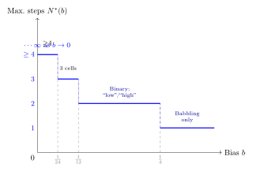{fig-alt="Maximum number of partition steps plotted against bias as a descending step function, falling to one at b equals one quarter."}
:::

At the left-hand edge, as $b \to 0$, arbitrarily fine communication is possible and $N^*$ grows
without bound. At $b \geq 1/4$ the function has fallen to $N^* = 1$ and only the babbling
equilibrium survives. The key message is that **informativeness is strictly decreasing in
bias**. Greater misalignment between sender and receiver necessarily produces coarser
communication.

#### What a partition equilibrium looks like

Putting the pieces together gives the full picture. The figure below shows the three-step case,
read in three layers:

- **The type space (upper bar).** The interval $[0,1]$ is divided into three cells of
  *increasing width*, with boundaries at $\theta_1$ and $\theta_2$. All types within cell $j$
  send the same message $m_j$, so the receiver cannot distinguish between them.
- **The action axis (below).** The grey arrows lead down to the receiver's response. Each
  message induces the conditional mean $a_j$, the midpoint of the corresponding cell.
- **The widths (orange brackets).** The cells grow wider moving up the type space, because the
  IC condition requires each to be $4b$ wider than the previous one.

::: {.gametree}
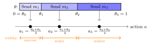{fig-alt="Three-step partition of the type space into cells of increasing width, with arrows mapping each cell to the receiver's action at its midpoint."}
:::

Types near the top are therefore pooled within wider intervals, so the receiver obtains coarser
posterior information about them than about types near the bottom.

### The Central Theorem of Crawford and Sobel

The analysis so far has established when informative communication is possible and what form
it takes. Crawford and Sobel's theorem collects these findings into five results.

::: {.highlightbox}
**Theorem (Crawford and Sobel, 1982): five key results**

- An $N$-step partition equilibrium exists if and only if $b < \frac{1}{2N(N-1)}$.
- The babbling equilibrium ($N=1$) always exists for any $b \geq 0$.
- **In this model, all equilibria are partition equilibria**, or payoff-equivalent to one.
  There is no other way to transmit information in the uniform-quadratic setting, because of
  the Spence–Mirrlees property in the sender's preferences, which guarantees that higher types
  prefer higher actions.
- When multiple partition equilibria exist, the one with the most steps **Pareto dominates**
  all others: both parties are weakly better off with finer communication.
- Expected welfare is **strictly decreasing in $b$**: greater misalignment reduces equilibrium
  informativeness and lowers both players' payoffs.
:::

The third result, that every equilibrium is a partition, is the deepest of the five, and two
distinct forces produce it. The sender's incentive to overstate rules out any precise
revelation of $\theta$. The monotonicity of her preferences then forces whatever pooling
survives to take the form of *intervals*, rather than arbitrary groupings of types.

#### Why only partitions?

The result requires two steps. The first rules out fine communication; the second establishes
that what remains must be intervals.

**Step 1: no strictly increasing map survives.** Suppose the receiver's strategy mapped
messages to actions via a strictly increasing, continuous function $a(m)$. Since $b > 0$, every
type $\theta$ could strictly gain by sending a marginally higher message, inducing an action
closer to her bliss point $\theta + b$. Every type therefore imitates a slightly higher type,
and the mapping unravels. No separating structure of this kind can be an equilibrium.

**Step 2: the pooling sets must be intervals.** Here the Spence–Mirrlees property does the
work. Take any two messages inducing actions $a < a'$. Under quadratic loss, type $\theta$
prefers the higher action precisely when her bliss point lies above the midpoint of the two:

$$
\theta + b \;>\; \frac{a + a'}{2}
$$

The left-hand side is strictly increasing in $\theta$; the right-hand side is a constant. The
types preferring the higher action are therefore exactly those above a cutoff. The set of types
sending any given message is consequently an *interval* and never a scattered collection, and
the type at each boundary is exactly indifferent between the two adjacent actions — the
indifference condition derived earlier.

Together the steps give a step function. Within a cell, deviating to another message in the
same cell leaves the receiver's action unchanged, so there is nothing to gain by lying; across
cells, the boundaries are pinned down by indifference. In equilibrium, communication can only
be coarse.

### Welfare Analysis

Both the receiver and the sender suffer welfare losses from the coarseness of cheap talk
communication. Understanding why requires thinking carefully about what each party loses when
messages convey only interval membership rather than precise values.

#### The receiver's loss

The receiver wants to set $a = \theta$ but can only observe which partition cell contains
$\theta$. She therefore sets $a$ equal to the midpoint of the relevant cell, the best she can
do given her information. Unless $\theta$ happens to fall exactly at the midpoint, she makes an
error, and the further $\theta$ lies from the cell's centre, the larger the squared loss she
incurs.

Consider a cell $[\theta_{j-1}, \theta_j]$ of width $d$. Given that $\theta$ lies in this cell,
the receiver learns nothing further and must set $a$ to the midpoint $\bar{\theta}_j$. Her
conditional expected loss is then proportional to the variance of $\theta$ within the cell. For
a uniform distribution on the interval, this variance is $d^2/12$, so the expected squared error
is

$$
\mathbb{E}\bigl[(\theta - \bar{\theta}_j)^2 \mid \theta \in [\theta_{j-1}, \theta_j)\bigr] = \frac{d^2}{12}
$$

Wider cells mean larger within-cell variance and thus larger expected error. Since partition
cells grow wider as bias increases, the receiver's expected loss rises with $b$.

#### The sender's loss, from an ex ante perspective

At first glance the sender might seem to benefit from coarse communication, since she can pool
with types that induce higher actions, exploiting her upward bias. But this intuition is
misleading from an *ex ante* perspective, before the sender learns her type.

Ex ante, the sender does not know whether she will be a low type or a high type. Consider a
sender who turns out to be near the bottom of a cell: the receiver's action, the cell midpoint,
overshoots her ideal by a substantial margin. Conversely, a sender near the top of the cell
finds the action undershooting her ideal. In both cases the sender suffers from the mismatch
between the coarse action and her true bliss point.

The key insight is that **the sender cannot systematically exploit coarse communication**,
because she does not control which type she draws. Ex ante, she would prefer the receiver to
have finer information, so that the action tracks her realised bliss point more closely,
regardless of what that realisation turns out to be.

::: {.gametree}
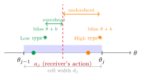{fig-alt="Within one partition cell, the receiver's action at the midpoint overshoots a low type's bliss point and undershoots a high type's."}
:::

#### Why finer partitions help both parties

In any partition equilibrium, the sender's expected utility is

$$
U_S = -\mathbb{E}[(\theta + b - a(\theta))^2] = -\mathbb{E}[(\theta - a(\theta))^2] - 2b\,\mathbb{E}[\theta - a(\theta)] - b^2
$$

The receiver's expected utility is

$$
U_R = -\mathbb{E}[(\theta - a(\theta))^2]
$$

Thus

$$
U_S = U_R - 2b\,\mathbb{E}[\theta - a(\theta)] - b^2
$$

Since $a(\theta)$ is the receiver's best response to the partition, the conditional mean of each
cell, $\mathbb{E}[a(\theta)]$ equals $\mathbb{E}[\theta] = 1/2$ ex ante, so
$\mathbb{E}[\theta - a(\theta)] = 0$. Therefore

$$
U_S = U_R - b^2
$$

The sender's ex ante expected utility is exactly the receiver's, shifted down by the constant
$b^2$. Both gain from finer partitions because both reduce the within-cell variance. The
sender's intrinsic disadvantage from her upward bias, $b^2$, is fixed regardless of the
partition's coarseness.

::: {.infobox}
**Why does the sender also prefer more steps?**

More partition steps track $\theta$ more closely, and since $b$ is a fixed offset, they track
the sender's ideal $\theta + b$ more closely too. Both players therefore benefit from reducing
the *residual noise* within cells, even though they disagree on the *level* of the action.
:::

### Worked Example: Communication with a Biased Adviser

::: {.exercisebox}
**Setup**

Consider a Crawford–Sobel cheap talk game with the following features:

- The state of the world is $\theta \sim U[0,1]$, observed only by the sender.
- The sender's ideal action is $\theta + b$; the receiver's ideal action is $\theta$.
- The bias is $b = 1/8$.

Both players have quadratic loss preferences, so each suffers a loss equal to the squared
distance between the action taken and her own ideal.

**Objectives**

- Determine how many partition steps the most informative equilibrium supports.
- Find the partition boundary $\theta_1$ and the receiver's equilibrium actions $a_1, a_2$.
- Verify that the incentive compatibility (IC) condition holds at the boundary type.
- Confirm that all other types have a strict preference for the correct message.
:::

#### How many partition steps?

Recall the existence condition: an $N$-step equilibrium exists if and only if
$b < \frac{1}{2N(N-1)}$. Checking each $N$ in turn:

- $N=2$: requires $b < \frac{1}{4}$. Since $\frac{1}{8} < \frac{1}{4}$, this is **feasible**.
- $N=3$: requires $b < \frac{1}{12}$. Since $\frac{1}{8} > \frac{1}{12}$, this is **not
  feasible**.

The most informative equilibrium has $N=2$: the sender sends one of two messages, "low" or
"high", and the receiver takes one of two actions.

#### The boundary and the receiver's actions

Substituting $b = 1/8$ into the two-step formula:

$$
\theta_1 = \frac{1}{2} - 2b = \frac{1}{2} - \frac{2}{8} = \frac{1}{4}
$$

**Why not the midpoint?** Consider what would go wrong with $\theta_1 = 1/2$. The receiver
would then set $a_1 = 1/4$ and $a_2 = 3/4$. A sender type just below $\theta = 1/2$ has ideal
action $\theta + 1/8 \approx 5/8$, which is closer to $a_2 = 3/4$ than to $a_1 = 1/4$. She
would prefer to send "high" even though she belongs in the low cell, a profitable deviation
that unravels the equilibrium.

Shifting the boundary left to $1/4$ shrinks the "low" cell and expands the "high" cell, pulling
the two receiver actions closer together and reducing the temptation to exaggerate.

**The receiver's actions.** Best-responding by taking the conditional mean of each cell:

$$
a_1 = \frac{0 + \tfrac{1}{4}}{2} = \frac{1}{8}, \qquad a_2 = \frac{\tfrac{1}{4} + 1}{2} = \frac{5}{8}
$$

The cells have widths $1/4$ for the low cell and $3/4$ for the high cell, necessarily unequal
because the upward bias $b > 0$ forces the low cell to be compressed.

#### Verifying IC at the boundary type

The boundary type must be *exactly indifferent* between the two messages; otherwise she would
strictly prefer one, and the partition would shift. Her ideal action is

$$
\theta + b = \frac{1}{4} + \frac{1}{8} = \frac{3}{8}
$$

Comparing the distance from her bliss point to each receiver action:

$$
\underbrace{\left|\frac{1}{8} - \frac{3}{8}\right|}_{\text{distance to }a_1} = \frac{1}{4} = \underbrace{\left|\frac{5}{8} - \frac{3}{8}\right|}_{\text{distance to }a_2}
$$

Her bliss point $3/8$ lies exactly halfway between $a_1 = 1/8$ and $a_2 = 5/8$. This
equal-distance condition is not a lucky coincidence: it is the equation that *defines*
$\theta_1 = 1/4$ in the first place. Any other boundary would leave the boundary type with a
strict preference, making the partition unsustainable.

#### Verifying IC for all other types

- **Low types** ($\theta < 1/4$): ideal action $= \theta + 1/8 < 3/8$, strictly closer to
  $a_1 = 1/8$ than to $a_2 = 5/8$. Sending "low" is strictly optimal.
- **High types** ($\theta > 1/4$): ideal action $= \theta + 1/8 > 3/8$, strictly closer to
  $a_2 = 5/8$. Sending "high" is strictly optimal.

The boundary type is indifferent and can break the tie either way without disturbing the
equilibrium. The two-step partition is fully verified.

#### Measuring the welfare gain

Using $\mathbb{E}[U^R] = -\sum_j d_j^3/12$, where $d_j$ is the width of cell $j$:

$$
\mathbb{E}[U^R] = -\frac{(1/4)^3}{12} - \frac{(3/4)^3}{12} = -\frac{1}{768} - \frac{27}{768} = -\frac{28}{768} = -\frac{7}{192} \approx -0.0365
$$

Under babbling ($N=1$) there is a single cell of width $1$, so

$$
\mathbb{E}[U^R] = -\frac{1}{12} \approx -0.083
$$

The two-step partition cuts the receiver's expected loss by more than half. Even a single
credible distinction between "low" and "high" delivers a substantial welfare gain over no
communication at all.

#### Summary of the equilibrium

| Feature | Value |
|---|---|
| Partition boundary | $\theta_1 = \frac{1}{4}$ |
| Message "low" sent by | $\theta \in \left[0, \frac{1}{4}\right]$ |
| Message "high" sent by | $\theta \in \left[\frac{1}{4}, 1\right]$ |
| Action on hearing "low" | $a_1 = \frac{1}{8}$ |
| Action on hearing "high" | $a_2 = \frac{5}{8}$ |

The equilibrium geometry is shown below. The upper bar is the type space, split at
$\theta_1 = 1/4$ into a narrow "low" cell and a "high" cell three times its width. The grey
arrows lead down to the action axis, where the two messages induce $a_1 = 1/8$ and
$a_2 = 5/8$. The red point between them is the boundary type's bliss point at $3/8$, and the
green arrows confirm that it sits equidistant from both actions.

::: {.gametree}
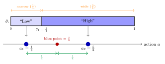{fig-alt="Two-step partition with boundary at one quarter: the narrow low cell and wider high cell above, arrows down to the two induced actions, and the boundary type's bliss point equidistant between them."}
:::

### Extensions and Applications

The Crawford–Sobel framework applies wherever an informed party advises a decision-maker
without being able to commit.

#### Expert advice and credibility

A patient (R) wants treatment intensity $a = \theta$ matching their condition. The doctor (S)
knows $\theta$ but prefers slightly more treatment, so $b > 0$, whether because she is paid
per procedure, errs on the side of caution, or does not suffer the side effects herself.

The model predicts:

- Precise severity assessments are not credible, because patients correctly expect
  exaggeration.
- Categorical assessments such as "mild", "moderate" and "severe" are the best achievable,
  with the number of credible categories $N^*(b)$ decreasing in the doctor's financial bias.
- If the doctor's bias exceeds $1/4$, patients should ignore medical advice entirely and rely
  on their prior.
- **Policy implication**: Separating diagnostic payment from treatment payment reduces $b$,
  expanding $N^*$ and improving communication.

#### Central bank communication

Central banks communicate through forward guidance, inflation reports, and speeches. These are
cheap talk, since no central bank can legally bind future policymakers, yet markets respond
significantly to them.

The model predicts:

- Communication is informative when the bank's objectives align broadly with markets', since
  both want stable, predictable inflation. The effective bias is low.
- When credibility is low, meaning perceived bias is high, communication becomes coarser and
  markets assign less weight to forward guidance.
- **Institutional design**: Inflation targeting frameworks, independence mandates and
  transparent committee structures all reduce $b$, expanding $N^*$ and increasing
  informativeness. This is the game-theoretic rationale for central bank independence.

#### Delegation as an alternative to communication

Dessein (2002) compares cheap talk with **delegation**: giving the sender direct control over
the action. The two mechanisms fail in different ways.

- **Cheap talk.** The receiver retains control but acts on a coarse partition signal.
  Information loss is unavoidable.
- **Delegation.** The receiver surrenders control. The sender acts on full information, so
  nothing is lost, but the action is always $b$ above optimal: $\mathbb{E}[U^R] = -b^2$.

For small $b$ the bias cost is second-order while the information loss is first-order, so
delegation wins. The sender prefers it too, making the result a Pareto improvement for
$b \in (0, 1/4)$.

Above $b = 1/4$ only babbling remains, giving $\mathbb{E}[U^R] = -1/12$ against $-b^2$ under
delegation. Delegation still wins provided $b < 1/\sqrt{12} \approx 0.289$; beyond that the
receiver prefers to babble and keep control.

| Range of $b$ | Comparison | Receiver's choice |
|---|---|---|
| $0 < b < \frac{1}{4}$ | Cheap talk ($N^* \geq 2$) vs. delegation | Delegation dominates |
| $\frac{1}{4} \leq b < \frac{1}{\sqrt{12}}$ | Babbling vs. delegation | Delegation dominates |
| $b \geq \frac{1}{\sqrt{12}}$ | Babbling vs. delegation | Babbling preferred |

**Implication**: Principals often delegate to better-informed agents rather than demanding
reports, because communication is an inherently leaky channel. Delegation only becomes
undesirable when the agent's bias is severe.

### Practice Activities

#### Activity 1: finding the most informative equilibrium

::: {.exercisebox}
Consider the standard Crawford–Sobel model, with $\theta \sim U[0,1]$, the sender's ideal
action $= \theta + b$, and the receiver's ideal action $= \theta$. Set $b = 1/6$.

- What is $N^*(1/6)$, the largest number of partition steps that can be sustained in
  equilibrium? Justify by applying the existence condition.
- For the most informative equilibrium, find the partition boundary $\theta_1$ and the
  receiver's two equilibrium actions $a_1, a_2$.
- Verify the IC condition at the boundary type $\theta = \theta_1$.
- Compute the receiver's expected payoff $\mathbb{E}[U^R]$ under this equilibrium and under
  babbling ($N=1$). How large is the welfare gain from communication?
:::

::: {.answerbox}
**Maximum steps.** Apply the existence condition: an $N$-step equilibrium exists if and only
if $b < \dfrac{1}{2N(N-1)}$.

- $N=2$: requires $b < \tfrac{1}{4}$. Since $\tfrac{1}{6} < \tfrac{1}{4}$, this is feasible. ✓
- $N=3$: requires $b < \tfrac{1}{12}$. Since $\tfrac{1}{6} > \tfrac{1}{12}$, this is not
  feasible. ✗

Therefore $N^*(1/6) = 2$.

**Partition boundary and receiver actions.** Substituting $b = 1/6$ into the two-step formula:

$$
\theta_1 = \frac{1}{2} - 2b = \frac{1}{2} - \frac{2}{6} = \frac{1}{2} - \frac{1}{3} = \frac{1}{6}
$$

The receiver takes the conditional mean of each cell:

$$
a_1 = \frac{0 + \tfrac{1}{6}}{2} = \frac{1}{12}, \qquad a_2 = \frac{\tfrac{1}{6}+1}{2} = \frac{7}{12}
$$

**IC verification at $\theta = 1/6$.** The boundary type's ideal action is
$\theta + b = \tfrac{1}{6} + \tfrac{1}{6} = \tfrac{1}{3}$. Checking equal distances:

$$
\left|\tfrac{1}{12} - \tfrac{1}{3}\right| = \tfrac{1}{4} = \left|\tfrac{7}{12} - \tfrac{1}{3}\right| ✓
$$

**Welfare.** Two-step equilibrium, with cell widths $d_1 = 1/6$ and $d_2 = 5/6$:

$$
\mathbb{E}[U^R]_{N=2} = -\frac{1}{12}\left[\left(\frac{1}{6}\right)^3 + \left(\frac{5}{6}\right)^3\right] = -\frac{1}{12}\cdot\frac{1+125}{216} = -\frac{126}{2592} = -\frac{7}{144}
$$

Babbling ($N=1$, one cell of width $1$) gives $\mathbb{E}[U^R]_{N=1} = -\frac{1}{12}$. The
welfare gain from communication is

$$
\Delta = \frac{1}{12} - \frac{7}{144} = \frac{12}{144} - \frac{7}{144} = \frac{5}{144} \approx 0.035
$$

a 42% reduction in expected loss relative to babbling.
:::

#### Activity 2: when the bias is not constant

::: {.exercisebox}
Suppose the sender's utility is $U^S(a,\theta) = -(a - k\theta)^2$ for some $k > 1$. The
sender wants the receiver to "scale up" the action proportionally to the type, rather than
shift it by a constant.

- Express the sender's ideal action in terms of $\theta$ and $k$. Write the effective bias as
  $b(\theta) =$ (sender's ideal) $-$ (receiver's ideal). How does this bias behave as a
  function of $\theta$? Does this fit the standard Crawford–Sobel framework with a fixed bias?
- Discuss qualitatively how communication in this game differs from the fixed-bias case. In
  particular, consider how the temptation to exaggerate varies across types, and what this
  implies for the structure of any partition equilibrium.
:::

::: {.answerbox}
**Effective bias.** The sender's ideal action is the $a$ that maximises $-(a-k\theta)^2$,
which is simply $a^*_S = k\theta$. The receiver's ideal action remains $a^*_R = \theta$. The
effective bias is therefore

$$
b(\theta) \;=\; a^*_S - a^*_R \;=\; k\theta - \theta \;=\; (k-1)\,\theta
$$

This bias is *not* constant. It is zero at $\theta = 0$ and grows linearly, reaching $(k-1)$
at $\theta = 1$. Because the standard framework requires a fixed bias $b$ independent of
$\theta$, this model **does not** fit it. The IC conditions become type-dependent and the
equal-increment formula no longer applies.

**Qualitative differences.**

- **Low types barely exaggerate.** Near $\theta = 0$ the bias $b(\theta) \approx 0$, so
  interests are nearly aligned. The sender's message is nearly truthful and little information
  is lost.
- **High types exaggerate a lot.** Near $\theta = 1$ the bias is large, approaching $k-1$, so
  the sender strongly wants to inflate the action. The IC condition is hard to satisfy at the
  top of the type space.
- **Unequal cell widths, concentrated at the top.** The partition intervals must be wider at
  the top, where types are most tempted to pool together to inflate the action, and narrower
  at the bottom, where the bias is small and finer distinctions are incentive compatible. This
  is the opposite of the fixed-$b$ model, where cells are compressed near zero.
- **Communication breaks down at the top.** As $k$ increases, the top of the type distribution
  becomes increasingly uninformative. In the limit, only low types can credibly communicate,
  and high types all pool into a single "high" message.

In summary, the game looks like cheap talk with a very small bias at the bottom and a very
large bias at the top. The partition is coarser where the bias is largest.
:::

#### Activity 3: delegation against communication

::: {.exercisebox}
Return to the standard model, with $\theta \sim U[0,1]$, the sender's ideal action
$\theta + b$, and the receiver's ideal action $\theta$.

**Delegation** means the receiver hands the decision right to the sender, who then sets
$a = \theta + b$, her unconstrained optimum. **Cheap talk** means the receiver retains the
decision right but must rely on the sender's unverifiable message.

- Under cheap talk with $b = 1/8$, use the two-step partition equilibrium to compute the
  sender's expected payoff $\mathbb{E}[U^S]$.
- Under delegation, compute the receiver's expected payoff $\mathbb{E}[U^R]$ for any $b$.
  Compare this to the two-step cheap talk result with $b = 1/8$.
- For what range of $b$, if any, does delegation yield strictly higher receiver welfare than
  the best available cheap talk equilibrium? Provide an intuitive explanation of the result.
:::

::: {.answerbox}
**Sender's expected payoff under two-step cheap talk, $b = 1/8$.** With $\theta_1 = 1/4$,
$a_1 = 1/8$ and $a_2 = 5/8$, the sender's payoff is $U^S = -(a - (\theta+b))^2$.

*Cell 1* ($\theta \in [0, 1/4]$, action $a_1 = 1/8$):

$$
\int_0^{1/4} -\!\left(\frac{1}{8} - \theta - \frac{1}{8}\right)^2 d\theta = -\int_0^{1/4} \theta^2\,d\theta = -\left[\frac{\theta^3}{3}\right]_0^{1/4} = -\frac{1}{192}
$$

*Cell 2* ($\theta \in [1/4, 1]$, action $a_2 = 5/8$):

$$
\int_{1/4}^1 -\!\left(\frac{5}{8} - \theta - \frac{1}{8}\right)^2 d\theta = -\int_{1/4}^1 \!\left(\frac{1}{2}-\theta\right)^2 d\theta = -\left[\frac{(\theta-1/2)^3}{3}\right]_{1/4}^{1} = -\frac{9}{192}
$$

Adding the two cells:

$$
\mathbb{E}[U^S]_{CT} = -\frac{1}{192} - \frac{9}{192} = -\frac{10}{192} = -\frac{5}{96} \approx -0.052
$$

**Receiver's expected payoff under delegation.** Under delegation the sender sets
$a = \theta + b$, so the receiver's loss is $U^R = -(\theta + b - \theta)^2 = -b^2$ for every
$\theta$, hence $\mathbb{E}[U^R]_{\text{del}} = -b^2$. For $b = 1/8$ this gives
$-1/64 \approx -0.016$.

Comparing with the two-step cheap talk benchmark:

$$
\mathbb{E}[U^R]_{CT,N=2} = -\frac{(1/4)^3 + (3/4)^3}{12} = -\frac{1/64 + 27/64}{12} = -\frac{28}{768} = -\frac{7}{192} \approx -0.036
$$

Delegation gives $-1/64 = -3/192$, which is strictly greater than $-7/192$. **The receiver
prefers delegation.**

**Comparison for general $b$.** For any $N$-step equilibrium, the cell widths $\{d_j\}$
satisfy $\sum_j d_j = 1$, and a general algebraic result gives

$$
\mathbb{E}[U^R]_{CT,N} = -\frac{1}{12N^2} - \frac{b^2(N^2-1)}{3}
$$

Comparing with delegation:

$$
\mathbb{E}[U^R]_{\text{del}} - \mathbb{E}[U^R]_{CT,N} = \frac{1}{12N^2} + \frac{b^2(N^2-1)}{3} - b^2 = \frac{1}{12N^2} + b^2\cdot\frac{N^2-4}{3}
$$

Whenever an informative partition survives, delegation yields strictly higher receiver
welfare. Once $b \geq \tfrac{1}{4}$ only babbling remains, and delegation continues to
dominate up to $b = 1/\sqrt{12} \approx 0.289$. Above that the receiver prefers to babble and
keep control.

**Intuition.** Under delegation the receiver bears a known, fixed loss of $b^{2}$, since the
action is always wrong by exactly $b$. Under cheap talk her action is the conditional mean of
the cell, so it is unbiased; what she bears instead is the residual variance from not knowing
where within the cell $\theta$ lies. The comparison is therefore variance against bias.

While an informative partition survives, the variance cost is the larger of the two and
delegation wins. Once $b \geq \tfrac{1}{4}$ only babbling remains, and the receiver's variance
cost stops growing: it is capped at $\tfrac{1}{12}$, the variance of the prior. The bias cost
$b^{2}$ keeps rising. Beyond $b = 1/\sqrt{12}$ the fixed bias is the more expensive of the
two, and the receiver prefers to keep control and ignore the sender.
:::

### Quick Check-In {.unnumbered}

Test your understanding of the cheap talk material.

:::: {.quiz data-answer="B"}
**Question 1.** Which statement about the babbling equilibrium is correct?

(A) It exists only when the sender's bias satisfies $b \geq 1/4$.
(B) It exists for every value of $b \geq 0$, including $b = 0$.
(C) It exists only when the sender and receiver have opposed preferences.
(D) It requires the receiver to hold off-path beliefs that punish deviation.

::: {.feedback data-option="A"}
**Try again.** At $b \geq 1/4$ babbling is the *only* surviving equilibrium, but that is not the same as it being the only case in which it exists.
:::

::: {.feedback data-option="B"}
**Well done.** Babbling is always a PBE. If the receiver ignores all messages, every message induces the same action, so the sender is indifferent across messages and pooling on $m_0$ is weakly optimal. The equilibrium is self-fulfilling, which is what makes it so robust.
:::

::: {.feedback data-option="C"}
**Try again.** Even under perfect alignment, $b = 0$, babbling remains an equilibrium. It is Pareto dominated by the fully revealing equilibrium, but it does not cease to exist.
:::

::: {.feedback data-option="D"}
**Try again.** No punishment is needed. Treating any unexpected message as uninformative is sufficient, and the sender gains nothing from deviating in any case.
:::

::::

:::: {.quiz data-answer="C"}
**Question 2.** In an $N$-step partition equilibrium the cell widths satisfy $d_{j+1} = d_j + 4b$. Why must intervals widen moving up the type space?

(A) Because higher states are more likely under the uniform prior.
(B) Because the sender's bias $b$ grows with $\theta$.
(C) Because each boundary type must be deterred from exaggerating upward, which requires the next action to overshoot her bliss point by more.
(D) Because the receiver's squared-loss function penalises errors at high $\theta$ more heavily.

::: {.feedback data-option="A"}
**Try again.** The prior is $\theta \sim U[0,1]$, so all states are equally likely. The asymmetry comes from incentives, not from the distribution.
:::

::: {.feedback data-option="B"}
**Try again.** In the Crawford–Sobel model the bias is a fixed constant, independent of $\theta$. A state-dependent bias is the subject of Activity 2.
:::

::: {.feedback data-option="C"}
**Well done.** The boundary type $\theta_j$ must be exactly indifferent, so $\theta_j + b = (a_j + a_{j+1})/2$. Since types further up have higher bliss points, sustaining indifference requires $a_{j+1}$ to sit further above the boundary type's ideal, and that in turn requires a wider cell. Iterating gives exactly $4b$ per step.
:::

::: {.feedback data-option="D"}
**Try again.** Squared loss depends only on the distance $|a - \theta|$, not on the level of $\theta$. The receiver would prefer uniform cells; the widening is forced on her by the sender's (IC) condition.
:::

::::

:::: {.quiz data-answer="B"}
**Question 3.** A sender has bias $b = 1/10$. What is $N^*(b)$, the largest number of partition steps sustainable in equilibrium?

(A) $N^* = 1$; only babbling survives.
(B) $N^* = 2$.
(C) $N^* = 3$.
(D) $N^* = 5$.

::: {.feedback data-option="A"}
**Try again.** Babbling is the only equilibrium once $b \geq 1/4$. Here $1/10 < 1/4$, so an informative equilibrium exists.
:::

::: {.feedback data-option="B"}
**Well done.** An $N$-step equilibrium exists if and only if $b < \frac{1}{2N(N-1)}$. For $N = 2$ this requires $b < 1/4$, and $1/10 < 1/4$. For $N = 3$ it requires $b < 1/12 \approx 0.083$, but $1/10 = 0.1 > 1/12$. So the most informative equilibrium is binary, with $\theta_1 = \frac{1}{2} - 2b = \frac{3}{10}$.
:::

::: {.feedback data-option="C"}
**Try again.** Three cells require $b < 1/12 \approx 0.083$, and $b = 0.1$ exceeds this. Check the condition for each $N$ in turn rather than reading off the nearest threshold.
:::

::: {.feedback data-option="D"}
**Try again.** Five cells require $b < 1/40 = 0.025$. The threshold falls rapidly in $N$ because it depends on the product $N(N-1)$.
:::

::::

:::: {.quiz data-answer="B"}
**Question 4.** Why can no equilibrium involve a strictly increasing, continuous mapping from messages to actions?

(A) Because the message space $M$ is too small to support a continuum of messages.
(B) Because every type would strictly gain by sending a marginally higher message, so the mapping unravels.
(C) Because the receiver cannot compute a posterior from a continuous message.
(D) Because the sender is risk averse over actions.

::: {.feedback data-option="A"}
**Try again.** The message space is assumed rich. The obstruction is strategic, not technological.
:::

::: {.feedback data-option="B"}
**Well done.** With $b > 0$ each type wants an action slightly above the one her truthful message induces, so she imitates a marginally higher type. Since this holds for every type, the mapping collapses and no message conveys information. Only a step function is stable, because within a cell a deviation changes nothing.
:::

::: {.feedback data-option="C"}
**Try again.** Bayes' rule applies perfectly well to continuous strategies. The problem is that no such strategy is a best response.
:::

::: {.feedback data-option="D"}
**Try again.** Quadratic loss does imply the sender dislikes variance, but the unravelling argument turns on the fixed upward bias $b$, not on risk preferences.
:::

::::

:::: {.quiz data-answer="C"}
**Question 5.** The receiver is choosing between delegating the decision and retaining control under babbling. For which biases does she prefer to keep control?

(A) For all $b > 0$, since delegation surrenders the decision right entirely.
(B) For $b \geq 1/4$, the point at which informative communication collapses.
(C) For $b \geq 1/\sqrt{12} \approx 0.289$.
(D) Never, since delegation eliminates the coarseness cost entirely.

::: {.feedback data-option="A"}
**Try again.** Surrendering control is not costly in itself. Under delegation the sender acts on full information, so the receiver's only loss is the fixed bias, $E[U^R] = -b^2$.
:::

::: {.feedback data-option="B"}
**Try again.** At $b = 1/4$ cheap talk collapses to babbling, but babbling gives $-1/12 \approx -0.083$ against $-b^2 = -0.0625$ under delegation. Delegation is still better.
:::

::: {.feedback data-option="C"}
**Well done.** Delegation costs the receiver $b^2$; babbling costs the within-cell variance of a single cell of width one, namely $1/12$. Delegation is preferred while $b^2 < 1/12$, that is $b < 1/\sqrt{12}$. Beyond that the sender's bias is severe enough that the receiver would rather act on her prior and keep control.
:::

::: {.feedback data-option="D"}
**Try again.** Delegation does remove the within-cell noise, but it leaves the bias cost $b^2$ in every state. Once $b$ is large enough that this cost exceeds the noise cost of babbling, the ranking reverses.
:::

::::

## Moral Hazard: Hidden Actions in Contractual Relationships

### Understanding the Moral Hazard Problem

Think about the last time you rented a car. Did you drive it quite as carefully as your own
vehicle? Probably not. Did you park a little closer to that concrete pillar than you
normally would? Almost certainly. You were insured, after all. That is **moral hazard**, and
this section asks what a contract can do about it.

Moral hazard is a *post-contractual* problem. It emerges after an agreement has been struck,
when one party to the contract takes actions the other cannot observe or verify. This is
what distinguishes it sharply from adverse selection, the asymmetric information problem
studied in the previous chapter, where the informational gap exists **before** the contract
is signed. Here, the asymmetry concerns **actions taken after the deal is done**.

The term was coined by insurance underwriters in the 17th and 18th centuries, who noticed
that insured parties had a troubling tendency to exercise less care than uninsured ones. The
insurance origins should not mislead you. Moral hazard is pervasive throughout the modern
economy, arising wherever one party (an *agent*) acts on behalf of another (a *principal*)
and those actions cannot be fully observed.

#### What defines moral hazard?

Four features characterise every moral hazard problem:

- **Temporal sequence**: The information asymmetry develops *after* the contract is signed.
  It is a hidden *action* problem rather than a hidden *type* problem.
- **Hidden actions**: One party cannot observe the other's effort or behaviour, not because
  they refuse to look, but because monitoring is impossible or prohibitively costly.
- **Anticipated difficulty**: Both parties know in advance that effort will be unobservable,
  and this shapes the design of the contract from the outset.
- **Contract design challenge**: The central question becomes how to structure incentives
  when the principal cannot watch what the agent does.

#### Moral hazard against adverse selection

|  | Adverse selection | Moral hazard |
|---|---|---|
| What is hidden | Characteristics (types) | Actions (effort) |
| When it arises | Before contracting | After contracting |
| Informed party | Knows who she is | Chooses what she does |
| Contractual remedy | Screening menus | Incentive contracts |

In the screening problems earlier in this chapter, the principal designed a menu so that
agents would reveal information they already held. Under moral hazard there is nothing to
reveal at the point of contracting: the agent has not yet decided how hard to work. The
contract must instead make the desired action attractive once the agreement is in force.

#### Where moral hazard appears

- **Corporate governance**: Shareholders hire a chief executive to maximise firm value, but
  cannot observe whether she is building long-run value or boosting short-run share prices
  to cash in her options.
- **Insurance markets**: After buying comprehensive health cover, individuals may eat less
  well, exercise less, and skip preventive check-ups. After buying motor insurance, drivers
  may text at the wheel a little more readily.
- **Banking and finance**: Lenders cannot perfectly monitor whether a borrower uses the
  funds for the stated low-risk project or pivots to a high-risk gamble once the loan is
  disbursed.
- **Employment relations**: An employer cannot continuously observe effort. Was the two-hour
  gap in output due to deep concentration or a YouTube rabbit hole?
- **Healthcare**: A patient cannot verify whether a recommended procedure reflects medical
  necessity or the doctor's incentive to perform a more expensive treatment.

### The Owner–Manager Model

To study moral hazard, the analysis turns to a canonical **principal–agent model**. Think of
it as the most stripped-down version of a real firm: one owner who wants a project managed,
and one manager who actually runs it. The model is deliberately simple, but it captures the
logic of moral hazard exactly.

#### The players

- **Owner (principal)**: Owns the project and wants it managed well, but has neither the
  time nor the ability to watch the manager at every moment.
- **Manager (agent)**: Hired to run the project, and makes the effort decision that
  determines, probabilistically, how the project performs.

#### Outcomes and effort

The project generates gross profit $\pi$, taking one of two values:

$$
\pi \in \{\pi_L, \pi_H\}, \qquad \pi_H > \pi_L
$$

Call $\pi_H$ the good outcome and $\pi_L$ the bad one. Two outcomes are enough for every
result in this section. A longer profit ladder adds notation rather than economics; the one
point at which it would make a difference is flagged below.

The manager chooses between two effort levels, $e \in \{e_L, e_H\}$, where $e_L$ is low
effort, or shirking, and $e_H$ is high effort. Effort is continuous in reality, but the
binary case captures every essential trade-off and keeps the mathematics clean.

#### The observability problem

The owner observes the project's outcome $\pi$, but *cannot* observe the manager's effort
level $e$. This is the defining feature of moral hazard.

A subtlety matters here. For the problem to bite, the owner must not be able to *deduce*
effort from the outcome. If high effort always produced high profits and low effort always
produced low profits, the owner could infer effort perfectly by reading the bottom line. The
interesting case, and the realistic one, is when outcomes are *noisy*: even a diligent
manager sometimes faces bad luck, and even a lazy one occasionally gets lucky.

This is modelled through conditional probabilities. Write

$$
p_H \;\equiv\; \Pr(\pi = \pi_H \mid e_H), \qquad p_L \;\equiv\; \Pr(\pi = \pi_H \mid e_L)
$$

for the probability of the *good* outcome under each effort level, and $p_e$ for whichever
of the two applies to the effort $e$ under discussion. Effort shifts the odds of success; it
does not determine the outcome.

#### Higher effort raises expected gross profit

**Assumption 1:** Higher effort makes the good outcome more likely:

$$
p_H \;>\; p_L.
$$

Without this assumption, effort would have no economic value and neither party would have
any reason to care about it. If both effort levels generated identical outcome
distributions, the owner would be indifferent between them, while the manager would strictly
prefer low effort because it costs less in disutility. The contractual relationship would
collapse.

The assumption also embeds the noise described above. Effort affects outcomes only
**probabilistically**, so profits are a noisy signal of effort rather than a perfect one.
That noise is precisely what preserves the information asymmetry and makes the problem
economically interesting.

::: {.infobox}
**What the assumption requires**

With two outcomes the assumption is just $p_H > p_L$, and the statement about expected gross
profit follows from it:

$$
\bigl[p_H \pi_H + (1-p_H)\pi_L\bigr] - \bigl[p_L \pi_H + (1-p_L)\pi_L\bigr] \;=\; (p_H - p_L)(\pi_H - \pi_L) \;>\; 0.
$$

Effort raises expected profit by the shift in the odds multiplied by the stake. The same
product appears again when the owner decides whether high effort is worth buying.

With more than two outcomes the same idea is written as first-order stochastic dominance:
$\sum_{i \leq k} P(\pi_i \mid e_H) \leq \sum_{i \leq k} P(\pi_i \mid e_L)$ for every $k$, so
probability mass shifts towards better outcomes as effort rises. Nothing stronger than this
is needed anywhere in this section.
:::

#### Preferences

The manager's utility has two components, the benefit of earnings and the cost of effort:

$$
u(w, e) = v(w) - g(e),
$$

where:

- $v(w)$ is utility from the wage, with $v'(w) > 0$ (more money is better) and
  $v''(w) \leq 0$ (risk aversion).
- $g(e)$ is the disutility of effort, capturing fatigue and opportunity cost, with
  $g(e_H) > g(e_L)$.
- $\overline{u}$ is the value of the manager's **outside option**, what she could obtain by
  walking away and taking the next best job.

The owner is **risk neutral**:

$$
U(\pi, w) = \pi - w
$$

so she keeps profits net of wages. Risk neutrality is a reasonable approximation for
well-diversified shareholders or large financial institutions, which spread risk across many
projects. The manager, by contrast, cannot diversify away the risk attached to her own
employment contract.

::: {.infobox}
**The asymmetry that drives everything**

A risk-neutral principal facing a risk-averse agent is not an incidental modelling choice.
It is the source of the central tension in what follows. Efficient risk sharing points
towards a flat wage, since the party better able to absorb risk should bear it. Incentive
provision points towards a wage that varies with the outcome, since that is the only
observable quantity on which pay can be conditioned. The sections that follow trace what
happens as these two pressures are brought into conflict.
:::

### Benchmark 1: Observable Effort

Before the cost of moral hazard can be measured, it helps to establish what the world looks
like without it. The **first-best** is that benchmark: the outcome that would arise if the
owner could perfectly observe, and contractually enforce, the manager's effort. No hidden
actions, no incentive problem, just a clean contracting problem.

A world that does not exist is worth studying because it pins down the maximum achievable
surplus. Comparing it with the moral hazard case reveals precisely how much efficiency is
sacrificed once effort becomes unobservable. The gap between the first-best and the
second-best *is* the cost of moral hazard.

#### The complete contract

With observable effort, the owner issues a **complete contract** specifying both the effort
the manager must exert and the wage she receives in each possible outcome. If the manager
deviates, she is in breach of contract and can be penalised or replaced.

In this world effort is not merely requested, it is legally mandated. That single feature is
what separates this benchmark from the two cases that follow, where effort cannot be
observed.

#### The owner's problem

The owner chooses an effort level $e$ and a pair of wages $(w_H, w_L)$, paid after the good
and the bad outcome respectively, to maximise expected profit:

$$
\max_{e \in \{e_L, e_H\},\; (w_H, w_L)} \; p_e\bigl(\pi_H - w_H\bigr) + (1 - p_e)\bigl(\pi_L - w_L\bigr)
$$

subject to the **participation constraint**:

$$
p_e\, v(w_H) + (1 - p_e)\, v(w_L) - g(e) \;\geq\; \overline{u} \qquad \text{(IR)}
$$

**The objective.** The owner captures the residual, profits net of wages, and maximises it
in expectation. She controls two levers: how hard the manager works, and how much the
manager is paid in each state.

**The constraint.** The manager is a free agent who signs only if the contract is at least
as good as her outside option, worth $\overline{u}$ in expected utility. The left-hand side
is what the contract delivers: expected utility from wages, less the personal cost of
effort.

Notice what is **absent**. There is no incentive compatibility constraint. Because effort is
observable and contractible, the owner simply specifies the effort level and enforces it.
The only requirement is that the contract be attractive enough to accept.

#### Deriving the optimal wage schedule

Fix a target effort $e^*$, write $p \equiv p_{e^*}$ for brevity, and minimise the expected
wage bill subject to participation:

$$
\min_{(w_H, w_L)} \; p\, w_H + (1-p)\, w_L
\quad \text{subject to} \quad
p\, v(w_H) + (1-p)\, v(w_L) - g(e^*) \geq \overline{u}
$$

Forming the Lagrangean:

$$
\mathcal{L} = -\bigl[p\, w_H + (1-p)\, w_L\bigr] \;+\; \gamma \Bigl[p\, v(w_H) + (1-p)\, v(w_L) - g(e^*) - \overline{u}\Bigr],
$$

where $\gamma \geq 0$ is the multiplier on (IR). Economically, $\gamma$ is the shadow cost of
the manager's outside option: were $\overline{u}$ marginally lower, the owner would save
$\gamma$ pounds on the expected wage bill.

The first-order conditions with respect to the two wages are

$$
\frac{\partial \mathcal{L}}{\partial w_H} = -p + \gamma\, v'(w_H^*)\, p = 0,
\qquad
\frac{\partial \mathcal{L}}{\partial w_L} = -(1-p) + \gamma\, v'(w_L^*)\, (1-p) = 0
$$

Dividing each by its probability, which is strictly positive, and rearranging:

$$
v'(w_H^*) = v'(w_L^*) = \frac{1}{\gamma}
$$

This pair of equations contains the entire logic of optimal risk sharing. It requires the
marginal utility of income to be *identical across outcomes*, independent of which one
occurs. Since risk aversion makes $v'$ strictly decreasing, the only way to equalise $v'$
across the two states is to pay the same wage in both:

$$
w_H^* = w_L^* = w_{e^*}
$$

where $w_{e^*}$ solves the binding participation constraint,
$v(w_{e^*}) = \overline{u} + g(e^*)$.

The economic logic is one of cost efficiency. The owner must deliver utility $\overline{u}$
as cheaply as possible. An additional pound of wages buys more utility when the manager is
poorly paid (high $v'$) than when she is well paid (low $v'$), so any unevenness in the
schedule is wasteful: shifting a pound from a rich state to a poor state raises the
manager's expected utility at no extra cost. At the optimum the schedule is flat, delivering
full insurance.

::: {.infobox}
**The Borch Rule**

Constant wages across states is an instance of the **Borch Rule**: optimal risk allocation
equalises marginal utilities of income across states. Where one party is risk neutral and
the other risk averse, the rule prescribes perfect insurance for the risk-averse party. The
risk-neutral owner absorbs all the variation because it costs her nothing to do so.
:::

#### What the first-best delivers

**Result 1: full insurance.** The wage is flat across states, with
$v(w_{e^*}) = \overline{u} + g(e^*)$. The owner absorbs all income risk because she is risk
neutral; the manager bears none because she is risk averse. This allocation is efficient:
risk is borne by those least harmed by bearing it.

**Result 2: zero economic rents for the manager.** The participation constraint binds at the
optimum, so the manager receives exactly her reservation utility $\overline{u}$ and the owner
extracts all surplus. Were (IR) slack, the owner could cut the wage and raise her payoff,
contradicting optimality.

**Result 3: socially efficient effort.** The owner chooses effort to solve

$$
\max_{e \in \{e_L, e_H\}} \; \bigl[p_e \pi_H + (1-p_e)\pi_L\bigr] - v^{-1}\!\bigl(\overline{u} + g(e)\bigr)
$$

High effort is implemented if and only if the gain in expected output exceeds the additional
compensation it requires:

$$
\underbrace{(p_H - p_L)(\pi_H - \pi_L)}_{\text{expected output gain}} \;\geq\; \underbrace{v^{-1}\!\bigl(\overline{u} + g(e_H)\bigr) - v^{-1}\!\bigl(\overline{u} + g(e_L)\bigr)}_{\text{extra wage needed}}
$$

Because the owner captures all surplus and pays the manager only her reservation utility plus
her effort cost, the owner's problem is identical to the social planner's. Private incentives
and social efficiency coincide exactly.

#### The first-best in contract space

::: {.gametree}
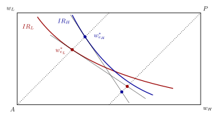{fig-alt="Contract space with the wage after the good outcome on the horizontal axis and after the bad outcome on the vertical axis. Participation curves for high and low effort are shown, tangent to iso-cost lines on the 45-degree full-insurance line."}
:::

The diagram plots the wage paid after the good outcome, $w_H$, on the horizontal axis
against the wage paid after the bad outcome, $w_L$, on the vertical axis. Every point in the
box is a feasible contract.

- **Opposed directions of preference:** The manager's welfare improves moving northeast,
  since higher wages in both states are better for her. The owner's improves moving
  southwest. Any contract is a compromise between the two.
- **The 45° line:** Along the diagonal the manager is paid the same in both states, so she is
  perfectly insured. Here manager and owner share a marginal rate of substitution of
  $-p_e/(1-p_e)$, where $p_e$ is the probability of the good outcome under the effort $e$
  being implemented.
- **Slopes reflect effort, not risk aversion:** The curves for $e_H$ and $e_L$ differ in
  slope because effort shifts the probability of success. Under $e_H$ the good state is more
  likely, making the curves steeper; under $e_L$ they are flatter. Neither the utility
  function nor the degree of risk aversion affects the slope.
- **Effort cost fixes the position of $IR_e$:** Since $g(e_H) > g(e_L)$, the manager needs
  higher expected wages to reach $\overline{u}$ under high effort, so $IR_H$ lies above and
  to the right of $IR_L$.
- **The owner's choice:** She takes the best contract available while keeping the manager on
  her participation curve, and implements $e_H$ when the extra expected revenue covers the
  extra wage needed to satisfy $IR_H$.

Full insurance, zero rents, and efficient effort. This is the benchmark against which
everything that follows will be measured, and none of it survives intact once the owner can
no longer see what the manager does. The next two sections remove that assumption, first with
a risk-neutral manager and then with a risk-averse one.

### Benchmark 2: Unobservable Effort with a Risk-Neutral Manager

Before confronting the full complexity of moral hazard, it helps to take an intermediate
step that is both analytically clean and economically revealing. Effort remains
*unobservable*, so the owner cannot monitor the manager, but the manager is now assumed to
be risk neutral. With risk-neutral preferences, utility is linear in wages, so setting
$v(w)=w$ gives the manager's utility function:

$$
u(w, e) = w - g(e)
$$

This case is illuminating precisely because it isolates the *pure incentive problem* without
any entanglement from risk preferences. Comparing the solution here with the first-best
answers a sharp question: is unobservability by itself what distorts efficiency, or does the
distortion arise from the interplay of unobservability and risk aversion?

#### The contracting problem with unobservable effort

When effort is unobservable, the owner cannot write a contract that mandates $e_H$. Any such
instruction is unenforceable. Instead, the contract must be *self-enforcing*: given the pair
of wages $(w_H, w_L)$, the manager must *prefer* to exert the target effort $e$ over the
alternative $e'$. This is the essence of the **incentive compatibility (IC) constraint**.

The owner's problem is now

$$
\max_{e,\; (w_H, w_L)} \; p_e\bigl(\pi_H - w_H\bigr) + (1-p_e)\bigl(\pi_L - w_L\bigr)
$$

subject to

$$
\begin{aligned}
\text{(IR)} \quad & p_e\, w_H + (1-p_e)\, w_L - g(e) \geq \overline{u} \\[6pt]
\text{(IC)} \quad & p_e\, w_H + (1-p_e)\, w_L - g(e) \geq p_{e'}\, w_H + (1-p_{e'})\, w_L - g(e')
\end{aligned}
$$

Relative to the first-best, the constraint set has expanded: both (IR) *and* (IC) now apply.
The (IC) constraint requires the wage schedule to make the manager prefer the owner's
intended effort level $e$ over any deviation $e'$.

Note the key feature: the pair $(w_H, w_L)$ is held fixed on both sides. The manager cannot
renegotiate her pay when she deviates. She faces the same two payments whichever effort she
chooses; all that changes is the probability with which each is realised.

#### The franchise contract

The key insight is to search for a contract that makes (IC) *trivially satisfied* at both
effort levels, not by carefully balancing incentive payments, but by restructuring who owns
the residual. Consider the following class of contracts:

$$
w_H = \pi_H - \alpha, \qquad w_L = \pi_L - \alpha,
$$

that is, $w(\pi) = \pi - \alpha$ whichever outcome occurs, where $\alpha \geq 0$ is a fixed
fee paid by the manager to the owner.

Under this arrangement, the owner receives a safe, certain income of $\alpha$ regardless of
the outcome; the manager pays $\alpha$ upfront and retains every pound of profit the project
generates. The manager is the **residual claimant**.

This is why the arrangement is often described as **selling the firm to the manager**: for a
price of $\alpha$ she buys the project outright and keeps whatever it earns. "Franchise
contract" and "selling the firm" name the same contract, and the second name makes the
mechanism plainer.

#### Why the contract trivially satisfies incentive compatibility

Substituting into the manager's objective:

$$
\begin{aligned}
p_e\, w_H + (1-p_e)\, w_L - g(e) &= p_e\bigl(\pi_H - \alpha\bigr) + (1-p_e)\bigl(\pi_L - \alpha\bigr) - g(e) \\
&= \underbrace{p_e \pi_H + (1-p_e)\pi_L}_{\text{expected gross profit}} - \alpha - g(e)
\end{aligned}
$$

Since $\alpha$ is a constant that does not vary with $e$, the manager's problem reduces to

$$
\max_{e} \; p_e \pi_H + (1-p_e)\pi_L - g(e)
$$

This is **identical** to the social planner's problem, the problem that maximises total
expected surplus. The manager internalises the full marginal return to effort. There is no
wedge between her private incentives and social efficiency, so whatever effort level she
freely chooses is precisely the socially optimal level $e^*$.

#### Determining the optimal fee

The owner sets $\alpha$ to extract maximum rent while still satisfying (IR). At the optimum,
(IR) binds:

$$
p_{e^*} \pi_H + (1-p_{e^*})\pi_L - \alpha - g(e^*) = \overline{u}
$$

Solving:

$$
\alpha^* = p_{e^*} \pi_H + (1-p_{e^*})\pi_L - g(e^*) - \overline{u}
$$

::: {.highlightbox}
**Proposition 2: efficiency under bilateral risk neutrality**

When both the owner and the manager are risk neutral, the optimal contract is the franchise,
or "sell the firm", contract $w(\pi) = \pi - \alpha^*$. This contract:

- Implements the first-best effort level $e^*$.
- Delivers the first-best expected total surplus.
- Leaves the manager with her outside option utility $\overline{u}$, so zero rents.
- Transfers all residual risk, and all residual profit, to the manager.

**Proof.** The franchise contract is feasible, since it satisfies both (IR) and (IC), and it
achieves total surplus equal to the first-best. Since no feasible contract can exceed the
first-best, which represents the unconstrained maximum, the franchise contract is optimal.

**Corollary.** Under bilateral risk neutrality, moral hazard causes no efficiency loss. The
second-best coincides with the first-best.
:::

#### The economic mechanism: residual claimancy

The result may seem remarkable, but the mechanism is simple and general. The incentive
problem arises because the manager bears the cost of effort but does not fully capture its
benefits when the contract insulates her from variation in outcomes. The franchise contract
*eliminates* this wedge entirely by internalising the externality, so that the manager
becomes the full residual claimant and captures every pound of incremental profit her effort
generates.

This is the principle of **residual claimancy**, and it underlies a wide range of
institutional arrangements observed in practice.

- **Franchising.** A franchisee pays a fixed fee to the franchisor and keeps all local
  operating profits. With full residual claimancy, the franchisee has exactly the same
  incentives as an independent owner, and the moral hazard problem that plagues employment
  relationships is dissolved.
- **Fixed-rent tenancy.** A tenant farmer pays a fixed land rent and retains the entire
  harvest. This gives efficient farming incentives, in sharp contrast to sharecropping, where
  the tenant surrenders a fraction of output to the landlord and consequently faces marginal
  incentives diluted by the sharing rule.
- **Debt finance.** An entrepreneur who borrows at a fixed interest rate retains all residual
  profits above the debt repayment. Her incentive to exert effort is undistorted, since she
  is the residual claimant on the upside.
- **Private ownership.** A sole proprietor who owns a firm outright faces the purest form of
  residual claimancy. The efficiency properties of owner-managed firms follow directly from
  this logic.

In each case, the institutional arrangement that "solves" the incentive problem works through
the same channel: assign the residual to the party whose effort is to be elicited.

#### A critical qualification: risk allocation has changed

Despite this efficiency result, something important has shifted relative to the first-best.

|  | First-best | Franchise contract |
|---|---|---|
| Who bears income risk? | Owner (fully) | Manager (fully) |
| Effort level | $e^*$ | $e^*$ |
| Total surplus | First-best | First-best |
| Manager's utility | $\overline{u}$ | $\overline{u}$ |

**What has not changed?** The effort level and total surplus are identical across the two
columns, and the manager earns exactly her outside option in both. On every measure of
efficiency, the franchise contract matches the first-best.

**What has inverted?** The risk allocation has flipped. In the first-best with observable
effort, the risk-neutral owner bore all income risk and the manager received a certain fixed
wage. Under the franchise contract, the manager bears all of it.

**Why is this costless here?** For a *risk-neutral* manager the inversion is inconsequential.
She is indifferent between a certain payment of
$p_{e^*}\pi_H + (1-p_{e^*})\pi_L - \alpha^*$ and the variable payment with that same expected
value, because risk neutrality means she demands no premium for bearing income variance.

**Why will this not survive risk aversion?** For a *risk-averse* manager, the franchise
contract imposes a real cost. She suffers a utility loss from bearing income risk and will
demand a risk premium on top of her outside option, driving up the cost of the contract to
the owner. Any attempt to reduce her risk exposure, by making wages less sensitive to
outcomes, simultaneously weakens her incentive to exert effort, since she is no longer the
full residual claimant.

This is the **insurance–incentives trade-off**, the irreducible tension at the heart of moral
hazard theory. It does not arise under risk neutrality, because the cost of bearing risk is
zero. Once risk aversion enters, the trade-off binds. That is the subject of the next
section.

### Moral Hazard with a Risk-Averse Manager

#### The formal problem

The owner's strategy is to choose a target effort level $e \in \{e_L, e_H\}$ and a pair of
wages $(w_H, w_L)$ that minimises the expected cost of implementing that effort, then to
compare net payoffs across the two effort levels.

**The cost-minimisation problem.** For a given target effort $e$, with alternative $e'$, the
problem is

$$
\min_{(w_H, w_L)} \; p_e\, w_H + (1-p_e)\, w_L
$$

subject to

$$
\begin{aligned}
\text{(IR)} \quad & p_e\, v(w_H) + (1-p_e)\, v(w_L) - g(e) \geq \overline{u} \\[6pt]
\text{(IC)} \quad & p_e\, v(w_H) + (1-p_e)\, v(w_L) - g(e) \geq p_{e'}\, v(w_H) + (1-p_{e'})\, v(w_L) - g(e')
\end{aligned}
$$

**Understanding the constraint set.** (IR) requires that the manager's expected utility
under the contract be no less than her outside option $\overline{u}$. Without it, she walks
away. (IC) requires that, given the wages $(w_H, w_L)$, the manager prefers to exert effort
$e$ over the available deviation $e'$. Because the owner cannot observe effort, she can
neither prevent deviations by contract nor monitor them. The contract must therefore be
*self-enforcing*: high effort must be a best response for the manager.

This is the structural departure from the first-best. There, the owner faced a single binding
constraint and dictated effort. Here she faces two, and they pull in opposite directions.

**Simplifying the constraint for the binary case.** Collecting terms, the (IC) for
implementing $e_H$ reduces to a single inequality:

$$
\underbrace{(p_H - p_L)}_{\text{shift in the odds}} \cdot \underbrace{\bigl[v(w_H) - v(w_L)\bigr]}_{\text{utility spread the contract offers}} \;\geq\; \underbrace{g(e_H) - g(e_L)}_{\equiv\, \Delta g \;>\; 0}
$$

The left-hand side is the *expected marginal benefit of effort* to the manager: working
harder raises the chance of the good outcome by $p_H - p_L$, and the good outcome is worth
$v(w_H) - v(w_L)$ more to her than the bad one. The right-hand side is the *marginal cost*
she bears personally.

Three things follow immediately.

- A flat wage cannot implement $e_H$. With $w_H = w_L$ the left-hand side is zero and the
  inequality fails, since $\Delta g > 0$.
- The required spread is $v(w_H) - v(w_L) \geq \Delta g / (p_H - p_L)$. The manager must be
  exposed to risk, and the ratio says how much.
- The noisier the signal, meaning the smaller $p_H - p_L$, the larger that spread must be. As
  $p_H \to p_L$ it grows without bound, and high effort becomes impossible to buy.

#### Implementing low effort

As in the observable-effort case, begin by fixing the target effort level and then derive the
minimum wage needed to implement it. Start with the low-effort case.

The optimal way to implement $e_L$ turns out to be simple: the (IC) constraint is
*redundant*, imposing no restriction beyond what (IR) already requires. The problem therefore
reduces to the first-best cost-minimisation problem, and the solution is identical.

Targeting $e_L$ means the owner needs a contract under which the manager weakly prefers $e_L$
to the deviation $e_H$, so the (IC) requires

$$
-(p_H - p_L)\bigl[v(w_H) - v(w_L)\bigr] \;\geq\; -\Delta g
$$

Since $\Delta g > 0$, the right-hand side is *strictly negative*. The (IC) is therefore
satisfied so long as the gain from deviating to $e_H$ is not too large. A flat wage, which
sets $v(w_H) - v(w_L) = 0$, satisfies it strictly.

The expected cost of implementing $e_L$ is therefore the same whether effort is observable or
not. Moral hazard imposes no cost at all in this regime, which is why the entire welfare cost
of the problem is concentrated in the high-effort case examined next.

#### Implementing high effort

**The owner's problem.** The owner minimises expected wages subject to both constraints:

$$
\min_{(w_H, w_L)} \; p_H\, w_H + (1-p_H)\, w_L
$$

subject to

$$
\begin{aligned}
\text{(IR)} \quad & p_H\, v(w_H) + (1-p_H)\, v(w_L) - g(e_H) \geq \overline{u} \\[6pt]
\text{(IC)} \quad & (p_H - p_L)\bigl[v(w_H) - v(w_L)\bigr] \geq \Delta g
\end{aligned}
$$

Unlike the low-effort case, neither constraint can be set aside here. The results that follow
establish that both bind at the optimum.

**The Lagrangean and the first-order condition.** The Lagrangean is

$$
\begin{aligned}
\mathcal{L} = &-\bigl[p_H\, w_H + (1-p_H)\, w_L\bigr] + \gamma \Bigl[p_H\, v(w_H) + (1-p_H)\, v(w_L) - g(e_H) - \overline{u}\Bigr] \\
&+ \mu \Bigl[(p_H - p_L)\bigl(v(w_H) - v(w_L)\bigr) - \Delta g\Bigr]
\end{aligned}
$$

where $\Delta g \equiv g(e_H) - g(e_L) > 0$, $\gamma \geq 0$ is the multiplier on (IR) and
$\mu \geq 0$ the multiplier on (IC).

Differentiating with respect to each wage:

$$
\begin{aligned}
\frac{\partial \mathcal{L}}{\partial w_H} &= -p_H + \gamma\, v'(w_H)\, p_H + \mu\, v'(w_H)\,(p_H - p_L) = 0 \\[4pt]
\frac{\partial \mathcal{L}}{\partial w_L} &= -(1-p_H) + \gamma\, v'(w_L)\,(1-p_H) - \mu\, v'(w_L)\,(p_H - p_L) = 0
\end{aligned}
$$

Dividing each by its probability and rearranging gives the pair

$$
\frac{1}{v'(w_H^{**})} = \gamma + \mu\!\left[1 - \frac{p_L}{p_H}\right],
\qquad
\frac{1}{v'(w_L^{**})} = \gamma + \mu\!\left[1 - \frac{1-p_L}{1-p_H}\right]
$$

Both have the same shape. Writing
$\ell_i \equiv \Pr(\pi_i \mid e_L) / \Pr(\pi_i \mid e_H)$ for the **likelihood ratio** of
outcome $i$, so that $\ell_H = p_L/p_H$ and $\ell_L = (1-p_L)/(1-p_H)$, each condition reads

$$
\frac{1}{v'(w_i^{**})} = \gamma + \mu\bigl[1 - \ell_i\bigr], \qquad i \in \{L, H\}.
$$

This first-order condition, due to Mirrlees (1976) and Holmström (1979), is the central
equation of principal–agent theory, and it takes the same form however many outcomes there
are. Every important result of the model follows from reading it carefully.

**Reading the first-order condition.** The left-hand side, $1/v'(w)$, is the **marginal cost
of delivering one additional unit of utility** to the manager at wage $w$. Because $v$ is
strictly concave, $v'$ is strictly decreasing, so $1/v'(w)$ is strictly increasing in $w$.
Transferring utility to the manager is cheap when she is poorly paid, since each pound buys a
lot of utility, and expensive when she is well paid.

The right-hand side has two components:

- $\gamma$ is the shadow cost of (IR): the baseline cost of attracting the manager,
  independent of any incentive consideration.
- $\mu\bigl[1 - \ell_i\bigr]$ is the **incentive adjustment**: the premium or discount applied
  to outcome $\pi_i$ according to how informative that outcome is about whether the manager
  exerted high effort.

The likelihood ratio does all the work in what follows. Since $p_H > p_L$, the good outcome
has $\ell_H < 1$ and attracts a premium, while the bad outcome has $\ell_L > 1$ and attracts
a discount. Pay attaches to evidence of effort, not to profit as such: here the two coincide,
because with only two outcomes the profitable one is also the one that is evidence of effort.

#### Three implications of the first-order condition

::: {.answerbox}
**Result 1: both constraints bind.** At any solution to the cost-minimisation problem when
$e_H$ is the target effort, $\gamma > 0$ and $\mu > 0$.

**Proof.**

- *Suppose $\gamma = 0$.* The owner could then reduce the wage paid in the low-profit outcome
  slightly without violating (IC), giving a better contract that still implements $e_H$. This
  contradicts optimality, so $\gamma > 0$ and (IR) binds.
- *Suppose $\mu = 0$.* The owner could then reduce the manager's risk slightly by decreasing
  the wage paid in the high-profit outcome and increasing the wage paid in the low-profit
  outcome, without violating (IC). Lower risk means the manager will participate for a lower
  expected wage, giving a better contract that still implements $e_H$. This contradicts
  optimality, so $\mu > 0$ and (IC) binds.
:::

::: {.answerbox}
**Result 2: the manager bears risk, and is paid more after the good outcome.** The
second-best contract satisfies $w_H^{**} > \tilde{w} > w_L^{**}$, where $\tilde{w}$ is the
wage defined by $1/v'(\tilde{w}) = \gamma$. In particular $w_H^{**} > w_L^{**}$: the manager
is not fully insured, and pay rises with profit.

**Proof.** From the first-order condition,
$1/v'(w_i^{**}) = \gamma + \mu[1 - \ell_i]$, and $\mu > 0$ by Result 1, so the wage is
strictly decreasing in the likelihood ratio $\ell_i$. Since $p_H > p_L$,

$$
\ell_H = \frac{p_L}{p_H} < 1 < \frac{1-p_L}{1-p_H} = \ell_L,
$$

so the good outcome carries a premium over $\tilde{w}$ and the bad outcome a discount.
Because $v'' < 0$ under risk aversion, $1/v'$ is strictly increasing, and the ordering of
$1/v'(w_i^{**})$ carries over to the wages themselves.

**What the ordering means.** The good outcome is paid more because it is *evidence* of high
effort, not because there is more money to share in that state. In general the wage lies
above $\tilde{w}$ where $\ell_i < 1$, so that the outcome is more likely under $e_H$; below
$\tilde{w}$ where $\ell_i > 1$; and at $\tilde{w}$ wherever $\ell_i = 1$ and the outcome says
nothing about effort. With two outcomes, $p_H > p_L$ is all that is needed for the evidence
ranking and the profit ranking to coincide.
:::

::: {.infobox}
**What changes with more than two outcomes**

With two outcomes, "pay rises with profit" and "pay rises with evidence of effort" say the
same thing, since there is only one way to order two outcomes. With a longer profit ladder
they can come apart. The wage is still ordered by the likelihood ratio, but that ordering
need not match the ordering of profits, and pay rises with profit only if $\ell_i$ falls as
$\pi_i$ rises, a condition known as the **monotone likelihood ratio property**.

It can fail. Consider a manager who "swings for the fences" with a high-variance strategy.
Very high profits may then be more likely under a risk-taking, low-effort manager than under
a diligent, conservative one, so a spectacular result is evidence of gambling rather than of
effort. The optimal contract then *penalises* extreme outcomes. This is directly relevant to
executive compensation in financial services, where uncapped short-run bonuses can reward
risk-taking at the expense of long-run value.
:::

::: {.answerbox}
**Result 3: the agency cost is strictly positive.** The **agency cost of moral hazard** is
defined as

$$
AC \;\equiv\; \underbrace{p_H\, w_H^{**} + (1-p_H)\, w_L^{**}}_{\text{second-best expected wage}} \;-\; \underbrace{v^{-1}\!\bigl(\overline{u} + g(e_H)\bigr)}_{w_{e_H}^*\;:\;\text{first-best fixed wage}}
$$

and it is strictly positive: $AC > 0$.

**Proof.** Both constraints bind by Result 1, so the binding (IR) gives

$$
p_H\, v(w_H^{**}) + (1-p_H)\, v(w_L^{**}) = \overline{u} + g(e_H)
$$

Since $\mu > 0$, the two wages differ. Applying Jensen's inequality with the strict concavity
of $v$:

$$
v\!\bigl(p_H\, w_H^{**} + (1-p_H)\, w_L^{**}\bigr) \;>\; p_H\, v(w_H^{**}) + (1-p_H)\, v(w_L^{**}) \;=\; \overline{u} + g(e_H)
$$

Applying the strictly increasing inverse $v^{-1}$ to both sides:

$$
p_H\, w_H^{**} + (1-p_H)\, w_L^{**} \;>\; v^{-1}\!\bigl(\overline{u} + g(e_H)\bigr) = w_{e_H}^*
$$

Hence $AC > 0$: delivering the same expected utility through a variable wage costs strictly
more than delivering it through a certain one.
:::

The proof of Result 3 reveals the exact source of the agency cost. It is the **risk premium**
the owner must pay to compensate the risk-averse manager for bearing the income variance that
(IC) forces upon her.

The distortion can be seen directly in contract space.

::: {.gametree}
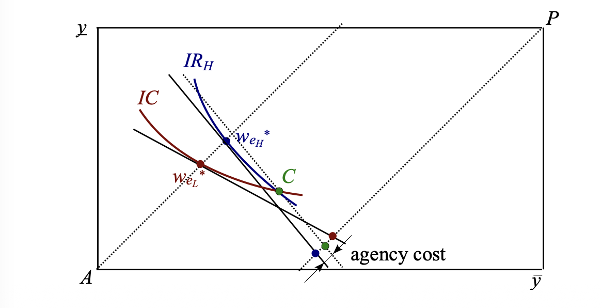{fig-alt="Contract space showing the 45-degree full-insurance line, the participation curve IR_H, the incentive curve IC, and the second-best contract C at their intersection, with the agency cost marked."}
:::

Reading the diagram:

- **The full-insurance line.** The 45° line represents equal wages in the good and bad states.
  In the first-best the contract lies on this line, so the manager bears no risk at all.
- **The participation curve.** The curve $IR_H$ is the manager's indifference curve through
  $e_H$ at utility $\overline{u}$. It represents every contract giving her exactly her outside
  option when she exerts high effort. Because (IR) binds, the optimal contract must lie
  somewhere on this curve.
- **The incentive curve.** (IC) requires the contract to lie on or above the curve
  $IC \equiv IR_L$, the set of contracts under which the manager is just indifferent between
  $e_H$ and $e_L$. Contracts strictly above this curve induce high effort; contracts below it
  induce low effort.
- **The second-best contract.** Since both constraints bind, the optimal contract sits at
  point $C$, the intersection of $IR_H$ and $IC$. This point lies strictly off the 45° line,
  so the manager bears some income risk. It also lies below the first-best contract on
  $IR_H$, and that gap is the agency cost.

#### Structural properties of the second-best contract

The optimal contract implementing $e_H$ has four features:

- **Partial risk exposure:** The two wages differ, since $\mu > 0$, but by strictly less than
  under the franchise contract, where the spread is the full $\pi_H - \pi_L$. The manager
  bears some, but not all, income risk.
- **Informativeness-based pay:** The premium or penalty at an outcome is determined by its
  likelihood ratio $\ell_i$, not by the profit level itself. The good outcome is rewarded
  because it is evidence of high effort, and the size of the reward is set by
  $\Delta g/(p_H - p_L)$, the utility spread (IC) demands.
- **Strictly positive agency cost:** $AC > 0$, so the owner's expected profit falls strictly
  below the first-best. This is the deadweight loss from the information asymmetry, and no
  contract can eliminate it however cleverly designed.
- **Zero rents for the manager:** Both constraints bind, so she earns exactly $\overline{u}$.
  The entire agency cost falls on the owner.

::: {.infobox}
**Why can the conflict not be resolved?**

The results so far establish a structural asymmetry: moral hazard is distortionary *if and
only if* the owner targets the higher effort level. When she targets $e_L$, any flat wage
satisfying (IR) with equality automatically satisfies (IC) strictly. The manager would bear
the full incremental disutility $\Delta g > 0$ from deviating to $e_H$, while her expected
pay would be unchanged, since a flat wage pays the same whichever outcome occurs and effort
only shifts the odds between outcomes. Deviation is strictly unprofitable, so the entire
welfare cost of moral hazard is concentrated in the high-effort regime.

In that regime, two requirements pull in opposite directions and cannot both be satisfied at
once:

- **Efficient risk sharing calls for a flat wage**, one that does not depend on which outcome
  is realised. With a risk-averse manager and a risk-neutral owner, optimal insurance means
  the manager bears no outcome risk.
- **Incentive compatibility calls for a variable wage.** The manager must actually prefer
  $e_H$ to $e_L$, and since effort is costly and unobservable, the only way to make high
  effort attractive is to tie her pay to outcomes, rewarding good results and penalising bad
  ones.

A contract cannot do both. The second-best resolves the conflict by conceding partial risk
exposure, and the agency cost is what that concession costs the owner.
:::

#### When is high effort socially worthwhile?

High effort is implemented if and only if

$$
\underbrace{\bigl[p_H \pi_H + (1-p_H)\pi_L\bigr] - \bigl[p_H w_H^{**} + (1-p_H) w_L^{**}\bigr]}_{\text{owner's expected profit under } e_H} \;\geq\; \underbrace{\bigl[p_L \pi_H + (1-p_L)\pi_L\bigr] - w_{e_L}^*}_{\text{owner's expected profit under } e_L}
$$

Rearranging, the condition requires that the gain in expected output from $e_H$ outweighs the
additional total compensation cost:

$$
\underbrace{(p_H - p_L)(\pi_H - \pi_L)}_{\text{expected output gain}} \;\geq\; \underbrace{\bigl[p_H w_H^{**} + (1-p_H) w_L^{**}\bigr] - w_{e_L}^*}_{\text{additional compensation cost}}
$$

The right-hand side now exceeds the first-best implementation cost by the agency cost. This
implies a key and often overlooked result: *the owner may choose to implement low effort even
where high effort would be socially efficient*, if the agency cost of inducing high effort is
sufficiently large.

Moral hazard therefore causes not just a distortion in the *form* of the contract, but a
distortion in the *effort level* chosen. This is a second layer of efficiency loss.

#### Comparative statics

High effort is less likely to be implemented when:

- **The manager is more risk averse:** She demands a larger risk premium to bear incentive
  risk, raising the agency cost. Formally, greater concavity in $v$ implies a larger gap
  between the expected wage and its certainty equivalent.
- **The effort productivity gap is smaller:** If $(p_H - p_L)(\pi_H - \pi_L)$ is small, the
  output benefit of high effort is modest and the agency cost may exceed it.
- **Outcome noise is greater:** When profits are driven mainly by factors outside the
  manager's control, they are a weak signal of effort. Formally, (IC) requires
  $v(w_H) - v(w_L) \geq \Delta g / (p_H - p_L)$, so as the odds shift $p_H - p_L$ shrinks,
  the required spread grows without bound. The manager is made to bear a great deal of risk,
  most of it rewarding or penalising luck rather than effort, for very little incentive
  benefit.
- **The manager's outside option works differently:** A higher $\overline{u}$ raises the
  fixed cost of satisfying (IR) whichever effort is targeted, without affecting the agency
  cost directly. Since it raises the cost of implementing $e_H$ and $e_L$ alike, its net
  effect on the effort decision depends on the curvature of $v$.

**Why noise matters.** The third of these comparative statics deserves particular emphasis:
*in noisier environments the agency cost of high effort is larger, so it may be optimal to
abandon high-powered incentives entirely*.

Where a manager's compensation is determined largely by macroeconomic fluctuations,
industry-wide shocks, or luck rather than her own choices, tying pay to outcomes is a blunt
and costly incentive instrument. In the limit, if $p_H = p_L$ so that profit is completely
uninformative about effort, the required spread $\Delta g/(p_H - p_L)$ is infinite: no wage
pair can satisfy (IC), and the owner can only implement low effort.

This provides a formal rationale for why high-powered incentive contracts are rare in sectors
where output is driven largely by aggregate factors.

### Economic Implications and Empirical Predictions

The principal–agent model yields testable predictions about the structure of compensation
contracts, insurance markets, financial regulation and agricultural organisation.

#### Insurance markets

This is a *different* insurance market from the one in the previous chapter. There, the
insurer faced a hidden **type**, a customer who already knew her accident probability, and
competition among insurers drove profits to zero. Here the insurer faces a hidden **action**:
the risk depends on care the policyholder chooses after the policy is signed, and the insurer
is a principal designing a single bilateral contract rather than a firm competing for
customers in a Rothschild–Stiglitz market. Partial coverage appears in both models and does
quite different work in each. Under adverse selection it separates good risks from bad; here
it keeps the policyholder's own money at stake so that she still takes care.

Within that setting, the model explains co-payments, deductibles, and coverage limits. These
features are often attributed to actuarial pricing, but the model reveals a deeper rationale:
they are a deliberate design response to moral hazard. By retaining some risk exposure for
the insured party, the insurer maintains a financial incentive for the policyholder to take
preventive action.

The cost is that policyholders are not fully insured, so the contract is second-best from a
risk-sharing perspective. This is the price of information asymmetry. The optimal insurance
contract balances the gain from risk reduction against the cost of weakened prevention
incentives, exactly as in the principal–agent problem.

Empirical evidence on health insurance (Finkelstein et al. 2012; Einav et al. 2013) and on
motor insurance (Abbring, Chiappori and Pinquet 2003) confirms that moral hazard is
quantitatively significant: coverage expansions do lead to measurable increases in
utilisation and risk-taking.

#### Financial regulation and systemic risk

When financial institutions expect government bailouts in the event of failure, they enjoy
implicit downside insurance. The model predicts, and the 2007–2008 global financial crisis
confirmed, that this implicit guarantee induces excessive risk-taking. The mechanism is
direct: with the downside socialised and the upside private, the bank's incentive structure
resembles holding a call option on the outcome. The socially efficient level of risk-taking
is not internalised.

Regulatory responses such as capital requirements, mandatory "bail-in" debt, resolution
frameworks, and restrictions on proprietary trading are best understood as mechanisms to
restore the institution's exposure to loss. They move the bank back toward the incentive side
of the trade-off by ensuring that equity holders and creditors bear losses before taxpayers.

The model thus provides a principled normative basis for financial regulation that goes
beyond the standard market-failure justifications.

#### Employment contracts and organisational design

The model explains why different occupations feature very different compensation structures.
Piece rates, commissions, and profit-sharing are common in sales, real estate, and law, where
individual output is observable and relatively easy to attribute to a specific agent's
effort. Flat salaries are standard in assembly-line manufacturing, public administration, and
academic research, where individual contribution is hard to measure, team production is
prevalent, and output variance is driven by factors outside individual control.

The model predicts precisely this pattern. High-powered incentives are optimal when:

- Individual output is a precise signal of individual effort, meaning low noise.
- The agent is not too risk averse.
- Effort has a large effect on expected output.

When these conditions fail, flat pay with monitoring is the second-best arrangement. This
prediction has been tested and confirmed in the empirical literature on incentive contracting
(see Prendergast 1999 for a comprehensive survey).

#### Agricultural contracts and development economics

Sharecropping contracts, under which a tenant farmer remits a fixed fraction $s \in (0,1)$ of
output to the landlord, create a classic moral hazard problem. The tenant captures only
$(1-s)$ of her marginal product, so her private return to effort falls strictly below the
social return. The result is inefficiently low effort.

Fixed-rent tenancy, as established in the risk-neutral benchmark earlier in this section,
eliminates this distortion by making the tenant the full residual claimant after a fixed
payment. But for a risk-averse tenant facing significant weather or price risk, fixed rent
imposes undesirable income volatility. Sharecropping provides partial insurance precisely
through the profit-sharing structure that weakens incentives.

The second-best contract therefore trades off insurance, the argument for sharecropping,
against incentives, the argument for fixed rent, and the optimal sharing rate $s^*$ is an
interior solution. This framework, due to Stiglitz (1974) and Cheung (1969), shaped an entire
literature on agricultural organisation in developing economies, and its predictions about
the prevalence of sharecropping against fixed-rent tenancy as a function of risk and
monitoring costs have been extensively examined (Otsuka, Chuma, and Hayami 1992).

The same framework therefore runs from executive pay to crop-sharing agreements, and from
insurance markets to prudential banking regulation. Its usefulness lies less in its generality
than in the fact that its comparative statics are sharp enough to be taken to data.

### Worked Example: Observable and Unobservable Effort

This example puts a number on the cost of moral hazard.

::: {.exercisebox}
**Setup**

A risk-neutral owner hires a risk-averse manager, who chooses between two effort levels:

- **Shirk** ($e = S$): zero effort cost, $c_S = 0$.
- **Work hard** ($e = H$): effort disutility of $c_H = 10$ in money units.

Revenue outcomes depend on effort:

|  | Revenue $= R$ | Revenue $= 0$ |
|---|---|---|
| Hard effort ($e = H$) | probability $0.8$ | probability $0.2$ |
| Shirk ($e = S$) | probability $0.3$ | probability $0.7$ |

**Preferences:**

- **Manager** (risk averse): utility $= \sqrt{w} - c_j$ when paid wage $w$ and exerting
  effort $e_j$.
- **Owner** (risk neutral): maximises expected profit $=$ expected revenue $-$ expected wage.

**Outside option:** the manager can take an outside job paying $w = 400$ with effort cost
$5$, giving utility $\sqrt{400} - 5 = 15$. She accepts the owner's contract if it gives her
at least $15$. If indifferent, she stays.
:::

Two numbers carry this example: the revenue threshold at which the owner chooses to induce
hard work when she can observe effort, and the same threshold when she cannot. The gap
between them is the cost of moral hazard.

#### Observable effort: inducing shirking

When the owner observes both effort and the revenue realisation, she can write a contract
$w(e, \text{revenue})$ that conditions wages on effort directly. Two considerations pin down
the contract:

- **Participation (IR):** The manager must prefer the contract to her outside option, so
  $\sqrt{w} - 0 \geq 15$, giving $w \geq 225$.
- **Cost minimisation:** The owner pays no more than she must, so $w = 225$.

Since effort is observable, the owner can simply specify shirking in the contract. She offers
a **flat wage of $225$** regardless of the revenue outcome. A flat wage is efficient here
because the risk-neutral owner should absorb all income risk, and with effort contractible
there is no incentive reason to expose the manager to any of it.

**Owner's expected profit:** $0.3R - 225$.

#### Observable effort: inducing hard work

Two conditions apply:

- **Participation (IR):** $\sqrt{w_H} - 10 \geq 15$, so $\sqrt{w_H} \geq 25$ and
  $w_H \geq 625$.
- **Cost minimisation:** set $w_H = 625$.

Since effort is directly observable, there is no incentive problem. The owner can *verify*
that the manager worked hard and pay $625$ accordingly, while paying a sufficiently low wage
if the manager shirks, which makes shirking unattractive.

With $w_H = 625$, the manager's payoff from working hard is $\sqrt{625} - 10 = 25 - 10 = 15$,
exactly her outside option.

Note what the contract does *not* do: the wage does not depend on the revenue realisation.
The manager receives **full insurance** and bears no income risk.

**Owner's expected profit:** $0.8R - 625$.

#### Observable effort: the owner's choice

The owner prefers hard work when

$$
0.8R - 625 \;\geq\; 0.3R - 225
$$

$$
0.5R \;\geq\; 400 \qquad \Longrightarrow \qquad R \;\geq\; 800
$$

**Intuition.** Inducing hard work raises the probability of the high revenue outcome from
$0.3$ to $0.8$, a gain of $0.5R$ in expected revenue, but costs an extra $625 - 225 = 400$ in
wages. It is worthwhile only when the revenue gain exceeds the wage premium.

#### Hidden effort: setting up the constraints

The contract can now condition only on the revenue realisation: $w_R$ if revenue is $R$, and
$w_0$ if revenue is $0$.

**Inducing shirking is unchanged.** A flat wage $w_R = w_0 = 225$ still works. Under a flat
wage the manager has no financial reason to exert costly effort whether or not she is
observed, so the optimal shirking contract is identical to the observable case, and the
owner's expected profit is again $0.3R - 225$.

**Inducing hard work now requires two constraints.** The **incentive compatibility**
constraint requires that hard work be at least as attractive as shirking:

$$
\underbrace{0.8\sqrt{w_R} + 0.2\sqrt{w_0} - 10}_{\text{utility from hard work}} \;\geq\; \underbrace{0.3\sqrt{w_R} + 0.7\sqrt{w_0}}_{\text{utility from shirking}}
$$

Rearranging gives

$$
0.5\sqrt{w_R} - 0.5\sqrt{w_0} \;\geq\; 10 \qquad \Longrightarrow \qquad \sqrt{w_R} - \sqrt{w_0} \;\geq\; 20 \qquad \text{(IC)}
$$

The **participation** constraint requires that expected utility from working hard be at least
the outside option:

$$
0.8\sqrt{w_R} + 0.2\sqrt{w_0} - 10 \;\geq\; 15 \qquad \Longrightarrow \qquad 4\sqrt{w_R} + \sqrt{w_0} \;\geq\; 125 \qquad \text{(IR)}
$$

(multiplying through by $5$).

**Intuition.** (IC) requires the wage *spread* to be large enough that the extra probability
of a high revenue outcome under hard effort, $0.8 - 0.3 = 0.5$, compensates the manager for
the effort cost of $10$. Pay must be sensitive to outcomes, which is precisely what the
observable-effort contract avoided.

#### Hidden effort: the optimal contract

The owner solves

$$
\max_{w_R,\, w_0} \;\; 0.8R - 0.8w_R - 0.2w_0 \qquad \text{subject to (IC) and (IR)}
$$

**Step 1: (IR) binds.** Suppose it did not, so the manager earns a strict surplus above $15$.
The owner could then lower $w_0$ slightly. This reduces the wage bill and *relaxes* (IC),
since a lower $w_0$ widens the spread $\sqrt{w_R} - \sqrt{w_0}$. Both constraints would still
hold at a lower cost, contradicting optimality. Hence

$$
4\sqrt{w_R} + \sqrt{w_0} = 125 \qquad \Longrightarrow \qquad \sqrt{w_0} = 125 - 4\sqrt{w_R}
$$

**Step 2: substitute into (IC).**

$$
\sqrt{w_R} - \bigl(125 - 4\sqrt{w_R}\bigr) \geq 20 \qquad \Longrightarrow \qquad 5\sqrt{w_R} \geq 145 \qquad \Longrightarrow \qquad \sqrt{w_R} \geq 29
$$

**Step 3: solve the reduced problem.** Writing $x = \sqrt{w_R}$, so that $w_R = x^2$ and
$w_0 = (125 - 4x)^2$, the Lagrangean is

$$
\mathcal{L} = 0.8R - 0.8x^2 - 0.2(125 - 4x)^2 + \lambda(x - 29)
$$

Differentiating:

$$
\frac{\partial \mathcal{L}}{\partial x} = -1.6x + 1.6(125 - 4x) + \lambda = -8x + 200 + \lambda = 0 \qquad \Longrightarrow \qquad \lambda = 8x - 200
$$

At the optimum either (IC) is slack, with $\lambda = 0$ and $x > 29$, or it binds, with
$\lambda > 0$ and $x = 29$.

Setting $\lambda = 0$ gives $x = 25$, which is below $29$ and violates (IC). The
unconstrained optimum is therefore infeasible, so **(IC) binds** at $x = 29$, giving
$\lambda = 8(29) - 200 = 32 > 0$. ✓

From the binding (IR), $\sqrt{w_0} = 125 - 4(29) = 9$. Therefore

$$
w_R = 841, \qquad w_0 = 81
$$

**Interpretation.** The manager earns $841$ if the project succeeds and only $81$ if it
fails. She bears substantial income risk, a direct consequence of effort being unverifiable,
and being risk averse she dislikes that exposure. The owner must compensate her for it
through higher expected wages.

#### Hidden effort: the new threshold

|  | Induce shirking | Induce hard work |
|---|---|---|
| Expected wage | $225$ | $0.8 \times 841 + 0.2 \times 81 = 689$ |
| Expected revenue | $0.3R$ | $0.8R$ |
| **Expected profit** | $0.3R - 225$ | $0.8R - 689$ |

The owner prefers hard work when

$$
0.8R - 689 \;\geq\; 0.3R - 225 \qquad \Longrightarrow \qquad 0.5R \geq 464 \qquad \Longrightarrow \qquad R \;\geq\; 928
$$

**Comparison with observable effort:**

|  | Observable effort | Unobservable effort |
|---|---|---|
| Threshold $R$ | $800$ | $928$ |
| Expected wage to induce hard work | $625$ | $689$ |
| Manager's risk exposure | None (full insurance) | Substantial ($w_R = 841$, $w_0 = 81$) |

::: {.infobox}
**The cost of moral hazard, in numbers**

Hidden effort imposes two distinct costs in this example.

- **A higher wage bill.** The owner pays $689$ in expectation instead of $625$, an extra
  $64$. This is the risk premium the risk-averse manager demands for accepting an unequal
  wage contract, and it is the agency cost in this example.
- **A distorted effort choice.** For $R$ between $800$ and $928$, the owner would induce hard
  work if she could observe effort, but settles for shirking when she cannot. Across that
  range, socially valuable effort goes unprovided because the information asymmetry makes it
  too costly to incentivise.

The second cost is the more striking. Moral hazard distorts not only the *form* of the
contract, through the risk the manager is forced to bear, but the *level of effort* the owner
chooses to buy.
:::

### Moral Hazard with Two Manager Types

Everything so far has assumed the owner knows exactly who she is hiring. She cannot see what
the manager *does*, but she knows what the manager *is*: her disutility of effort, her risk
preferences and her outside option are all common knowledge. Only the action is hidden.

In practice that is a strong assumption. Some managers find hard work genuinely easier than
others — through stamina, experience, better organisation, or simply a lower opportunity cost
of their time — and a prospective employer rarely knows which sort is sitting across the
table. This section extends the model so that the **cost of effort is itself private
information**. The owner now faces two layers of asymmetry at once: a hidden *type* before
contracting, and a hidden *action* afterwards.

This brings the chapter full circle. The screening problem we opened with was pure adverse
selection; the principal–agent problem of this section was, until now, pure moral hazard.
Here they operate simultaneously, and the interaction produces a result that neither model
delivers on its own.

#### Setup

The environment is exactly as before — two outcomes $\pi_H > \pi_L$, two effort levels, a
risk-neutral owner and a risk-averse manager with utility $v(w) - g(e)$ — with one change.

Normalise $g_\theta(e_L) = 0$ and write $g_\theta \equiv g_\theta(e_H)$ for the incremental
disutility of high effort. The manager is one of two types:

- Type $A$ (the **low-cost** type) with $g_A$, drawn with probability $\beta$;
- Type $B$ (the **high-cost** type) with $g_B > g_A$, drawn with probability $1 - \beta$.

Write $\Delta g \equiv g_B - g_A > 0$. The two types are identical in every other respect:
same $v(\cdot)$, same outside option $\overline{u}$, same technology $(p_H, p_L)$. Only the
price of effort differs.

**Timing.** Nature draws $\theta \in \{A, B\}$; the manager privately observes it; the owner
posts a **menu** of contracts; the manager selects one; she then chooses effort, which the
owner cannot observe; the outcome realises and wages are paid.

By the revelation principle (introduced in the screening section of this chapter) it is enough
to consider menus with one contract per type, $\{C^A, C^B\}$, under which each type
truthfully selects the contract meant for her.

#### Working in utility space

The algebra is far cleaner if the owner is treated as choosing *utilities* rather than wages.
Let

$$
u_H = v(w_H), \qquad u_L = v(w_L), \qquad h \equiv v^{-1}
$$

so that $h$ is increasing and **convex** (the inverse of an increasing concave function). The
wage needed to deliver utility $u$ is $h(u)$. For a contract $C = (u_H, u_L)$ define

$$
U_e(C) = p_e u_H + (1-p_e)u_L, \qquad \Delta(C) = u_H - u_L, \qquad K_e(C) = p_e h(u_H) + (1-p_e)h(u_L)
$$

so $U_e$ is expected utility of money under effort $e$, $\Delta$ is the **spread**, and $K_e$
is the owner's expected wage bill. A useful identity follows directly:

$$
U_L(C) = U_H(C) - (p_H - p_L)\,\Delta(C)
$$

Because $h$ is convex, widening the spread at a fixed $U_H$ is a mean-preserving spread in
utility and therefore strictly raises $K_H$. **The owner wants the smallest spread she can get
away with**, exactly as in the one-type model.

#### The four families of constraints

**Effort incentive compatibility.** To induce $e_H$ from type $\theta$ on contract $C$,

$$
(p_H - p_L)\,\Delta(C) \;\geq\; g_\theta \qquad\Longleftrightarrow\qquad \Delta(C) \;\geq\; \delta_\theta \equiv \frac{g_\theta}{p_H - p_L}
$$

Since $g_A < g_B$, we have $\delta_A < \delta_B$: **the low-cost type needs a smaller spread**.

**Participation.** $U_H(C^\theta) - g_\theta \geq \overline{u}$ for each type.

**Type incentive compatibility.** Each type must prefer its own contract. The subtlety is that
a deviating manager, having taken the *other* type's contract, then chooses whatever effort
suits her on it. Two deviations must be checked, and they are not symmetric.

::: {.highlightbox}
**Who can mimic whom, and how**

- **Type $A$ taking $C^B$ works hard.** $C^B$ must have spread at least $\delta_B > \delta_A$,
  so it more than satisfies $A$'s own effort constraint. $A$ gets $U_H(C^B) - g_A$ — the same
  gross package $B$ receives, but at a lower effort cost.
- **Type $B$ taking $C^A$ shirks.** $C^A$ needs a spread of only $\delta_A < \delta_B$, which
  is too flat to make high effort worthwhile for $B$. So $B$ pockets the pay and shirks,
  getting $U_L(C^A)$.

The low-cost type mimics to capture a *rent*; the high-cost type mimics to capture a *quiet
life*. Both deviations constrain the menu, and the second is the one that bites.
:::

Formally, if the owner wants both types to work hard:

$$
\begin{aligned}
\text{(T-A)} \quad & U_H(C^A) - g_A \;\geq\; U_H(C^B) - g_A \;\;\Longleftrightarrow\;\; U_H(C^A) \geq U_H(C^B) \\[4pt]
\text{(T-B)} \quad & U_H(C^B) - g_B \;\geq\; U_L(C^A) \;=\; U_H(C^A) - (p_H - p_L)\Delta(C^A)
\end{aligned}
$$

#### Result 1: the menu collapses

::: {.answerbox}
**Proposition 3.** If the owner wants *both* types to exert high effort, the optimal menu
consists of a **single contract**, the one that would be offered to the high-cost type alone:

$$
U_H = \overline{u} + g_B, \qquad \Delta = \delta_B
$$

Both types accept it, both work hard, the high-cost type earns exactly her outside option,
and the low-cost type earns an informational rent of exactly $\Delta g = g_B - g_A$.

**Proof.** First, (IR-B) binds. Raising $U_H(C^B)$ above $\overline{u} + g_B$ costs the owner
strictly more and relaxes nothing: it appears in (T-B) only through the combination below,
which is unaffected by it.

Given $U_H(C^B) = \overline{u} + g_B$, constraint (T-A) requires
$U_H(C^A) \geq \overline{u} + g_B$. Substituting both into (T-B) and rearranging,

$$
(p_H - p_L)\,\Delta(C^A) \;\geq\; U_H(C^A) - U_H(C^B) + g_B \;\geq\; g_B
$$

so $\Delta(C^A) \geq \delta_B$. The owner's cost is strictly increasing in both
$U_H(C^A)$ and $\Delta(C^A)$, so both sit at their lower bounds:
$U_H(C^A) = \overline{u} + g_B$ and $\Delta(C^A) = \delta_B$. But those are precisely the
terms of $C^B$, so $C^A = C^B$. ∎
:::

This is worth pausing on, because it is the opposite of what the screening section of this
chapter led us to expect. There, the monopolist separated two consumer types by *degrading* the
low-type product. Here the owner would like to give the low-cost manager a flatter, cheaper
contract — but any contract flat enough to suit type $A$ is a standing invitation for type $B$
to take it and shirk. Closing that door requires widening $A$'s spread all the way to
$\delta_B$, at which point $A$'s contract is indistinguishable from $B$'s.

::: {.infobox}
**Why screening fails here**

Separation requires an instrument that the two types rank differently. Under monopolistic
screening that instrument was *quality*, and single crossing guaranteed the ranking. Here the
only instrument is the **wage spread** — and both types dislike spread for exactly the same
reason, since they share the utility function $v$. The spread does not sort the types; it
only determines who finds effort worth exerting.

So the owner cannot screen on *contract terms* at a given effort level. The only thing that
separates these two managers is the **effort they are asked to supply**.
:::

The rent follows immediately. On the pooled contract type $A$ obtains

$$
U_H - g_A \;=\; \overline{u} + g_B - g_A \;=\; \overline{u} + \Delta g
$$

The low-cost manager is paid as though effort were as painful for her as it is for her
high-cost counterpart, and keeps the difference. This is the familiar informational rent of
screening models, arriving here through an entirely different route.

#### Result 2: separation happens through effort, not through contracts

If the owner will not pay the rent, her alternative is to stop buying effort from the
high-cost type. Suppose she targets $e_H$ from $A$ and $e_L$ from $B$. Then:

- $B$'s contract is **flat** at $h(\overline{u})$, since implementing low effort imposes no
  incentive constraint and the cheapest way to deliver $\overline{u}$ is full insurance.
- $A$'s contract is her own one-type second-best:
  $U_H(C^A) = \overline{u} + g_A$ with $\Delta(C^A) = \delta_A$.

Both type constraints now hold. Type $A$ considering $B$'s flat contract would shirk on it and
receive $\overline{u}$, exactly what her own contract delivers. Type $B$ considering $A$'s
contract would also shirk, receiving

$$
U_L(C^A) = U_H(C^A) - (p_H - p_L)\delta_A = \overline{u} + g_A - g_A = \overline{u}
$$

again exactly her own payoff. Both constraints hold with equality, so the menu is incentive
compatible under the usual tie-breaking convention, and **neither type earns a rent**.

A third possibility is to ask neither type for effort, paying everyone the flat wage
$h(\overline{u})$.

::: {.infobox}
**Why the owner never asks the high-cost type alone to work**

Buying effort from $B$ costs strictly more than buying it from $A$: $B$ needs both a higher
expected utility ($\overline{u} + g_B$ against $\overline{u} + g_A$) and a wider spread
($\delta_B$ against $\delta_A$), while the output gain $(p_H - p_L)(\pi_H - \pi_L)$ is the
same for both. So whenever $B$'s effort is worth buying, $A$'s certainly is. Only three
regimes survive.
:::

#### The three regimes

Write $S_e = p_e \pi_H + (1-p_e)\pi_L$ for expected gross profit under effort $e$, and
$K(U, \delta)$ for the expected wage cost of a high-effort contract with expected utility $U$
and spread $\delta$.

| Regime | Who works hard | Expected profit | Rent to type $A$ |
|---|---|---|---|
| 1. Pool on high effort | Both | $S_H - K(\overline{u}+g_B,\ \delta_B)$ | $\Delta g$ |
| 2. Separate by effort | Only $A$ | $\beta\bigl[S_H - K(\overline{u}+g_A,\ \delta_A)\bigr] + (1-\beta)\bigl[S_L - h(\overline{u})\bigr]$ | $0$ |
| 3. Pool on low effort | Neither | $S_L - h(\overline{u})$ | $0$ |

Comparing regimes 2 and 3 gives a condition identical to the one-type model, applied to type
$A$:

$$
\underbrace{S_H - S_L}_{\text{output gain}} \;\geq\; \underbrace{K(\overline{u}+g_A,\ \delta_A) - h(\overline{u})}_{\text{cost of motivating } A}
$$

Comparing regimes 1 and 2 gives the condition that is new to the two-type model:

$$
\underbrace{(1-\beta)\bigl(S_H - S_L\bigr)}_{\text{output gained from } B\text{'s effort}} \;\geq\; \underbrace{K(\overline{u}+g_B, \delta_B) - \beta K(\overline{u}+g_A, \delta_A) - (1-\beta)h(\overline{u})}_{\text{extra wage bill, including the rent paid to every } A}
$$

The right-hand side is the crux. To buy effort from the $(1-\beta)$ high-cost managers, the
owner must put *everyone* on the expensive contract — including the $\beta$ low-cost managers
who would have worked hard for less. She pays for $B$'s effort twice: once in $B$'s own
higher wage, and again in the rent conceded to every $A$.

#### Worked example

::: {.exercisebox}
Take the worked example from the previous section and add a second type. As before
$v(w) = \sqrt{w}$, $p_H = 0.8$, $p_L = 0.3$, $\overline{u} = 15$, $\pi_H = R$, $\pi_L = 0$.

The manager is now equally likely ($\beta = 0.5$) to be

- type $A$ with $g_A = 10$ — the manager of the previous section;
- type $B$ with $g_B = 15$.

Find the optimal menu and the owner's choice of regime as a function of $R$.
:::

::: {.answerbox}
With $v(w) = \sqrt{w}$ we have $h(u) = u^2$, and $p_H - p_L = 0.5$, so the minimum spreads are

$$
\delta_A = \frac{10}{0.5} = 20, \qquad \delta_B = \frac{15}{0.5} = 30
$$

**Regime 1 — pool on high effort.** By Proposition 3 the single contract has
$U_H = 15 + 15 = 30$ and $\Delta = 30$, so

$$
u_H = 30 + 0.2(30) = 36, \qquad u_L = 30 - 0.8(30) = 6
$$

$$
w_H = 36^2 = 1296, \qquad w_L = 6^2 = 36, \qquad \mathbb{E}[w] = 0.8(1296) + 0.2(36) = 1044
$$

Check the types. Type $B$: utility $30 - 15 = 15 = \overline{u}$, and her effort constraint
$0.5(30) = 15 \geq 15$ binds exactly. Type $A$: utility $30 - 10 = 20$, a rent of
$5 = \Delta g$, and her effort constraint $15 \geq 10$ is slack, so she works hard willingly.

Expected profit: $0.8R - 1044$.

**Regime 2 — separate by effort.** Type $A$ receives her own second-best contract,
$U_H = 15 + 10 = 25$ with $\Delta = 20$:

$$
u_H = 29,\quad u_L = 9 \quad\Longrightarrow\quad w_H = 841,\ w_L = 81,\ \mathbb{E}[w] = 689
$$

— precisely the contract derived in the one-type example. Type $B$ receives the flat wage
$15^2 = 225$ and shirks. Checking (T-B): type $B$ taking $A$'s contract and shirking earns
$0.3(29) + 0.7(9) = 15$, exactly her own payoff, so she does not deviate.

Expected profit: $0.5\,[0.8R - 689] + 0.5\,[0.3R - 225] = 0.55R - 457$.

**Regime 3 — pool on low effort.** Flat wage $225$, nobody works hard. Expected profit:
$0.3R - 225$.

**The owner's choice.**

| Comparison | Condition | Threshold |
|---|---|---|
| Regime 2 against 3 | $0.55R - 457 \geq 0.3R - 225$ | $R \geq 928$ |
| Regime 1 against 2 | $0.8R - 1044 \geq 0.55R - 457$ | $R \geq 2348$ |

So the owner pools on low effort for $R < 928$; buys effort from the low-cost type only for
$928 \leq R < 2348$; and puts everyone on the high-powered contract for $R \geq 2348$.

The first threshold, $928$, is exactly the one from the one-type example — unsurprisingly,
since type $A$ *is* that manager. The second threshold is new, and it is high: at $R = 2348$
the owner is paying an extra $1044 - 689 = 355$ per low-cost manager purely to bring the
high-cost ones along.
:::

#### What the second type changes

::: {.highlightbox}
**Four lessons from the two-type model**

1. **Screening on contract terms is impossible.** Both types dislike wage risk identically, so
   the spread cannot sort them. The owner's only separating instrument is the effort she asks
   for, which is why the optimal "both work hard" menu is a single contract.
2. **The low-cost type earns a rent of exactly $\Delta g$.** She is paid as if effort cost her
   $g_B$ and pockets the difference. As in the screening model, the rent accrues to the type
   whose incentive constraint binds — here the one who finds it cheapest to imitate.
3. **The distortion falls on the high-cost type, and it is a distortion of *effort*.** Over the
   intermediate range of $R$ she is deliberately left on a flat wage and allowed to shirk, even
   though her effort would be socially valuable. This is the two-type analogue of "distortion
   at the bottom": the quantity being distorted is effort rather than quality.
4. **Hidden types make high-powered incentives rarer.** The threshold for putting everyone on
   an incentive contract rises from $928$ to $2348$, because the owner must pay the rent to
   every low-cost manager in order to motivate the high-cost ones. Uncertainty about *who* the
   agent is, on top of uncertainty about *what she does*, pushes the firm further towards flat
   pay.
:::

The last point connects back to the empirical patterns discussed earlier. Flat salaries are
common not only where output is a noisy signal of effort, but also where the workforce is
heterogeneous in ways the employer cannot observe — because any incentive scheme strong enough
to motivate the marginal employee overpays everyone who was already willing to work.

:::: {.quiz data-answer="C"}
**Question 1.** In the two-type model with hidden effort costs, why does the optimal menu
collapse to a single contract when the owner wants both types to work hard?

(A) Because the two types have the same outside option, so they must receive the same contract.
(B) Because the revelation principle rules out menus with more than one item.
(C) Because any contract flat enough to suit the low-cost type would be taken by the high-cost type, who would then shirk.
(D) Because the low-cost type's participation constraint binds, leaving no room to differentiate.

::: {.feedback data-option="A"}
**Try again.** A common outside option does not force a common contract — the types could in
principle be offered different spreads. What rules that out is the high-cost type's incentive
to take the flatter contract and shirk on it.
:::

::: {.feedback data-option="B"}
**Try again.** The revelation principle does the opposite: it says it is *enough* to consider
menus with one contract per type. The collapse to a single contract is a result of the
constraints, not of the principle.
:::

::: {.feedback data-option="C"}
**Well done.** The low-cost type only needs spread $\delta_A$, but a contract with that spread
is too flat to make high effort worthwhile for the high-cost type, who would take it and
shirk. Deterring that requires widening the low-cost contract's spread to $\delta_B$, at which
point the two contracts coincide.
:::

::: {.feedback data-option="D"}
**Try again.** It is the *high-cost* type whose participation constraint binds. The low-cost
type earns a strictly positive rent of $\Delta g$, so her participation constraint is slack.
:::
::::

:::: {.quiz data-answer="B"}
**Question 2.** In the worked example, the owner's threshold for putting everyone on a
high-powered contract is $R \geq 2348$, well above the one-type threshold of $R \geq 928$. What
accounts for the gap?

(A) The high-cost type is more risk averse, so she demands a larger risk premium.
(B) To motivate the high-cost managers the owner must put the low-cost managers on the same expensive contract, paying each of them a rent of $\Delta g$.
(C) The probability of the good outcome falls when the workforce is heterogeneous.
(D) The high-cost type's participation constraint is slack, so she must be paid above her outside option.

::: {.feedback data-option="A"}
**Try again.** Both types share the same utility function $v(w) = \sqrt{w}$ and so the same
attitude to risk. They differ only in the disutility of effort, $g_\theta$.
:::

::: {.feedback data-option="B"}
**Well done.** Since the menu collapses, the only way to buy effort from the high-cost types is
to place everyone on the contract tailored to them. Each low-cost manager then costs
$1044$ instead of $689$ — an extra $355$ — and that overpayment is the rent $\Delta g$
expressed in wages.
:::

::: {.feedback data-option="C"}
**Try again.** The technology $(p_H, p_L)$ is identical for both types. What changes with
heterogeneity is the *cost* of inducing effort, not the probability with which effort
delivers the good outcome.
:::

::: {.feedback data-option="D"}
**Try again.** The high-cost type's participation constraint binds: she earns exactly
$\overline{u} = 15$. It is the *low-cost* type who is paid above her outside option.
:::
::::

### Quick Check-In {.unnumbered}

Test your understanding of the moral hazard material.

:::: {.quiz data-answer="B"}
**Question 1.** When the owner targets low effort $e_L$, the (IC) constraint imposes no restriction beyond the (IR). Why?

(A) Because low effort is always the socially efficient effort level.
(B) Because under a flat wage the manager's expected pay is unaffected by effort, while high effort carries strictly positive disutility.
(C) Because the owner can verify low effort at zero cost.
(D) Because the participation constraint fails under low effort.

::: {.feedback data-option="A"}
**Try again.** Whether $e_L$ or $e_H$ is efficient depends on the output gain from effort. The redundancy of (IC) here is a separate, purely incentive-based point.
:::

::: {.feedback data-option="B"}
**Well done.** With a constant wage the manager is paid the same whichever outcome occurs, so shifting the odds from $p_L$ to $p_H$ leaves her expected pay untouched: she gains nothing financially from deviating to $e_H$ but bears $g(e_H) - g(e_L) > 0$. She strictly prefers to shirk, and (IC) holds with slack. This is why the entire welfare cost of moral hazard is concentrated in the high-effort regime.
:::

::: {.feedback data-option="C"}
**Try again.** Effort remains unobservable throughout. Nothing about the monitoring technology changes when the target effort changes.
:::

::: {.feedback data-option="D"}
**Try again.** (IR) binds at $w = v^{-1}(\bar{u} + g(e_L))$, exactly as in the first-best. It is satisfied, not violated.
:::

::::

:::: {.quiz data-answer="B"}
**Question 2.** Under bilateral risk neutrality the franchise, or `sell the firm', contract $w(\pi) = \pi - \alpha^*$ achieves the first-best. What is the mechanism?

(A) The fixed fee $\alpha^*$ allows the owner to monitor effort indirectly.
(B) The manager becomes the full residual claimant, so her private problem coincides with the social planner's.
(C) Risk is eliminated from the relationship entirely.
(D) The manager earns a strictly positive rent, which motivates effort.

::: {.feedback data-option="A"}
**Try again.** No monitoring occurs. The contract works by changing who holds the residual claim, not by revealing effort.
:::

::: {.feedback data-option="B"}
**Well done.** Since $\alpha$ does not vary with $e$, the manager's objective reduces to $\max_e \; p_e \pi_H + (1-p_e)\pi_L - g(e)$, which is exactly the surplus-maximisation problem. She internalises the full marginal return to effort, so (IC) is satisfied trivially at $e^*$ and no wedge remains.
:::

::: {.feedback data-option="C"}
**Try again.** Risk is not eliminated, it is reallocated: the manager now bears all of it. That is costless only because she is risk neutral, which is precisely why the result does not survive risk aversion.
:::

::: {.feedback data-option="D"}
**Try again.** (IR) binds, so she earns exactly $\bar{u}$. Effort is motivated by marginal incentives, not by the level of her payoff.
:::

::::

:::: {.quiz data-answer="B"}
**Question 3.** In the second-best contract with a risk-averse manager, what determines the wage attached to each outcome?

(A) The level of profit, since a better outcome means more to share.
(B) The likelihood ratio $\ell_i = \Pr(\pi_i \mid e_L) / \Pr(\pi_i \mid e_H)$.
(C) The manager's degree of risk aversion alone.
(D) The variance of profits under high effort.

::: {.feedback data-option="A"}
**Try again.** Pay tracks profit only indirectly. Two outcomes with very different profit levels attract the same wage if they are equally informative about effort.
:::

::: {.feedback data-option="B"}
**Well done.** The first-order condition gives $1/v'(w_i^{**}) = \gamma + \mu[1 - \ell_i]$. Since $\mu > 0$, the wage is strictly decreasing in the likelihood ratio: outcomes that are evidence of high effort are rewarded, outcomes that are evidence of shirking are penalised. Here $\ell_H = p_L/p_H < 1 < (1-p_L)/(1-p_H) = \ell_L$, so the good outcome is the one that is paid more. Pay attaches to evidence, and with two outcomes the evidence happens to run the same way as profit.
:::

::: {.feedback data-option="C"}
**Try again.** Risk aversion shapes how costly the required variation is, through the curvature of $v$, but the *pattern* of rewards across outcomes is set by the likelihood ratio.
:::

::: {.feedback data-option="D"}
**Try again.** Outcome noise matters for whether high effort is worth implementing at all, but it does not determine which individual outcomes are rewarded.
:::

::::

:::: {.quiz data-answer="C"}
**Question 4.** The agency cost of moral hazard, $AC > 0$, is strictly positive. What is its source?

(A) The cost of monitoring the manager's effort.
(B) The rents the manager extracts from her private information.
(C) The risk premium the owner must pay to compensate the manager for the income variance that (IC) forces upon her.
(D) The additional disutility of effort $g(e_H) - g(e_L)$.

::: {.feedback data-option="A"}
**Try again.** No monitoring takes place in the model. The cost arises even though the owner spends nothing on observation.
:::

::: {.feedback data-option="B"}
**Try again.** Both constraints bind, so she earns exactly $\bar{u}$ and zero rents. The entire agency cost falls on the owner. This is a sharp contrast with the screening model of Section 2, where the high type does capture a rent.
:::

::: {.feedback data-option="C"}
**Well done.** Because $\mu > 0$, the optimal schedule is non-constant. Jensen's inequality then implies that delivering $\bar{u} + g(e_H)$ through a variable wage costs strictly more in expectation than the certain wage $v^{-1}(\bar{u} + g(e_H))$. The gap is the risk premium, and no contract design can eliminate it.
:::

::: {.feedback data-option="D"}
**Try again.** That cost is present in the first-best too, and is already compensated there. The agency cost is measured net of it, as the gap between the second-best and first-best wage bills.
:::

::::

:::: {.quiz data-answer="C"}
**Question 5.** In which environment are high-powered incentive contracts *least* likely to be optimal?

(A) Where effort has a large effect on the distribution of output.
(B) Where individual output is a precise signal of individual effort.
(C) Where output is driven largely by aggregate shocks and luck.
(D) Where the manager is close to risk neutral.

::: {.feedback data-option="A"}
**Try again.** A large productivity gap makes high effort more worth buying, so high-powered incentives become *more* attractive.
:::

::: {.feedback data-option="B"}
**Try again.** This is the classic case *for* piece rates and commissions, as seen in sales and real estate.
:::

::: {.feedback data-option="C"}
**Well done.** When $p_H - p_L$ is small, (IC) requires a utility spread of at least $\Delta g/(p_H - p_L)$, so the wage gap must be very large, and most of it rewards or penalises luck. The manager bears substantial risk for little incentive gain, so the agency cost is high and flat pay with monitoring becomes the second-best arrangement. This explains flat salaries in public administration and academic research.
:::

::: {.feedback data-option="D"}
**Try again.** A near-risk-neutral agent demands almost no risk premium, so the agency cost approaches zero and the franchise-style contract is close to optimal.
:::

::::

## Wrap-Up

### Three Responses to Asymmetric Information

This chapter has examined three settings in which one party knows something the other does
not. The friction is the same in each case. What differs is the instrument available to
resolve it, and how much of the resulting loss each party bears.

|  | Screening | Cheap talk | Moral hazard |
|---|---|---|---|
| What is hidden | Type (valuation) | State of the world | Action (effort) |
| When | Before contracting | No contract at all | After contracting |
| Instrument | Menu of contracts | Words alone | Outcome-contingent pay |
| What binds | (IR-L), (IC-H) | Sender's indifference at each boundary | (IR) and (IC), when high effort is targeted |
| Who bears the loss | Monopolist: rent plus degradation cost; low type indifferent | Both parties, through coarseness | Owner, through the risk premium |

#### What is hidden, and when?

The three problems are distinguished by the timing of the informational gap, not by its size.

Under screening the gap exists before anyone signs anything. The consumer already knows her
valuation, and the monopolist's task is to design a menu that makes her act on it. Cheap talk
sits outside contracting altogether: the sender observes a state, and the only question is what
she can credibly say about it. Under moral hazard there is nothing to reveal at the point of
contracting, because the manager has not yet decided how hard to work; the contract must make
the desired action attractive once it is in force.

That timing difference is what selects the instrument. A menu works on information the agent
already holds. Where no menu and no scheme is available, all that remains is a message. An
incentive scheme works on a choice the agent has yet to make.

#### Does private information pay?

It is tempting to assume the informed party always profits from knowing more. She does not.

Under screening she does. The high type captures a rent of $(\theta_H - \theta_L)q_B$, and she
captures it precisely because (IC-H) binds: the monopolist must concede a discount to stop her
taking the cheaper contract. Degrading the low-type product is the firm's attempt to shrink
that concession.

Under cheap talk she is actively worse off for the misalignment. Ex ante the sender's expected
payoff is the receiver's, shifted down by $b^{2}$: her own bias is what makes her unable to
communicate precisely, and she bears the cost of that inability.

Under moral hazard with a known manager she captures nothing. Both constraints bind, so the
manager earns exactly her outside option $\overline{u}$, and the entire agency cost falls on
the owner. Her private information destroys surplus without transferring any of it to her.
Only when her *type* is also hidden, as in the two-type extension, does she capture a rent —
and then only the low-cost type does, and only $\Delta g$ of it. Having private information is
not the same as being able to profit from it.

#### What is each party assumed to be able to commit to?

Commitment is not a trait that principals possess in greater or lesser degree. It is an
assumption about the setting being modelled, and in each of the three models it does a great
deal of work.

- **Screening.** The monopolist posts the menu first and is bound by it. That is a fair
  description of a published price list or product range, which cannot be rewritten for a
  particular customer once she has revealed her hand by choosing. Remove the assumption and
  the firm would want to renegotiate with a consumer who has just identified herself as a high
  type, which she anticipates; the problem becomes a dynamic one, and the menu derived above
  is no longer optimal.
- **Cheap talk.** Neither party commits to anything. The sender cannot bind herself to report
  truthfully, and the receiver cannot bind herself to act on the report in any particular way.
  Both assumptions matter, and relaxing either one gives a different and well-studied model:
  - If the **sender** could commit in advance, before learning the state, to how her message
    would depend on it, the problem becomes one of **Bayesian persuasion** (Kamenica and
    Gentzkow, 2011). She would then be choosing an information structure rather than a
    message, and would generally do strictly better than cheap talk allows.
  - If the **receiver** could commit to how she will act on each report, the problem becomes
    one of **optimal delegation** (Holmström, 1984; Dessein, 2002). Handing the decision to
    the sender outright is one such commitment, and often a better one than asking for a
    report.
- **Moral hazard.** The owner commits to the wage schedule, but can write it only on what a
  court could check, which here is realised profit. Effort is excluded not because the owner
  lacks commitment power but because it is unobservable, and it is that restriction on the
  *contracting space* that puts the first-best out of reach.

Each model leaves a specific quantity on the table: the rent $(\theta_H - \theta_L)q_B$
conceded to the high type and the quality withheld from the low type in the screening problem;
the risk premium paid to a manager forced to bear income risk under moral hazard; the
within-cell variance the receiver cannot resolve under cheap talk. Identifying which constraint
binds, and what relaxing it would be worth, is what allows the framework to be applied well
beyond the three settings examined here: auctions, income taxation, regulation, financial
supervision, and the design of institutions generally.

### Key Takeaways

#### Monopolistic screening

When a monopolist cannot observe how much each consumer values quality, it designs a menu of
price–quality pairs that induces consumers to reveal their type through choice. Two constraints
bind at the optimum: the low type's participation constraint and the high type's incentive
compatibility constraint. Everything else follows from those two.

The solution delivers four robust predictions: full rent extraction from the lowest type,
informational rents for every type above, no distortion at the top, and downward distortion of
every allocation below it. The damaged good is the instrument that buys back rent at the top by
distorting quality at the bottom, and the firm will pay real resources to produce it even
though degradation generates no consumer value.

Screening is only a middle-ground strategy in the type mix. Pooling at a low price sweeps the
whole market when high types are rare; excluding low types altogether wins when high types are
numerous. The damaged good is optimal only in the band between.

#### Cheap talk

Cheap talk is communication that is costless, unverifiable and non-binding. Credibility cannot
come from a signalling cost, as it does in Spence's model, so it must come from the alignment
of interests instead.

- **Babbling always exists:** An uninformative equilibrium is available at every level of bias,
  so informative communication is never guaranteed.
- **Only partitions are informative:** The sender can announce which interval contains the
  state, never the state itself, because any finer mapping would unravel through exaggeration.
- **Intervals widen up the type space:** Each cell is $4b$ wider than the one below it, so the
  receiver learns least about the highest states.
- **Informativeness falls with bias:** The maximum number of credible messages $N^{*}(b)$
  declines as interests diverge, and at $b \geq \tfrac{1}{4}$ only babbling survives.

Coarseness hurts both parties, which is why the finest available partition Pareto dominates.
Sender and receiver disagree about the level of the action but agree that tracking the state
more closely is better.

#### Moral hazard

Moral hazard arises after a contract is signed, when one party takes actions the other cannot
observe or verify. Because pay can only be conditioned on what a court could confirm, contracts
must be written on outcomes rather than on effort itself. That single restriction generates
every result in the section.

- **Under bilateral risk neutrality there is no loss:** The franchise contract makes the
  manager the full residual claimant and restores the first-best. Unobservability alone costs
  nothing.
- **Risk aversion creates the agency cost:** Incentive compatibility forces income risk onto a
  manager who dislikes it, and the risk premium she demands is the cost of the problem.
- **Pay tracks evidence, not profit:** Wages follow the likelihood ratio, so an outcome is
  rewarded insofar as it signals high effort. With two outcomes the two orderings coincide, and
  the required wage spread is $\Delta g/(p_H - p_L)$: the noisier the signal, the larger the
  spread and the worse an instrument high-powered pay becomes.
- **The distortion reaches the effort level:** Where the agency cost is large, the owner buys
  low effort even when high effort would be socially efficient.
- **Hidden types compound the problem:** When the manager's cost of effort is itself private,
  the menu collapses to a single contract, the low-cost type earns a rent of $\Delta g$, and
  the threshold for using high-powered pay at all rises sharply.

### Conclusion

This chapter has shown how game-theoretic reasoning applies to economic problems where private
information, rather than pure strategic conflict, is the central friction. Working through the
damaged goods model showed how a monopolist designs a menu of contracts to screen consumers it
cannot identify, why the low type's product is degraded rather than the high type's, and why a
firm may rationally spend real resources to make its own product worse.

We then examined what can be communicated when nothing is at stake in the message itself. The
Crawford–Sobel model showed that costless words can carry information when interests are
sufficiently aligned, that this information is necessarily coarse, and that communication
collapses entirely once the sender's bias becomes severe.

Finally, we turned to moral hazard, where the informational gap concerns actions rather than
characteristics, and traced how the tension between insurance and incentives makes the
first-best unattainable and gives rise to the agency cost — and how adding a hidden type on top
of the hidden action transfers a rent to the manager who finds effort cheap, while leaving the
other on a flat wage.

Across all three settings the same lesson recurs: information asymmetries do not merely
redistribute surplus, they destroy it, and the institutions you observe in practice — product
ranges, deductibles, performance pay, central bank independence, delegated authority — are best
understood as responses to that loss. These frameworks underpin a great deal of applied work in
industrial organisation, public finance, corporate governance and regulation, and you will find
the same constraints recurring wherever one party acts or decides on behalf of another.
